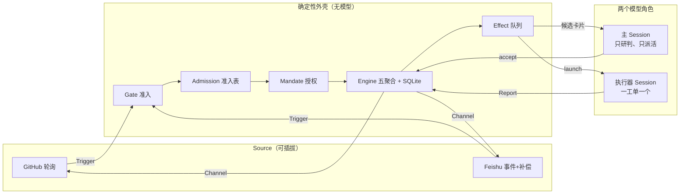
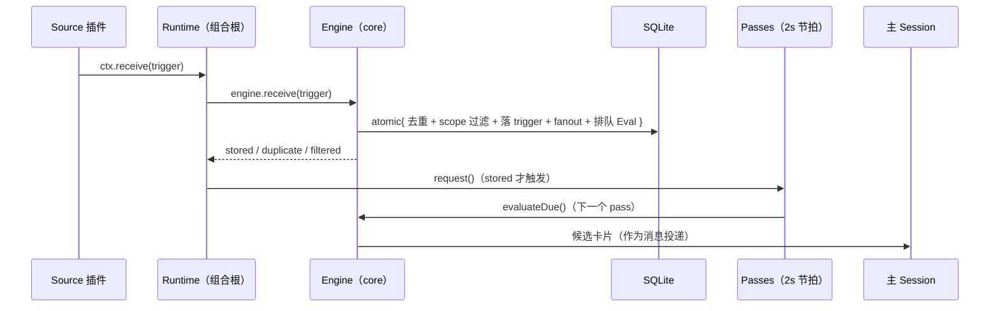

# dsh-superagent 架构导览（中文）

> 面向「想在一两个小时内看懂这个项目」的工程师。每条非平凡结论都带 `文件:行号`，可直接跳读。
> 项目自我定位（`README.md`）：**research prototype for reference only, not an official DeepSeek product**。
> **路径注记（2026-11-06 阶段 0 之后）**：本文写作时领域层在 `packages/dsh/src/core/`，现已整体迁到 `packages/kernel/src/`（`@superagent/kernel`，见提交 `3f7a158`）。文中所有 `packages/dsh/src/core/...` 的引用按此一一对应，行号与内容未变。

> 本导览由 2026-11-06 的代码走读产出，基线提交 `6337fc8`；与 `docs/007-architecture.md`（作者权威文档，617 行）的分歧在文中标「文档/代码不一致」。

---

## 目录

| 节 | 内容 | 什么时候读 |
| --- | --- | --- |
| 0 | 30 秒结论 + 三条铁律 | 现在 |
| 1 | 它解决什么问题（三种常见病） | 想知道「为什么需要它」 |
| 2 | 分层与三条总线 | 想建立全局图 |
| 3 | 11 个领域概念 | 想读懂命名 |
| 4 | 目录地图、大文件、测试组织 | 要开始翻代码 |
| 5 | 状态机 / 事务 / effect 队列 / 2s 节拍 | 想懂运行时机制 |
| 6 | 授权链 gate → admission → assessment → Mandate | 全项目最核心的 242 行 |
| 7 | 一次请求的完整旅程（10 步） | **时间有限只看一节就看这里** |
| 8 | Session 装配、提示词、工具面、槽位 | 想知道「模型看到什么」 |
| 9 | bundle 接入、Source 协议、HTTP、面板 | 要做二次开发或集成 |
| 10 | 8 条设计决策与代价 | 想抄设计 |
| 11 | 已知欠账与风险 | 上生产前 |
| 12 | 分档阅读路线 + 本地跑起来 | 下一步行动 |

---

## 0. 30 秒结论

**这是一台「由消息驱动的、被授权的编程智能体流水线」：确定性代码负责准入、授权、记账与幂等，两个模型角色负责研判与干活，所有跨重启状态落在一个 SQLite 文件里。**

三个数字先记住：

| 事实 | 数值 | 证据 |
| --- | --- | --- |
| 代码规模 | `packages/dsh/src/` 111 文件 / 15 205 行 | `find src -name '*.ts*' \| xargs wc -l` |
| 测试 | 59 文件 / **1 197 用例全绿**，22.28s | `./node_modules/.bin/vitest run`（本机实测） |
| 运行时依赖 | 2 个（`proper-lockfile`、`zod`）；约 20 个 `@deepseek-ai/dsh-*` 是 **peerDependencies** | `package.json:48-86` |

三条铁律（后面每一节都是它们的展开）：

1. **模型只做判断，不做授权。** 「谁可以让智能体干活」由 `packages/dsh/src/policy.ts` 的确定性 gate 决定；模型（主 Session 的研判步，assessment）只能在 gate 已经放行的范围里判断「这件事该不该接」，且接单强度被 gate 钉死（`docs/002-authorization.md:5`）。
2. **先记账，后干活。** 任何对外副作用（发消息、起 Session、调模型）都不是在命令里直接执行，而是**与领域写同一事务**写入 `effect` 表，提交后再派发（`packages/dsh/src/app/effects.ts:61-66`、`:84-88`）。所以「命令成功但副作用丢了」这种状态不存在。
3. **一状态一写者。** Trigger/Thread/Decision/Ticket/Assignment 只有 `Engine` 能写；Thread 上的 label/url 归 Source；Settings/Prompts/outbox 收据/health 各有唯一 owner（`docs/007-architecture.md:259-271`）。Source 拿到的 context 是**被 `Pick` 收窄过的**，它物理上拿不到 `store.saveSettings` 或 `engine.decide`（`packages/dsh/src/app/source-context.ts:11-27`）。

---

## 1. 它解决什么问题

一句话：**让一个 coding agent 常驻在 GitHub / 飞书里，平时不吵人，被需要时才动手，动完把结果放回原对话。**

现有「把 agent 接到 IM/工单系统」的做法通常有三种病：

| 常见做法 | 病 |
| --- | --- |
| 消息来了就唤醒 agent | 每条闲聊都烧一次模型，且不可审计 |
| 全交给模型判断「要不要接活」 | 授权不可证伪；prompt 注入 = 越权 |
| 一次对话一个长 Session | 崩溃即失忆；并发工单互相踩目录 |

这个项目的解法是把「智能体」拆成**确定性的外壳 + 两个模型角色 + 可插拔事件源**：



- 主 Session（代码里叫 `orchestrator`）**只路由**：转发原始 Trigger 与研判结论，不做技术决策，不等待，一轮里用 `orchestrator_route` 一次处理多个候选（`docs/004-prompts.md:77`）。
- 执行器 Session（`worker`）一工单一个，在独立目录里读源码、改代码、跑测试、开 PR，通过 6 个工具向宿主汇报（`docs/004-prompts.md:63`、`packages/dsh/src/app/tools/executor.ts`）。
- 两者之间的所有状态变化都经 `Engine` 的原子命令，所以「谁在干什么、凭什么、到哪一步」永远可从库里回答，而不是从模型的对话历史里猜。

---

## 2. 架构总览：三层 + 三条总线

### 2.1 分层（实测依赖方向）

```
packages/dsh/src/
├── index.ts          插件入口：Cordis 的 name/inject/Config/apply（27 行）
├── policy.ts         授权链：gate / admission / revalidate / policyEffects（242 行）
├── deployment.ts     配置 schema 与 SetupError 解析（含 volatile 字段）
├── admission.ts, kv.ts, limits.ts, setup.ts, navigation.ts
├── core/    2088 行  ← 纯领域库：Engine + 五 Part + SQLite/Memory 双实现的端口
├── app/     5292 行  ← 组合根与适配器：Runtime/Store/Effects/Passes/Prompts/HTTP/views/tools
├── sources/ 2059 行  ← SourceKind 描述符 + GitHub / Feishu 两套采集
├── executor/ 838 行  ← DshExecutor：把 Assignment 变成 DSH Session 与目录
├── client/  4037 行  ← 面板（React，浏览器半，与宿主同源）
└── infra/    347 行  ← Commands / HealthBoard 等基础设施
```

**依赖方向是单向的，而且可以机械验证**：

```bash
grep -rn "@deepseek-ai" packages/dsh/src/core/ | wc -l   # → 0
grep -rn "from '\.\./" packages/dsh/src/core/ | wc -l    # → 0
```

`packages/dsh/src/core/` 不 import 任何宿主包、也不 import 上层目录——它只依赖 `node:crypto` 和自己的同目录文件。外部世界通过 `packages/dsh/src/core/ports.ts` 的接口（`Repositories` / `Executor` / `Assessor` / `Outbox` / `Policy`）注入。这就是为什么它能在 `packages/dsh/src/core/memory.ts` 里有一份纯内存实现，使 1 197 个用例中的大部分不需要 SQLite（`packages/dsh/src/core/memory.ts:16-24`）。

**唯一允许的「反向」依赖是 type-only**：`packages/dsh/src/app/api.ts` 从各 view 的返回类型推导 HTTP 契约，`packages/dsh/src/client/api.ts` 再消费它，运行时无环，类型图有环（`packages/dsh/src/app/api.ts:2-10`）。

### 2.2 三条总线

| 总线 | 载体 | 一句话 |
| --- | --- | --- |
| **控制面** | `Engine` 的原子命令 + 5 个聚合 | 所有状态变化的唯一入口；调用方拿到的是角色化 `Pick`（`packages/dsh/src/core/engine.ts:261-270`） |
| **数据面** | `trigger` / `thread` / `ticket` / `decision` 等表 | 事实的唯一真相；生成列（`open`/`active`）把 JSON 里的集合关系变成可索引列（`packages/dsh/src/app/store.ts:30-44`） |
| **执行面** | `effect` 表 + 6 种 kind | 「提交后要做的事」的持久化队列；at-least-once，靠确定性 id 收敛（`packages/dsh/src/app/effects.ts:11-24`） |

### 2.3 一个请求在层间的流动



---

## 3. 领域模型：11 个概念，一个也不多

全部定义在 `docs/001-domain.md`，代码里是 `packages/dsh/src/core/model.ts`。先记住主干链条，其余都是从它长出来的属性：

```
Source ──产生──▶ Trigger ──属于──▶ Thread ──▶ Eval ──accept──▶ Ticket ──▶ Assignment ──▶ Executor
                    │                             │  └─授予─▶ Mandate
                    └──扇出（Subscription）───────▶ Ticket
```

| 概念 | 一句话 | 最容易误解的点 |
| --- | --- | --- |
| **Source** 来源 | 一串事件；kind=可复用实现，instance=一份配置 | 它自己持有**读位置**和 bot 身份；重启不能重放事件，所以读位置必须在 `receive` 成功后才推进（`docs/001-domain.md:27`） |
| **Trigger** 触发 | 一个不可变事件 | 是**审计与幂等的最小单位**——同一 Trigger 接受两次只建一张工单（`:28`） |
| **Thread** 线程 | 时间序的 Trigger；同一时刻最多一个 Eval | 一个 Thread 可以有**多张**工单；Thread 是「Eval 的一致性视图」而非会话（`:29`） |
| **Correlation** 关联 | 一个 Trigger 所属多个 Thread 之间的关系 | 只加背景，**永不路由**（`:30`）。路由只由 Subscription 做 |
| **Channel** 渠道 | Thread 的写侧（回帖、评论、PR） | 一个 Thread 可以有多个 Channel；写失败要能重试且保序（`docs/003-execution.md` 的出站一节） |
| **Policy** 策略 | 版本化的规则 + 各 Source 的名单/准入表 | 改 Policy **不撤销**已发 Mandate，只投递变更通知（`docs/002-authorization.md:117`） |
| **Eval** 评估 | 对一个 Trigger 批的判断，两层：gate + assessment | **无状态**；输入是「批 + Thread 快照 + 该 Thread 全部工单（含已结束）+ 当前 Policy」（`docs/001-domain.md:33`） |
| **Mandate** 授权 | accept 到底授予了什么 | 不可变；只有人的 stop 能撤回、revalidate 失败能 revoke（`:34`） |
| **Ticket** 工单 | 授权工作的单位 | 只有 Eval 能建；open→ended，**人的消息能复活它**；状态自己定义，不跟随 DSH Session（`:35`） |
| **Assignment** 派工 | 工单 ↔ 一个执行器实例的绑定 | 一张工单有多个 Assignment，与工单状态独立；只有最终 Report 能从执行器侧结束工单（`:36`） |
| **Subscription** 订阅 | 工单 ↔ Thread 的多对多，由 Thread 持有 | 匹配的 Trigger 扇出给**所有活着的**订阅工单，不查发送者；已结束工单也保留订阅，等人来复活（`:37`） |

这张表里两个设计值得单独记住：

- **Mandate 与 Subscription 是两套授权**：Subscription 负责「继续已有的活」（绕过 gate、不给新授权），Eval 负责「开新活」。一条后续消息走哪条路，决定了它能不能扩大范围（`docs/002-authorization.md:7-22`）。
- **人不是领域概念**：没有 Principal/Membership，人的身份只是 Trigger 上的元数据；跨 Source 的身份对应关系是**提示词文本**，不是代码（`docs/001-domain.md:39`）。这是刻意的减法——作者在「Rejected concepts」里列了 12 个被拒绝的概念及理由（`:45-60`），那张表比概念表更能说明设计意图。

枚举值（面板与 API 共用，`docs/001-domain.md:107-112`）：

```
Decision   accept 接单 | stop 停止 | ignore 忽略 | unavailable 未完成
Strength   explicit 明确 | inferred 推断
Assignment pending 待启动 | running 执行中 | ended 已结束
Report     progress 进展 | waiting 等待 | ready 就绪 | blocked 受阻 | failed 失败 | dropped 无需处理
```

---

## 4. 代码组织：目录地图

### 4.1 目录 → 职责 → 先读哪个文件

| 目录 | 行数 | 职责 | 入口文件 |
| --- | --- | --- | --- |
| `packages/dsh/src/core/` | 2 088 | 领域层：Engine、五 Part、模型、纯内存实现、端口定义 | `engine.ts`（一入口）→ `stage.ts`（26 行，先读） |
| `packages/dsh/src/app/` | 5 292 | 组合根与适配器：Runtime、Store、Effects、Passes、Sessions、Prompts、HTTP、views | `runtime.ts`（254 行，全景） |
| `packages/dsh/src/sources/` | 2 059 | SourceKind 描述符 + registry + GitHub/Feishu 两套采集 | `kind.ts`（描述符）→ `registry.ts` |
| `packages/dsh/src/executor/` | 838 | 把 Assignment 变成 DSH Session（`dsh.ts` 673 行，最重的适配器） | `dsh.ts` |
| `packages/dsh/src/client/` | 4 037 | 面板：6 个 tab、设置草稿机、本地化 | `index.tsx`（挂载）→ `route.ts`（路由） |
| `packages/dsh/src/infra/` | 347 | Commands（起 CLI 子进程）、HealthBoard | `commands.ts` |
| 顶层 | ~700 | 插件入口、授权链、配置/部署、KV 键、限额 | `index.ts`(27) → `policy.ts`(242) |

### 4.2 五个「最大的文件」为什么这么大

| 文件 | 行数 | 为什么 |
| --- | --- | --- |
| `packages/dsh/src/client/locales.ts` | 770 | 中英两份文案的单一来源（面板 + 药丸提示 + 错误码） |
| `packages/dsh/src/executor/dsh.ts` | 673 | 整个 DSH 集成面：建 Session、注入 preset、投递输入、读 turn 结果、resume、中断——**难度集中在这里** |
| `packages/dsh/src/app/migration.ts` | 616 | schema 11 的具名迁移步骤；旧库拒绝启动而非静默降级（`migration.ts:20-25`） |
| `packages/dsh/src/sources/github.ts` | 459 | 四段轮询（通知 / 仓库流 / PR CI / 订阅线程）+ 各自游标与失败模型 |
| `packages/dsh/src/core/tickets.ts` | 423 | 工单生命周期：建单、attach、resume、retry、restart、stop、end、订阅增删、policy 变更通知 |

### 4.3 测试怎么组织

`tests/` 65 个文件 / 1 197 用例，形状与源码镜像：

| 测试 | 钉住什么 |
| --- | --- |
| `core-engine.spec.ts` | 引擎命令的行为字典（跨 Part 编排、事务、角色收窄） |
| `stage.spec.ts` | 面板 8 行判定表的**逐行** `it.each`；注释直接引用 `docs/003` 的表（`tests/stage.spec.ts:14`） |
| `policy.spec.ts` | gate 的 7 步顺序、admission cell 优先级、revalidate 的 basis 分支 |
| `effects.spec.ts` | 合并语义（generation）、`Later` 不增 attempts、回滚不派发 |
| `persistence.spec.ts`(store) | 迁移、生成列重建、收据三态、SAVEPOINT 嵌套 |
| `store.spec.ts:133-145` | **扫描测试**：KV 键必须由 `packages/dsh/src/kv.ts` 拼写，禁止散落 |

没有端到端启动测试（`docs/007-architecture.md:402` 的测试表是模块级单测）——这是它作为 prototype 的一个已知缺口。

---

## 5. 状态机与「先记账后干活」

### 5.1 面板看到的 8 行状态判定

`packages/dsh/src/core/stage.ts` 只有 26 行，但它是整个项目**可检查定义的样板**：一条 if/else 链，**先命中先返回**，顺序即优先级。

| # | 条件（`stage.ts`） | 结果 | 人话 |
| --- | --- | --- | --- |
| 1 | `ticket.ended` | `ended` | 已结单 |
| 2 | `ticket.delivery` | `person/delivery` | 消息投递失败，等人决定重试 |
| 3 | `ticket.attention` | `person/answer` | 执行器在提问，等人回答 |
| 4 | `latestAssignment().report?.state === 'ready'` | `person/review` | 干完了，等人验收 |
| 5 | `report ∈ {blocked, failed}` 且 `waitsForPerson` | `person/blocked\|failed` | 卡住了，且此后人没再说话 |
| 6 | 无 Assignment 或 `pending` | `working/queued` | 排队中 |
| 7 | `report === 'waiting'` 或 Assignment 已 `ended` | `idle` | 空闲等待 |
| 8 | 其余 | `working` | 在干活 |

三个坑（都写在测试里，文档没写）：

1. **`ready` 优先于「Assignment 已结束」**——`ready` 即使 Assignment 已 `ended` 仍显示「等人验收」（`tests/stage.spec.ts:23`）。Assignment 结束 ≠ 工单结束。
2. **blocked/failed 只在 `waitsForPerson` 为真时进 person**；如果人在这之后已经回过话，状态退回 `working`（`packages/dsh/src/core/model.ts:349-353`、`tests/stage.spec.ts:26`）。
3. **它读 `latestAssignment().report`，不是 `latestReport()`**（`stage.ts:13-14` vs `model.ts:336`）——代码里真实存在两套「最新报告」语义。

### 5.2 事务：手写的可重入 SAVEPOINT

`packages/dsh/src/app/store.ts:133-153` 是一个 `depth` 计数 + 分层 afterCommit 数组的实现：

- 进入：`SAVEPOINT orchestrator_atomic_<level>`；成功 `RELEASE`；失败 `ROLLBACK TO` + `RELEASE` + 重抛。
- 嵌套失败只回滚内层（`tests/store.spec.ts:220-247`），成功时把本层 afterCommit 冒泡到上一层，**最外层提交后才执行**（`store.ts:149-150`）。
- 回滚时该层 afterCommit 被丢弃 → 回滚的副作用不会执行（`tests/store.spec.ts:147-162`）。
- `packages/dsh/src/core/memory.ts:16-24` 对 5 张 Map 做全量快照来实现同样语义；测试同时跑两种后端并要求顺序一致。

**隐含前提**：`atomic` 的回调必须是同步的。effect 派发用 `queueMicrotask`（`effects.ts:84-88`），安全的前提是「命令全同步、事务在微任务运行前已提交」；类型系统并不禁止 async 回调，这是一个结构性风险点。

### 5.3 Effect 队列：六种 kind 与三档重试

`packages/dsh/src/app/effects.ts:11-24` 定义 payload，主键是 `(kind, key)`：

| kind | key | 注册点与参数 | 干什么 |
| --- | --- | --- | --- |
| `assessment` | Eval ID | `assessment.ts:96-101`：limit 4（暂停时 0） | 把**候选卡片**投给主 Session；投递成功后才开始算 Eval 超时 |
| `launch` | Assignment ID | `executor/dsh.ts:232-233`：limit = 空闲 worker slot，retry `[5000, 300000]` | 启动/唤醒执行器 Session |
| `delivery` | Ticket ID | `executor/dsh.ts:235`：limit 4，`quiet: true` | 把排队的 Input 一条条投给运行中的 worker |
| `relay` | request ID | `sessions.ts:104`：`ordered: true`（即 limit 1） | 把工单状态变化以 steer 消息转给主 Session |
| `notice` | 调用方给 | `sessions.ts:105`：`ordered: true` | 设置/提示词变更等**不唤醒**的通知注入 |
| `reply` | message ID | `outbox.ts:24`：limit `paused ? 0 : 1`，retry `[5000, 300000]` | 把已记账的出站消息真的发到 Source |

> 默认值是 `limit 1 / retry [2000, 60000] / ordered false`（`effects.ts:67-74`）。注意 `assessment` 这个 effect **本身不调用模型**——它只是把卡片送进主 Session；真正的研判由主 Session 用 `orchestrator_eval_read` / `orchestrator_eval_decide` 完成（见 §7 第 5 步）。

关键机制（`effects.ts:61-160`）：

- **入队 = UPSERT**：同一 kind/key 只有一行，后来的 payload 覆盖旧值、`attempts/error` 清零、`due` 立即到期，但 `seq` 不变 → **保留队列位置**（`tests/effects.spec.ts:70-83`）。
- **`generation+1`**：完成时用四元组条件删除，防止「运行中的旧行完成时删掉新行」；代价是中间 payload 被丢弃，只有最新一次会执行（`effects.ts:62`、`tests/effects.spec.ts:39-49`）。
- **`Later` ≠ 失败**：抛 `Later` 只推迟到 `retry[0]`，不增 attempts——用于「暂停 / 槽位满 / 前面还有同会话消息」（`effects.ts:138-139`）。
- 其他失败：指数退避 `min(retry[1], retry[0] * 2**attempts)`，`error` 只留前 1 000 字符。
- health：每种 kind 一条 entry，`MAX(attempts) >= 3` 即 error；`quiet` 的 delivery 只豁免告警不豁免重试（`effects.ts:151-160`）。

### 5.4 2 秒节拍 + 事件合并

`packages/dsh/src/app/passes.ts`：`setInterval(…, 2000)` 兜底（`:28`），`receive` 返回 `stored` 时立即 `request()`（`:34-39`）；`pump()` 是三态合并（`:56-62`）——没在跑就开一个，在跑就把并发请求折叠成**恰好一次**后续 pass（4 个并发请求测试断言只跑 2 次，`tests/passes.spec.ts:28-34`）。每个 pass 只做两件事：`effects.kick()` → `engine.evaluateDue()`（`:63-68`），且**一次 pass 共享一个 Policy 快照**（`engine.ts:76`）。

---

## 6. 授权链：gate → admission → assessment → Mandate

这是全项目最值得读的 242 行（`packages/dsh/src/policy.ts`）。

### 6.1 gate 的 7 步（`policy.ts:191-211`）

```
1. allowed = 该 Source 的 allowed 名单含 actor；scope = Source 当前是否监听该位置
2. allowed && trigger.addressed        → explicit（via addressed）   ← 最先返回，谁都覆盖不了
3. cell = admissionCell(allowed, addressed)（listedUnaddressed / unlistedAddressed / unlistedUnaddressed）
4. !receivable                           → ignore
5. admission === 'explicit'              → explicit                  ← 与 accept mode 无关
6. 在参与中的 Thread（有订阅 或 工单自带非 context Input）→ via followup，强度 = allowed ? explicit : inferred
7. admission === 'inferred' && mode ≠ off → inferred + observation
8. 否则拒绝：not_a_member / admission_ignored / no_mention
```

第 5 步在第 6 步之前是刻意的：先把准入表里的 explicit cell 判掉，Thread 上的工单就不能把一条明确请求「稀释」成 follow-up（`policy.ts:203` 的注释、`tests/policy.spec.ts:148-152`）。

bot 走另一条 `machineGate`（`:171-188`）：无 `actor.id` 的系统/CI 事件放行；列出的 bot 只能产生 inferred 候选，**永不能 explicit 或 stop**。

### 6.2 准入表：三个 cell，按「接收范围」分行

每个 Source 的 Policy 有一张表，行是接收范围（飞书：每个群/私聊；GitHub：新 Issue / 新 PR / 评论 / 默认分支 CI），列是三个 cell（`docs/002-authorization.md:63-71`）：

| cell | 可选值 | 默认 |
| --- | --- | --- |
| 名单内、未 @ 智能体 | inferred / ignore | inferred |
| 名单外、@ 了智能体 | **explicit** / inferred / ignore | ignore |
| 名单外、未 @ | inferred / ignore | ignore |

「名单外 @ 也放行」是刻意留的口子（专用支持群）；「名单内未 @ 也推断」让团队成员不用每次都 @。

### 6.3 assessment：模型只能「在规则内说 yes」

`assessmentOutcome`（`policy.ts:40-61`）把模型输出变成引擎能用的结论，硬约束：

1. 必须对**每条 enabled rule 恰好判一次**，多/少/未知/disabled 直接抛错（`:44-46`）；
2. accept 但方向不明确（未要求实现 / 目标依据未定 / 需要设计决策）→ `ignore(directionUnsettled)`；
3. 没有任何 matched rule → `ignore(noRuleMatched)`；
4. accept 但没有 `intent_evidence` → 抛错；
5. inferred 且 mode ≠ auto → 记 `ignore(observed)` 并带 `would_accept: true`（这就是 observe 档「只观察不接单」）。

### 6.4 三档 accept mode

| mode | 效果 | 适用 |
| --- | --- | --- |
| `off` | 所有 inferred 路径关闭（gate 直接拒） | 只想响应明确 @ |
| `observe`（默认） | 能研判、记 `would_accept`，但不接单 | 上线第一周观察误报 |
| `auto` | inferred 被接受，但要求全部 matched rules 仍 enabled | 信任之后 |

### 6.5 Mandate 与 revalidate

Mandate 记录 `{strength, policyVersion, basis, actor, scope}`（`evals.ts:306-316`），`basis` 记录**gate 是怎么放行的**（addressed / followup / admission{cell,observation} / listed / bot）。恢复一张已结束工单前调 `revalidate`（`policy.ts:213-240`），按 basis 分支判断「今天是否还能拿到至少原强度」。

**关键事实（文档没写）**：`revalidate` **从不比较 `mandate.policyVersion`**；版本比较只出现在 Eval 起评时（`evals.ts:285`）。Mandate 的 policyVersion 字段只作审计。

---

## 7. 一次请求的完整旅程

这是全篇最该先读的一节——把 §5 的状态机、§6 的授权链和 §8 的执行器串成一条时间线。场景：有人在一个 GitHub Issue 下评论 `@bot 修一下这个空指针`，机器人最后回了 PR 链接。

### 7.1 十步时间线

| # | 时刻 | 发生什么 | 写入了什么 | 代码 |
| --- | --- | --- | --- | --- |
| 1 | **采集** | GitHub 插件每 60 秒（可配 60–3600；GitHub 要求更长时以其为准）拉一次通知与游标流，把新评论/PR 事件转成 `Trigger` | `trigger` 表 + `trigger_thread` | `packages/dsh/src/sources/github.ts:280-343` |
| 2 | **进域** | `Engine.receive` 开一个事务，交给 `Intake.receive`：算确定性 id → 重复就丢弃 → `scope()` 过滤掉不听的（bot 自己的话、无关仓库）→ 解析出所属 Thread → 扇出给所有订阅工单 → 需要新决策则排队等 Eval | 同上，一个原子事务 | `intake.ts:19-62`、`engine.ts:255-257` |
| 3 | **过闸** | 2 秒节拍的 passes 被「有事件」立刻踢一脚 → `evaluateDue` → 该 Thread 没有正在跑的 Eval，就开一个 | `decision`（state=evaluating） | `passes.ts:56-68`、`evals.ts:71-119` |
| 4 | **确定性准入** | `gate()` 依次问：在允许名单里并 @ 了机器人？→ explicit；否则在准入表哪一格？（listedUnaddressed → inferred、unlisted → 拒）→ 不在参与中的 Thread 就到此为止 | 不授权，只算出一个候选强度 | `policy.ts:191-211` |
| 5 | **研判** | 候选卡片作为一条消息投进**主 Session**（`assessment` effect）。主 Session 用 `orchestrator_eval_read` 读到 Trigger + Thread 快照 + 该 Thread 全部工单 + 当前 Policy，再以 `orchestrator_eval_decide` 表态：accept/ignore/stop/unavailable，且必须对每条 enabled rule 给出一条理由；accept 还要给 `intent_evidence` 与 matched rules | `decision`（state=decided） | `assessment.ts:89-104`、`policy.ts:40-61`、`tools/main.ts` |
| 6 | **决定** | 主 Session 的工具层 `eval_decide` 收到 accept → 事务里生成 `Mandate`（授权）与 `Ticket`（工单），并把「去干活」写成效果 | `ticket` + `effect('launch')` | `evals.ts:306-316`、`tickets.ts:37-56` |
| 7 | **启动** | launch 效果派出：抢一个 worker 槽位（并发满就排队，人被额外给一个槽）→ 目录不存在才跑 prepare → `sessions.ensure(worker-<ticketId>, 目录, 标题)` → 把「工单说明 + 原始消息 + 批次上下文」作为第一条消息投给 worker | `ticket.assignment` 状态 pending→running | `dsh.ts:263-283`、`:424-470` |
| 8 | **干活** | worker 在自己的 Session（裁剪版 preset）里读到消息，用 6 个工具读上下文、动手改代码，最终调 `orchestrator_report({state:'ready', summary:'...'})`；若 turn 结束却没报告，宿主替它写一条 `waiting` | `ticket.assignment.report`、`ticket.attention` 可能被清 | `dsh.ts:601-672`、`tools/executor.ts:78` |
| 9 | **回话** | report 落库的同一事务里，把「向原对话发一条评论」写成 `effect('reply')` → 主 Session 也收到一条 relay（告诉它工单状态变了）→ reply 效果调用 Source 的 `channel.send` → 评论发出，并把回执记进 `outbox` | `outbox` | `outbox.ts:27-32`、`delivery.ts` |
| 10 | **复活与结束** | 人又在那条评论里追问 → 走**订阅**分支（不重新过 gate、不新建工单），把消息作为 Input 投给同一个 worker Session（`steer` 模式）→ worker 继续。工单真正结束（人或 PR 规则判定完成）时，宿主在事务提交后取消 turn、停掉后台 job 与 subagent | `ticket.ended` | `dsh.ts:290-343`、`:357-370` |

### 7.2 三个「此刻谁是真相」的提醒

新手最常把 DSH Session 当成真相源头。实际分层是：

| 问题 | 真相在 | 不在 |
| --- | --- | --- |
| 这活该不该干、谁授权了？ | `decision` + `mandate`（不可变记录） | 模型的推理文本、主 Session 的对话历史 |
| 这件工作现在到哪一步？ | `ticket` 的状态字段 + `assignment.report` | worker Session 的对话内容 |
| 这条消息发出去没有？ | `outbox` 的回执 | 代码里那句 `await send()` 的返回值 |

所以**删掉一个 DSH Session 不会丢业务状态**——`sessions.ensure` 会用同一个 id 重建，只是丢失对话历史；这也是重启后能把工单接回来的原因（`resume()` 在 `dsh.ts:524-537`）。

### 7.3 失败时走哪条岔路

| 失败点 | 行为 | 证据 |
| --- | --- | --- |
| gate 拒绝 | 记 `decision` 但不建工单；面板的 Trigger 页可见理由（not_a_member / admission_ignored / no_mention） | `policy.ts:191-211` |
| assessment 超时 | 重排队，连续三次记 `unavailable`；面板只在「24 小时内、是该 Thread 最新、未被 dismiss」时要求人处理 | `docs/002-authorization.md:147-151` |
| launch 失败（磁盘/权限/prepare 命令） | 抢占的槽位释放，工单标记 failed，等人来消息或显式重试；不自动重试 | `dsh.ts:270-283`、`:411-422` |
| 供应商/网络瞬时错误（408/429/5xx、连接重置） | 同一 Assignment 内退避重试 3 次（15/30/60 秒续推），超了才算失败 | `dsh.ts:548-576` |
| worker 报 blocked / failed | 工单进入「等人」，自动 Input 暂停投递，但人可以直接进 Session 接手，工具不被锁 | `docs/003-execution.md` |
| 主机重启 | 运行中的 Assignment 以 "host restarted" 结束，新 Assignment 带恢复提示；只重投「Session 还没取走」的消息 | `dsh.ts:524-537`、`dsh.ts:446-448` |
| 评论发布失败 | 出站消息已在 `outbox`，5 秒起指数退避到 300 秒；同一工单对同一会话严格保序 | `packages/dsh/src/app/outbox.ts`、`docs/003-execution.md` |

### 7.4 全链路的一句话版本

`Source 采集 → Intake 进域（幂等/过滤/扇出）→ Passes 踢 Eval → Gate 定强度 → 模型定取舍 → 决定生成 Mandate+Ticket → Effect 启动 worker Session → worker 用工具干活并 report → 事务内写 reply effect → Source 发回原对话 → 人再来时走订阅复活`。

看代码时按这条线找，就不会被 111 个文件劝退。

---

## 8. 两个模型角色：Session 怎么被装配出来

§7 第 7 步那句「`sessions.ensure(...)` → 投第一条消息」背后有一整套装配。这一节讲清楚：**一个 DSH Session 被创建后，宿主往它身上挂了什么**。

### 8.1 两个角色、两个 preset

| 角色 | Session id | preset | 干什么 | 工具数 |
| --- | --- | --- | --- | --- |
| 主 Session（orchestrator） | `settings.masterId`（持久化在 KV） | `dsh-superagent-router` | 研判 Trigger、决定接不接、向人汇报、调度工单 | 14 |
| 执行器 Session（worker） | `worker-<ticketId>` | `dsh-superagent-worker` | 在工单目录里真的改代码、开 PR | 6 |

两个 preset 不是代码而是 **bundle 里的两行配置**（`cordis.patch.yml` 的 `dsh-superagent-worker-preset` / `-router-preset`，order 90/91）。它们决定了「这个 Session 能用哪些 DSH 内置能力」：

- **worker**：是 DSH `standard` preset 的裁剪版——shell 与 job 等待都压到 5 秒（这样一步之内还能收到人的插话）、`web.fetch=false`、subagent 保留但被强制走宿主 `standard` preset、无「问人 / present / plan / 插件管理 / 定时 / goal / workflow」。
- **router**：更窄——文件系统只读（`write:false, edit:false`），无 web/subagent/todo/persona。主 Session 只做判断与转述，不亲自改代码。

`Session.id` 用**推导**而不是映射表：`workerSessionId(ticketId) = 'worker-' + ticketId`（`packages/dsh/src/executor/dsh.ts:24`）。所以重启后不需要查表就知道哪个 Session 属于哪个工单。

### 8.2 `ensure()` 的六件事

`sessions.ensure(id, cwd, title, role)`（`packages/dsh/src/app/sessions.ts:138-158`）做六件事，顺序有意义：

1. **解析或创建** Session：不存在就 `workspaceRegistry.create(cwd)` + `sessionController.create({sessionId, workspaceId, agentPreset})`。Session 只在创建时确定 preset，之后不会变。
2. **绑模型**：`initializeRoleModel(ctx, agent, settings.eval.model | settings.executor.model)`——两个角色可以配不同模型（研判用小模型、干活用大模型是常见配置）。
3. **装饰**（`decorate`，见 8.3）。
4. **放宽权限**：`permissionPresets.set(session, 'danger-full-access')`。这是刻意的：worker 要在无人值守下跑完整命令；安全边界靠「谁能创建工单」而不是「工具白名单」。
5. **改名**：Session 标题 = 工单标题，方便人在 DSH 侧栏里认出来。
6. 之后才允许 `prompt()` 投消息。

### 8.3 `decorate()`：往 Session 上挂四样东西

`packages/dsh/src/app/sessions.ts:236-275`：

| 挂什么 | 细节 |
| --- | --- |
| **系统提示词段** | 注册一个 `systemPrompt.section({name:'dsh-superagent-policy', order:9999, interpolate:false, complete: master})`。`text` 是一个**函数**——每次 model request 都会被调用，现场拼出 `[dsh-superagent prompt revision N]` + 角色提示词 + （worker 才有的）本工单 Mandate 指令 |
| **技能** | 在独立 skill scope 里注册 `dsh-superagent-github`、`dsh-superagent-feishu`（后者仅配了飞书时）+ 团队自定义技能；版本变化时整体重建 |
| **工具** | 主 Session `tools.restrict({allow:['skill','bash','read','read_image','job_output','job_list','job_kill']})` 屏蔽掉 DSH 默认工具，只留 7 个通用工具，再注册 14 个自有工具；worker 则用 `workOnly()` 只留 `WORK_TOOLS` 白名单 |
| **两道 guard** | 主 Session：`noWait` 守卫（发现命令是「等结果」类就重写/拒绝，逼模型走非阻塞用法）；worker：工单结束后所有工具调用直接返回 `Ticket ended; new work needs a new authorized ticket` |

这里有一个容易被忽略的细节：**提示词不是 Session 的属性，而是每次请求现算的函数**。所以团队在面板上改提示词，正在跑的 worker 下一步就生效，不需要重启、也不需要唤醒（`docs/004-prompts.md:91-96`）。

### 8.4 提示词装配：15 个内置部件 + 3 段团队文本

内置文本都在 `prompts/*.md`（`packages/dsh/src/app/context.ts` 导入），`composePrompt` 按固定顺序拼（`packages/dsh/src/app/prompts.ts:102-119`）：

```
1. runtime/shared          ← 两个角色共用的世界观
2. runtime/{role}          ← orchestrator.md 或 worker.md
3. ## Communication        ← 团队可编辑
4. ## Ticket scope         ← 团队可编辑
5. ## Delivery requirements← 团队可编辑
6. runtime/subscriptions + runtime/replies
7. runtime/dispatch（主）或 runtime/work（worker）
8. runtime/admission       ← 只有主 Session
9. runtime/handoff/{role}
10. runtime/environment    ← 生成段，填 {variables}
11. runtime/policy         ← 生成段，只有主 Session，永远放最后
```

三个设计点：

- **Policy 段放最后**：Policy 变更时只有这一段变，前面的文本保持稳定 → 前缀缓存不失效，也让「提示词指纹变了」这件事只对应一个原因。
- **环境段是「安装级事实」**：它申明「本节优先于指令里任何地方提到的仓库/账号」，并说明同一批环境变量也喂给 prepare 命令。这是把「配置」和「提示」分开的标准做法。
- **`interpolate:false`**：团队文本里的 `${{ ... }}` 不被 DSH 当变量展开，避免注入。

**强弱序**（`docs/004-prompts.md:77-89`）从强到弱：工具/宿主强制的事实 > 内置与生成段 > 主动工单的 matched rules > 团队段与技能 > 外部文本（消息/评论/文档，永远只是数据）。

### 8.5 版本与覆盖：升级不覆盖团队文本

- 每次 `save()` 生成一个不可变 `PromptVersion`（全文 + revision + previousRevision + savedAt + source + config），存在 `kv` 里（`prompts.ts:202-216`）。保存前要比对 `baseRevision`，不一致返回 409（`PromptConflict`）——面板两个人同时编辑不会静默覆盖。
- 团队可以覆盖任意一个内置部件，但要保留该部件的占位符（如 `{variables}`/`{version}{mode}{rules}`），且必须记下「我改的是哪一版内置文本」的 `base`（`prompts.ts:164-181`）。
- 升级后如果内置文本变了，`defaultChanged()` 会列出「你的覆盖基于旧默认」（`prompts.ts:186-194`），面板提示 `Default updated`，团队决定是否合并。**这是这套设计里最值得抄的一条**：模板提供方升级不会静默改掉用户的定制。

### 8.6 工具面：14 + 6

主 Session 的 14 个工具（`packages/dsh/src/app/tools/main.ts`）分成四组，命名即语义：

| 组 | 工具 |
| --- | --- |
| 研判 | `orchestrator_ticket_request_status`、`orchestrator_eval`、`orchestrator_eval_read`、`orchestrator_eval_decide` |
| 流转 | `orchestrator_route`、`orchestrator_ticket_retry`、`orchestrator_ticket_note`、`orchestrator_trigger_requeue`、`orchestrator_thread_unsubscribe` |
| 沟通 | `orchestrator_reply` |
| 配置 | `orchestrator_settings_save`、`orchestrator_policy_sync`、`orchestrator_prompts_save` |

worker 的 6 个（`packages/dsh/src/app/tools/executor.ts`）：`orchestrator_report`、`orchestrator_ack`、`orchestrator_thread_unrelated`、`orchestrator_thread_follow`、`orchestrator_trigger_handback`，外加一个通用的读资源工具。

两个细节值得注意：

1. **`orchestrator_report` 的 state 没有 `waiting`**（`executor.ts:78` 只有 progress/ready/blocked/failed/dropped）。`waiting` 是**宿主**在「turn 正常结束但没报告」时替它写的（`dsh.ts:601-672`）——也就是说「我还在等」不能由模型自称，只能由事实推断。这是 §5「状态诚实」在工具层的体现。
2. **工具白名单会随工单生死变化**：`workOnly()` 的 guard 是运行时判断，工单结束后 worker 仍能对话，但任何工具调用都被拒（`sessions.ts:280-300`）。

### 8.7 消息投递的三种模式

`sessions.prompt(sessionId, requestId, text, mode, authorize, accepted)`（`sessions.ts:162-168`）：

| mode | 语义 | 用在哪 |
| --- | --- | --- |
| `queue` | 等当前 turn 结束再作为下一轮输入 | 首次 launch、retry |
| `steer` | 插入当前 turn 的下一步（人插话优先） | 人追加消息、工单 followup |
| `{inject: label}` | 不唤醒 agent，只往上下文里塞一条带标签的通知 | 后台 job 结束提示、通知类 |
| `notify` | 主 Session 的持久通知（同名替换未投递的） | 设置/提示词变更 |

所有投递都以 `key(requestId)` 作为消息 id → **天然去重**：同一个 Input 重投十次，Session 里也只有一条（`sessions.ts:169`、`AgentDelivery.send`）。这是「幂等靠确定性 id」在消息层的复用。

### 8.8 槽位与后台工作

`WorkerSlots`（`dsh.ts:171-201`）是一个显式的小型调度器：

- 并发上限来自设置；**额外留一个槽给「人」**（`by === 'person'`），保证人的追问永远不排在新工单后面。
- worker 的 turn 结束后，它的 shell job / subagent 可能还在跑 → 这些**仍占槽位**，最多 30 分钟（`BACKGROUND_LIMIT_MS`），超时杀 job 并在下一轮告诉它。
- turn 结束时如果还有后台工作在跑，`workerIdle` 会等 `untilQuiet`（`dsh.ts:629-642`）：安静了才算 turn 真正结束；不安静就把「还在跑」写成 `waiting` 报告并释放人工注意力。

译成人话：**「结束」不是模型说了算，是「它的爪子都收回来了」才算。**

---

## 9. 接入面：一个 npm 包、五个入口、没有 API

### 9.1 bundle 如何被装载

`package.json:30-46` 的 `dsh` 段声明三件事：`bundle.patch`、`client.platform`、`client.inject`（6 个 UI 包）。构建产出 5 个入口（`tsdown.config.ts`）：`lib/index.js`、`lib/github-watch.js`、`lib/feishu-watch.js`、`lib/feishu-doc-watch.js`、`lib/client.js`。

`cordis.patch.yml` 是一个 `- insert:` 列表，插 **6 行**（4 个插件 + 2 preset）：

| 行 | name | 作用 |
| --- | --- | --- |
| `dsh-superagent` | `dsh-superagent` | 主插件（Runtime） |
| `dsh-superagent-github` | `dsh-superagent/github-watch` | GitHub 采集 |
| `dsh-superagent-feishu` | `dsh-superagent/feishu-watch`（默认 `disabled: true`） | 飞书采集 |
| `dsh-superagent-feishu-doc` | `dsh-superagent/feishu-doc-watch`（默认 `disabled: true`） | 飞书文档评论采集 |
| `dsh-superagent-worker-preset` | `@deepseek-ai/dsh-agent-preset`（id `dsh-superagent-worker`） | 执行器的宿主 tool 集（裁剪版 standard） |
| `dsh-superagent-router-preset` | 同上（id `dsh-superagent-router`） | 主 Session 的极窄 tool 集（连 write/edit 都关） |

6 行都**不带 config**：`stateDir` 由 profile 层补（`examples/profile.cordis.patch.yml:7-9`），缺了插件拒绝启动（`cordis.patch.yml:1-3`）。这是「bundle 只声明、profile 才配置」的分工。

**没有自有 API**：入口契约就是 Cordis 标准四件套 `name/inject/Config/apply`（`packages/dsh/src/index.ts:7-24`）；服务靠 `class Runtime extends Service` + `super(ctx,'orchestrator')` 提供（`runtime.ts:88`）；唯一主动注册的宿主能力是 HTTP 前缀 `ctx.webServer.register({kind:'prefix', path:'/orchestrator', handler})`（`packages/dsh/src/app/http.ts:232`）——**不新开端口**。

### 9.2 主插件的 apply() 只做五件事（27 行）

1. `machineOf(config)` 把配置冻成 `Machine`（volatile getter 保留）；
2. `settings.configure({ auto: false })` 关掉 DSH 自动设置页（本应用自己管设置）；
3. 定义 `restart`（`ctx.fiber.restart().then(() => settings.describe())`，带 TODO）；
4. `new Runtime(...)` + `ctx.effect(() => async () => runtime.stop())`（fiber 卸载时优雅关停）；
5. `await runtime.ready` 并打一行日志。

真正的重活在 `Runtime`（`runtime.ts`）：服务注册在**构造器**，HTTP 路由与 setup 在 `initialize()`（先注册路由，setup 未完成 UI 也能修，`:203`）。

### 9.3 Source 协议：描述符 + 收窄的 context

一个 Source kind 是一个**纯数据描述符**（`packages/dsh/src/sources/kind.ts`）：`kind/title/description/schema(zod)/fields(表单)/facts(账号事实)/health(独占健康名)/scope(过滤)/channel(写)/threadContext(评估上下文)/find(搜索)/repliesTo/policy(名单与准入表)/refreshLabels/environment(执行环境变量)`。

泛型层（engine/outbox/assessment/views）**从不 import** `github.ts` 或 `feishu.ts`，只经 `SourceRegistry` 与这个接口通信——这就是「两种 Source 可插拔」的实际含义。

```ts
// packages/dsh/src/sources/github.ts:113 —— 注册就是一次 ctx.effect，注销即回收
ctx.effect(() => ctx.orchestrator.sources.register(githubKind), 'github: source kind')
```

Source 拿到的 context 是 `Pick` 过的（`packages/dsh/src/app/source-context.ts:11-27`）：`engine` 只给 `bindThread/threadClosed`，`store` 不给 `saveSettings`，`outbox` 只给 `send`。**Source 实现者物理上无法越权改工单或设置**。

一个未文档化的现实约束：`registry.resolve` 永远用 `kind.kind` 当实例 id（`registry.ts:134-137`），所以**同一 kind 目前不能配两个实例**。

### 9.4 两种采集哲学

| | GitHub | Feishu |
| --- | --- | --- |
| 主入口 | 轮询（默认 60s） | 长驻事件消费 + 60s 历史补偿 |
| 位置 | 读位置游标（since / ETag / started） | message_id + 历史游标 + seen 表 |
| 去重 | 确定性内容 id + 游标回退 5 秒 | `key('feishu', message_id)` |
| 失败 | 每段独立 catch，聚合成一条 health | 三条循环 `allSettled`，各报各的 |

两者共同的两条规则：**14 天 horizon**（`poll.ts:7`）、**游标必须在 `receive` 成功后推进**、**稳定 id 使重放安全**。

### 9.5 HTTP：必须 loopback + 同源三重检查

`registerHttp` 第一行就要求 `ctx.webServer.host === '127.0.0.1'`（`http.ts:231`）——`localhost` 或 `::1` 都会拒绝启动。

同源检查（`http.ts:75-79`）要求同时满足：`Host` 严格等于 `127.0.0.1:<port>`/`localhost:<port>`；自定义头 `x-orchestrator-request: 1`；`Origin` 缺失或等于 `http://<Host>`。挡的是 CSRF 与 DNS rebinding，**不挡同源 XSS，也没有 token / 限流**。

25 条路由（`http.ts:151-213`），契约单点维护：`packages/dsh/src/app/api.ts` 是 type-only，`Routes` 类型是 `{[K in keyof Api]: …}`，漏一条编译不过；客户端 `call('GET tickets/:id', {params})` 由同一份类型推导（`packages/dsh/src/client/api.ts:105-117`）。加一条路由只改两处，两边立刻有类型。

**views 是纯读投影**：全目录没有 `.save(` / `.atomic(` / `.delete(`，写操作都在路由 handler 里（`http.ts:157-213`）。所以面板永远显示库里的事实，而不是自己缓存的状态。

### 9.6 面板

6 个 tab（Overview / Source / Trigger / Eval / Execution / Settings），Settings 分 5 组。挂载点有三处（`packages/dsh/src/client/index.tsx:50-58`）：keyed 主面板、侧栏入口（order 10）、Plugin Manager 的配置行。面板**不是 URL 路由页**，页内 tab 位置存 `sessionStorage`（`packages/dsh/src/client/route.ts:52-66`）。

两处值得学的实现：

- **草稿机**（`packages/dsh/src/client/draft.tsx:80-108`）：五动作状态机 `clean|editing|saving|awaitingRevision`，配三方合并 `merge3`——因为设置可能被 agent 工具或 `sync` 在后台改，没有 merge3 就只能整块覆盖别人的改动。
- **轮询**（`packages/dsh/src/client/api.ts:67-98`）：串行队列、值不变不 setState、`document.hidden` 时间隔 ×6；`PanelProvider` 5s 轮询并做重启检测（先 error 再恢复才 `restarts+1`）。

---

## 10. 关键设计决策与代价

这一节是「如果只带走 8 条」。每条格式：**问题 → 做法 → 代价 → 证据**。

### 10.1 确定性外壳包住模型内核

- **问题**：让模型判断「要不要接活」= 授权不可证伪，prompt 注入即越权。
- **做法**：两层 Eval——gate（确定性：名单、@、准入表、bot 名单）+ assessment（模型检讨：**由主 Session 这个模型角色**在 gate 已放行的范围内按 enabled rules 判；`MasterAssessor` 只负责投递卡片、缓存读取与超时）。模型输出还要过形状校验（每条 enabled rule 恰好判一次、accept 必须有 intent_evidence），不合格直接抛错。
- **代价**：规则要人来维护；每加一类「主动工作」就要写一条 rule 并重新评估误报。
- **证据**：`packages/dsh/src/policy.ts:40-61`、`:191-211`；`docs/002-authorization.md:5`。

### 10.2 先记账，后干活

- **问题**：命令成功但副作用丢了（或反过来）会留下不可解释的状态。
- **做法**：副作用不当场执行，而是与领域写**同一事务**写进 `effect` 表，提交后由微任务派发；失败按 kind 的曲线重试，进程崩溃则重启后继续。
- **代价**：对外语义是 at-least-once，所有 downstream 必须幂等；`(kind,key)` 合并会丢弃中间 payload（只有最新一次会执行）。
- **证据**：`packages/dsh/src/app/effects.ts:61-66`、`:84-88`、`:130-146`；`tests/effects.spec.ts:29-49`。

### 10.3 幂等靠确定性 id，不靠去重表

- **问题**：Source 重放、轮询重叠、命令重试都会重复。
- **做法**：`key(...values) = sha256(JSON.stringify(values)).slice(0,32)`；`ticket = key('ticket', eval.id)`、`decision = key('decision', eval.id)`、`assignment = key('assignment', ticket.id, index)`、`effect` 主键直接用聚合 id。
- **代价**：id 里必须只含「同一事实必然相同」的字段——改 id 派生式就是破坏幂等（所以 `POLICY_REVISION = 'mandate-v3'` 这种版本前缀是必要的）。
- **证据**：`packages/dsh/src/core/ids.ts:3-5`、`evals.ts:311,329`、`tickets.ts:381-385`。

### 10.4 一工单 = 一个 Session + 一个目录

- **问题**：一个长对话承载所有工单会互相污染；用映射表记 Session 会丢。
- **做法**：Session id 与目录名从工单 id **推导**（`workerSessionId(ticketId)`、`ticket.execution.name/directory`），不需要映射表；重启后用同一推导去找回 Session 续跑。
- **代价**：工单 id 一旦成为外部契约就不能随便改；删工单等于删目录语义。
- **证据**：`packages/dsh/src/executor/dsh.ts`（`workerSessionId`）、`docs/003-execution.md`；详见 §7。

### 10.5 Source 是可插拔描述符，且能力被收窄

- **问题**：加一个事件源不应该改核心。
- **做法**：SourceKind 是纯数据描述符（schema/fields/scope/channel/policy/environment…），泛型层只依赖描述符；Source 拿到的 context 是 `Pick` 过的，物理上无法写工单或设置。
- **代价**：能力不够时只能在 app 层开口子（如飞书的少量泄漏）；描述符字段一多，实现一个 kind 的门槛变高。
- **证据**：`packages/dsh/src/sources/kind.ts`、`packages/dsh/src/app/source-context.ts:11-27`、`packages/dsh/src/sources/registry.ts:34`。

### 10.6 提示词是「每次请求现算的部件树」，不是文件

- **问题**：Policy 变了要立刻影响在跑的会话；升级不能覆盖团队自己的文本。
- **做法**：内置部件 + 团队三段 + 技能 + 生成段（environment/policy）按固定 8 步装配；每次 model request 取最新版本；policy 段放最后，使它在 Policy 变更时前面的文本不变；override 记录它基于的内置文本，升级时标 `Default updated`。
- **代价**：没有「建会话时快照」的稳定性——同一 turn 的后续步骤看到的提示词可能已变；排查时要记版本号。
- **证据**：`docs/004-prompts.md:46-59,91-96`、`packages/dsh/src/app/prompts.ts`。

### 10.7 面板是只读投影，同意图靠同源 HTTP

- **问题**：面板自己缓存状态会撒谎；同机另一个网站不该能触发写操作。
- **做法**：views 里没有任何写语句，写操作全在路由 handler；`Host`、`x-orchestrator-request`、`Origin` 三重检查挡 CSRF 与 DNS rebinding。
- **代价**：没有 token/限流，同源 XSS 可全权调用；面板与 agent 共用同一套权限。
- **证据**：`packages/dsh/src/app/http.ts:75-79`、`:151-213`；views 无 `.save(`/`.atomic(`。

### 10.8 用「拒绝的概念」控制复杂度

`docs/001-domain.md:45-60` 列了 12 个被拒绝的概念，每条都有理由。最典型的两个：

- **不给 Eval 加 waiting/revoked 状态**——等待属于 Source；Eval 超时就重排队，两次后记 `unavailable`（`docs/002-authorization.md:147-151`）。
- **Policy 变更不取消在跑的工单**——取消会留下半成品；改为记录变更并投递 policy-changed Input（`docs/001-domain.md:32`）。

这条纪律的收益体现在代码规模上：15 205 行覆盖了采集、授权、执行、面板、提示词五件事。

---

## 11. 已知欠账与风险

| 欠账 | 事实 | 证据 |
| --- | --- | --- |
| **数据无界增长** | Trigger/Ticket/Decision/Thread 从不删除，只有一个 SQLite 文件；长期运行需外部清理 | 全仓无 `DELETE FROM trigger/ticket/decision/thread`；只有 `effect`/`outbox`/`kv` 会删（`packages/dsh/src/app/effects.ts:80,135`、`store.ts:129,287`） |
| **单实例** | `lockSync(stateDir)` 保证同一 stateDir 只能一个进程 | `packages/dsh/src/app/runtime.ts:91-94` |
| **无端到端测试** | 全是模块级单测；启动、bundle 合成、HTTP 全链路没有测试 | `docs/007-architecture.md:402` |
| **alpha 依赖** | `engines.dsh` 是 `^0.2.1-alpha.2`，而文档 pin `0.2.1-rc.3`；engines 挡不住更旧预发布 | `package.json:55` vs `docs/006-deployment.md:83` |
| **revalidate 不看 policyVersion** | Mandate 的 policyVersion 只作审计，有效性完全按当前配置重推 | `packages/dsh/src/policy.ts:213-240` |
| **atomic 必须同步** | 类型没禁止 async 回调；一旦 await，微任务可能在提交前读到未提交行 | `packages/dsh/src/app/store.ts:133-162` |
| **HTTP 无 token / 无速率限制** | 只靠 loopback + 同源检查 | `packages/dsh/src/app/http.ts:231-237` |
| **一个 kind 一个实例** | `registry.resolve` 永远用 `kind.kind` 当 id，多实例未实现 | `packages/dsh/src/sources/registry.ts:134-137` |
| **client 控件是手抄副本** | `controls.tsx` 镜像 DSH ui-primitives 的 markup/键盘行为，升级不自动跟随 | `packages/dsh/src/client/controls.tsx` 头注释 |
| **面板全量轮询** | 5s 一次 `GET state`，`document.hidden` 时间隔 ×6 | `packages/dsh/src/client/provider.tsx:89`、`packages/dsh/src/client/api.ts:67-98` |

另有两处「文档说 A、代码是 B」，读文档时要注意：`docs/007` 说 patch 插 4 个插件（实际 6 行，含 2 个 preset）；`docs/007:107` 列 12 个域事件，`packages/dsh/src/core/ports.ts:86-101` 实际 13 个（漏了 `trigger.followup`）。

---

## 12. 阅读路线与本地跑起来

### 12.1 分三档的阅读顺序

**第一档：1 小时，只求「看懂它怎么工作」（约 600 行）**

1. `README.md`（10 分钟）——它想解决什么。
2. `docs/000-philosophy.md`（33 行）——全项目唯一判据：**take as little human attention as possible**。后面所有「为什么不做 X」都能用它解释。
3. `docs/001-domain.md`（112 行，先看开头的 mermaid）——11 个概念与 12 个被拒绝的概念。
4. `packages/dsh/src/core/stage.ts`（26 行）——面板状态表。
5. `docs/003-execution.md`（203 行）——一张工单从排队到结束的规则。
6. 本导览的 §7（一次请求的旅程）。

**第二档：半天，看懂工程实现（约 2 500 行）**

7. `packages/dsh/src/core/engine.ts`（约 270 行）+ `part.ts`——一入口五 Part、角色 Pick、事务边界。
8. `packages/dsh/src/app/effects.ts` + `passes.ts`——「先记账后干活」与 2 秒节拍真正怎么落地。
9. `packages/dsh/src/policy.ts:108-242`——gate → admission → revalidate。
10. `packages/dsh/src/app/store.ts:30-44,133-162`——生成列与 SAVEPOINT。
11. `packages/dsh/src/executor/dsh.ts`——最重的适配器，一次 launch 与一次 turn-end。
12. `docs/002` + `docs/004`——授权语义与提示词装配。

**第三档：一周，吃透宿主集成**

13. `cordis.patch.yml` + `examples/profile.cordis.patch.yml` + `docs/006-deployment.md`——bundle/profile/fiber。
14. `packages/dsh/src/sources/kind.ts` + `registry.ts` + `packages/dsh/src/sources/github.ts`——Source 协议与两种采集哲学。
15. `packages/dsh/src/app/http.ts` + `packages/dsh/src/app/api.ts` + `packages/dsh/src/client/api.ts`——类型单点维护的 HTTP 契约。
16. `tests/`（1 197 用例）——当行为字典反查边界。
17. `.analysis/verify-core.md` 与 `.analysis/verify-surface.md`（本轮的逐条核实笔记，带更多 path:line）。

### 12.2 本地跑起来（最低路径）

前置：Node 22.19+/24+、pnpm、git、tmux、Python 3.8+、GitHub CLI 2.48+、一个已配好模型的 DSH。

```bash
pnpm install          # 若 corepack 报 EPERM，先清 ~/.cache/node/corepack，或直接用 ./node_modules/.bin/*
pnpm check            # build + typecheck + test 三连；也可分开：./node_modules/.bin/vitest run
```

然后按 `SETUP.md` 与 `docs/006-deployment.md`：

1. 复制 `examples/profile.cordis.patch.yml` 到 `$DSH_HOME/profiles/superagent/cordis.patch.yml`，填 `stateDir`（**必须绝对路径**，缺了插件拒绝启动）与 `port`（示例 3082）。
2. 起 DSH：`dsh --profile superagent`（`scripts/dsh-superagent` 是 tmux 包装，`status` 子命令走 HTTP `/orchestrator/api/state`）。
3. 在面板 **Superagent** 里填：GitHub 仓库、agent 账号、允许名单、accept mode（先 `observe`）。
4. 试一次：用允许名单里的账号在 Issue 下评论 `@<agent login> <你的请求>`，约一分钟内 Overview 出现工单。

**试玩时最该观察的三件事**（它们分别对应三个设计点）：

| 观察 | 说明什么 |
| --- | --- |
| 一条闲聊没进 Eval | Source 的 `scope` 在进域前就过滤掉了（`intake.ts:25-28`） |
| 名单内不 @ 也被接单，但强度是 inferred | gate 第 6 步的 followup 分支 |
| 面板显示「等待验收」时执行器 Session 可能已结束 | `stage.ts` 第 4 行优先于第 7 行 |

### 12.3 一句话记忆法

- 想改**授权**：`packages/dsh/src/policy.ts`（gate / admission / revalidate）。
- 想改**状态与规则**：`packages/dsh/src/core/`（stage 是面板口径，tickets 是生命周期）。
- 想改**副作用与重试**：`packages/dsh/src/app/effects.ts`（kind 的 limit/retry 在各注册点）。
- 想接**新的消息源**：`packages/dsh/src/sources/kind.ts` 写一个描述符 + 一个插件入口。
- 想改**智能体的行为**：`packages/dsh/prompts/` 与面板的 Prompts 页，而不是代码。
- 想改**面板**：`packages/dsh/src/client/` + `packages/dsh/src/app/views/`（只读投影）。