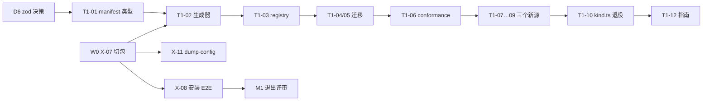

# M1 启动包与交接

> 基线：`main@1a268c5`（工作区干净、与 `origin/main` 同步）· 65 spec / 1233 tests 全绿（18.2s，干净环境）
> 宿主：`dsh 0.2.1-rc.5` · 状态库 schema 12 · 依据 `TASK-PLAN.zh.md` §4/§8/§12、`PLUGIN-PACKAGING.zh.md` §3–§5
> 日期：2026-11-07 · 用途：M1 是否可启动、怎么排、谁来接、接到什么程度算完成

---

## 0. 结论

1. **可以启动，但不是整段 M1 立即开工。** `X-07`（切包）已于 2026-11-07 落地，`T1-02`/`T1-03` 的切包前置随之解除。现在真正就绪的是 `T1-01`（manifest 类型，2 人日）、`X-11` 与 `X-08`；`T1-02` 及之后的任务只等 T1-01。
2. **D6 已定（2026-11-07，方案 A）**：`SourceManifest` 的类型放 `packages/kernel`，zod 校验放 `@superagent/dsh`，kernel 的零依赖契约不必放宽。
3. **真正的约束是人数，不是代码。** M1 的 39 人日里 Connector 泳道占 32 人日，且 T1-02 → T1-04/05 → T1-06 → T1-07/08/09 → T1-10 是串行链。按计划 §1.3 的 4 人配置（1 名 Connector），M1 需要约 **6.5 周**，不是 39/4≈2 周。补第 2 名 Connector 可压到 **3.2 周**。
4. **建议节奏**：W0（约 1 周）`X-07` + `X-11` + `D6` + `T1-01` 类型；W1 起进 M1 主链；4 人 4–5 周走完 M1 并拿到退出证据（`X-08`）。只有 1–2 人时按 §1.3 顺序不变、时间 ×2.5，且三个新源砍到一个。
5. **本轮交付的交接物**是本文 + 仓库既有 `TASK-PLAN.zh.md` / `PLUGIN-PACKAGING.zh.md` / `docs/runbooks/why-not-sent.md`；不需要另建仓库或分支。

---

## 1. 基线核验（实测，2026-11-07）

| 项 | 结论 | 证据 |
| --- | --- | --- |
| Git | 干净，15 个提交，与远端同步 | `git status --porcelain` 空；`main...origin/main` 无差异 |
| 类型检查 | 通过 | `./node_modules/.bin/tsc --noEmit` 退出 0 |
| 测试 | 65 文件 / 1233 测试全绿，18.2s | `vitest run`（干净环境，见 §1.1） |
| 构建与体积门 | 通过 | `tsdown` 11 个产物 / 707.56 kB；`check-bundle-size` 972077 B 在预算内 |
| 存储 | schema 12，`OLDEST_SCHEMA` 10 | `src/app/migration.ts:21-23` |
| kernel | 16 个模块 / 2178 行，零依赖 | `packages/kernel/src`；`kernel-boundary.spec.ts` 三条断言 |
| 切包 | **只有一个 workspace 包** `@superagent/kernel`，runtime/浏览器半/meta 仍是一个 `dsh-superagent` | `ls packages`、根 `package.json` |
| `SourceManifest` | **不存在** | `packages/kernel/src` 无 `manifest.ts` |
| conformance 套件 | **不存在** | `tests/conformance/` 无此目录 |
| `dump-config` 断言 | **不存在**，X-11 未开始 | `grep -rn "dump-config" tests src scripts` 无结果 |
| lint | **不存在**，X-01 未开始 | 无 eslint/oxlint 配置 |
| 宿主版本 | 本机 `0.2.1-rc.5`；`docs/006` 仍写 `rc.3` | `dsh --version`；`docs/006-deployment.md:76` |
| 计划漂移 | `T1-11` 指定的 `src/client/settings-sources.tsx` **不存在**，实际是 `src/client/source.tsx` + `settings-kit.tsx` | `grep` 仅命中 `TASK-PLAN.zh.md:197` |

### 1.1 复跑陷阱（重要，写进交接）

`pnpm` 在本机因 corepack 目录不可写而失败（`EPERM …/.cache/node/corepack`，计划 R6 已登记），**所有验收命令直接用 `./node_modules/.bin/*`**。

另外，本会话的进程环境自带 `GIT_CONFIG_GLOBAL` 与前置的 `worker-bin` PATH（因为会话本身跑在 superagent worker 里），直接跑全量会有 2 个 `tests/runtime.spec.ts` 断言失败（"restores the process environment"）。**这是环境继承，不是代码回归**；干净环境复跑即全绿：

```sh
env -u GIT_CONFIG_GLOBAL -u GIT_CONFIG_NOSYSTEM -u GIT_AUTHOR_NAME -u GIT_AUTHOR_EMAIL \
    -u GIT_COMMITTER_NAME -u GIT_COMMITTER_EMAIL \
    PATH="$(dirname "$(command -v node)"):/usr/bin:/bin:/usr/sbin:/sbin" \
  ./node_modules/.bin/vitest run
```

交接给新人时先让他跑这一条；跑出 2 个失败时不要开 issue 查代码，先查环境。

---

## 2. 可启动性：逐任务判定

状态口径：**就绪**＝前置齐备可立刻开 PR；**待 T1-01**＝切包前置已解除，等 manifest 类型冻结；**被阻塞**＝上游任务未完成。

| 任务 | 泳道 | 人日 | 状态 | 前置 / 原因 |
| --- | --- | --- | --- | --- |
| X-07 包切分 + meta | Platform | 3 | **完成**（2026-11-07，工作区） | `packages/dsh` 为 runtime，根包为 meta；patch 行名不变（D7）；1233 测试与构建全绿 |
| X-11 `dump-config` 断言 5 行 | Platform | 2 | **就绪** | X-07 已完成；按 D7 行名不变，可立刻写断言 |
| T1-01 `SourceManifest` 类型 | Kernel | 2 | **就绪** | 无代码前置；D6 已定：类型在 kernel，zod 校验在 `@superagent/dsh` |
| T1-02 manifest → 表单生成器 | Connector | 3 | 待 T1-01 | 交付物在 `packages/dsh/src/sources`，切包前置已解除 |
| T1-03 registry 按 manifest 装配 | Runtime | 2 | 待 T1-01 | 同上 |
| T1-04 / T1-05 GitHub、Feishu 迁 manifest | Connector | 各 3 | 被阻塞 | T1-02 → T1-03（切包前置已解除） |
| T1-06 conformance 套件 | Connector | 4 | 半就绪 | 骨架可在 T1-01 后动，验收要等 T1-04/05 |
| T1-07 / 08 / 09 Gmail、飞书文档、日历 | Connector | 5 / 5 / 6 | 被阻塞 | T1-06 |
| T1-10 `kind.ts` 退役 | Connector | 2 | 被阻塞 | T1-07…09 |
| T1-11 源配置页面板驱动 | Runtime | 3 | 被阻塞 | T1-02；注意 §1 的计划漂移 |
| T1-12 新增源指南 | Platform | 1 | 被阻塞 | T1-10 |
| X-08 安装/卸载 E2E | Platform | 5 | **就绪** | X-07 已完成；这是 M1 的退出证据 |
| T2-01 / T2-02 Action 与 Approval | Kernel | 2 / 3 | **就绪（并行）** | 不依赖 M1，可与 W0 同周起，作为 kernel 泳道的填充 |

**一句话**：X-07 已完成；现在能开的是 **T1-01（类型部分）**，随后是 `X-11` 与 `T1-02`；其余排进 W1 之后的依赖链。

---

## 3. 待拍板决策（动工前必须回话）

### D6 · zod 放哪（阻塞 T1-01）

| 方案 | 内容 | 代价 |
| --- | --- | --- |
| A（推荐） | kernel 只放 **纯 TS 类型** `SourceManifest`；zod schema 放 `src/sources/manifest-schema.ts`（`@superagent/dsh`，已有 zod 4.4.3） | 偏离 T1-01 原文一句；kernel 零依赖契约原样保留 |
| B | 给 kernel 加 `zod` 依赖，`kernel-boundary.spec.ts` 与 `docs/007` 的依赖规则同步放宽 | 放弃「kernel 零依赖」，但 manifest 校验与第三方 adapter 的契约集中在领域层 |

推荐 A：manifest 的**类型**是领域契约（kernel），**校验实现**是 runtime 的事（dsh 包）。B 的唯一好处是第三方作者能直接 `import` 校验器，但那个场景要等 `source-kit` 独立拆包（`PLUGIN-PACKAGING.zh.md` §3 的「第三个 adapter 作者出现」）才需要。

### D7 · 切包后的命名与旧安装兼容（随 X-07）

`cordis.patch.yml` 现在插的行名是 `dsh-superagent` / `dsh-superagent/github-watch` / `dsh-superagent/feishu-watch`。切包后 runtime 若改叫 `@superagent/dsh`，**已装用户的 profile 里这 5 行会解析失败**（静默"装了没生效"，`PLUGIN-PACKAGING.zh.md` §5 的最坏失败）。

建议：meta 包保留 `dsh-superagent` 名称与三个子路径 exports（转发到 `@superagent/dsh`），patch 行名**不改**；`@superagent/dsh` 只作为内部依赖。验收：`X-11` 的 dump-config 断言在**旧 profile** 与新 profile 上都能看到 5 行。

### D8 · 人员配置（决定砍不砍源）

- 4 人（Kernel 1 / Connector 1 / Runtime 1 / Platform 0.5）：M1 ≈ 6.5 周。
- 4 人但 Connector 2（Runtime 在 T1-11 后转 Connector）：M1 ≈ 3.2 周 + W0。
- 1–2 人：按计划 §1.3 ×2.5，三个新源砍到一个（保留 Gmail，它的 conformance 最能暴露 manifest 缺口）。

D1（默认不自动发送）在 M2 前拍即可，未拍时按默认值实现，不影响 M1。

---

## 4. 计划：W0–W6



| 周 | 主链 | 并行 | 周末可验收 |
| --- | --- | --- | --- |
| W0 | X-07（3） | T1-01 类型（1–2）、D6 | `pnpm check` 绿；`dsh --dump-config` 仍能合成 5 行；meta 包可 `pnpm pack` |
| W1 | T1-01 校验 + T1-02 生成器（3） | X-11、T2-01 | 给定 manifest 生成表单快照；错误带 JSON 路径 |
| W2 | T1-03 registry + T1-04 GitHub | T2-02、T1-11 起步 | 现有源行为逐条 diff 为空 |
| W3 | T1-05 Feishu + T1-06 骨架 | X-08 起步 | 假 adapter 幂等键写错必须红 |
| W4 | T1-07 Gmail + T1-06 完成 | T1-11 | Gmail 走完整 conformance |
| W5 | T1-08 飞书文档 + T1-09 日历 | X-08 完成 | 新源总改动 ≤ 2 人日（用日历计时） |
| W6 | T1-10 退役 + T1-12 文档 | - | M1 退出评审（见 §5.6） |

### 4.1 三人并行排期（D8：最多 3 条泳道）

可并行的上限是 **3**，不是 4：T1-06 必须由一个人统一 conformance，T1-09 是新源计时的样本（必须一人从头做到尾），`registry.ts` 与客户端设置页各自只有一个 owner。

| 泳道 | D1–2 | D3–5 | D6–8 | D9–12 | D13–18 | D19–20 |
| --- | --- | --- | --- | --- | --- | --- |
| A（Connector） | T1-01 类型 | T1-02 生成器 | T1-04 GitHub | T1-06 conformance | T1-09 日历（计时样本） | T1-10 退役 |
| B（Connector） | X-11 dump-config | T1-03 registry | T1-05 Feishu | T1-07 的 manifest 草稿 | T1-07 Gmail | T1-12 指南 |
| C（Platform） | X-08 安装 E2E | X-08 | T1-11 面板 | T1-08 的 manifest 草稿 | T1-08 飞书文档 | X-08 收尾 + 退出评审 |

三人并行时 M1 约 **4 周（20 个工作日）**：T1-06 是唯一同步点，之后 T1-07/08/09 正好三路并行。只有 2 人时把 C 并入 A/B、Gmail 与飞书文档二选一，约 6 周。第 4 个人只应去做 M2 的 T2-01/02，不要塞进 M1。

**关键路径**：X-07 → T1-02 → T1-03 → T1-04/05 → T1-06 → T1-07/08/09 → T1-10 → X-08。任何一周拖一天，退出评审顺延一天；`T1-11` 与 `T2-01/02` 是缓冲池，不要把它们排进关键路径。

**不建议**：先写新源再补 conformance（T1-06 是"支持 30 个源"的唯一可行办法，倒过来会写成三个一次性实现）；先做 T1-11 面板（生成器未定型，会返工两次）。

---

## 5. 交接方案

### 5.1 交接物清单

| 交接物 | 位置 | 接手人怎么用 |
| --- | --- | --- |
| 任务分解与验收口径 | `TASK-PLAN.zh.md` §4、§11、§12 | 每个 PR 对照六个字段（目标/交付/验收/估时/依赖/泳道） |
| 切包与安装边界 | `PLUGIN-PACKAGING.zh.md` §3–§5 | X-07/X-08/X-11 的设计依据与最坏失败模式 |
| 排障三步法 | `docs/runbooks/why-not-sent.md` + `.drill.md` | 接手第一周做一次 30 秒定位演练 |
| 领域与架构 | `docs/000` → `docs/007` 顺序读 | 每篇只依赖前一篇，不要跳读 |
| 启动包（本文） | `M1-KICKOFF.zh.md` | 排期、决策、DoD、交接会 |
| 决策记录 | 本文 §3 + `PLATFORM-EVOLUTION.zh.md` §D1–D5 | 未拍板的决策不得用"先这样"绕过 |
| 可执行契约 | `tests/*.spec.ts`（尤其 `layers` / `kernel-boundary` / `docs` / `bundle-patch`） | 改不动就说明越界了 |

### 5.2 角色与决策权

| 角色 | 拥有 | 决策权 |
| --- | --- | --- |
| Lead（你） | 排期、D6/D7/D8、M1 退出评审 | 只有 Lead 能改 `TASK-PLAN.zh.md` 的验收口径 |
| Kernel | `T1-01`、`T2-01/02` | kernel 契约测试先行；不新增依赖（除 D6 拍板） |
| Connector | `T1-02`…`T1-10`、`T1-12` | manifest 字段增删需 Lead + Runtime 同意（会波及表单与 registry） |
| Runtime | `T1-03`、`T1-11`、`T2-07` | 面板交互；不手写表单是硬约束 |
| Platform | `X-07`、`X-08`、`X-11` | 包边界、CI、安装验证 |

### 5.3 首次交接会（90 分钟）

1. 10′ 基线：跑 §1.1 的测试命令，看 1233 绿；
2. 15′ 走一遍 `docs/runbooks/why-not-sent.md` 的三步法（现场随机抽一个历史工单）；
3. 20′ 过本文 §2 的可启动性表，逐任务认领；
4. 20′ 拍 D6/D7/D8，写进本文 §3（改动留在同一分支）；
5. 15′ 定 PR 纪律与周节奏（§5.5）；
6. 10′ 定 M1 退出评审日期与证据清单（§5.6）。

### 5.4 接手人 Day-1 检查单

- [ ] `git switch main && git pull`；`git status` 干净；HEAD 为 `1a268c5` 或其后
- [ ] 跑 §1.1 的干净环境全量测试：65 文件 / 1233 通过
- [ ] `./node_modules/.bin/tsc --noEmit` 通过；`./node_modules/.bin/tsdown` 产物 11 个
- [ ] 读 `docs/000` → `007`，再做一次 runbook 演练（30 秒内说出卡点）
- [ ] 读 `TASK-PLAN.zh.md` §4 与本文 §2，认领第一张 PR（X-07 或 T1-01）
- [ ] 确认本机 `dsh --version`（当前 `0.2.1-rc.5`）在 `engines.dsh` 范围内

### 5.5 PR / issue 纪律（可直接贴进模板）

- 一个 PR 只对应一个任务编号；标题 `feat(<area>): <task-id> <一句话>`。
- 动 `packages/kernel`：契约测试先行；`kernel-boundary.spec.ts` 必须保持绿。
- 动 schema：迁移向前兼容 + 旧库拒启文案不变。
- 动面板：空态 / 错误态 / 无权限态三态都渲染过。
- 动 `src` 或 `packages` 的文件清单：`docs/007` 的 Modules 表必须同步（`docs.spec.ts` 会抓）。
- 任何包变更带 changeset；CI 三个工作流（`check` / `changesets` / `release`）必须绿。
- PR ≤ 400 行有效 diff；超过就拆。周节奏：周一排、周三中检、周五演示 + 退出证据留档。

### 5.6 M1 退出评审（不满足就不算 M1 完成）

1. 新源总改动 ≤ 2 人日可复现（以 `T1-09` 日历为计时样本，录一次从零到 conformance 绿的屏幕记录或 PR 链）；
2. 面板零手写表单：加一个测试 fixture 源，只改 manifest，字段与标签自动出现；
3. `kind.ts` 退役，行为 diff 为空；
4. `X-08` 在临时 `DSH_HOME` 上跑通：安装 → 起进程 → 面板可用 → 卸载后 stateDir 仍在；
5. `X-11` 断言 `dump-config` 5 行齐全（新旧 profile 各一次）；
6. 全量测试绿、领域测试 < 2s、`pnpm check` 在干净 clone 上可复现。

---

## 6. M1 期风险（按触发信号）

| 风险 | 触发信号 | 动作 |
| --- | --- | --- |
| R2 manifest 过窄 | 第二个源就要加 `extra` 分支 | 写完 `T1-09` 再冻结 v1；`extra` 保留 |
| R-conn | Connector 请假/串行拖期 | Runtime 在 `T1-11` 后转入；或按 D8 砍源 |
| R7 宿主漂移 | `dsh` 升到新 rc，patch 锚点变化 | X-10 兼容矩阵先跑 `rc.5`；`X-11` 是兜底 |
| R6 包管理 | `pnpm` 报 corepack EPERM | 用 `./node_modules/.bin/*`；CI 不受影响 |
| 环境误判 | 全量跑出 2 个 runtime 失败 | 先按 §1.1 清环境复跑，再判断是否回归 |
| 文档漂移 | `docs/006` 仍写 rc.3；`T1-11` 指向不存在的文件 | 随 X-07/T1-11 顺手修正，并在 PR 里说明 |

---

## 7. 本周就做的五件事

1. 拍 D6（zod 放哪）与 D7（patch 行名是否改），各一句话即可。
2. ~~开 `X-07`~~：已完成。`packages/dsh` 持有 runtime，根包是 meta，`dsh-superagent` 名称与三个子路径 exports 不变；`bundle-patch.spec.ts` 与全量测试绿。
3. 同时开 `T1-01` 的类型部分（纯 TS，不碰 zod），先让 `SourceManifest` 能表达 GitHub + Feishu 两个源的全部配置。
4. 把 `X-11` 的 `dump-config` 断言写进 `tests/`，作为切包不回归的证据。
5. 把 §1.1 的干净环境测试命令写进 `README.md` 的 Development 段，避免下一个人把环境问题当代码 bug。
