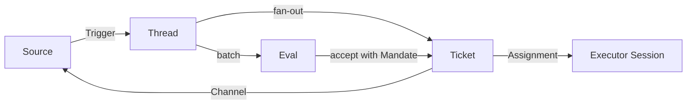

# dsh-superagent

> **Research prototype for reference only, not an official DeepSeek product.** This code grew out of our team's day-to-day development work, with much of the engineering done by coding agents. Treat it as research code, not production-ready software. It may still contain bugs, and its coding style and engineering practices may be inconsistent. Review and adapt it before using it in your own environment.
>
> We have adapted it for publication, so it is not identical to our internal version or the implementation described in *Exploring Super-agent Design: Towards a More Autonomous Agent System*. Some designs discussed in the article are directions for future development and are not implemented in this prototype.

**dsh-superagent is an auditable superagent for a team, packaged as a bundle for [DeepSeek Harness](https://www.deepseek.com/en/harness/).** It is general-purpose by design: it treats the places a team already writes — GitHub Issues, pull requests and reviews; Feishu chats and document comments; the local conversation with the agent — as **Sources** of work. GitHub, Feishu and the local conversation are the Sources implemented today; Gmail, calendar and office actions remain on the roadmap. A request becomes a **Ticket** with a **Mandate** that records who asked, on which Source, with what strength, under which Policy version, and how far the work may act. An Executor Session works each Ticket in its own directory, and the result returns to the conversation where it started: a pull request, a comment, or a Deliverable with a preview for review. A web panel shows what needs a person.

The goal is not maximum autonomy. It is **trust**: an agent that can act for a whole team can also waste the whole team's attention or cause an irreversible mistake. Four properties define what "entrusted" means here, and the codebase is organized around them:

- **Authorization is traceable.** Every action answers who asked, on whose behalf, under which rule, and how far it may go.
- **Side effects are enumerable for runtime writes.** Every external message the runtime sends is an `Action` with an idempotency key and a receipt. Worker shell calls such as `git push` and `gh pr create` are not yet runtime Actions; see [Status and limitations](#status-and-limitations).
- **Failures are recoverable.** A durable effect is recorded before it happens, so a crash neither duplicates nor loses a send.
- **Overreach is blockable.** Tightening the Policy stops the next action above the new ceiling of work already running, not only future work.

The other budget is human attention. Messages, questions, panel rows and even documentation each cost someone's attention, so the agent acts only when asked or when a written rule allows it, and speaks only when a person must decide or can use a result. [docs/000-philosophy.md](docs/000-philosophy.md) states the principle and what it asks of an operator. The project began as a proactive coding agent for one GitHub repository; this repository is evolving that prototype into one kernel for office and development work, on the assumption that office actions are *less* reversible than code.

## How a request becomes work



1. **A Source records a Trigger.** It keeps its own read position and identity, so a restart does not replay events. It translates its own vocabulary — an Issue comment, a Feishu message, a conversation message — into the domain's.
2. **A Trigger reaches a Thread and then Eval.** It fans out as context to every Ticket subscribed to its Threads; a person's message that reaches a Ticket this way stays with that Ticket's Executor, while every other Trigger enters Eval. There a deterministic **gate** decides whether the sender may originate work and with what strength; a model **assessment** decides whether a proactive message matches a written rule. An inferred candidate always needs an assessment; an explicit request from an allowed person does not.
3. **Accept creates the Ticket, its Mandate and its first Assignment in one transaction.** The Ticket owns the work and the audit trail; the Mandate owns the permission. Only Eval creates a Ticket, so duplicate suppression, Decision history and authorization stay on one path.
4. **An Executor Session does the work.** `worker-<ticket id>` gets a directory and the Ticket's Inputs. It reports `progress`, `waiting`, `ready`, `blocked`, `failed` or `dropped`; a `ready` Report may carry a Deliverable with a preview; a blocking question is one structured `human_action`, not a paragraph in a report.
5. **The result leaves through a Channel.** A comment, reply or review is an external write; the runtime's outbound messages pass the Action gate. A pull request opened from the Ticket's branch is followed as a Thread. When the pull requests it follows close or merge, the Ticket ends with that outcome. A later human message on a subscribed Thread resumes the same Ticket under the same Mandate, unless a person stopped it.

The conversation is not a shortcut around this flow. When a person assigns work by talking to the main agent, `orchestrator_dispatch` records the message as a conversation Trigger and an Eval accepts it, so the Ticket still has a Decision, a Mandate and an audit trail; chat and status questions create nothing. See [docs/009-conversation-tasks.md](docs/009-conversation-tasks.md).

## Design

### A small kernel, a host runtime, and a bundle

`packages/kernel` (`@superagent/kernel`) is the domain: Triggers, Threads, Evals, Tickets, Mandates, Assignments, Deliverables, Actions and Approvals, with the `Engine` as the only writer of Triggers, Threads, Decisions, Tickets and Assignments. It imports nothing outside itself apart from Node's hashing and does no I/O, so the rules are testable in milliseconds without DeepSeek Harness. `packages/dsh` (`@superagent/dsh`) is the runtime: Cordis plugins, Source implementations, the Executor, the management API, the panel, prompts and skills. The root package (`dsh-superagent`) is the bundle that installs the runtime through one patch, its locale and its entry re-exports.

The split is enforced, not conventional: `tests/kernel-boundary.spec.ts` refuses a host import in the kernel, and `tests/layers.spec.ts` reads the imports to enforce the dependency rules in [docs/007-architecture.md](docs/007-architecture.md). The trade-off is more explicit wiring in the runtime; the benefit is a domain that can be tested, read and reused without the host.

### The model judges; the code authorizes

Prompt text can describe policy, but it cannot grant permission. The gate is deterministic and lives in code: it decides who may ask through a Source, on that Source's own identities, and with what strength (`explicit` or `inferred`). The model's job is judgement — does this proactive candidate match a written rule? — and its output is an assessment, not a permission.

The design keeps three boundaries sharp:

- **No cross-Source identity mapping.** A person is Trigger metadata, not a global account. Each Source has its own allowed list, in its own identifiers; that one person has accounts on several Sources is prompt text.
- **Accept mode is a dial.** `off`, `observe` (the default) and `auto` decide whether inferred work is recorded, assessed or accepted. Explicit requests work in every mode.
- **A person's stop is the only thing that withdraws a Mandate.** A Ticket ending does not end its Mandate; a later message can resume it. A failed revalidation before resume revokes the Mandate; a failed check at action time refuses that Action only, and the Mandate stays.

[docs/002-authorization.md](docs/002-authorization.md) has the gate, the admission table, revalidation and the approval rules.

### A Source is a manifest plus an adapter

A Source kind declares its identity, settings fields, sign-in, health entries and polling limits in a **manifest** — declarative data the registry validates and the panel renders — and implements its behavior in an **adapter**: scope, Channel, Thread context, policy rows, environment variables. Adding a Source means writing the manifest, the adapter and a conformance test, then the packaging wiring that declares them — runtime and bundle entries, exports, a patch row, build and test subpaths, and the documentation tables. It does not mean editing `packages/dsh/src/app` or the kernel. GitHub, Feishu, Feishu document comments and the built-in conversation Source are the four in tree.

The manifest/adapter split is a deliberate trade-off: functions cannot be validated by a schema, and putting host types in the kernel would break its zero-dependency rule. The flat `SourceKind` still exists as a migration view and is retired by T1-10. [docs/008-cookbook.md](docs/008-cookbook.md) is the full recipe.

### Five action levels, one approval per revision

The domain models an `Action` at one of five levels — `read`, `draft`, `commit`, `send`, `spend` — and a `spend` carries its money or time cost. The Policy sets a maximum action level (default `draft`); an Action above it is refused, and a Mandate records the ceiling it was accepted with, so raising the Policy does not widen existing work.

An external Action can also wait for an **Approval**: one person's or the Policy's consent to one Action at one exact revision, with an optional recorded target and a 24-hour lifetime. Today the runtime uses it for outbound messages: the send is revalidated against the Mandate, then either the Policy auto-approves it (an internal domain during working hours; a tenant rule overridden by a Source rule) or it stays for a person. A `spend` is never automatic and a multi-recipient target never matches. The default ceiling is `draft`, so an operator must raise it to `send` and then decide each external message or configure the whitelist. [docs/002-authorization.md](docs/002-authorization.md) explains the request, release, recall and drop paths.

### The outbox is the only writer of external messages

The Outbox owns a receipt per outbound message, keyed by the `send` Action's idempotency key: `(source, object, kind, level, revision, actor)`. A message stays `pending` for the Policy's undo window (30 seconds by default; an IM tenant usually sets 0), can be `recalled` inside it, and is only sent after it. If an attempt may have reached the remote service, the next retry asks the Source's `probe` first: `sent` settles without writing again, `gone` makes the retry safe, `unknown` keeps the message pending for a person. A Source that declares a `withdraw` adapter can take a sent message back; one that does not says so instead of pretending.

This is the "no duplicate send" machine. `tests/chaos.spec.ts` aborts and restarts at four durable points, 100 rounds, and asserts one remote write per Action; `pnpm drill:withdraw` exercises the withdrawal path against the fixtures, GitHub and Feishu. The cost is a short delay and per-Source adapters; the benefit is that a crash or a timeout cannot silently double-send.

### The Executor is outside the domain

A Ticket can have several Assignments over time. An Assignment binds it to one Executor Session and one directory; a retry or restart starts another in the same Session, directory, branch and pull request. The Executor runs as the operator's OS user without approvals, so the directories and command wrappers are defaults, not a security boundary. A worker's own shell `git` and `gh` calls are not runtime Actions; the approval gate covers the runtime's external `send` path (see the limitations below).

### Conversation tasks and a derived task view

The main Session is a router, not a second execution path: it reads candidates and reports, dispatches a person's message, attaches a follow-up to the Ticket it names, and stops work at a person's request. It does not implement. A conversation request becomes a Ticket only through dispatch and Eval, which keeps the audit trail intact.

The Tasks tab then folds Tickets into milestones and plan tasks by the ids their titles and Mandate scopes already carry, puts a review Ticket under the Ticket whose pull request it reviews, and shows unplanned work under **Unplanned**. Ownership is derived when the board is read; no Ticket, Thread or row gains a planning field. The trade-off is that ownership is a heuristic over names and scopes; the benefit is no migration and no hidden work. The Events tab groups the same ownership into one group per task, so the tree and the feed do not disagree.

### Attention is the budget

Everything above serves one rule: take as little human attention as possible and give as much value as possible. The panel opens with what needs a person, not with a dashboard; a healthy state takes no space; one outcome costs one notification; the agent confirms a request once, stays quiet while it works, and writes again only when a result is ready, a decision is needed, or it cannot finish. The same rule applies to this README: the rest is in `docs/`, in order. The design principles that follow from it — internalized organization, independent evolution, composable context and replaceable boundaries — are in [011 Design principles](docs/011-design-principles.zh.md).

## Repository layout

| Path | Responsibility |
| --- | --- |
| `packages/kernel/` | `@superagent/kernel`: the domain model, the `Engine`, the ports, trace and reason types. No host imports, no I/O. |
| `packages/dsh/` | `@superagent/dsh`: the runtime. `src/app` is the composition root and the Engine adapters; `src/sources` the Source kinds; `src/executor` the DshExecutor; `src/client` the browser half; `src/infra` the CLI transport, environment and health. |
| `packages/dsh/prompts/`, `packages/dsh/skills/` | The built-in prompt text and the Source skills. |
| `meta/` | The bundle's entry points, re-exporting the runtime plugins under the names the patch rows resolve. |
| `cordis.patch.yml` | The bundle layer: four plugin rows and the two agent presets. |
| `locale/` | The bundle's locale files. |
| `examples/profile.cordis.patch.yml` | The machine configuration an operator copies into a profile. |
| `scripts/` | `dsh-superagent` service script, the bundle-size gate, the install-e2e check. |
| `tests/` | Unit, integration, conformance, chaos, panel and packaging tests; the repository's executable contracts. |
| `docs/` | The numbered design and operations documents (000–014), the documentation map, runbooks and images. |
| `docs/plan/` | The milestone plan, its dated kickoff and session-entry notes, and the single task tracking table. |
| `SETUP.md` | The guided setup an agent follows with an operator. |

## Install

Setup has many steps, so let an agent do it with you. In your coding agent, ask:

> Read SETUP.md in this repository and set up dsh-superagent with me.

It asks one short question at a time, shows the full plan once, and then installs and configures everything. [SETUP.md](SETUP.md) is what it follows.

### Manual quick start

Prerequisites: Node.js 22.19+ or 24+, pnpm 11.7, git 2.32+, Python 3.8+, tmux, GitHub CLI 2.48+, and DeepSeek Harness `0.2.1-rc.5` (the `engines.dsh` range is `^0.2.1-rc.5`). You need a repository on github.com and a dedicated agent account with write access; GitHub Enterprise Server is not supported. Feishu is optional and needs `lark-cli` and a bot app. The host also needs a configured model provider.

The bundle and its runtime are private and unpublished, so install from a checkout with `link:`:

```sh
npm install -g @deepseek-ai/dsh@0.2.1-rc.5
git clone https://github.com/touch-agent/dsh-superagent.git && cd dsh-superagent
pnpm install && pnpm build
dsh superagent --from-default-profile web --dump-config > /dev/null   # create the profile
dsh plugin --profile superagent add "link:$PWD"                      # install this bundle
cp examples/profile.cordis.patch.yml ~/.dsh/profiles/superagent/cordis.patch.yml
# edit stateDir (and the port, if needed) in the copied file
```

Run the profile-creation command only for a new installation: if the profile already exists, it replaces the profile and deletes its `cordis.patch.yml`. For an upgrade, edit the existing file instead. `DSH_HOME` relocates the default `~/.dsh`. If you use Feishu, enable the `dsh-superagent-feishu` row in the copied file; for document comments, enable `dsh-superagent-feishu-doc`.

Verify that the host composes the bundle's six rows (the bundle, three Sources and two presets) before starting:

```sh
dsh --profile superagent --dump-config | grep 'id: dsh-superagent'
```

Then:

```sh
scripts/dsh-superagent start
scripts/dsh-superagent status
```

`start` runs the profile in tmux and waits up to a minute for the runtime to become ready. `status` exits 0 when the service runs normally, 1 when it does not run or its runtime reports an error, 2 when another part reports an error (a restart does not fix it), and 3 when setup waits for a setting. The panel is at `http://127.0.0.1:3082` by default, under **Superagent** in the sidebar.

### First configuration

Do this in the panel's **Settings**:

- **Sources.** Set the GitHub repository (`owner/name`) and the agent account's CLI wrapper. Enable Feishu or the Feishu document Source only if you use them.
- **Policy.** Add the people who may ask for work, in each Source's own identifiers. Start in `observe`; switch to `auto` after the recorded decisions look right. **Raise `maxActionLevel` to `send` before expecting any external message**: the default is `draft`, and an external Channel message is dropped with `actionLevelExceeded` until the ceiling is raised. A Mandate records its ceiling, so accept new work after raising it.
- **Execution.** Set the directory root and a prepare command that creates a checkout per Ticket, for example with `git worktree`. List personal CLIs as blocked commands.
- **Prompts.** Set the commit author and the auto-merge condition in **Delivery requirements**, and the disclosure line and review bots in **Communication**.

[docs/006-deployment.md](docs/006-deployment.md) has the account setup, the Feishu bot, the management API, upgrades and troubleshooting.

### Try it

From a GitHub account on the allowed list, comment `@<agent-login> <request>` on an Issue. Within a polling interval (one minute by default) the panel shows a Ticket; the agent acknowledges in the thread, works in its own Session and directory, and answers with a result, usually a pull request. You can also open the **main Session** and assign the work there; an explicit assignment becomes a Ticket through the same path. On Feishu, mention the bot in a configured chat.

## Status and limitations

The milestone definitions are in [TASK-PLAN.zh.md](docs/plan/TASK-PLAN.zh.md), and the live per-task status, PR and evidence are in [TRACKING.zh.md](docs/plan/TRACKING.zh.md). In summary:

| Milestone | State | Landed / remaining |
| --- | --- | --- |
| M0 Observability | Done | Trace spans, the health figures, the panel's health view and the "why was this not sent" runbooks. |
| M1 Source Kit | Core done; open | Manifest + adapter, registry, conformance suite, GitHub, Feishu, Feishu documents and manifest-driven Source settings. Gmail and calendar Sources and the `kind.ts` retirement remain. |
| M1.5 Conversation tasks | Core done; phase 4 open | The built-in conversation Source, dispatch and attach, task threads, multi-source bindings and anchors. Phase 4 hardening (replay, duplicate dispatch, prompt-injection review, transcript privacy) remains. |
| M1.6 Entry and events | Done | The main-Session entry and badge, the Status page, the Events tab and the activity grades. |
| M2 Action gate | Done | The five levels, approvals and auto-approval, the undo window, probe, the withdrawal drill and the 100-round crash test. |
| M3 Delivery | Partial | The Deliverable and review gate, the doc and sheet previewers, the review page. The mail previewer, inline execution, warm-session reuse and the ticket timeline remain. |
| M4 Multi-tenant | Not started | Tenancy, retention, audit export and isolation drills. |

What is not wired yet, and matters when you evaluate the project:

- **Only the outbound `send` path is gated.** The runtime has no `commit` or `spend` executor today; those levels are modeled, and `spend` is never auto-approved, but a worker's shell `git`/`gh` calls are not runtime Actions. The gate is the seam those paths must call.
- **The review previewers are not connected to the review page yet.** The page renders the worker-supplied `previewRef`; the previewer registry, the mail previewer and a value comparison are follow-ups. The doc and sheet previewers exist and are tested, but the review surface does not call them.
- **The default is safe, not convenient.** `maxActionLevel` is `draft`, so an upgraded installation drops external Channel messages until an operator raises it to `send`; a Mandate records its ceiling, so existing work does not widen. The undo window is 30 seconds by default (0 is common for an IM tenant).
- **The bundle is private and unpublished.** Installation is from a checkout with `link:`; there is no registry or packed-tarball path yet, and the install-e2e check covers only the link path.
- **One process, one SQLite, single tenant.** A state-directory lock prevents a second process. There is no retention or compaction: trigger, decision, outbox and revision rows grow without bound (only the activity feed keeps a 5,000-row window). M4 is not started.
- **The state directory is not a security boundary.** Executors run as the operator's OS user with `danger-full-access`; the CLI wrappers and directory layout are defaults. Use a dedicated OS account for isolation.
- **GitHub.com only; Feishu optional.** GitHub Enterprise Server is unsupported. The built-in conversation Source is single-user and trusted because it is the local authenticated user; a shared conversation would need an ordinary Source policy.
- **Task ownership is derived.** The Tasks tree folds Tickets by title and scope; that is a view, not a planning entity. Unplanned work is shown, not silently hidden, but a title is not a schema.

## Documentation

Read 000–010 in order; each builds only on the ones before it. 011 and 012 are a cross-referencing pair: the product and organization principles, and the platform evolution they sit above. 013 applies them to the workspace model, 014 records the end-to-end golden path that proves the task tree and parent review, and 015 designs the reusable profile layer over the two roles.

- [000 Philosophy](docs/000-philosophy.md): the attention rule, and what the agent may and may not do.
- [001 Domain model](docs/001-domain.md): Sources, Triggers, Threads, Evals, Mandates, Tickets, Assignments, Deliverables and Subscriptions.
- [002 Authorization](docs/002-authorization.md): the gate, the admission table, Mandates, action levels and approvals.
- [003 Execution](docs/003-execution.md): Ticket stages, the Executor, concurrency, failure, delivery and recovery.
- [004 Prompts](docs/004-prompts.md): what the agents read, what a team can edit, and which rules code enforces.
- [005 Panel](docs/005-panel.md): the three questions the panel answers and the tabs that answer them.
- [006 Deployment](docs/006-deployment.md): manual setup, accounts, configuration, upgrades and troubleshooting.
- [007 Architecture](docs/007-architecture.md): the classes, modules, tests and tables of the implementation.
- [008 Cookbook](docs/008-cookbook.md): the full recipe for adding a Source.
- [009 Conversation tasks](docs/009-conversation-tasks.md): assigning work by talking to the agent, and multi-source tasks.
- [010 Adding a Source in 30 minutes](docs/010-adding-a-source.md): the fast path from an empty checkout to a registered, panel-visible Source.
- [011 Design principles](docs/011-design-principles.zh.md): attention as the budget, internalized organization, independent evolution, composable context and replaceable boundaries (Chinese).
- [012 Platform evolution](docs/012-platform-evolution.zh.md): why the project has this shape, from a single-repository agent to a trustable action base (Chinese).
- [013 Workspace model](docs/013-workspace-model.zh.md): `Execution.directory` as the single space locator, write leases, lifecycle, decision rules, read-only UI exposure and phased migration (Chinese, proposal).
- [014 E2E golden path](docs/014-e2e-golden-path.zh.md): the one end-to-end path from an Issue to accepted, merged work, its fake-host boundary and its stability rules (Chinese).
- [015 AgentProfile](docs/015-agent-profile.zh.md): reusable, versioned execution profiles for the two roles, with authorization kept in Policy, Eval and the action gate; current-state evidence, evolution loop, risks and a phased landing (Chinese, proposal).

The design and evolution layer and the plan set are Chinese working documents, and can be ahead of, or behind, the numbered set. [docs/README.md](docs/README.md) maps the whole documentation set; [docs/plan/README.md](docs/plan/README.md) explains the plan documents and the tracking convention.

Design proposals (unnumbered, not implemented):

- [任务视图架构设计](docs/tasks-view-architecture.zh.md): the right-pane task view, event-induced categories, self-referencing child Tickets with per-node owners/workers and the parent-owner review chain, and the data model behind them

## Development

`pnpm check` is the gate: typecheck, the full test suite, the build and the bundle-size budget. The pieces:

```sh
pnpm typecheck        # tsc --noEmit
pnpm test             # vitest run (tests/)
pnpm build            # tsdown, the runtime and the bundle
pnpm check:size       # bundle-size budget
pnpm check            # all of the above, in order
pnpm test:install-e2e # install, open and remove the bundle in a throwaway DSH_HOME
pnpm drill:withdraw   # the withdrawal drill
pnpm changeset        # record a version bump for a package change
```

`pnpm test:install-e2e` needs `dsh` on `PATH` (or `DSH_BIN` pointing at another copy); `KEEP=1` keeps the temporary home. The same applies to `tests/dump-config.spec.ts`, which composes an installed profile through the host's own `--dump-config`.

The tests are the specification. `tests/kernel-boundary.spec.ts` and `tests/layers.spec.ts` enforce the package boundaries; `tests/conformance/` is the contract every Source must satisfy; `tests/chaos.spec.ts` and `tests/withdraw-drill.spec.ts` cover delivery failure; `tests/runtime.spec.ts` runs the application against a simulated host, and the panel specs against a fake management API; `tests/docs.spec.ts` checks that the numbered documents link only backwards, that the README lists every numbered document once and in order, and that the 007 module and test tables stay complete.

CI runs three workflows: `check` (the gate above, with the pinned host installed so the dump-config test is real, plus a `changesets` job that requires a package change to name the package it bumps), `install-e2e` (the bundle installs, opens and uninstalls), and `release` (a dry run on `main` that shows the versions and changelogs a release would write; nothing is published).

## License

[MIT](LICENSE)
