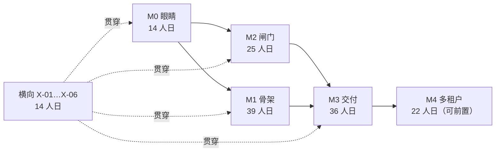

# TASK-PLAN — 从原型到可托付底座：任务分解与排期

> 基线：`touch-agent/dsh-superagent`（private）· `main` 4 个提交，HEAD `0d9298c` · CI `check` 全绿
> 依据：`PLATFORM-EVOLUTION.zh.md`（下称「方案」）· 本文只做**任务分解**，不重复方案里的取舍论证
> 日期：2026-11-07 · 状态：草案，待拍板 D1–D5 后冻结第一版

---

## 0.0 进度（2026-11-07 晚）

M0 已收官。下表按任务编号记完成情况，验收命令都在 CI 上跑过。

| 任务 | 状态 | 落地 | 验收证据 |
| --- | --- | --- | --- |
| T0-01 trace 端口 + `span` 表 + schema 12 | 完成 | `fcbae91` | 62 files / 1212 tests；schema-11 库升 12，13 版库被拒 |
| T0-02 十段埋点 | 完成 | `7f11e0d`、`ab8f6c5` | 一条 trace 从 intake 到首次报告十段齐全，重复发生各自成行 |
| T0-03 四指标 + `GET metrics` | 完成 | `1377989` | `tests/metrics.spec.ts`；空样本给 `null` 不给 0 |
| T0-04 面板只读健康区 | 完成 | `1377989` | Overview 页「运行健康」四个数字 + 中断/恢复提示 |
| T0-05 changesets + 体积门 + 两段 CI | 完成 | `894c1a5` | `pnpm changeset status` 两包各一 minor；`release` dry-run 18s |
| T0-06 runbook + 演练 + trace 读取面 | 完成 | `492e668`、`a3809b1` | 三次查找 36–50 ms；`docs/runbooks/why-not-sent.md` |

**M1 前置已动**：X-07（包切分）于 2026-11-07 落地——`src/`、`skills/`、`prompts/` 迁入 `packages/dsh`（`@superagent/dsh`），根包成为 meta（patch + locale + 三个 re-export 入口）；patch 行名与子路径不变（D7）。X-11 与 X-08 仍未做。

基线随之变化：65 个 spec / 1232 个测试（13.2s），领域子集 496 个 / 549 ms，`src` + `packages` 代码量见 `git show --stat`；CI 三个工作流（`check` / `changesets` / `release`）均已实跑通过。

---

## 0. 今天在哪里

| 维度 | 现状 | 证据 |
| --- | --- | --- |
| 仓库 | 新仓库已立，原仓库只读（`deepseek-ai/dsh-superagent-prototype`，`push:false`） | `gh repo view` |
| 提交 | 原型 + kernel 抽包 + 装配器拆解 + CI，共 4 个 | `git log --oneline` |
| 测试 | 61 个 spec 文件 / 1204 个测试，全绿 15.6s；领域 + 守卫子集 479 个 / 641ms | `vitest run` |
| 代码量 | `packages/dsh/src/` + `packages/` 共 111 文件 / 15293 行 | `find` + `wc -l` |
| 依赖面 | kernel 包零依赖；全部 `@deepseek-ai/*` 走 peerDependencies | `packages/kernel/package.json` |
| CI | 一段 `check`：typecheck → test → build；`--frozen-lockfile` 验 workspace 形状 | `.github/workflows/check.yml` |
| 源 | 2 个 kind（GitHub、Feishu），Feishu 默认 `disabled: true` | `packages/dsh/src/sources/kind.ts` |
| 存储 | 单 SQLite，`SCHEMA_VERSION = 11`，`OLDEST_SCHEMA = 10` | `packages/dsh/src/app/migration.ts:20-22` |

**相对方案 §8 的完成度**：M0 六项任务全部完成（见 §0.0）；M1 尚未开始。

**仍然缺的能力**（= 后面所有任务的来源）：源只能手写、动作不分级、没有审批与撤销、没有交付物与预览、单租户单实例。trace 与指标已补齐（§0.0）。

---

## 1. 这份计划怎么用

### 1.1 任务编号与字段

`T<里程碑>-<序号>`，每个任务给六件事，缺一不成立：

| 字段 | 含义 | 不合格的样子 |
| --- | --- | --- |
| 目标 | 一句话说清为什么做 | 「优化性能」 |
| 交付 | 落在哪些文件/表/端点 | 「加个监控」 |
| 验收 | 可执行的检查（测试名或演练动作） | 「感觉能用」 |
| 估时 | 人日，按「熟手、含测试」 | 「大概几天」 |
| 依赖 | 前置任务或决策 | 空着 |
| 泳道 | Kernel / Connector / Runtime / Platform | 「大家一起」 |

### 1.2 四条排序原则

1. **信任先于连接器**：M2（闸门）必须早于「第 4 个源」。源可以后补，审计与撤销不能。
2. **kernel 变更先有契约**：任何改 `packages/kernel` 的任务，必须先有或同时有 `tests/kernel-*.spec.ts` 覆盖，否则不允许合并。
3. **每个任务自带回退**：新路径与旧路径并存，靠 feature flag 切换；方案 §10.3 的 strangler 四步是硬约束。
4. **1204 个测试任何时刻必须绿**：任何任务把 `vitest run` 弄红超过一个工作日，就算该任务失败，回退。

### 1.3 泳道与假设

按 4 人（Kernel 1 + Connector 1 + Runtime 1 + Platform 0.5 + 我）估算，每人 5 人日/周。若只有 1–2 人，顺序不变、时间 ×2.5，且 M1 的三个新源砍到一个。

估时只覆盖**里程碑退出标准所需的最小实现**：源按 3 个计，每多一个源 +4~6 人日；previewer 每个 +3~6 人日。

---

## 2. 里程碑总表

| 里程碑 | 目标 | 任务 | 估时 | 前置 | 退出标准 | 方案章节 |
| --- | --- | --- | --- | --- | --- | --- |
| M0 眼睛 | 能回答「为什么没发出去」 | T0-01…06 | 14 人日 | — | 任意工单 30 秒定位卡点；领域测试 < 2s | §6.8、§8 |
| M1 骨架 | 新源只写 manifest + adapter | T1-01…12 | 39 人日 | M0 | 新源 ≤ 2 人日；零手写表单；`kind.ts` 退役 | §6、§7.4 |
| M2 闸门 | 不可逆动作有审批与撤销窗口 | T2-01…10 | 25 人日 | M0（与 M1 并行） | 断电注入 100 次重复发送 0；可撤回源 100% | §6.2、§6.3 |
| M3 交付 | review 真可审；小活不付 Session 冷启动 | T3-01…08 | 36 人日 | M1、M2 | 小活 p50 < 10s；review 页必有 preview | §6.4–6.6 |
| M4 多租户 | 能卖团队版/私有化 | T4-01…06 | 22 人日 | M3 | 单租户故障不影响他人；删除演练可验证 | §6.7 |

> 合计约 150 人日 ≈ 7.5 周（4 人）。这是「机制可用」的估算，不含 30 个源、产品化打磨与合规认证；方案 §8 的「5–6 个月」含这些。

---

## 3. M0 收尾：观测（T0-01…06）

**判断标准（唯一）**：给一个卡住的工单，30 秒内能说出它停在哪一段、为什么。做不到就不算 M0 完成。

### T0-01 Trace 端口与 span 存储 · Kernel · 3 人日

- **目标**：领域层能产 trace，但不认识 OTel、不新增依赖。
- **交付**：`packages/kernel/src/trace.ts`（`Tracer` / `Span` 端口 + `NoopTracer`）；`packages/dsh/src/app/trace.ts` 适配器（写 SQLite）；`packages/dsh/src/app/store.ts` 建 `span` 表（`trace_id, span_id, parent_id, name, at, ms, attrs`）+ 索引；`migration.ts` `SCHEMA_VERSION` 11 → 12 与 11→12 迁移。
- **验收**：`tests/trace.spec.ts`：一次 `accept` 恰好 1 条 traceId；父子 span 可还原成树；重启后 span 仍在；11→12 迁移可回放。
- **依赖**：无。**回退**：NoopTracer 是默认值，关掉即回到现状。

### T0-02 十个阶段埋点 · Runtime · 4 人日

- **目标**：方案 §6.8 的十段每段一个 span：`ingest → intake → gate → assess → decide → authorize → run → report → action → accept`。
- **交付**：在 `packages/dsh/src/core/engine.ts` 的角色方法边界与 `packages/dsh/src/app/effects.ts` 的 dispatch 处开 span；属性至少 `tenant / workItem / actor / policyVersion / effectKind`。
- **验收**：`tests/trace-journey.spec.ts`：一条真 trigger 走完 ≥9 段；故意让 gate 拒绝时，trace 停在第 3 段且带 reason；缺段能被测试断言出来（防止埋点悄悄丢）。
- **依赖**：T0-01。**回退**：`machine.trace.enabled` 配置，默认开，可关。

### T0-03 四指标派生 · Runtime · 3 人日

- **目标**：TTFA、duplicate-send rate、restart recovery rate、decision throughput，全部从 span + ledger 派生，不新增埋点。
- **交付**：`packages/dsh/src/app/metrics.ts`（纯 SQL 查询 + 计算）；HTTP `GET /metrics`（同源只读，复用 `http.ts` 的检查链）；主 Session 一个只读工具 `orchestrator_metrics`。
- **验收**：`tests/metrics.spec.ts` 用合成 ledger：TTFA 取「trigger.at → 首条 outbox.sent」的 p50/p95；重复发送率 = 同幂等键多条 sent / sent 总数；重启恢复率 = 被 host restarted 结束且续跑成功的工单占比；决策吞吐 = 每小时 accept+stop 数。
- **依赖**：T0-02。**回退**：`/metrics` 是只读端点，删掉不影响任何写入路径。

### T0-04 面板只读健康页 · Runtime · 2 人日

- **目标**：方案 §9 的九个数字里先上四个，加上「按工单看 span」的入口。
- **交付**：`packages/dsh/src/app/views/overview.ts` 增一块；`packages/dsh/src/client/` 增一个 `Trace` 视图（列表 + 时间轴），走 `api.ts` 的类型契约。
- **验收**：面板显示真实数字；无数据时整块不显示（docs/005「默认安静」）；`tests/panel.spec.ts` 覆盖空态与有数据态。
- **依赖**：T0-03。**回退**：视图独立，隐藏即回退。

### T0-05 changesets 与两段 CI · Platform · 1 人日

- **目标**：阶段 1 的欠账——包版本可独立发布。
- **交付**：`.changeset/config.json`（`@superagent/kernel` 独立版本、其余 private）；`release.yml`（仅 main，先 dry-run，不真发 npm）。
- **验收**：CI 里 `pnpm changeset status` 通过；`packages/kernel` 版本与 changelog 由 changeset 驱动。
- **依赖**：能装依赖的环境（本机 pnpm 因 corepack EPERM 不可用，见 §11 R6）。**回退**：删 workflow，配置无害。

### T0-06 M0 退出标准验证 · Lead · 1 人日

- **目标**：把「30 秒定位卡点」变成一次演练，而不是一句口号。
- **交付**：`docs/runbooks/why-not-sent.md`（从 trace 读的三步法）+ 一份演练记录。
- **验收**：随机抽 3 个历史工单，按 runbook 在 30 秒内说出卡点；`pnpm check` 绿；领域测试 < 2s。
- **依赖**：T0-01…05。

---

## 4. M1 骨架：Source Kit v2（T1-01…12）

**判断标准**：加一个源 = 写一个 manifest + 一个 adapter + 一份 conformance 测试，**不碰** `packages/dsh/src/app`、不碰内核、不手写表单。

### T1-01 `SourceManifest` 类型与校验 · Kernel · 2 人日

- **交付**：`packages/kernel/src/manifest.ts`：声明式的 `SourceManifest`（`id / title / description / auth / fields / health / limits` 与 `extra`）；`Localized` 与 `FieldSpec` 从 runtime 迁入并 re-export，全仓只留一份定义。**行为与准入**（`schema`、`channel`、`threadContext`、`policy`（含准入行与 explicit）、`environment`、`find`、`repliesTo`）留在 runtime 的 adapter，不进 manifest（D9、D10）。zod 校验放 `packages/dsh/src/sources/manifest-schema.ts`（D6，kernel 零依赖不放宽）。
- **验收**：`tests/manifest.spec.ts`：合法 manifest 通过；缺 `scope`、`id` 冲突、auth 字段未声明、字段 key 重复、`limits` 非法时均给出带路径的错误。
- **依赖**：无。

### T1-02 manifest → 表单/健康项/限流 生成器 · Connector · 2 人日

- **交付**：`packages/dsh/src/sources/manifest-form.ts`：`manifestForm(manifest)` 产出面板模型——fields 保持顺序（含 `advanced`）；auth 的字段 key 解析为字段本身；health 成为健康条目名；limits 成为轮询默认值。准入表（rows + explicit）由 adapter 的 policy part 提供给面板（D10），不进表单模型。React 渲染留给 T1-11。
- **验收**：`tests/manifest-form.spec.ts`：生成结果与手写的 `githubKind` 的 fields / health 一致；auth 引用未声明字段时抛错；结果可 JSON 往返。
- **依赖**：T1-01。

### T1-03 registry 按 manifest 装配 · Runtime · 2 人日

- **交付**：`packages/dsh/src/sources/registry.ts` 的登记单元改为 `{ manifest, adapter }`：新增 `registerDefinition`（注册时用 `SourceManifestSchema` 校验 manifest），`register(kind)` 作为迁移期兼容入口（T1-10 删除）；`kind()` 从登记项合成扁平视图供面板与视图读取；`resolve` 仍保证一 id 一实例。`kind.ts` 拆出 `SourceAdapter` 与 `SourceDefinition`，`SourceKind` 继承 adapter。
- **验收**：`tests/registry.spec.ts` 覆盖定义注册：kind 视图、配置校验、scope、health claim/release、非法 manifest 的路径错误、两入口的 id 冲突；现有 GitHub/Feishu 行为不变（全量绿）。
- **依赖**：T1-01。

### T1-04 / T1-05 GitHub、Feishu adapter 迁到 manifest · Connector · 各 3 人日

- **状态**：已完成（2026-11-07）。
- **交付**：`github.ts` / `feishu.ts` 各自导出 `*Manifest`（声明式数据，含 auth/scope/health/limits）、`*Adapter`（schema/scope/channel/threadContext/find/repliesTo/policy/environment/facts）与 `*Definition = { manifest, adapter }`；插件改用 `registerDefinition` 注册，`kind.ts` 的扁平类型仍在，两个 `*Kind` 只是从 manifest + adapter 合成、供面板与测试读取，T1-10 删除。
- **验收**：全量测试绿；`sources.spec` 断言“registry 从 definition 合成的扁平视图与手写 kind 深度相等”，作为无行为差异的等价证明。
- **依赖**：T1-02、T1-03。

### T1-06 adapter conformance suite · Connector · 4 人日

- **目标**：方案 §10.1 的第 2 条契约测试——这是「支持 30 个源」的唯一可行办法。
- **交付**：`tests/conformance/`：一组可被任何 adapter 复用 `describe` 的用例：幂等键生成、游标回退 5 秒、health claim 命名、`probe` 语义、scope 裁决、出站 `sent/gone` 两态。
- **验收**：GitHub 与 Feishu 都跑通；故意写错幂等键的假 adapter 必须失败。
- **依赖**：T1-04、T1-05。
- **状态**：已完成（2026-11-07）。`tests/conformance/suite.ts` 由任何 Source 的 fixture 驱动；GitHub 与 Feishu 各有一个 spec，`tests/conformance/suite.spec.ts` 证明写错幂等键、漏掉 5 秒游标回退、丢掉出站幂等键的假 adapter 必红。probe 用例已留好，等 T2-06 给 adapter 加 `probe` 后填入。

### T1-07 / T1-08 / T1-09 三个新源：Gmail、飞书文档、日历 · Connector · 5 / 5 / 6 人日

- **交付**：每个 = manifest + adapter + 环境变量注册 + conformance 通过。
- **验收**：新增一个源的总改动 ≤ 2 人日可复现（用 T1-09 的日历作为计时样本）；面板无手写表单。
- **依赖**：T1-06。

### T1-10 `kind.ts` 退役与等价证明 · Connector · 2 人日

- **交付**：删 `packages/dsh/src/sources/kind.ts`（或缩成 manifest 的 re-export）；`docs/007` 与 `docs/001` 同步。
- **验收**：全量绿 + conformance 覆盖新旧两版；diff 里没有行为改动。
- **依赖**：T1-07…09。

### T1-11 源配置页由 manifest 驱动 · Runtime · 3 人日

- **交付**：`packages/dsh/src/client/source.tsx`（字段渲染在 `settings-kit.tsx`）改为渲染生成器产物；权限提示、健康条目、限流说明都从 manifest 读。
- **验收**：加一个假源（测试 fixture）只改 manifest，面板自动出现正确的字段与标签。
- **依赖**：T1-02。

### T1-12 文档：新增源 30 分钟指南 · Platform · 1 人日

- **交付**：`docs/009-adding-a-source.md`；`docs.spec.ts` 的文档表同步。
- **验收**：按指南从零写一个假源（noop），全程无 `packages/dsh/src/app` 改动。

---

## 5. M2 闸门：动作分级与审批（T2-01…10）

**判断标准**：断电 100 次，重复发送 0；能撤回的源，撤回成功率 100%。

### T2-01 Action 五级与类型 · Kernel · 2 人日

- **交付**：`packages/kernel/src/action.ts`：`read / draft / commit / send / spend`；`Action` 对象带 `source / objectId / revision / actor / level / idempotencyKey`。
- **验收**：`tests/action.spec.ts`：五级的幂等键互不相同；`spend` 必须带金额或时间成本字段（日历占他人时间也映射到 spend）。
- **依赖**：无（可与 M0 并行）。

### T2-02 `Approval` 对象与状态机 · Kernel · 3 人日

- **交付**：`approval` 表 + 迁移；状态 `requested → approved / denied / expired / revoked`；与 Ticket 一对多。
- **验收**：`tests/approval.spec.ts`：状态不可跳变；过期后 approve 被拒；同一 action 重复 approve 幂等。
- **依赖**：T2-01。

### T2-03 `maxActionLevel` 进 Authority 与 revalidate · Kernel · 2 人日

- **交付**：`policy.ts` 的 mandate 增加 `maxActionLevel`；`revalidate` 时同时校验等级（当前只校验规则与 strength）。
- **验收**：政策把等级从 send 降到 draft 后，在跑的工单下一动作被拒并记 reason；`tests/policy.spec.ts` 覆盖。
- **依赖**：T2-01、T2-02。

### T2-04 outbox `pending-send` + 撤销窗口 + `recalled` 态 · Runtime · 3 人日

- **交付**：`packages/dsh/src/core/outbox.ts`（或 ticket part）引入 `pending` 状态与窗口计时；`effect` 增 `recalled` 终态；`delivery` 的 `limit` 与窗口关系写清。
- **验收**：`tests/outbox.spec.ts`：窗口内 recall → 外发 0 次；窗口后 recall → 拒绝并说明原因。
- **依赖**：T2-01。

### T2-05 幂等键改造 · Kernel + Runtime · 2 人日

- **交付**：键从 `(kind,key)` 语义扩展为 `(source, objectId, action, revision, actor)` 派生；`effects.enqueue` 的 UPSERT 语义同步。
- **验收**：同一 action 两种 revision 产生两条 effect；同一 revision 重复触发只有一条。断电注入测试见 T2-09。
- **依赖**：T2-01。

### T2-06 Source `probe` 语义 · Connector · 3 人日

- **交付**：manifest 增 `probe(idempotencyKey)`：源能回答「这条消息发出去了吗」；支持 probe 的源在撤回/重试时用它校验。
- **验收**：conformance 增 probe 用例；假源返回 unknown 时必须走「保守不重发」分支。
- **依赖**：T1-06。

### T2-07 面板「待我批准」视图 · Runtime · 3 人日

- **交付**：新 tab 或 Overview 顶部队列：动作、对象、后果、一键批准/拒绝/改等级。
- **验收**：审批延迟（requestedAt → decidedAt）进 T0-03 的指标；空态安静。
- **依赖**：T2-02。

### T2-08 审批白名单与时间窗自动批 · Runtime · 2 人日

- **交付**：租户级/源级白名单（内部域、工作时间内）自动批准；每条自动批留痕为 approval 而非跳过。
- **验收**：`tests/approval-policy.spec.ts`：白名单外仍需人工；自动批不能用于 spend。
- **依赖**：T2-07。

### T2-09 断电注入测试 · Platform · 3 人日

- **交付**：`tests/chaos.spec.ts`：在 enqueue → sent 的每个可中断点注入 abort/重启，100 轮；断言重复发送 0。
- **验收**：100 轮 0 重复；失败时能打印幂等键与 trace。
- **依赖**：T2-05。

### T2-10 撤回演练 · Platform · 2 人日

- **交付**：演练脚本：对支持撤回的源（邮件草稿、日历邀请）发→撤→验；不支持撤回的源给出「不可撤回」提示。
- **验收**：演练记录进 `docs/runbooks/`；撤回失败有明确 reason。

---

## 6. M3 交付：交付物、预览、执行三层（T3-01…08）

**判断标准**：review 状态的工单**必须**有 preview 才能被批准；小活 p50 端到端 < 10s。

### T3-01 `Deliverable` 类型与验收标准 · Kernel · 3 人日

- **交付**：`packages/kernel/src/deliverable.ts`：`artifact`（文件/文档/表格/邮件草稿/日历邀请）+ `previewRef` + `acceptanceCriteria[]`（机器可判的才算）。
- **验收**：`tests/deliverable.spec.ts`：没有 previewRef 的 review 工单被拒绝；criteria 不可判时降级为「人工确认」并记原因。
- **依赖**：M2（Approval 复用）。

### T3-02 doc previewer（redline）· Runtime · 6 人日

- **交付**：`packages/dsh/src/app/preview/doc.ts`：解析 docx/markdown 的段落 diff，产出结构化 hint（增/删/改/移动）。
- **验收**：固定 fixture 三份文档，diff 结果稳定；`tests/preview-doc.spec.ts`。
- **回退**：解析失败降级为通用文本 diff + 原文链接（方案 D4）。

### T3-03 sheet previewer · Runtime · 6 人日

- **交付**：`preview/sheet.ts`：按行列 diff，标注公式变化与数值变化两类。
- **验收**：公式改动不会被误报为数值改动；大表（1 万行）耗时 < 2s。

### T3-04 mail previewer · Runtime · 4 人日

- **交付**：`preview/mail.ts`：收件人/主题/正文/附件四段 diff + 「将发给谁」的显式清单。
- **验收**：抄送/密送差异必须显式显示（这是最容易出事故的地方）。

### T3-05 inline 执行层（无 Assignment 的轻量工单）· Runtime · 6 人日

- **交付**：`packages/dsh/src/core/tickets.ts` 增 `tracked / lightweight` 两种形态；lightweight 不进 Session，走 inline 执行器；审计粒度 = action 序列。
- **验收**：小活（改一个单元格、发一封草稿）端到端 < 10s；`tests/lightweight.spec.ts` 保证也写 disposition 与 trace。
- **依赖**：T0-01（trace 是轻量工单唯一的审计来源）。

### T3-06 workspace handle 与 warm session 复用 · Runtime · 5 人日

- **交付**：`sessions.ts` 增 warm 池（N 个空闲 worker，超时回收）；Assignment 复用同 Session 时不再 `create`。
- **验收**：连续 5 个小活，第 2 个起冷启动耗时为 0；池泄漏测试（回收后进程数回落）。

### T3-07 review 页的结构性约束 · Runtime · 3 人日

- **交付**：`views/tickets.ts` 在 stage=person/review 时强制渲染 preview；缺 preview 显示「无法审核」而不是「批准」按钮。
- **验收**：`tests/panel.spec.ts` 断言无 preview 时 approve 按钮不存在。

### T3-08 工单时间线（审计视图）· Runtime · 3 人日

- **交付**：按 trace + disposition + approval 合成一条人类可读时间线。
- **验收**：任意工单的每个动作都能回答「谁、凭什么、改了什么」。

---

## 7. M4 多租户（可选前置，T4-01…06）

**判断标准**：一个租户的故障不影响另一个；删除演练可验证；审计可导出。

| ID | 任务 | 泳道 | 人日 | 交付与验收要点 |
| --- | --- | --- | --- | --- |
| T4-01 | `Tenant` 对象与 stateDir 布局 | Kernel | 4 | 一进程多 stateDir；`tests/tenant.spec.ts` 断言跨租户查询不可能 |
| T4-02 | 控制面：注册、配额、策略分发 | Platform | 5 | 控制面只做元数据，不碰业务数据；配额超限被拒且可解释 |
| T4-03 | 审计汇聚与标准格式导出 | Platform | 3 | 导出 OCSF/CEF 之一；字段可映射 |
| T4-04 | 保留三类与 crypto-shredding | Kernel | 5 | transient / policy-bound / audit；per-subject 密钥删除即不可读 |
| T4-05 | 隔离健康检查与演练 | Platform | 3 | 单租户故障注入，其他租户 TTFA 不受影响 |
| T4-06 | 私有化密钥（本地 keyring） | Platform | 2 | 无 KMS 时可跑；密钥轮换有 runbook |

---

## 8. 横向任务（贯穿所有里程碑）

| ID | 任务 | 人日 | 为什么现在做 |
| --- | --- | --- | --- |
| X-01 | lint（oxlint 或 eslint）+ CI | 2 | 1204 个测试没有 lint，风格债会随并行开发放大 |
| X-02 | dependency-cruiser 架构规则 | 2 | 现有 `tests/layers.spec.ts` 是自己写的扫描器，规则一多就该换工具；两者并存一个版本 |
| X-03 | E2E golden path（fake host 先行） | 5 | 方案 §10.5 的最后一道门；真宿主依赖 DSH 环境，先用 fake host 跑通 issue→授权→PR→accepted |
| X-04 | `api.ts` → JSON Schema 单一真相 | 3 | 现在路由、类型、面板三处手写，是 25 条路由的主要维护成本 |
| X-05 | 文档-代码一致性检查扩展 | 1 | `docs.spec.ts` 已强制「每个 spec 都在表里」，再扩到「每个 manifest 字段都有文档」 |
| X-06 | 性能基线守住 | 1 | 领域测试 < 2s 是方案 §10.1 的第 1 条契约，加一个 CI 计时断言 |
| X-07 | 包切分：`@superagent/dsh` + meta 包 | 3 | 详见 `PLUGIN-PACKAGING.zh.md` §3；必须在 M1 前完成，否则 source-kit 会落错包 |
| X-08 | 安装/卸载 E2E：临时 `DSH_HOME` → `dsh plugin add` → 起进程 → 面板可用 → 卸载后 stateDir 仍在 | 5 | 这是「能被组织安装」的唯一证据；M1 结束前 |
| X-09 | 入口首页三区（待我处理 / 正在跑 / 最近历史）+ 侧边栏角标 | 5 | 详见 `PLUGIN-PACKAGING.zh.md` §4；M3 前 |
| X-10 | 宿主兼容矩阵：CI 跑两个 alpha 版本，断言必需服务齐备 | 3 | 对应 R7；每个里程碑跑一次 |
| X-11 | `dump-config` 断言：patch 5 行齐全 | 2 | 防「装了没生效」的静默失败；随 X-07 一起做 |

**X-07 与 X-11 是 M1 的前置**（5 人日）：M1 要写 `SourceManifest` 与新源，这些代码落在哪个包取决于切分结果；切晚了等于搬两次。X-08 是 M1 的退出证据——没有它，M1 交付的「三个源」只在本机跑过。

---

## 9. 第一个 sprint（2 周，4 人 + 我）

目标只有一个：**让 M0 的「30 秒定位卡点」在第二周周五能演示**。

| 周 | Kernel（1） | Runtime（1） | Connector（1） | Platform（0.5） | Lead |
| --- | --- | --- | --- | --- | --- |
| W1 | T0-01 trace 端口 + span 表 + 迁移 12 | T0-02 前五段埋点（ingest→authorize） | T1-01 `SourceManifest` 类型（只写类型与 zod） | T0-05 changesets（先本地） | 冻结 D1–D5；review 每个 PR 的测试增量 |
| W2 | T0-01 迁移回放 + T2-01 Action 五级（设计稿） | T0-02 后五段 + T0-03 四指标 | T1-02 表单生成器（只做 3 种字段） | X-01 lint 选型 | T0-06 runbook + 演练 |

**第二周周五的验收动作**：随便挑一个被 gate 拒掉的 trigger，打开面板 → 点进 trace → 看到「停在 gate 第 3 段，reason=not_a_member」→ 全程 < 30 秒。

**这个 sprint 明确不做**：新源、审批、previewer、多租户。理由是它们都依赖 trace 或 Authority，现在做等于把返工写进计划。

### 9.1 开工包：前三个 PR（可以直接照着建 issue）

这三个 PR 是 T0-01…T0-04 的展开，目的是第一周结束就能看到「一条 trigger 的完整轨迹」。

| PR | 标题 | 改哪些文件 | 验收（跑什么、看什么） |
| --- | --- | --- | --- |
| PR-1 | kernel: trace 端口 + `span` 表 + schema 12 | `packages/kernel/src/ports.ts`（新增 `TraceSink` / `SpanContext`，只有接口）、`packages/kernel/src/trace.ts`（`SpanKind` 十个枚举 + `TraceId`）、`packages/dsh/src/app/trace.ts`（`SqliteTraceSink`，实现端口）、`packages/dsh/src/app/store.ts`（`span` 表 + `trace_id`/`kind` 索引）、`packages/dsh/src/app/migration.ts`（`SCHEMA_VERSION = 12`，11→12 迁移）、`docs/007-architecture.md`（表清单 + Modules 两行）、`tests/trace.spec.ts`、`tests/migration.spec.ts` | `tsc --noEmit`；`vitest run`（新增 ≥8 个断言：span 树可按 trace_id 取回、迁移 11→12 后可读旧 trigger、`OLDEST_SCHEMA` 仍为 10、旧库拒启文案不变）；`Makefile`/CI 无改动 |
| PR-2 | runtime: 前五段埋点（ingest → authorize） | `packages/dsh/src/core/engine.ts`（`receive` / `evaluateDue` 用注入的 `TraceSink` 开 span，不 import 实现）、`packages/dsh/src/core/intake.ts`、`packages/dsh/src/core/evals.ts`、`packages/kernel/src/part.ts`（`queueForEval` 里带 span）、`tests/trace-stages.spec.ts`（表驱动：断言一次 receive 产生且仅产生 `ingest / dedupe / gate / admission / enqueue` 五段，名字与顺序固定） | `vitest run tests/core-engine.spec.ts tests/trace-stages.spec.ts`；`grep -rn "trace" packages/kernel/src/*.ts` 只出现类型引用、无实现 |
| PR-3 | panel: 四指标 + 只读健康页 | `packages/dsh/src/app/metrics.ts`（TTFA / duplicate-send / restart-recovery / decision-throughput 四条 SQL 或增量派生）、`packages/dsh/src/app/http.ts`（`GET /metrics`）、`packages/dsh/src/app/views/overview.ts`（或新 `health.ts`）、`packages/dsh/src/client/panels/health.tsx`、`packages/dsh/src/client/locales.ts`、`tests/metrics.spec.ts` | `curl -s localhost:3082/api/metrics` 返回四个数字齐全；空库返回 0 而不是 `NaN`/`null`；面板在空库、有数据、查询失败三态都渲染过 |

**三个 PR 的共同约束**：kernel 仍然零依赖；每个 PR 自带迁移或不动 schema；不动 `docs/007` 的表结构描述就会红（`docs.spec.ts` 强制）。

---

## 10. 决策门（D1–D5 对任务的影响）

| # | 决策 | 阻塞哪些任务 | 未拍板时的默认动作 | 最晚拍板 |
| --- | --- | --- | --- | --- |
| D1 | 默认不自动发送 | T2-04、T2-07、T2-08 | 按「默认人工批准」实现，白名单留空即可反向 | M2 开始前 |
| D2 | kernel 独立包 | 已执行（`packages/kernel` 存在） | — | 已定 |
| D3 | 放弃一工单一 Session | T3-05、T3-06 | 先把 `tracked/lightweight` 类型加上，不切默认行为 | M3 开始前 |
| D4 | 自建预览器只做 3 个 | T3-02…T3-04 | 只做 doc/sheet/mail，其余用通用 diff | M3 第 2 周 |
| D5 | 单租户优先 | T4-01…T4-06 | M4 整体后置，控制面只留接口 | M3 中期 |
| D6 | manifest 的类型与校验分处两包 | T1-01、T1-02 | A（已定）：kernel 只放纯类型，zod 校验放 `@superagent/dsh`；kernel 零依赖不变 | 已定（2026-11-07） |
| D7 | 切包后 patch 行名是否改 | X-07、X-11 | 不改：保留 `dsh-superagent` 与三个子路径 exports，已装 profile 不受影响 | 已定（2026-11-07） |
| D9 | manifest 是否包含宿主能力 | T1-01…T1-05 | 不含：manifest 只放声明式数据，函数能力留 adapter——函数无法被 zod 校验，且会把宿主类型拖进 kernel | 已定（2026-11-07） |
| D10 | 准入表（rows + explicit）放 manifest 还是 policy | T1-01、T1-02、T1-11 | 放 policy part：行由配置决定（飞书每个群一行），且随 Policy 版本走；manifest 只放与配置无关的声明，避免第二份真相 | 已定（2026-11-07） |
| D11 | 会话派活如何进入领域 | M1.5 | 内置 `conversation` Source + `orchestrator_dispatch`：会话消息先成为 Trigger，仍由 Eval 建 Ticket；主 agent 派活/协调/回答，不做技术实现；多源任务仍是 Ticket + Channels + Threads，不新增 Task 聚合。已定：按任务开线程、确定性接受（保留 Eval，后续可接 jev 类快速判断）、主 agent 不直接向外部源发消息、先单用户 | 已定（2026-11-07） |

---

## 10.1 M1.5 会话派活（T1-13…T1-17）

决策见 D11 与 [docs/009](docs/009-conversation-tasks.md)。目标是让“和主 agent 说话”成为合法的工作入口，同时不破坏“Only Eval creates a Ticket”。

| 任务 | 内容 | 人日 | 依赖 |
| --- | --- | --- | --- |
| T1-13 | 内置 `conversation` Source：manifest 允许 `fields: []`、trusted adapter（scope / channel / threadContext）、definition 与宿主注册；会话投递能力加入 `SourceContext`；任务线程的 Trigger 构造 | 2 | 无 |
| T1-14 | `orchestrator_dispatch` 工具：校验消息归属、幂等记录 Trigger、`Engine.receive` + `Engine.decide`（直接 Eval 的确定性接受，保留 Decision/Mandate），拒绝路径可解释 | 2 | T1-13 |
| T1-15 | 任务线程闭环：Channel 投递到会话、attach 状态询问、主 agent 提示词从“只路由”改为“派活/协调/回答” | 2 | T1-14 |
| T1-16 | 面板与文档：会话任务卡 / 任务视图、conversation Source 的独立区块；一致性测试与操作手册 | 1 | T1-15 |
| T1-17 | 多源任务：`Engine.bindChannel` + `orchestrator_ticket_bind`、任务卡展示外部锚点与状态点 | 2 | T1-15 |

**总：9 人日（T1-13…T1-16 为 7 人日；T1-17 可与 M2 并行）。**

**验收（M1.5 出口）**：在会话里派活能创建恰好一个 Ticket；重复派活不重复建单；闲聊与状态询问不建单；任务线程里的追问能回到对应 Executor；主 agent 无法绕过 Ticket 直接向外发消息；全量测试与构建绿。

**进度（2026-11-07）**：T1-13、T1-14 已实现（conversation Source、trusted/local 准入、会话投递、`orchestrator_dispatch`、直接 Eval 受理），单测与 Engine 集成测试覆盖幂等与关闭拒绝；T1-15、T1-16 已实现（会话 Channel 投递、状态追问 attach、提示词、conversation 内置来源区块、工单“来自会话”标识、来源筛选、回到会话、操作手册）；T1-17 已实现（`Engine.bindChannel`、`orchestrator_ticket_bind`、GitHub PR 领取时自动绑定 PR Channel、任务卡外部锚点与状态点、绑定审计 Input）。M1.5 全部完成。

### 排期建议

- 先做 T1-13/T1-14（4 人日，1 条泳道），把“派活→Eval→Ticket→回执”打通；T1-15 紧随其后。
- T1-17 已随 M1.5 完成；后续按 M2 核心闸门（T2-01…05）推进。

---

## 11. 任务级风险与回退

| # | 风险 | 触发信号 | 回退动作 |
| --- | --- | --- | --- |
| R1 | span 表增长过快（一条 trigger 十个 span，量大） | 单库 > 1GB 或写入 p95 上升 | 采样率（保留全部 error trace，正常 trace 1/10）；span 表加 TTL |
| R2 | manifest 设计过窄，写完三个源就重构 | 第二个源就要加 `extra` 分支 | 先写 T1-07…09 再冻结 v1；manifest 带 `extra` 逃生字段 |
| R3 | 审批拖慢自动化，用户绕过 | 审批 p50 > 5 分钟，或白名单被滥用 | 时间窗自动批 + 「内部域免批」；把审批延迟做成指标暴露 |
| R4 | previewer 吃人 | 单个 previewer 超 6 人日仍在调 | 降级为通用文本 diff + 原文链接（D4） |
| R5 | inline 执行削弱审计 | 轻量工单说不清「凭什么做」 | 轻量工单只能做 `read/draft`，`send` 以上必须 tracked |
| R6 | 本机 pnpm 不可用（corepack EPERM） | 装依赖失败 | 用 CI 或另一台机器装；本文所有「验收」都不依赖本机装包 |
| R7 | 真宿主（DSH alpha）行为变化 | 契约测试红 | `packages/dsh/src/app` 的适配层隔离 `^0.2.x-alpha`；X-03 先 fake host |

---

## 12. 完成定义（DoD）

每个任务合并前必须同时满足：

1. `./node_modules/.bin/tsc --noEmit` 通过；
2. `./node_modules/.bin/vitest run` 全绿（不允许「暂时 skip」）；
3. 新增行为有自己的测试文件，且测试名能当文档读；
4. `docs/` 里对应段落同步（`docs.spec.ts` 会抓漏）；
5. 若动 schema：迁移有向前一个 major 的路径，旧库拒启文案不变；
6. 若动面板：空态、错误态、无权限态三种状态都渲染过；
7. 若动 `packages/kernel`：契约测试先行，且 `pnpm check` 在干净 clone 上可复现。

---

## 附录 A：任务 → 方案章节索引

| 任务族 | 方案章节 |
| --- | --- |
| T0-01…04 | §6.8 观测、§9 度量 |
| T1-01…12 | §6.1 节末的 Source Kit、§7.4 办公分源、§10.1 第 2 条契约 |
| T2-01…10 | §6.2 Action、§6.3 Ledger |
| T3-01…08 | §6.4 Acceptance、§6.5 Deliverable、§6.6 Runtime |
| T4-01…06 | §6.7 Tenant 与保留 |
| X-07…X-11 | `PLUGIN-PACKAGING.zh.md` §3（切包）、§4（入口）、§5（安装边界） |
| X-01…06 | §10.1、§10.5 |