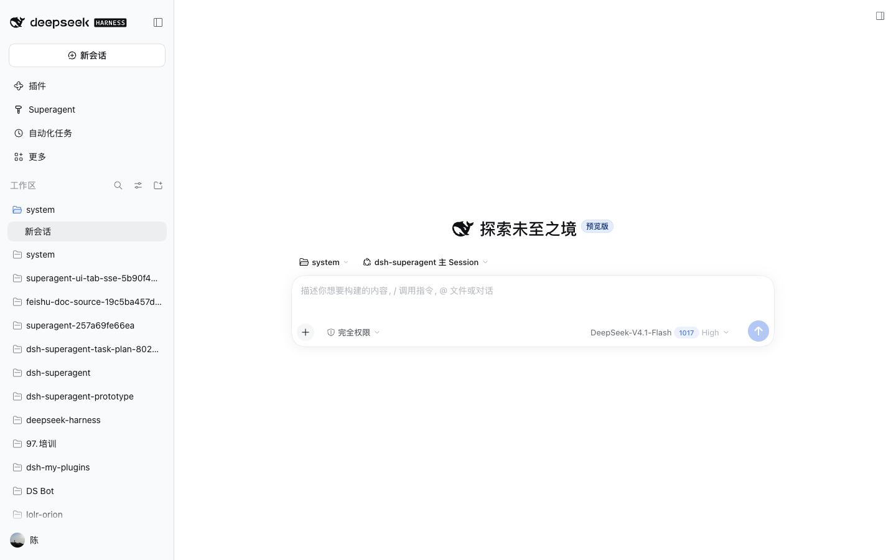
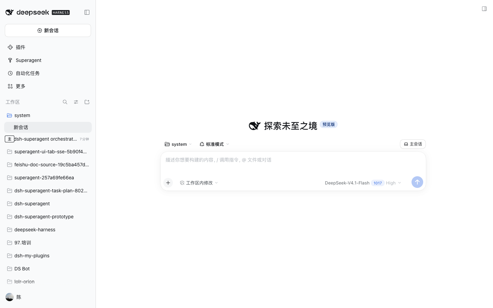
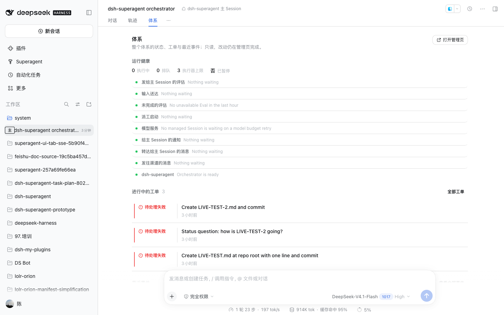
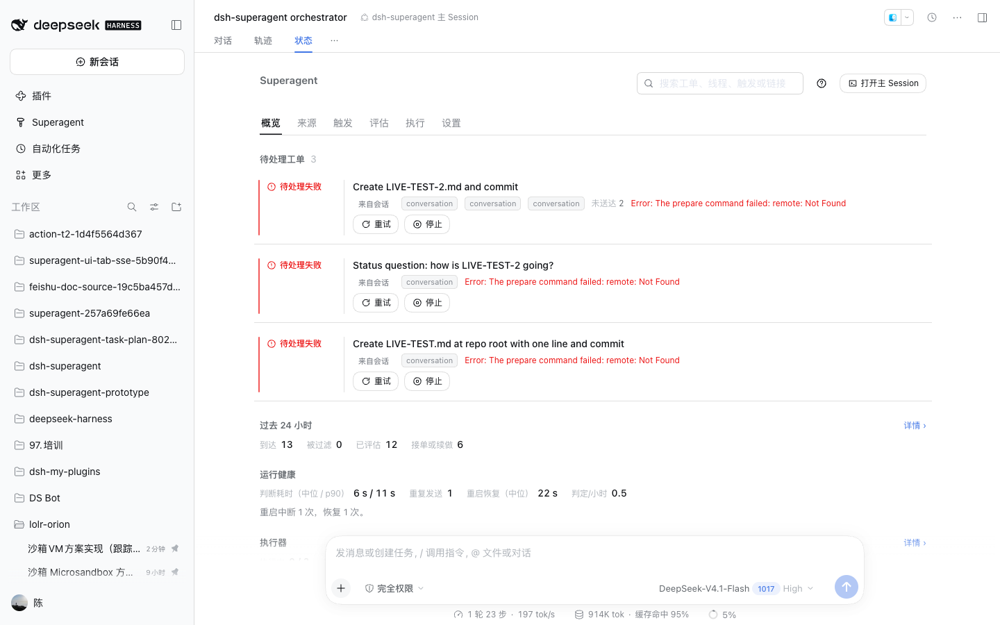
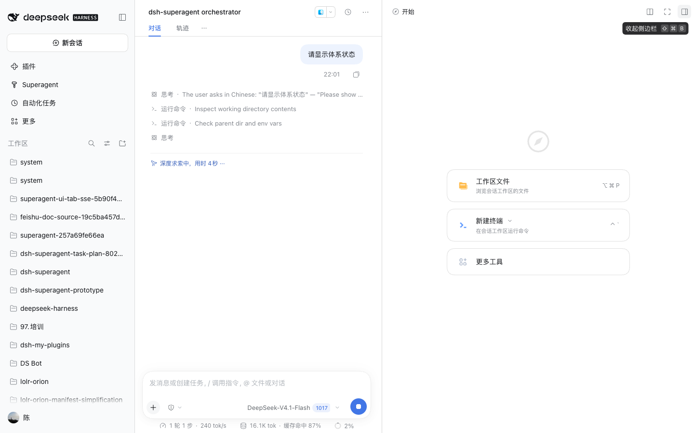
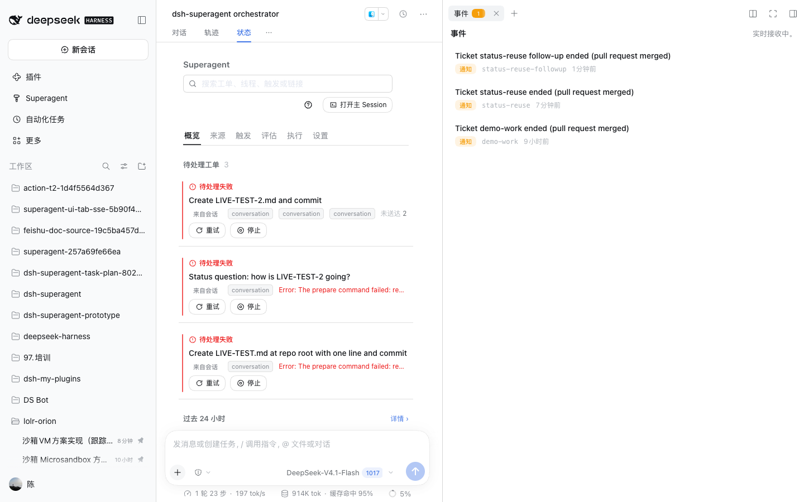
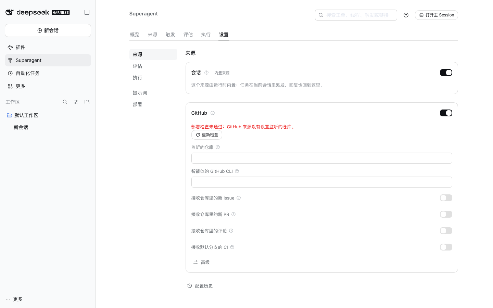
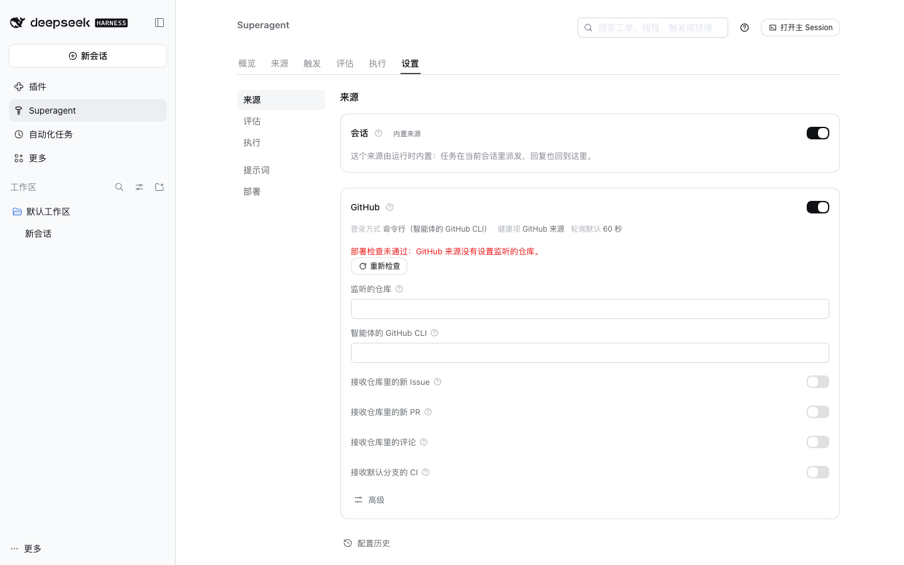

# 005 Panel

Open **Superagent** in the DeepSeek Harness Web sidebar to supervise the agent. The panel prioritizes work that needs a person, then system health and history. This document builds on [000 Philosophy](000-philosophy.md) through [004 Prompts](004-prompts.md).

## Three questions

Opening the panel answers three questions, in this order:

1. Does anything need me now?
2. Is the system healthy and doing the right things?
3. What is the history of one piece of work, from Trigger through Eval to Ticket?

## Tabs

The tabs follow the workflow: **Overview**, **Source**, **Trigger**, **Eval**, **Execution**, and **Settings**. Until repository and account setup succeeds, Overview shows what is missing and links to the relevant setting.

| Tab | Shows |
| --- | --- |
| Overview | Tickets needing action, system problems, activity counts and health figures for the last 24 hours, and Executor load. Each block links to its detailed page |
| Source | Source state, setup problems and non-zero counts. Filtered Triggers and dropped messages cover the same 24-hour window as Overview |
| Trigger | Threads filtered by Subscribed, Evaluating, New Triggers in 24 h, or All Threads. Each Thread shows its Triggers newest first, Decisions and Subscriptions |
| Eval | Decisions with their reason and matched rules |
| Execution | Executor state, Pause processing, and Tickets filtered by Open, Pending, Working, Waiting for a Trigger or Ended. Ticket details show actions, authorization, waiting Inputs, Subscriptions and Assignments |
| Settings | Sources, Eval, Execution, Prompts and Deployment. Each group includes its save history |

### Reading individual records

A dropped message links to its Ticket, or to its Thread when it has no Ticket. The Source page explains whether its conversation disappeared or the Source stopped listening to it.

A human follow-up still owned by an Executor is marked **Delivered to Ticket**, without an Eval. The Thread also shows hand-back reasons and context-only Subscriptions. **Evaluate again** can send that follow-up to Eval, or retry a Trigger with no effective judgement: one filtered by its Source, an unavailable Eval, or a delivered message with neither a non-stop Decision nor an Executor acknowledgement. **Why**, on every Trigger, opens the stages it went through in the order the Engine ran them, from intake to the first report of the work it became, and stops where the trace stops — the gate's reason when it refused the Trigger, and an explicit "still in flight" before the Decision.

Ticket details show the originating Trigger, Decision and reason, scope and Policy version. Assignments and secondary details are folded below the immediate actions. **Retry** is available for failed Input delivery or a Ticket waiting for a person after a blocked or failed Report. Ended Tickets show outcomes such as **Pull request merged** or **Stopped by a person**.

### Work assigned in the conversation

Talking to the main agent is a work entry, but only an explicit assignment becomes a Ticket. The main agent calls `orchestrator_dispatch` with the person's latest message; the message is recorded as a conversation Trigger and accepted by a direct Eval, so the Ticket keeps its Decision, Mandate and audit. Small talk, a status question and the agent's own notices create nothing.

The conversation Source is built in and has no configuration fields; **Source** shows it as **Built in** with a switch and no health probe. **Execution** gains **All origins / From the conversation**, which narrows the Ticket list to work assigned this way. Such a Ticket carries **From the conversation** in the list and on its page, where **Open conversation** returns to the main Session that started it. A status question or follow-up that names the Ticket is attached to it instead of opening a second one; the Ticket page shows the question among its Inputs.

Subscribed Threads appear as anchors on the Ticket page. Each shows its Source facts and last event; **Opened here** marks a Thread the Ticket created, such as its own PR, **External anchor** one that only has a Channel, and a closed anchor carries its outcome. A bound Channel is also listed among the Ticket's Channels and in its Inputs as a binding.

Only the latest message from the person is dispatched. A message that arrived from the agent, a Source notice or a relay is refused, so an obsolete request cannot be revived later.

### Main-Session surfaces

The main Session is the process's single router Session. Four surfaces make it the entry to the system; the Status tab reuses the management page itself so the two cannot drift apart:

- **New Session → Main Session.** The right side of the New Session composer offers **Main Session** (主会话), which selects the existing `masterId` through the Workspace. It never starts another router Session; using it twice returns to the same Conversation. If the Session catalog is not ready, the control disables itself and reports why. The management panel keeps its own **Open main Session** header button as a fallback.
- **The main Session row** carries a compact **Main** (主) badge in its leading decoration. DSH `0.2.1-rc.5` has no trailing decoration on Session rows, so the badge is leading rather than trailing.
- **Status** (状态) is a tab inside the main Conversation. It mounts the existing management page itself — the same header, search, tabs (Overview, Sources, Triggers, Eval, Execution, Settings) and actions as the sidebar panel — rather than a reduced second view. The embedded copy keeps its own page route, so navigating inside 状态 does not move the sidebar panel, and vice versa. Any other Session shows one sentence explaining that the Status page belongs to the main Session.
- **Events** (事件) is a right-pane tab. Its title shows the number of unread `notice`-level events; opening the tab marks the current head seen and persists the cursor in this browser. The tab opens automatically once, when the first unread notice reaches the main Session; later opening and closing stay manual. Rows link to their Ticket or Thread. The tab uses the same-origin SSE stream and falls back to five-second cursor polling when the stream is unavailable; a notice whose result was already relayed by a report stays in the feed without counting as unread.

These surfaces depend on host seats introduced by `0.2.1-rc.5` (`conversation.hero.options`, `conversation.view`, `sidebar.session.row.leading`, `sidebar.right.pane.tab` and its title, and `conversation.session.header.utilities`). Registration runs through `slots.inject`, so a host that does not declare a seat omits that surface and keeps the management panel; nothing throws and no separate business logic or API model is created.

| Surface | Before | After |
| --- | --- | --- |
| Main-Session entry in New Session |  |  |
| Status page (reused management page) in the main Conversation |  |  |
| Events tab with unread title |  |  |

Captured on DSH `0.2.1-rc.5`, same 1440×900 viewport and light theme. For the entry and Events rows, Before is the host without this plugin's surface and After is this branch. For Status, Before is revision `c18d8a6`, where 体系 was a reduced read-only view, and After is this branch's 状态 page, which mounts the existing management page. The Events capture adds one unread notice.

### Health figures

Overview ends with four read-only figures, each derived from the Store: the time from a Trigger to the first Decision about it (median and p90), outbound messages that repeated the same words to one conversation for one ticket, how long work stayed stalled after a restart (median), and judgements per hour. A figure with no samples reads `—` rather than `0`, so an empty Store never looks healthy. `GET metrics` returns the same figures as JSON.

## Settings groups

- **Sources:** one card per Source with its switch, fields and verified account facts. The card derives its fields, sign-in hint, health entries and polling default from the Source manifest, so adding a Source needs no panel code. GitHub also offers receive-all switches for new Issues, pull requests, comments and default-branch CI. Polling and read limits are under Advanced.

| Before (main `9a705f9`) | After (this change) |
| --- | --- |
|  |  |

Same 1440×900 viewport, light theme and Settings › Sources. The GitHub card before shows only its fields; after it also shows the sign-in, health items and polling default read from the manifest.

- **Eval:** the Policy version and rules, followed by **On each Source** and the Eval settings. Each Source tab contains its allowed list, membership sync, admission table and bot list. Sync runs at startup and on **Sync now**. The admission table distinguishes receiving scope, sender membership and whether the message addresses the agent. Eval settings select the accept mode, timeout and assessment model.
- **Execution:** worker model, concurrency, directory root, prepare command and blocked commands. Clicking an available variable inserts it into the prepare command.
- **Prompts:** **Edit** changes team sections, built-in parts and skills. **Full prompt** shows the assembled text and compares it with saved text or defaults. **History** lists versions. Edited built-in parts are marked changed and can be reset; templates list their required placeholders.

  An upgrade that changes an overridden default marks it **Default updated** (默认内容已更新). The panel compares the old and new defaults above the team's text. If the old default was not recorded, it compares the team's text with the new default instead. Choose **Keep my text** or **Use the new default**. Overrides for removed parts are listed below the tab bar and dropped on the next save.
- **Deployment:** startup problems with **Check again**, the state directory and machine limits. Saved limits apply without restart. The DeepSeek Harness Plugin Manager exposes the same page.

## Search

The header search finds Triggers by text, id, Feishu message id or a stored link, such as a GitHub comment URL. A Feishu link missing from the original message becomes searchable only after the host reads it during the current process lifetime.

Search also finds Threads by references such as `#12` or a GitHub URL, and Tickets by title or a matching Thread.

## Principles

1. **Focus on what matters.** Every element answers one of the three questions, or it is removed. A number appears only when it changes what the supervisor does.
2. **Precise definitions.** Categories have checkable definitions, are mutually exclusive and cover every case, as the Ticket stages do. A label says whom a row waits for and what it needs, not an internal status code.
3. **One place per concept.** Source state belongs in Source; Threads and Triggers in Trigger; Decisions in Eval; Tickets in Execution. Settings are grouped by the concept they configure. Overview summarizes these pages and links to them instead of becoming another detailed view.
4. **Domain structure.** The panel uses the domain terms. Internal identifiers appear only in folded details, and names replace identifiers where they can be resolved.
5. **Honest state.** A count equals the length of the list it links to, and no state contradicts another fact.
6. **Quiet by default.** Healthy states take no extra space. Problems must be actionable; a one-off network error is not enough. Rows needing a person offer their action directly. Keep page explanations to one sentence and put further detail in the (?) tooltip. Destructive actions require confirmation.
7. **Consistent controls.** Use DeepSeek Harness design tokens and control behavior. The same information should look the same throughout the panel. Each settings block has one save bar, visible only while changes exist, a save runs or a save fails.
