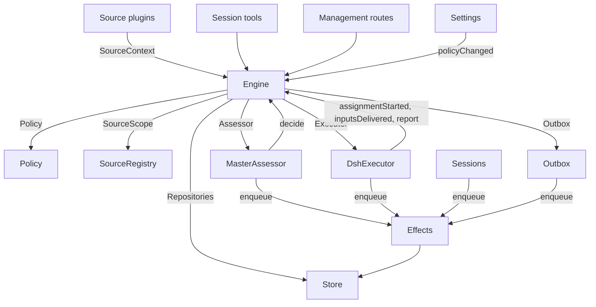

# 007 Architecture

This is the developer guide to the implementation. It maps the concepts in [001 Domain model](001-domain.md) through [006 Deployment](006-deployment.md) to classes, interfaces and files. Start with the runtime and Engine, then use the module and test tables as a code index.

## Core classes and glue

Core classes own domain concepts and external boundaries behind small interfaces. Glue translates tool arguments, HTTP requests, Source payloads and DeepSeek Harness events into calls to those classes, then turns results into cards, views and messages.

`assemble` (`packages/dsh/src/app/assembly.ts`) constructs the application in one explicit dependency order, and `Runtime` (`packages/dsh/src/app/runtime.ts`) owns the state directory, startup and shutdown. `Engine` constructs its own internal parts. The Executor and Assessor call back into the Engine, so Runtime gives them getters rather than requiring construction in a circular order.

### Runtime

`Runtime` is the composition root; it contains no domain rules. Its constructor locks the state directory, opens the Store and builds each component. If construction fails, it closes the Store and releases the lock.

Startup registers management routes and runs Setup. After setup resolves, it installs Session and Executor hooks, ensures the main Session exists, starts Policy syncs, resumes interrupted Assignments, and starts passes and effects. `ready` marks completion of startup.

Shutdown cancels turns, waits for passes, effects and agents, restores the process environment, closes the Store and releases the lock. Source plugins inject Runtime as the `orchestrator` service through the narrow `SourceHost` interface.

| Part | Module | Does |
| --- | --- | --- |
| Setup | `packages/dsh/src/app/setup.ts` | Resolves the repository and the accounts by probing their CLIs the way worker shells run them, writes and applies the workers' environment and command shims, and keeps the setup problems; Settings checks a changed account through it, and restarts through it, which runs setup again |
| Passes | `packages/dsh/src/app/passes.ts` | One pass at a time, every two seconds and whenever a command asks: the due effects, then `Engine.evaluateDue`; a Source's Trigger reaches the Engine through it |
| Outbox | `packages/dsh/src/app/outbox.ts` | The Engine's `Outbox` port, and the only writer of the receipts: `send` keeps a message's receipt and queues its `reply` effect for the end of the Policy's undo window in one transaction, both under the idempotency key of the message's `send` Action, and the effect's handler sends it through `SourceRegistry.send`; before a retry whose earlier attempt may have reached the remote service, the handler asks `SourceRegistry.probe` and only resends when the Source answers `gone`, so a probed Source is never written twice while one without a probe keeps the old retry; `recall` cancels a pending message inside that window and keeps its receipt as `recalled`; a message waits while its Source is off, and is dropped when the conversation is gone or not listened to |
| Notices | `packages/dsh/src/app/notices.ts` | Converts domain events and worker activity into main-Session messages. `eventNotice` handles domain notices, and suppresses a Ticket's end when its latest Assignment's report already gave the outcome or a person ended it, so one outcome costs one notification; `reportRelay` forwards questions immediately, keeps ordinary progress on its Ticket, and relays other reports; `followupRelay` names the Tickets that own a human follow-up. Relays arriving during a turn are delivered together at its next step through the DeepSeek Harness inbox |

### Engine

`Engine` (`packages/kernel/src/engine.ts`) is the only writer of Triggers, Threads, Decisions, Tickets and Assignments. It receives these ports from `packages/kernel/src/ports.ts`: `Repositories`, a current-Policy getter, `SourceScope`, `Assessor`, `Executor` and `Outbox`. Optional dependencies are `prepareTicket`, `now` and `emit`.

All Engine methods are synchronous. Each command changes its aggregates in one transaction. `evaluateDue` uses a separate transaction for each Eval or Ticket it changes. Ports enqueue external work inside the transaction; adapters perform it after commit. Invalid requests throw `UserError`.

The Engine exposes one entry point and delegates to five internal parts. It owns each command's transaction. Commands spanning parts, such as `attach`, `evaluateDue` and `policyChanged`, call the parts in sequence.

Each part extends `EnginePart` (`packages/kernel/src/part.ts`), which provides options and shared reads. Dependencies between the parts flow in one direction:

| Part | Responsibility | Depends on |
| --- | --- | --- |
| `Intake` | A Source's Trigger: stored once with its disposition, recorded on its Threads and their correlations, fanned out to the subscribed Tickets and, unless it is a person's message that reached one, queued for Eval on its primary Thread | Tickets |
| `Evals` | The Evals of Threads: batching, the gate's strength, actor and basis with the Trigger that gave them (`primary`), the deadline from the candidate's delivery and its shift by a pause, the requeue of an expired Eval, candidates, replays and hand-backs, the requeue on a Policy change, and the Decision each ends with: accept, stop, ignore or unavailable | Tickets |
| `Tickets` | The Ticket lifecycle: creation from an accept with its Mandate, Subscriptions and first Assignment, the Threads it follows and their closes (`followsDone`), attached Threads and Threads followed for context, Inputs and notes, resume and the messages a resume refuses, retry, restart, stop and end, the Subscriptions it drops, and the notice of a Policy change to the Tickets it bears on | Replies |
| `Assignments` | What the Executor and its workers report: an Assignment started, Inputs reached it or failed to, a restart interrupted it, and a worker's Report with its question for a person | Tickets, Replies |
| `Replies` | Channel writes through the `Outbox`: the acknowledgement, the answer, the result and the attention message, each by the rule that allows it | Nothing |

Commands use imperative names such as `stopTicket`; facts reported by adapters use past-tense names such as `assignmentStarted`. The query `candidate` uses a noun.

Callers receive only their role's `Pick` of the Engine: `EngineForSources`, `EngineForMainSession`, `EngineForPeople`, `EngineForSettings` or `EngineForExecutor`.

| Role | Method | Effect |
| --- | --- | --- |
| Sources | `receive(trigger)` | Stores a Trigger once and answers `stored`, `duplicate`, or `filtered` when no Source receives it; fans it out to the Tickets subscribed to its Threads, where a person's message resumes an ended Ticket at once unless processing is paused, and queues it for Eval on its primary Thread, unless it is a person's message that reached a Ticket, which stays that Ticket's |
| Sources | `bindThread(ticketId, thread, own)` | Makes an open Ticket follow one of the Source's Threads, such as a pull request's, `own` when the Ticket opened it; a closed Thread bound again is open again. The Threads' closes, not a `ready` Report, end the Ticket |
| Sources, Main Session | `bindChannel(ticketId, channel)` | Adds a Channel from another Source to an open Ticket and subscribes it to that Channel's Thread, without making the Thread a state point, recording a `binding` Input. The caller checks that the Source is enabled and the address may receive replies; repeating the binding changes nothing |
| Sources | `threadClosed(thread, outcome, at)` | A Thread closed: each open Ticket that follows it records the close, and ends once it is done with the Threads it follows (`followsDone`): no Thread it opened is open, or, when it opened none, every Thread it follows closed. It ends `merged` or `closed` as the latest of those closes did, unless work resumed after the close has not reported `ready`, or its Executor took up, by acknowledging or answering it, a person's follow-up it decides after its latest Report other than `progress`, or the end of its last turn; a `dropped` Report then ends it as the close did |
| Main Session | `candidate(triggerId)` | The Eval that holds a Trigger, as its assessor sees it |
| Main Session | `candidateDelivered(evalId)` | The Eval's candidate reached the main Session: its deadline counts from now |
| Main Session | `decide(triggerId, outcome)` | Records an Eval Decision, or a direct Decision for an explicit request. Accept creates the Ticket, Mandate, Assignment, Subscriptions and acknowledgement atomically. An inferred candidate ignored from its card records `ignoredFromCard` before the supplied reason. While `followupOwners` still owns a human follow-up, only stop is allowed |
| Main Session | `attach(ticketId, triggerId, note?)` | Routes a Trigger to a Ticket it points at, whose Executor then decides it as a follow-up, and ends the Eval that holds it, whose other Triggers wait for a fresh Eval; an ended Ticket resumes under its Mandate at once unless processing is paused. A follow-up an Executor still decides is refused, as is one routed back to the Ticket that handed it back |
| Main Session | `requestStatus(ticketId)` | Asks a waiting Executor Session for its status, and answers whether it asked |
| Main Session | `note(ticketId, text)` | Gives a Ticket's Executor a fact from other work as a text Input, which grants nothing |
| Main Session, Executor | `reply(request)` | Queues a message for the Channel its purpose names: `acknowledgement`, `answer`, `result` or `attention` |
| People | `stopTicket(ticketId, reason?)` | A person's stop, which withdraws the Mandate |
| People | `retryTicket(ticketId)` | Ends the stalled Assignment of a Ticket that waits for a person after a `failed` or `blocked` Report, or whose Input delivery failed (`canRetry`), and starts a new one |
| People | `reviewTicket(ticketId, by, reviewRevision)` | Accepts the root Ticket's current review aggregate at that revision and records who accepted it; refused when the Ticket is a child (`childRequiresParent`), has unresolved child Tickets (`unfinishedChildTickets`), is not awaiting review (`reviewNotReady`), has no deliverable (`deliverablePreviewMissing`) or the revision is stale (`reviewStale`) |
| People | `reevaluate(triggerId)` | Queues a stored Trigger for a fresh Eval |
| People | `unsubscribe(thread)` | Drops every Subscription on a Thread, and the Tickets that followed it follow it no more; each keeps deciding the follow-ups it received there |
| People | `dismiss(decisionId)` | Dismisses the problem an `unavailable` Decision shows, which the Decision records |
| Executor | `assignmentStarted(ticketId, assignmentId)` | An Assignment runs; its waiting Inputs go out |
| Executor | `inputsDelivered(ticketId, assignmentId, inputIds)` | Inputs reached the Assignment's Executor Session, where each waits for a step to take it |
| Executor | `inputsRead(ticketId, inputIds)` | The Executor Session took the messages that carry these Inputs into its history (a `user/message` Session event), from which its model has them; a step that claimed them and was cancelled or failed before does not count. Each counts as read once a Report or the end of a turn follows, also after a restart, and its Ticket's end does not let go of it; an Input delivered before reads were recorded counts as read once a Report or the end of a turn followed its delivery |
| Executor | `turnEnded(ticketId, assignmentId)` | A turn of the Executor Session ended, also after a Report, once nothing runs for it in the background or as it hands off to a person. What a step took before, it read (`inputsRead`) |
| Executor | `deliveryFailed(ticketId, assignmentId, error)` | Delivering Inputs failed; the Ticket shows it until a delivery succeeds, a new Assignment starts or the Ticket ends |
| Executor | `report(ticketId, report)` | Records a Report and its question for a person; a ready Report's optional deliverable is normalized by `enterReview` and kept with the revision; `dropped` ends the Ticket, and `ready` completes one that follows no Thread, and ends one done with the Threads it follows as they ended |
| Executor | `markUnrelated(ticketId, thread, reason)` | Drops only that Ticket's Subscription to an attached Thread it found unrelated, and hands back, with the reason, the follow-ups there that the Ticket decides |
| Executor | `followForContext(ticketId, thread)` | Subscribes an open Ticket to a related Thread for context: its messages reach the Ticket but lend it no follow-up strength and do not resume it |
| Executor | `handback(ticketId, triggerId, reason)` | Records that the Ticket hands back a Trigger that reached it, with the reason its candidate carries, and queues it for a fresh Eval once no other Ticket decides it, if this Ticket did; it answers whether it queued it. A Ticket hands back each Trigger once and keeps its Subscription |
| Executor | `assignmentInterrupted(ticketId, assignmentId)` | An Assignment was running when the host stopped: one interrupted mid-work, or one that received an Input after its latest Report, starts again with a recovery note and the Inputs delivered to it that its Executor Session did not take, as a retry does; one that had reported since keeps its Session. The DshExecutor reports each at start (`resume`), oldest Ticket first, and queues again a launch that waits |
| Passes | `evaluateDue()` | Unless processing is paused: starts the Evals of the Threads whose queued Triggers wait, one per Thread with the Triggers queued meanwhile as one batch; queues the Triggers of an Eval past its deadline again, twice in a row, and records it `unavailable` the third time; and resumes the ended Tickets a person's message reached during a pause, if their Mandates still hold. An Eval whose candidate has not reached the main Session does not expire. While processing is paused, no Eval expires, and once it resumes each deadline moves later by the pause's length |
| Settings | `policyChanged(from, to, effects)` | Tells each live Ticket the change bears on how (`policyEffects` in `packages/dsh/src/policy.ts`: a rule it was accepted under changed or no longer applies, its requester may no longer start work, or proactive work is no longer accepted), and restarts the Evals in progress under the new version |

The Engine keeps batching, authorization, fan-out, resume and attention lifecycle rules private. Several shared predicates make these rules consistent:

- `waitsForPerson` (`packages/kernel/src/model.ts`): the latest Assignment reported `blocked` or `failed`, and no human message has arrived since. Automatic Inputs and failed launches remain held while this is true.
- `followupOwners`: the Tickets still responsible for a human follow-up received on their own Threads. A Ticket can be live or ended without a human stop and waiting to resume. Handing back the message ends that ownership.
- `settled`: a Decision resolved the request; stop, unavailable, routed and refused-stop Decisions do not count.
- `ticketStage` (`packages/kernel/src/stage.ts`): implements the stage table in [003 Execution](003-execution.md).

When a Ticket ends, unread follow-ups return to Eval unless another Ticket still owns them or another disposition settled them. Acknowledged, answered and handed-back messages are excluded. For older records without acknowledgement dispositions, the outbox receipt supplies that fact. A final Report also covers messages waiting when the Assignment began, including the message that resumed it. The message that stopped a Ticket is not automatically re-evaluated.

After a change, the Engine emits an event from `DomainEvents` in `packages/kernel/src/ports.ts`:

`trigger.received`, `eval.started`, `decision.recorded`, `ticket.created`, `ticket.resumed`, `ticket.ended`, `assignment.started`, `assignment.ended`, `thread.subscribed`, `thread.unsubscribed`, `trigger.requeued`, or `policy.changed`.

Runtime turns `ticket.ended`, `trigger.requeued` and `thread.unsubscribed` into notices. A human `trigger.received` delivered to Tickets becomes a follow-up relay. `pullEndNotices` sends one chat notice, using a stable id, when a Ticket ends merged or closed. Other events currently have no consumer.

### Model

`packages/kernel/src/model.ts` holds the domain types, and `packages/kernel/src/stage.ts` the Ticket stages. A Decision records why as `reason`, a list of `Reason`s (`packages/kernel/src/reasons.ts`): each a `code` with its `values` and, for one Trigger of a batch, its `triggerId`.

The core's codes, such as `timeout`, `policyChanged`, `routed` and `startedTicket`, are `REASONS`, with the English that agents read through `reasonText`; a gate or a Source scope gives its own, such as `not_a_member`; and `said` carries words an assessor or a person wrote. The panel words each code by `reason.<code>`, and a Trigger a Source filtered records the Source's code the same way.

A Ticket keeps each fact once. It is open while it has no `ended`, which records when, by whom, why and with what outcome it ended; what it last said is its latest Assignment Report (`latestReport`); and its Executor Session is named after it (`workerSessionId` in `packages/dsh/src/executor/dsh.ts`).

Its fields are typed: `origin`, the admissible Trigger that gave its Eval's batch its strength and the batch itself (`triggerId`, `triggerIds`); `execution`, what the Executor chose (`name`, `directory` and `assignment`); `delivery`, the last failed Input delivery (`error`, `at`), until a delivery succeeds, a new Assignment starts or the Ticket ends; and `follows`, the Threads a Source made it follow, each `{thread, own, closed?}`: `own` when the Ticket opened it, and `closed` with `at` and `outcome` once it closed. Tickets alone writes `follows`; the GitHub Source reads its pull requests with `pullsOf` and `pullOf` (`packages/dsh/src/sources/github-pull.ts`).

An Input that carries a Trigger records whether a person wrote it, which `waitsForPerson` reads. A Thread also lists in `context` the subscribed Tickets that follow it only for context, and counts in `expired` the Evals of its queued Triggers that expired in a row; an Evaluation records its `primary` Trigger and when its candidate was `delivered`.

A Trigger's disposition records the Tickets it reached, by fan-out or attachment, a person's requeue, each Ticket that handed it back, with the reason, and each Ticket whose Executor acknowledged or answered it.

A Mandate's `basis` (`MandateBasis`) records how the gate admitted its Trigger. Revalidation reads the receiving `source`, `scope` and `row`, the listed `sender`, matched `rules`, and `via`. A Mandate also records `maxActionLevel` and, when the Policy sets a lifetime, `expiresAt`; action-time revalidation checks both alongside the basis.

| `via` | Admission basis |
| --- | --- |
| `addressed` | An allowed sender addressed the agent |
| `followup` | A message arrived on a Thread with Tickets |
| `admission` | An admission-table cell; `observation` marks an inferred candidate |
| `bot` | A listed bot produced an inferred candidate |

Trigger and Thread `meta` belong to the Source. The core does not interpret them.

### Policy

`packages/dsh/src/policy.ts` defines settings schemas, authorization and assessment rules. `settingsPolicy(settings, scope)` returns a fresh, stateless `Policy` on each use:

- `version`, `paused` and `evalTimeoutMs` describe its current state.
- `gate(trigger, thread, tickets)` returns admission strength and basis.
- `revalidate(mandate, at, action?)` checks whether an existing Mandate still holds at `at`; it always enforces the Mandate's expiry and, with an action, its level, and it returns `{ ok: true }` or the `reason` a caller records.
- `mandateLimits(at)` gives a new Mandate its maximum action level and, when the Policy sets a lifetime, its expiry.
- `admitsInferred(rules)` permits proactive acceptance only in auto mode with enabled matching rules.

`assessmentOutcome(assessment, settings, strength)` converts the model's assessment to an Engine outcome. It requires a judgement for every enabled rule, settled direction, a matching rule and evidence of intent. Outside auto mode, an inferred accept becomes a “would accept” record.

`policyEffects(tickets, old, now, at, scope)` identifies which open Tickets a change affects and how. `Engine.policyChanged` notifies only those Tickets. `policyVersion` hashes rules, accept mode, the action ceiling and Mandate lifetime, and the Sources' Policy parts, including bot lists. The `approval` block's tenant and per-Source auto-approval rules are settings for later approval requests, not part of that hash, as the undo window is not.

### Store

`Store` (`packages/dsh/src/app/store.ts`) owns one SQLite database. Runtime acquires the directory lock before opening it, preventing a second process from migrating or writing the same state.

Its interfaces are grouped by purpose:

- **Domain repositories:** `atomic`, plus `triggers`, `threads`, `tickets`, `decisions` and `approvals`, each with `get`, `save` and list queries. Indexed working sets are `threads.active()`, `tickets.open()`, `tickets.active()`, `approvals.pending()`, which leaves out requests past their expiry, and `read.subscribedThreads`.
- **Read queries:** `read` serves views, tools and Source polls through methods such as `threadTriggers`, `triggerStats`, `search` and `droppedReplies`. These methods never write.
- **Source metadata:** `threads.describe` and `threads.patchMeta` update Source-owned Thread metadata.
- **Settings:** `settings`, `saveSettings`, `blockRevision` and `settingsHistory`. Settings and prompts use numbered `Versions` (`packages/dsh/src/app/versions.ts`).
- **Outbox receipts:** `replyStatus` and `receipts`, written only by Outbox. Receipt operations are `get`, `waiting`, `behind`, `add`, `attempt`, `settle`, `recall` and `withdraw`. Each receipt is stored under the idempotency key of the message's `send` Action: its Channel's Source, the object written on, the message kind, its content revision and the outbox actor. Two revisions of one write are therefore two receipts and two effects, while a replay of one revision keeps the first receipt. A pending receipt records the end of its undo window (`dueAt`), the window it used (`windowMs`), and the start of an attempt whose outcome is not yet known (`attemptedAt`), which makes the next try probe the Source first; `recall` changes it to `recalled` only before `dueAt`, while `withdraw` cancels any still-pending receipt, such as one whose retries keep failing after the window. Both cancel the message's `reply` effect. A send already in flight when the receipt is withdrawn settles it to what actually happened, so a receipt can move from `recalled` to `sent` or `dropped` in that race. Receipts without a window, such as those migrated from earlier versions, cannot be recalled. `behind` checks whether an earlier message for the same Ticket and conversation is waiting with fewer than three failures. A message whose conversation is gone or not listened to settles with `channelGone` or `channelIgnored`. Read queries expose failed and dropped replies through `failingReplies`, `droppedReplies` and `droppedSince`.
- **Typed key-value records:** `get`, `set`, `delete` and `keys`, using entries from `KV`.

`afterCommit` runs an action only after the transaction commits, never after rollback. Runtime reads records in their stored shape; the migration converts older supported records at startup. Schema 12 added the `span` table, schema 13 the `activity` table, schema 14 the `approval` table, schema 15 the ticket tree's generated `parent`/`root` columns and indexes, and schema 16 the additive `space_lease` table, without rewriting records: a database at schema 11 or 10 opens at 16 with its records untouched, and old ticket rows read as authorization roots.

### Effects

`Effects` (`packages/dsh/src/app/effects.ts`) is the durable side-effect queue. A command calls `enqueue(kind, key, payload, due?)` inside its transaction; execution begins only after commit. `due` schedules the row for later and defaults to now; Outbox uses it for the end of a message's undo window. For `reply`, the key is the message's `send` Action idempotency key, so the effect row follows the same `(source, objectId, action, revision, actor)` identity as its receipt.

Each kind/key pair has one row. Enqueuing the same waiting key replaces its payload and its due time without changing queue order. `handle(kind, run, options)` registers one handler per kind. It processes due rows oldest first, up to the concurrency limit.

Failures retry with exponential backoff. Throwing `Later` defers work without counting a failure, for example when no worker slot is available. `start` begins processing after setup, `drain` stops it during shutdown while preserving pending rows, and `pending`/`idle` expose queue state.

| Kind | Handler | Does | At once | Retry |
| --- | --- | --- | --- | --- |
| `assessment` | MasterAssessor | Steers an Eval's candidate card into the main Session's turn, then tells the Engine it was delivered, which starts the Eval's deadline | 4, none while paused | 2 s doubling to 60 s |
| `launch` | DshExecutor | Launches a pending Assignment: prepare command, Executor Session, assignment message | The free worker slots, none while paused | A passing failure of the model provider or the network runs again after 5 s doubling to 300 s, three times; any other failure, and a failed prepare command, fails its Ticket. One held by a pause or by full worker slots tries again after 5 s |
| `delivery` | DshExecutor | Hands a Ticket's waiting Inputs to its running Assignment, in order | 4, none while paused | 2 s doubling to 60 s; one that waits for a worker slot tries again after 2 s |
| `relay` | Sessions | Steers a worker's report or question, or a person's follow-up, into the main Session's turn | 1, in queue order | 2 s doubling to 60 s |
| `notice` | Sessions | Injects a notice into the main Session without waking it | 1, in queue order | 2 s doubling to 60 s |
| `reply` | Outbox | Sends a message for a Channel through its Source at the end of its undo window, after the earlier messages of its Ticket to its conversation that have not failed three times; recalling the message inside the window cancels it | 1, none while paused; the undo window holds the row without consuming a slot | 5 s doubling to 300 s; one whose Source is off, or behind an earlier message, tries again after 5 s |

Each kind has a health entry under its name. It reports an error once one of its effects failed three times in a row, except `delivery`, whose failures show on their Ticket instead. Relays keep their order, and so do notices; a failed one holds back the later ones of its kind.

### Sources

Sources extend the host through a `SourceDefinition`, defined in `packages/dsh/src/sources/kind.ts`: the kernel's declarative `SourceManifest` (identity, title, description, sign-in, settings `fields`, `health` entries and optional polling `limits`) plus the runtime `SourceAdapter` (configuration `schema`, derived `facts`, and optional behavior). `SourceRegistry.registerDefinition` validates the manifest and registers the pair; the flat `SourceKind`, which declares its identity and fields itself, is the migration view T1-10 retires. Optional adapter behavior includes `scope`, a `channel` (`allowed`, `send`, `probe`, `withdraw`, `link`), `threadContext`, `find`, `repliesTo`, `policy`, `environment` and `refreshLabels`.

`SourceRegistry` (`registry.ts`) owns registered kinds and stored instances, and implements the Engine's `SourceScope`. Registration claims health entries on `HealthBoard`; duplicate claims and reserved `sync:` names are refused. A SourceContext writes only through its registration's claimed entries, so reports after unregistration do nothing.

Registry configuration methods include `kind`, `instances`, `instance`, `validate`, `validatePolicy`, `policyPart`, `channelAllowed`, `declarations`, `environments`, `find` and `scope`. `find` asks each kind that supports search.

Generic code accesses Source behavior through the registry. `send(message, commands)` calls the kind's Channel and returns `sent`, `gone` or `waiting` if the kind is not installed. `probe(message, commands)` asks the Channel whether the message already arrived, or answers nothing when the kind has no probe. `withdraw(message, commands)` takes back a message already sent when the Channel declares a `withdraw` adapter, and answers nothing when it does not, so an absent adapter never reads as a withdrawal. `link` resolves its Channel link. `threadContext` pairs a kind's reader with its configuration, or returns nothing when the kind has no reader. Invalid stored configuration disables the instance.

Plugins receive `SourceHost`: the registry and `context(kind)`. The kind itself uses a narrower `SourceContext`, built by `sourceContextOf` in `packages/dsh/src/app/source-context.ts`.

That context supplies deployment and commands, setup readiness (`ready`, `configured`, `problem`), configuration, `receive`, `atomic`, and typed `state`. It also exposes Thread reads and metadata writes, Ticket reads and binding/closure commands, Trigger reads, `notify` through Outbox, and `report` for declared health entries.

### DshExecutor

`DshExecutor` (`packages/dsh/src/executor/dsh.ts`) provides one Session and directory per Ticket. `start` and `deliver` enqueue `launch` and `delivery` effects. `stop` cancels the turn through `Store.afterCommit`, so a rolled-back end does not stop the worker.

`prepare(ticket, outcome)` supplies the Engine's `prepareTicket` hook: short name, directory and `ticketExecution` assignment text. `workerSessionId(ticket.id)` derives the Session id.

`WorkerSlots` reserves capacity before a launch or a delivery that wakes an idle worker. A human message can use one slot beyond `maxWorkers`, and wakes have priority over launches. `activeCount` supplies panel load.

Transient provider and network failures get three retries. Launches use effect backoff; failed turns receive continuation messages after 15, 30 and 60 seconds. `inputMessage` renders each Input from current Ticket state, and `mandateInstructions` adds the matched-rule limits for inferred work.

`install` subscribes to Session events; `dispose` unsubscribes. A turn end normally reports waiting, except after readiness or while human action is required. Errors report failed. At startup, `resume` reports interrupted Assignments through `assignmentInterrupted` and requeues pending launches that do not wait for a person, oldest Ticket first.

Before a launch touches the workspace, `ContextAssembly` builds the six dimensions from facts the host already has, records the read-only snapshot through `Engine.contextAssembled`, writes a `context` trace stage, and either passes the entries to the first message or reports `blocked` with a question. The assembly never authorizes an action; the message and its snapshot carry references only.

### MasterAssessor

`MasterAssessor` (`packages/dsh/src/app/assessment.ts`) lets the main Session assess proactive candidates. `request` queues an assessment effect; `release` drops cached state when its Eval ends.

Its `context`, `read` and `decide` methods serve `orchestrator_eval`, `orchestrator_eval_read` and `orchestrator_eval_decide`. They provide bounded Thread context through `SourceRegistry.threadContext`, repository context, and decision submission. A kind without a context reader supplies only the Trigger and batch.

`assessmentOutcome` converts the model's answer for `Engine.decide`. Evals checks inferred acceptance against the current Policy again.

### Settings

`Settings` (`packages/dsh/src/app/settings.ts`) reads and writes revisioned settings blocks. `current` and `view` read them; `save(block, value, revision, origin)` validates a save; `pause(paused, origin)` changes the separate `paused` setting.

Every save declares its origin: `panel`, `tool` or `sync`. Only `panel` can change the execution environment or fields listed in `SETUP_FIELDS` (`packages/dsh/src/deployment.ts`).

A Policy-version change calculates `policyEffects`, records which Tickets were notified, and calls `Engine.policyChanged`. `syncable` and `sync(id)` refresh a Source's Policy part. `refreshLabels(id)` refreshes display names.

### Prompts

`Prompts` (`packages/dsh/src/app/prompts.ts`) stores configurations as `Versions`. `current`, `version` and `history` read them; `validate`, `preview` and `save(value, baseRevision, source)` check and save them. `compose` and `skills` build Session text.

`builtInParts` lists override keys, roles, default text and required template placeholders. Each override stores team `text` and a `base`: the `builtInBase` key of its original default. Saves preserve that default under `KV.prompts.builtIn`. `defaultChanged` then reports changed defaults, their old text when available, and removed parts.

Validation inherits an omitted base from the saved override, drops removed parts already present in saved data, and rejects blank text or other unknown keys. This allows the save tool to round-trip a configuration it read. `environmentSection` and `policySection` substitute template values once, using own keys only. Configurations without overrides use defaults.

### Sessions

`Sessions` (`packages/dsh/src/app/sessions.ts`) manages DeepSeek Harness Sessions for both roles. `ensure` creates a Session with its role's model. `install` follows agent events and registers prompts, skills and tools for managed Sessions.

`prompt` delivers once per request id. `relay` and `notify` enqueue main-Session messages handled by the `relay` and `notice` effects. `packages/dsh/src/app/notices.ts` defines their content; `delivery` checks whether a message arrived.

Each model request binds the Session to the current prompt revision. The revisions it used are stored durably: `promptVersion` identifies the active one and `mayRead` restricts which versions a worker can inspect. Registrations are tracked in one map per agent.

`status` and `promptVersion` serve prompt pages. Saves go through `Prompts.save` and notify the main Session. `modelRetry` exposes model-budget retry state.

### Glue

| Glue | Translates |
| --- | --- |
| `packages/dsh/src/app/runtime.ts` | The composition root: builds the parts with the interfaces they use, registers the routes and the Source host, and starts and stops dsh-superagent |
| `packages/dsh/src/app/notices.ts` | Domain events and worker reports into notices and relays for the main Session, under the one-notification-per-outcome budget |
| `packages/dsh/src/app/activity.ts` | Domain events into graded activity records for the system view, their presentation into tasks, origins, states and durations (reviews join the Ticket they review through the shared ownership derivation), and the rule that says when an end was already told |
| `packages/dsh/src/app/tools/main.ts`, `packages/dsh/src/app/tools/executor.ts` | Tool arguments of the main Session and the Executor Sessions into calls of the core classes, and their results into cards |
| `packages/dsh/src/app/http.ts`, `packages/dsh/src/app/views/`, `packages/dsh/src/app/api.ts` | HTTP requests into calls, and Store reads into the panel's views; `api.ts` types every route for the panel |
| `packages/dsh/src/app/resources.ts`, `packages/dsh/src/app/links.ts`, `packages/dsh/src/app/cards.ts` | Resource names into reads, source messages into links, records into compact cards for models |
| `packages/dsh/src/sources/github*.ts`, `packages/dsh/src/sources/feishu*.ts`, `packages/dsh/src/sources/poll.ts` | GitHub and Feishu payloads into Triggers and Thread facts, and messages into CLI calls |
| `packages/dsh/src/deployment.ts`, `packages/dsh/src/setup.ts`, `packages/dsh/src/infra/` | Setup probes and problems, CLI transport, the agent's process environment |

## Dependency rules

- **Explicit, narrow dependencies.** Each class receives an interface that names what it uses, mostly as `Pick` types of other classes: `ExecutorHost`, `AssessorHost`, `SessionsHost`, `SettingsHost`, `SetupHost`, `PassesHost` and `OutboxHost` for the core classes, and `HttpHost`, `MainToolsHost`, `ExecutorToolsHost`, `ResourceHost`, `LinkHost` and `SourceContextDeps` for the glue, with the Engine as the `Pick` of the role that calls it. The Runtime passes itself only behind such an interface. A Source plugin injects the `orchestrator` service, which its type names as a `SourceHost`: the registry and `context(kind)`; its kind's code sees only its `SourceContext`.
- **What may import what.** `packages/kernel` (`@superagent/kernel`) imports nothing outside itself apart from Node's hashing, and does no I/O; `.dependency-cruiser.mjs` enforces it. `packages/dsh/src/sources` imports nothing from `packages/dsh/src/app`. The bundle's `meta/` entries import only the runtime's exported package entries, by name, never by relative path, and only to re-export them. The panel imports only types from the host side, and the plain values of `packages/dsh/src/admission.ts`, `packages/dsh/src/limits.ts`, `packages/dsh/src/setup.ts`, `packages/dsh/src/navigation.ts`, `packages/dsh/src/sources/host.ts`, `packages/kernel/src/errors.ts`, `packages/kernel/src/reasons.ts` and the filter lists of `packages/dsh/src/app/api.ts`.
- **One writer per state.** Each kind of state has one writer, and the others read it or ask that writer.

  | State | Writer |
  | --- | --- |
  | Triggers, Threads, Decisions, Tickets, Assignments | Engine |
  | A Source's read positions, and the meta it keeps on its Threads (`label`, `url`, `facts` and its own keys) | That Source, through `SourceContext` |
  | Settings and their history | Settings |
  | Prompt versions | Prompts |
  | Effect rows | Effects |
  | Outbox receipts | The Outbox: the Engine's messages and Sources' `notify` go through its `send`, and its `reply` effects mark them |
  | A health entry | The part that claimed it on the `HealthBoard` (`packages/dsh/src/infra/health.ts`), which refuses a second claim: `runtime` the Runtime, which Passes report through, `evals` the Runtime after each pass, `models` Sessions, each effect kind Effects, `worker` the DshExecutor, a Source kind's entries the SourceRegistry for that kind's Source, `sync:<id>` Settings |

  A Source changes a Ticket only through `SourceContext.tickets.bindThread` and `threadClosed`, which call the Engine.
- **Requests and facts.** A method that asks for something is named by an imperative verb and its object, such as `stopTicket` or `bindThread`, and may be refused; a method that records what an adapter did is named in the past tense, such as `assignmentStarted` or `deliveryFailed`. Each host receives the Engine as the role type it needs.
- **Typed fields, and Source data under the Source.** The code reads typed fields of Tickets and Mandates. A Source keeps nothing on a Ticket: which of its Threads a Ticket follows is the Ticket's `follows`, and what it keeps about a Trigger or a Thread is in their `meta`.
- **Fixed refusals.** A refusal a person or an agent can cause is a `UserError(code, values)` from `USER_ERRORS` in `packages/kernel/src/errors.ts`. The management API answers a `missing` code with 404 and the others with 400, and the panel words each code in its language. Setup problems are `SetupError` codes (`packages/dsh/src/setup.ts`) and fixed health texts `HealthCode`s (`packages/dsh/src/sources/host.ts`), worded the same way.

### Architecture checks

[`.dependency-cruiser.mjs`](../.dependency-cruiser.mjs) encodes the import rules above as errors: the kernel imports only its own files and `node:crypto`, the runtime never depends on the bundle, `meta/` entries only re-export the runtime, Sources never import the host, the panel takes host modules as types and the documented plain values as values, `packages/` is entered by package name rather than by relative path, and the browser half imports no Node built-in. The rules run in `pnpm check:arch`, which `pnpm check` and the `check` CI job run. `pnpm check:api` renders the management API's JSON Schema artifact from `app/api-contract.ts` and compares it with the committed `app/api.schema.json`, so a contract change that forgets to refresh the published schema fails the same gate; `tests/api-contract.spec.ts` also proves every contract route has one handler.

`tests/dependency-rules.spec.ts` is the reverse test: every rule has a deliberately violating file under `tests/fixtures/dependency-rules/violations`, so a rule that stops matching fails the suite, while the `clean` fixture asserts the allowed imports produce no violation. The spec also keeps the two rules the tool cannot express as path rules: the kernel manifest declares no dependency at all, and the panel's value import from `app/api.ts` names only its filter constants.

**Retiring the old scanners (X-02).** `tests/layers.spec.ts` and `tests/kernel-boundary.spec.ts` still run for one release, so both scanners agree while the tool is new. They are deleted in the release after the one that first ships `.dependency-cruiser.mjs`; the checks they alone carried (the kernel manifest and the filter-constant bindings) already moved to `tests/dependency-rules.spec.ts`.

### Lint

[`eslint.config.mjs`](../eslint.config.mjs) is the lint gate, run as `pnpm lint` by `pnpm check` and the `check` CI job. It uses ESLint 10 with `typescript-eslint` 8 and the project service, so the same TypeScript program that `pnpm typecheck` builds also answers the type-aware rules. ESLint was chosen over oxlint because the defects this repository most needs caught are type-dependent — a floating promise, a promise passed where a `void` callback is expected, and `await` on a non-promise — and `typescript-eslint` implements those as its long-standing checked rules. [Oxlint's type-aware linting](https://oxc.rs/docs/guide/usage/linter/type-aware) is newer and would add a second type engine to a repository where lint already takes under ten seconds, so its speed advantage does not pay for that duplication.

The check covers `packages/kernel`, `packages/dsh`, `meta/`, `scripts/` and `tests/`. `scripts/**/*.ts` is part of the `tsconfig.json` include, so a new standalone script also has a program for the type-aware rules. The rule set is deliberately about defects:

- `eslint:recommended` and `typescript-eslint:recommended`: unused declarations (type positions included), explicit `any`, unused expressions, `ban-ts-comment`, duplicate or impossible constructs, and the core correctness rules.
- Type-aware: `no-floating-promises`, `no-misused-promises`, `await-thenable` and `no-array-delete`.

Nothing formats, reorders imports, renames or enforces a house style. `prefer-const` is off: it only flagged setup variables assigned once in a `beforeEach`, where a `const` cannot express the lifecycle. `no-base-to-string` was evaluated and not adopted, because all 31 findings in the typed `.ts`/`.tsx` files were deliberate stringification of `Record<string, unknown>` and SQLite display values, and exempting them would have needed 31 directives.

A temporary probe file containing an unused import, a floating promise, an explicit `any`, `await` on a non-promise and an async function assigned to a `() => void` property failed with exactly those five rules; it was removed. The one-time cleanup removed 38 unused declarations and fixed 22 misused-promise call sites, 18 non-promise awaits, four rethrows without `cause`, three useless regex escapes, two regex spaces, one dead store, one unsafe optional-chain assertion and one `this` alias, and removed a stale `react-hooks/exhaustive-deps` directive for a plugin this config does not load. No business rule changed; the diff consists of removals, two regex spellings, a `void` around an existing timer callback, `cause` on rethrows, and test doubles that return nothing.

Exemptions are narrow and carry their reason at the line:

- `tests/fixtures/dependency-rules/**` is ignored: those files are the import violations `tests/dependency-rules.spec.ts` reads as test data.
- `no-control-regex` in `packages/dsh/src/app/preview/mail.ts` and `sheet.ts`: control characters are the input and the placeholder format those functions read.
- `@typescript-eslint/no-empty-object-type` in `packages/dsh/src/client/api.ts`: `{}` is the `{} extends ApiRequest<K>` all-optional request test.
- `@typescript-eslint/no-unused-vars` in `packages/dsh/src/app/prompts.ts`: `PartKey` is derived from `PART_KEYS`; the value is never read.
- `@typescript-eslint/no-misused-promises` at three Vitest mock sites, where the mock helper's type loses the promise return type the test awaits.

Follow-up: narrow a noisy rule with an option or one reasoned directive rather than a broad ignore; revisit `no-base-to-string` if the display values become typed, and reconsider oxlint if its type-aware rules cover the promise rules and the second type engine becomes the larger cost.

### Source-specific dependencies

Some generic modules still refer directly to GitHub or Feishu:

- Outbox applies the Feishu chat word limit.
- `packages/dsh/src/app/links.ts` resolves Feishu message links and `repliedTo`. It and Runtime read settings with `feishuSettings`.
- `packages/dsh/src/app/resources.ts` reads the `feishu/` and `github/` originals; `packages/dsh/src/app/cards.ts` uses `pullOf` for Ticket cards.
- Runtime sends `pullEndNotices` for merged or closed Tickets.
- Executor tools bind reported pull requests with `readPull` and `claimPull`, using the GitHub context exposed by Runtime.
- MasterAssessor reads repository files with `readRepositoryPath`.
- Sessions and Prompts register built-in skills only for GitHub and Feishu. Migration converts their schema-10 records.
- Setup probes only GitHub and Feishu account fields (`SETUP_FIELDS`). Only those Sources receive account setup problems through `SourceContext.problem`.

## Modules

The domain kernel is the workspace package `packages/kernel` (`@superagent/kernel`), which no host package may enter. The runtime is the workspace package `packages/dsh` (`@superagent/dsh`), which owns the plugins, the management API, the browser half and the packaged skills and prompts. `dsh-superagent` is the bundle that installs the runtime: its patch, its locale files and its two node entry points, which re-export the runtime under the package name the patch names.

| Path | Responsibility |
| --- | --- |
| `meta/index.ts` | The bundle's main entry: re-exports the runtime plugin, so the patch row `dsh-superagent` resolves without knowing the runtime package name |
| `meta/github-watch.ts` | The bundle's `./github-watch` entry: re-exports the runtime's GitHub Source plugin |
| `meta/feishu-watch.ts` | The bundle's `./feishu-watch` entry: re-exports the runtime's Feishu Source plugin |
| `meta/feishu-doc-watch.ts` | The bundle's `./feishu-doc-watch` entry: re-exports the runtime's Feishu document Source plugin |
| `packages/dsh/src/index.ts` | The main plugin entry: reads the machine settings, starts the Runtime, and gives it the restart that a save of a Source's account uses |
| `packages/dsh/src/deployment.ts` | The plugin `Config` and `Machine`; `resolveDeployment` and `resolveFeishuBot` read the repository and the accounts from the Source settings, each CLI run as Executor shells run it; `SETUP_FIELDS` lists the Source fields setup reads. The code names no person, account or organization |
| `packages/dsh/src/setup.ts` | Setup problems: `SetupError`, with a code, the place that fixes it and the English text the log, the main Session and the panel share |
| `packages/dsh/src/policy.ts` | The Policy: the settings schemas by block, the Policy version, the gate (including the built-in local Source's `local` basis), Mandate revalidation, and assessment rules |
| `packages/dsh/src/admission.ts` | The admission table's values, each cell's options and defaults, shared with the panel |
| `packages/dsh/src/limits.ts` | The limits of the values a person sets, which the settings schemas check and the panel's fields offer |
| `packages/dsh/src/kv.ts` | `KV`: every family of `kv` records with its key, its value's type and its owner, and the `Key` and `Family` types the Store and `SourceContext.state` take |
| `packages/dsh/src/navigation.ts` | Opens a DeepSeek Harness Session from the panel once the host's catalog lists it |
| `packages/kernel/src/profile.ts` | The execution profile's pure types: `AgentProfile` and its immutable `ProfileSnapshot` (identity, revision, model/work-tool/prompt policy, effective hashes), `ProfileBinder`, and `profileSpan` for the `dispatch` trace. It carries no authorization field and does not import host code |
| `packages/kernel/src/context.ts` | The six-dimension context vocabulary shared by the host assembler and an Assignment: `ContextEntry`, its manifest, merge decisions, conflicts and the `ContextSnapshot` kept on `Assignment.context`. It grants nothing and stores no entry text |
| `packages/kernel/src/model.ts` | The domain types, among them the typed Ticket with its `TicketForm` (`tracked` or `lightweight`) and `MandateBasis`, with `ticketForm`, `threadKey`, `ticketOutcome`, `reached`, `followupOwners`, `settled`, `waitsForPerson`, `liveTicket`, `runningAssignment`, `latestAssignment` and `latestReport` |
| `packages/kernel/src/ports.ts` | The ports: `Repositories`, `Policy`, `SourceScope`, `Assessor`, `Executor`, `InlineExecutor` (with `InlineStep` and `InlineResult` for a lightweight Ticket's action sequence), `Outbox`, and the domain events |
| `packages/kernel/src/engine.ts` | The Engine, the core's entry point, and the role interfaces `EngineForSources`, `EngineForMainSession`, `EngineForPeople`, `EngineForSettings`, `EngineForExecutor` and `EngineForInline` |
| `packages/kernel/src/part.ts` | `EnginePart`, the base of the Engine's parts, and `EngineOptions` |
| `packages/kernel/src/intake.ts` | `Intake`: Triggers from Sources, to their Tickets and, unless a person's message reached one, to Eval |
| `packages/kernel/src/evals.ts` | `Evals`: the Evals of Threads and their Decisions |
| `packages/kernel/src/tickets.ts` | `Tickets`: the Ticket lifecycle, its tracked or lightweight form, the Threads a Ticket follows, Subscriptions and Inputs, and the inline run and action ledger of a lightweight Ticket |
| `packages/kernel/src/assignments.ts` | `Assignments`: the Executor's facts and its workers' Reports, including the normalized deliverable a ready Report carries and a person's acceptance of that revision |
| `packages/kernel/src/review.ts` | `ReviewAggregate`: the root Ticket's own latest delivery plus the current accepted child deliveries, deduplicated by `artifact.kind:ref:revision`, with merged criteria and source-aware person confirmations. `reviewRevision` fingerprints the sources, attempts, report times, artifacts, previews and criteria so a changed aggregate makes an older person approval stale; `acceptedReviewRevision`, `reviewNeedsApproval` and `reviewApproved` read the final approval stored on the root's latest Report |
| `packages/kernel/src/goal.ts` | `Goal` and `goalOf`: the read-only E0 projection of one Ticket — statement, source, state, the decision a person owes, delivered results and an acceptance summary — derived from the Ticket, never persisted and never authorization |
| `packages/kernel/src/replies.ts` | `Replies`: the Engine's Channel writes |
| `packages/kernel/src/stage.ts` | `ticketStage` and `canRetry`: the Ticket stages of [003 Execution](003-execution.md) |
| `packages/kernel/src/action.ts` | `Action` and the five `ActionLevel`s, the `ActionCost` a spend carries, `actionKey` and `createAction`, which derives the idempotency key and refuses a spend without a money or time cost; `OUTBOUND_KINDS`, `OUTBOX_ACTOR`, `outboundAction` for a `send` write and `acknowledgementAction` for an acknowledgement |
| `packages/kernel/src/approval.ts` | `Approval`, a person's or the Policy's consent to one Action and revision, with its five states, `createApproval`, and `approve` (which may keep a lower granted level as `grantedLevel`), `deny`, `revoke` and `expire`: no jump out of a final state, a repeated decision kept idempotent, a higher level refused, and a decision at or after the expiry refused. An optional `target` names where the Action reaches, which auto-approval matches against the internal-domain whitelist; it is trimmed on the record. An Approval's id is keyed by its Ticket and the Action's idempotency key, the same key an outbox receipt and its effect use |
| `packages/kernel/src/deliverable.ts` | `Deliverable`: one artifact (file, document, spreadsheet, mail draft or calendar invite) at one revision, its `PreviewRef`, and `acceptanceCriteria`; `enterReview` refuses a review without a deliverable or without a preview of the artifact's revision, keeps a rule only when the kernel can judge it, and downgrades the rest to human confirmations with a coded reason and the rule that was replaced. The kernel does not decide which preview kind fits an artifact; the previewer registry does. A worker's `ready` Report carries the normalized result as `Assignment.report.review`, and a person's acceptance of that revision sits beside it |
| `packages/kernel/src/errors.ts` | `UserError` and `USER_ERRORS` |
| `packages/kernel/src/reasons.ts` | `Reason`, `REASONS` and `reasonText`: why the core recorded a Decision or set a Trigger aside, by code |
| `packages/kernel/src/ids.ts` | `key`: ids derived from their inputs, equal for equal inputs |
| `packages/kernel/src/trace.ts` | `Span` and `SpanKind`, the stages `SPAN_KINDS` names in the order they run (`ingest`, `dedupe`, `enqueue`, `gate`, `admission`, `assess`, `decide`, `attach`, `dispatch`, `context`, `action`, `report`), and `traceId`/`spanId`: what the Engine reports as a Trigger moves, each action a lightweight Ticket runs, and the ids that keep one Trigger's stages together |
| `packages/kernel/src/memory.ts` | `MemoryRepositories`: the Store's repositories in memory, in the Store's order and with its nested rollback, for domain tests |
| `packages/kernel/src/index.ts` | The core's exports |
| `packages/dsh/src/app/runtime.ts` | The Runtime, the composition root, with its start and stop |
| `packages/dsh/src/app/assembly.ts` | The builder `Runtime` runs, in dependency order: the Engine, the host services, the Executor and the Assessor, each wired with the interfaces it uses, returned as one read-only graph |
| `packages/dsh/src/app/setup.ts` | Setup, and `setupChanged`, whether a save changes a field setup reads |
| `packages/dsh/src/app/passes.ts` | Passes, the pass scheduler |
| `packages/dsh/src/app/outbox.ts` | The Outbox: the Engine's `Outbox` port, the receipts, the undo window, the action gate every external Ticket message passes, and the `reply` effects that send them, with `reconcile` releasing or dropping messages held for an Approval |
| `packages/dsh/src/app/action-gate.ts` | The runtime's Approval producer: `requestActionApproval` revalidates the Ticket's Mandate at the Action's level, then requests the Approval the Policy's whitelist may decide, answering `approved`, `pending` or `refused` so a caller cannot treat a waiting request as a grant; `APPROVAL_TTL_MS` and `CONSEQUENTIAL_LEVELS` name the window and the levels it guards |
| `packages/dsh/src/app/notices.ts` | The main Session's notices and relays: `eventNotice`, `reportRelay`, `resultRelay` and `followupRelay` |
| `packages/dsh/src/app/activity.ts` | `ActivityLog`: every domain event graded `quiet`, `feed` or `notice` and kept in the Store's `activity` table; `endCoveredBy` is the single-notification budget; `presentActivity` adds the subject, task, origin, state and time since start when the feed is read, using the shared ownership derivation for reviews |
| `packages/dsh/src/app/ownership.ts` | The ownership derivation the Events tab and the Tasks board share: a Ticket's plan (`M`/`T` ids from its title or Mandate scope), the pull request a review Ticket reviews, the parent Ticket it therefore belongs to, and the reviews of a Ticket; read-only and derived at read time |
| `packages/dsh/src/app/tasks.ts` | The Tickets board: milestones, plan tasks, Tickets, reviews and pull requests as one tree, with rolled-up state, progress and elapsed times, the per-milestone graph lanes of parallel branches, merge points and open work, and the additive `TaskView` list the right Task tab and the status page share. The list carries root Tickets with child counts, owner/worker roles, delegation and `pendingEnd`; `GET tasks/:id` projects a detail tree to a requested depth. One `allList` read and in-memory parent index keep child projection free of per-row queries, and `TaskReviewView` exposes the deduplicated aggregate and its `reviewRevision` |
| `packages/dsh/src/app/goals.ts` | The read-only Goals surface: `goalView` wraps the kernel projection for the runtime types, `goalBoard` lists root Tickets newest first with counts, and `goalDetail` answers one Ticket; `GET goals` and `GET goals/:id` expose the same objects |
| `packages/dsh/src/app/context-assembly.ts` | The host-side six-layer assembler: reads the active Policy and prompt revision, the origin Trigger, the derived group, the root Ticket and Mandate, a child's delegation and the Assignment's agent facts; merges by key with constraint before scope; fails closed on conflict, missing or unreadable sources; returns the prompt entries and a snapshot without text |
| `packages/dsh/src/app/context-groups.ts` | The read-only context-group projection: a Ticket's shared space derived from its Channel addresses plus the Threads whose subscription lists still name it, with the shared address, Source-owned visibility, convention Threads and a T5-04-shaped dimension entry; `GET contexts/groups` aggregates groups by key, and the optional `context_group` appears in the ticket resource and the first Assignment message. It stores nothing, lists no members and grants no action |
| `packages/dsh/src/app/spaces.ts` | The Space read model and its write lease: the canonical locator `realpath(dirname(directory)) + basename(directory)`, the derived kind/name/branch/state/holder/legacy projection E1 reads, and the `GET spaces` rows E2 reads with the path and lease diagnostics. `SpaceLeases` reserves before prepare, activates after verification, releases when the Ticket ends, and marks an old-process lease stale only when no live Session holds it; the lease coordinates writers and never grants an action |
| `packages/dsh/src/app/preview/sheet.ts` | The sheet previewer: `parseCsv` and `parseXlsx` read CSV and `.xlsx` into sparse cells; a shared formula is expanded for its followers and formulas are compared by their cell-relative references. `previewSheet` aligns rows and columns with unique exact keys as patience anchors and a bounded Myers pass, matches wide column runs from a bounded row sample, lists the rows and columns only one side has, and keeps a formula change (even when its cached value moved) apart from a value change under the same formula. An unreadable workbook degrades to `text/diff` with the original link and the coded parse failure (D4); a readable side contributes its cells rather than its ZIP bytes |
| `packages/dsh/src/app/preview/mail.ts` | The mail previewer: two structured drafts into recipient, subject, body and attachment sections. The envelope is compared per address, so a move between To, Cc and Bcc is one explicit `changed` recipient; `recipients.audience` lists every address the after revision reaches, Bcc included, and coded warnings name a Bcc presence, a move to Bcc, duplicate recipients and an empty envelope. A joined multi-address string is refused rather than read as one recipient, and a subject with a line break is refused as a caller error. The body is a line diff of the readable text that trims the common prefix and suffix before aligning, and `body.alignment` says when an oversized middle paired by position; an attachment with content or a digest on both sides is compared by that fingerprint, a one-sided fingerprint is a content change, and `attachments.unverified` names pairs whose content had only metadata compared |
| `packages/dsh/src/app/store.ts` | The Store, and `Receipt`, a message of the outbox |
| `packages/dsh/src/app/store-read.ts` | `storeReads`: the Store's read queries for the views, the tools and the Sources' polls, which never write |
| `packages/dsh/src/app/trace.ts` | `SqliteTraceSink`: the Engine's `TraceSink`, keeping each stage in the Store's `span` table and reading a trace back for the panel |
| `packages/dsh/src/app/metrics.ts` | The health figures: time from a Trigger to its first Decision, repeated sends, restart recovery, judgements per hour and approval latency, read from the Store for the panel and `GET metrics`; it now adds `organization` and `attention` from `replacement.ts` |
| `packages/dsh/src/app/replacement.ts` | Read-only organization and attention observation for a replacement drill: task-tree depth, active children, parent review waits, orphans and unresolved children from stored Tickets; messages and graded activity per ended root result; and the two browser-only measures explicitly `not-collected` |
| `packages/dsh/src/app/approvals.ts` | The approval commands: `requestApproval` records one Approval request and refuses a different target for the same Action, `evaluateAutoApproval` decides it under the Policy's tenant or source internal-domain whitelist and working-hours window or explicit `always` exemption (never a `spend` Action), and `decideApproval` records the panel's approval or denial, as the local panel actor. The runtime's action gate calls `requestApproval` for every external Ticket message |
| `packages/dsh/src/app/migration.ts` | The schema migrations: one record-rewriting step from schema 10 to schema 11; schema 12 added only the `span` table, schema 13 only the `activity` table, schema 14 only the `approval` table, schema 15 only the generated ticket `parent`/`root` columns and indexes, and schema 16 only the additive `space_lease` table |
| `packages/dsh/src/app/effects.ts` | Effects |
| `packages/dsh/src/app/versions.ts` | `Versions`: a record kept as numbered snapshots with a pointer to the current one, for the settings and the prompts |
| `packages/dsh/src/app/cache.ts` | `TextCache`: texts kept in memory within a size, the least recently used dropped first |
| `packages/dsh/src/app/settings.ts` | Settings |
| `packages/dsh/src/app/settings-history.ts` | `policyHistory`: each saved settings revision with what it changed from the one before |
| `packages/dsh/src/app/work-tools.ts` | `WORK_TOOLS`, the worker role's work-tool ceiling, and `CHILD_DENIED`, the tools a child Ticket may not use; protocol tools are registered separately by the executor and never appear here |
| `packages/dsh/src/app/profiles.ts` | The versioned execution-profile registry: strict draft/schema validation (authorization and credential fields refused), canonical `contentHash`, immutable revisions and mutable head, the built-in compatible `worker-default@1`, independent KV flags, root binding and child copying, activation/rollback/disable/retire lifecycle, the approved-worker-model guard, and the launch-blocked error. A profile failure leaves a Ticket legacy; it never fails accept |
| `packages/dsh/src/client/profiles.tsx` | Settings › Agent profiles (E2): profile list without internal ids, immutable version history, create/revise, activate/rollback/disable/enable/retire, independent switches, and on-demand field metrics. The technical fold is the only place an id or content hash appears |
| `packages/dsh/src/app/profile-metrics.ts` | Read-only per-profile telemetry: grouping frozen profiles by `effective.hash` and moving ones by the run hash, success/blocked/rework/latency/token aggregates, child/lightweight/fallback/censored/closed separated, n<5 display suppression, unavailable values `unknown`, and monetary cost always `unknown` |
| `packages/dsh/src/app/prompts.ts` | Prompts, `builtInParts`, the built-in parts a team may override, and `promptParts`, the order of a role's prompt sections |
| `packages/dsh/src/app/context.ts` | The built-in prompt text, read from `prompts/`, and the transcript entries Sessions read |
| `packages/dsh/src/app/skill-files.ts` | Packaged text: `promptFile`, which joins a file's one-sentence lines into paragraphs, and the bundled skills |
| `packages/dsh/src/app/sessions.ts` | Sessions |
| `packages/dsh/src/app/delivery.ts` | `AgentDelivery`: delivers a message to a DeepSeek Harness agent once per request id, also across a restored Session |
| `packages/dsh/src/app/retry-health.ts` | `RetryHealth`: which Sessions wait on a model budget retry, for the `models` health entry |
| `packages/dsh/src/app/role-models.ts` | Resolves the Eval and Executor models, and seeds a new Session with its role's model |
| `packages/dsh/src/app/assessment.ts` | The MasterAssessor, the assessment schema and the window `orchestrator_eval` answers |
| `packages/dsh/src/app/execution-environment.ts` | The execution environment: its variables, a Ticket's values, the directory root and the lines of the prompt section, which `packages/dsh/src/app/prompts.ts` fills into its template |
| `packages/dsh/src/app/conversation.ts` | Reads the person's latest message from the main Session log, classifies a non-person or non-text input as refused, plans one item or several under the `dispatch` setting, and dispatches each as a conversation Trigger accepted by a direct Eval or attached to an existing ticket |
| `packages/dsh/src/app/source-context.ts` | `sourceContextOf`: each Source kind's `SourceContext` |
| `packages/dsh/src/app/links.ts` | `sourceLink`, the page of a Trigger's message, and `candidateCard` |
| `packages/dsh/src/app/cards.ts` | Compact cards of Triggers, Tickets, Threads and Decisions for models, the closed set of ticket card states `TICKET_STATES`, and `textPage` |
| `packages/dsh/src/app/resources.ts` | `RESOURCES` and `readResource`: what `orchestrator_read` reads, for each role |
| `packages/dsh/src/app/tools/tool.ts` | The `Tool` type, `readTool`, the `orchestrator_read` of both roles, and `AcknowledgementSchema` |
| `packages/dsh/src/app/tools/main.ts` | The main Session's tools, including `orchestrator_dispatch` for work the person assigned in the conversation |
| `packages/dsh/src/app/tools/executor.ts` | An Executor Session's tools |
| `packages/dsh/src/app/http.ts` | The `/orchestrator/api` routes, keyed by the contract's `ROUTES`, including approval and denial, the same-origin check, request limits and one status per kind of failure |
| `packages/dsh/src/app/api-contract.ts` | The management API request contract: `ROUTES`, one JSON Schema per route, `PUBLIC_ROUTES`, and the compile-time `QueryInput`/`QueryOutput`/`BodyInput`/`RouteParams` types the panel's `Api` derives from |
| `packages/dsh/src/app/api-filters.ts` | The Ticket and Thread filter constants and types shared by the contract, `api.ts` and the panel; kept separate so the browser half imports no server module |
| `packages/dsh/src/app/api-parser.ts` | Compiles contract schemas with `z.fromJSONSchema` and parses query, path parameters and bodies with the existing lenient query and strict issue semantics |
| `packages/dsh/src/app/api.ts` | `Api`, the panel's projection of the contract: every route's parameters, query and body from `api-contract.ts`, and its response from the handler's return type, including the optional lower level an approval grants; it re-exports the filters and imports only types, so the panel bundles it |
| `packages/dsh/src/app/views/text.ts` | The two forms of a view's text: `preview`, plain text on one line, and `markdown` without HTML; `plain` and `readable` |
| `packages/dsh/src/app/views/records.ts` | The rows the views share: Triggers, Tickets, Threads, Decisions and Channel links, and `ownersOf`, the owners of follow-ups as one request reads them |
| `packages/dsh/src/app/views/tickets.ts` | The Ticket lists by stage, a Ticket's page, the Mandate basis facts and the Executor's load |
| `packages/dsh/src/app/views/timeline.ts` | A Ticket's audit timeline: its Trigger's trace, the dispositions of the Triggers that reached it and its Approvals, composed as who acted, on what basis, and what changed |
| `packages/dsh/src/app/views/threads.ts` | The Thread lists, a Thread's timeline, the search and the Decision list |
| `packages/dsh/src/app/views/sources.ts` | The Source status: each Source instance's state, its last day's counts, and what it filtered and dropped in that day |
| `packages/dsh/src/app/views/settings.ts` | The settings page's view: each block with its revision, each Source's settings with its kind's form, and the execution environment |
| `packages/dsh/src/app/views/approvals.ts` | The approval queue: each requested Approval still decidable now, with its Ticket, Action, object, requested level and the levels a person may grant |
| `packages/dsh/src/app/views/overview.ts` | The overview: Approvals waiting for a person, Tickets that need a person, problems, the last day's flow and the Executor's load |
| `packages/dsh/src/app/views/trace.ts` | One Trigger's trace as a person reads it: the stages in the order they ran, where it stopped, and the gate's reason when it refused |
| `packages/dsh/src/app/preview/doc.ts` | The doc previewer: Markdown and Word `.docx` into paragraph blocks, and two revisions into added, removed, changed (with an inline token comparison) and moved paragraphs; a document it cannot parse degrades to a line diff of the best available text with the original link and the coded parse failure (D4) |
| `packages/dsh/src/executor/dsh.ts` | The DshExecutor, `WorkerSlots`, `ticketExecution`, `inputMessage` and `mandateInstructions` |
| `packages/dsh/src/executor/inline.ts` | `InlineWork`, the runtime's `InlineExecutor` for a read-only repository lookup: named paths extracted from the origin and unread follow-ups, one `repository.read` Action per file, a `completed` result with a bounded excerpt or `dropped` with the reason; no Assignment, Session or workspace |
| `packages/dsh/src/executor/background.ts` | A worker's background work in DeepSeek Harness, the shell jobs its Session owns (`ctx.jobs`) and its subagents (`ctx.subagents`): `runningJobs`, `untilQuiet`, `killJobs`, `collectJobs`, `stopSubagents`, `stopBackground`, `until`, and `cancelled`, the workers whose turn a stop of their subagents cancelled |
| `packages/dsh/src/infra/commands.ts` | `Commands`, the CLI transport: `run`; `api` and `pages`, limited to the configured repository and validated; `lark` as the bot; `git`. `CliError` carries the code a command's output reports, such as a GitHub HTTP status, and a command that prints nothing fails with how it ended, never with its arguments; `validItems` skips and counts the malformed items of a list |
| `packages/dsh/src/infra/environment.ts` | The agent's process environment: command shims, the git configuration and credential helper, `runAsWorker`, and the checks of the environment and of a Ticket's directory |
| `packages/dsh/src/infra/paths.ts` | The package's root, where packaged files are |
| `packages/dsh/src/infra/text.ts` | Word counts and the chat message limit, `fill` and `sameName` |
| `packages/dsh/src/infra/health.ts` | The `HealthBoard`, every part's health entry, each claimed by its one writer |
| `packages/dsh/src/sources/kind.ts` | The `SourceAdapter` (behavior, including the `trusted` flag of a built-in local Source), `SourceDefinition` (manifest plus adapter) and the flat `SourceKind` protocol: the runtime behavior a kind adds to the kernel manifest, and the re-export of `FieldSpec` and `Localized` |
| `packages/dsh/src/sources/registry.ts` | `SourceRegistry`: registers a manifest with its adapter (validating the manifest first) or, while kinds migrate, a flat `SourceKind`; presents either as the flat view runtime consumers and remaining panel consumers (facts, policy, history) read and, from the manifest, the panel form `form()` hands the Source settings cards (synthesized for a flat kind until T1-10); keeps one instance per id, claims health entries, marks a built-in local kind `trusted`, and implements the Engine's `SourceScope`; its send path also carries the conversation delivery host |
| `packages/kernel/src/manifest.ts` | The declarative Source manifest: `Localized`, `FieldSpec`, `SourceAuth`, `SourceLimits` and `SourceManifest`; behavior and admission (rows and the explicit-request note) stay in the runtime adapter's policy part |
| `packages/dsh/src/sources/manifest-schema.ts` | Zod validation of a manifest and of a list of manifests: fields, sign-in kind versus auth fields, health claims, limits and id uniqueness, each violation at its path |
| `packages/dsh/src/sources/manifest-form.ts` | `manifestForm`: the panel model a manifest yields — fields in order, sign-in fields resolved from their keys, health entries and polling defaults; the Source settings cards render it, and the admission table comes from the adapter's policy part |
| `packages/dsh/src/sources/host.ts` | `SourceHost`, `SourceContext`, `ConversationHost` (delivery into the main Session), `Health`, `health` and the fixed health texts |
| `packages/dsh/src/sources/poll.ts` | What GitHub and Feishu polling share: `POLL_HORIZON_MS`, `polled`, `cursorAt`, and `pollThreads`, which keeps a failure on its Thread as `pollError` |
| `packages/dsh/src/sources/github.ts` | The GitHub manifest (`githubManifest`: fields, CLI sign-in, health, polling limit), the adapter that implements it (`githubAdapter`: schema, behavior and the policy part with admission rows), the `githubDefinition` the plugin registers, and the plugin entry exported as `./github-watch`: a poll round of notifications, the pull requests of open Tickets with their CI, and subscribed Threads |
| `packages/dsh/src/sources/github-trigger.ts` | GitHub comments, reviews, Issue bodies and CI changes as Triggers, and GitHub addresses |
| `packages/dsh/src/sources/github-pull.ts` | The pull request rules: which pull requests a Ticket follows (`claimPull`, `observePull`), the closes it reports to the Engine, and `pullEndNotices`, the chat notice of a Ticket that ended merged or closed |
| `packages/dsh/src/sources/github-channel.ts` | The GitHub Channel: comments and review thread replies, `sent` or `gone`, the marker-aware `probe` a retry asks, and `withdraw` deleting the marked comment |
| `packages/dsh/src/sources/github-read.ts` | CI snapshots, repository reads, the `github/` resources, and `githubThreadContext`: an Issue's or pull request's conversation by page |
| `packages/dsh/src/sources/conversation.ts` | The built-in conversation Source: its manifest (no fields), the trusted adapter (always-listened scope, task-thread Trigger construction, replies into the main Session), and the definition the assembly registers |
| `packages/dsh/src/sources/feishu.ts` | The Feishu manifest (`feishuManifest`), the adapter that implements it (`feishuAdapter`), the `feishuDefinition` the plugin registers, and the plugin entry exported as `./feishu-watch` |
| `packages/dsh/src/sources/feishu-trigger.ts` | Feishu messages as Triggers, by one rule for live events, history pages and topic pages |
| `packages/dsh/src/sources/feishu-loops.ts` | The Feishu loops: the event consumer, history recovery, chat names and polling of subscribed topics |
| `packages/dsh/src/sources/feishu-channel.ts` | The Feishu Channel: topic replies, `sent` or `gone`, the mark read of its `probe`, and a `withdraw` that refuses because revoking a bot message needs a person's confirmation |
| `packages/dsh/src/sources/feishu-mark.ts` | The invisible zero-width delivery mark Feishu replies carry: `deliveryMark`, `deliveryMarkIds` and `stripDeliveryMarks`, shared by the IM and document comment Channels and by document Trigger reads |
| `packages/dsh/src/sources/feishu-read.ts` | The `feishu/` reads of a Trigger's message, its root, parent and topic, and `feishuThreadContext`, which gives them to assessments with their images |
| `packages/dsh/src/sources/admission-context.ts` | The bounded window an assessment starts from: the first pages of a Trigger's Thread, read through its kind, and the messages around the Trigger |
| `packages/dsh/src/sources/feishu-image.ts` | Reads a Feishu message's image as an attachment for the assessing Session |
| `packages/dsh/src/sources/feishu-doc.ts` | The Feishu document manifest (`feishuDocManifest`), the adapter that implements it (`feishuDocAdapter`), the `feishuDocDefinition` the plugin registers, and the plugin entry exported as `./feishu-doc-watch`; it reads and answers comments as the bot configured on the Feishu Source |
| `packages/dsh/src/sources/feishu-doc-trigger.ts` | Feishu document comment replies as Triggers: the comment card is the Thread, a bot mention is `addressed`, and release text carries the invisible delivery mark |
| `packages/dsh/src/sources/feishu-doc-read.ts` | The comment and reply reads of a document, and `feishuDocThreadContext`, which gives a comment card to assessments |
| `packages/dsh/src/sources/feishu-doc-channel.ts` | The Feishu document comment Channel: one reply per outbound message, `sent` or `gone`, and the mark-aware `probe` a retry asks |
| `packages/dsh/src/sources/feishu-doc-loops.ts` | The Feishu document loop: polling each document's new comment replies, document titles, and subscribed comment cards |
| `packages/dsh/src/client/index.tsx` | The client plugin entry: the sidebar entry, the main panel, the main-Session entry and row badge, the Status view that reuses the management page, the Events and Task tabs and the page in DeepSeek Harness's Plugin Manager |
| `packages/dsh/src/client/attention.ts` | The sidebar attention count: one 60-second `GET overview` poll while the panel icon is mounted, silent on failure, stopped when the three-zone entry is off |
| `packages/dsh/src/client/master.ts` | The shared read-only main-Session identity that the entry, row badge, Status page and Events tab follow, with one poller for all of them |
| `packages/dsh/src/client/activity-feed.ts` | The same-origin activity reader: first page, SSE with a cursor-polling fallback, dedupe by sequence, unread notice count and the persisted last-seen cursor |
| `packages/dsh/src/client/features.ts` | The client-only feature switches, read on render so a storage value of `off` rolls a surface back without a server change; `taskView.v1` keeps the compact task list and its right Task tab, `entry.threeZones.v1` keeps the X-09 three-zone entry page and its sidebar dot, and `ux.taskHierarchy.v1` / `ux.notifyDrawer.v1` / `ux.notifyOverlay.v1` / `ux.errorAggregate.v1` roll back the first UX batch, and `ux.opsInSettings.v1` / `ux.taskDetail.v2` / `ux.firstUse.v1` roll back the second; local preferences hold the notice auto-close choice, read cursor and the first-use read mark |
| `packages/dsh/src/client/tasks-view.ts` | The shared read-only task list: one `GET tasks` poll while a surface is mounted, the error and stale-data snapshot, and the selected Ticket that the Task and Events tabs share (`eventTaskId` maps a review to the Ticket it reviews) |
| `packages/dsh/src/client/system.tsx` | The main-Session surfaces: the New Session entry, the row badge, the Status gate around the reused management page, the Events tab with its task groups, filters, shared selected-task scope, locate action and title, and the first-notice auto-open bridge |
| `packages/dsh/src/client/panel.ts` | Selects the management panel at a route requested by a Conversation surface, remembering it for a panel that mounts later |
| `packages/dsh/src/client/styles.ts` | Installs the plugin stylesheet in the document head so surfaces outside the management panel share its tokens and classes |
| `packages/dsh/src/client/app.tsx` | The panel: header, search, glossary, tabs and the page of the current route |
| `packages/dsh/src/client/provider.tsx` | What every page reads from its host: copy, calls, navigation, notices, the state poll, and `restart`, which reads the state quickly while dsh-superagent restarts |
| `packages/dsh/src/client/api.ts` | Calls and polls of the management API, typed by `packages/dsh/src/app/api.ts`, and the Decision filters of the Eval status |
| `packages/dsh/src/client/route.ts` | The tabs, the settings groups, the typed routes that `parseRoute` reads, and the route memory with the settings group opened last |
| `packages/dsh/src/client/overview.tsx` | The entry page: X-09's waiting-for-you, running and recently-ended zones with the flow and health figures folded as E2, the flagged one-row Source/task/other problem aggregate with retry and disable entries, plus the pre-X-09 Overview behind the feature switch |
| `packages/dsh/src/client/tasks.tsx` | The Tasks pages: the compact flat list with its status filters, form badge, role and deliveries, the right Task tab, the milestone/task/Ticket/review/pull-request tree with its roll-up and optional graph, and the flagged entry into one-level Task detail |
| `packages/dsh/src/client/task-detail.tsx` | The flagged task hierarchy page: breadcrumb and back, goal/next step, owner profile, one level of child tasks, per-level deliverables, blocker, upward report and the root Session entry, with internal ids folded into E2; under `ux.taskDetail.v2` it leads with the person's decision, result summary and deliverable link, honest timing, a human owner description from the profile registry, and per-child report folds |
| `packages/dsh/src/client/notifications.ts` | The notice projection: `GET overview` approvals, person tasks, recent results and problems into attention/progress/system notices with what/next/consequence, in-place actions, attempts and last time; no server entity |
| `packages/dsh/src/client/notification-center.tsx` | The notice host: five-second overview poll, unread cursor, at most three eight-second floating cards, grouped drawer with read-all, and approve/deny/retry/requeue/dismiss/disable-Source/view actions over existing APIs |
| `packages/dsh/src/client/source.tsx`, `trigger.tsx`, `eval.tsx`, `execution.tsx` | One file per stage: its status, and its settings where it has some |
| `packages/dsh/src/client/thread.tsx`, `ticket.tsx` | The record pages: a Thread with its timeline, and a Ticket with its authorization, Inputs and Assignments |
| `packages/dsh/src/client/settings.tsx` | The Settings tab: grouped navigation with icons and one-line descriptions, the group on screen, the four operations status views embedded under `ux.opsInSettings.v1`, and the display switches |
| `packages/dsh/src/client/first-use.tsx` | The first-use notes and zero-task entries: three labelled lines read once per browser, a dismiss mark, and the main-Session/Source starting points, all gated by `ux.firstUse.v1` |
| `packages/dsh/src/client/settings-kit.tsx` | The building blocks of settings blocks: the settings the stage groups share, `useBlockDraft`, the fields, among them a Source kind's, and the history of saves |
| `packages/dsh/src/client/prompts.tsx` | The Prompts settings: the page owns the view it read and its editor the draft, and the Edit, Full prompt and History tabs render from them; a built-in part's editor shows a changed default and keeps or drops the override |
| `packages/dsh/src/client/prompt-config.ts` | The prompt configuration by section, by the team sections, skill names, built-in parts (`part/<key>`, with `withOverride`) and part headings the prompt views give, and the line diff of the full prompt, as pure functions |
| `packages/dsh/src/client/deployment.tsx` | The Deployment settings, also shown in DeepSeek Harness's Plugin Manager |
| `packages/dsh/src/client/draft.tsx` | Settings drafts: `draftReducer`, their states and their merge with a newer saved revision, `saveBarText`, the save bar's line, and the save bar |
| `packages/dsh/src/client/controls.tsx` | Local copies of DeepSeek Harness's controls, which follow its markup, keyboard behaviour and design tokens, since the bundle does not import `@deepseek-ai/dsh-client-ui-primitives`; they read no context |
| `packages/dsh/src/client/widgets.tsx` | The small components the pages share, which read the panel's context: sections, page heads, load states, times, links, confirmed actions, the setup check and Markdown |
| `packages/dsh/src/client/rows.tsx` | The rows the pages share: a Ticket, a Thread and a Decision, a Thread's chip, and the folding of runs of automated messages |
| `packages/dsh/src/client/markdown.ts` | The Markdown subset of reports and questions, and the bare addresses in messages, as blocks and inline parts |
| `packages/dsh/src/client/text.ts` | Copy by key and the wording of domain values, reasons, senders and times |
| `packages/dsh/src/client/marks.ts` | The marks of the states the views classify: a Ticket's or a Thread's stage, a Source's state and a Decision's outcome, each as a dot, an icon, a tone and a label |
| `packages/dsh/src/client/locales.ts` | All copy in both languages, and the glossary of [001 Domain model](001-domain.md) |
| `packages/dsh/src/client/client.css`, `css.d.ts` | The panel's stylesheet, loaded as text |

`packages/dsh/src/sources/github.ts`, `packages/dsh/src/sources/feishu.ts` and `packages/dsh/src/sources/feishu-doc.ts` are also the entries of the three Source plugins, built by `tsdown.config.ts` into `packages/dsh/lib` and exported by the runtime package as `./github-watch`, `./feishu-watch` and `./feishu-doc-watch`; the bundle re-exports them as `dsh-superagent/github-watch`, `dsh-superagent/feishu-watch` and `dsh-superagent/feishu-doc-watch`. The bundle's `cordis.patch.yml` inserts the four plugins, with the two Feishu ones disabled.

## Tests

| Test | Covers |
| --- | --- |
| `tests/kernel-boundary.spec.ts` | Transitional (X-02, one release): the kernel package as a boundary: it imports only its own files and Node built-ins, never reaches out of the package, and declares no dependency. `.dependency-cruiser.mjs` now checks the imports, and the manifest assertion moved to `tests/dependency-rules.spec.ts` |
| `tests/layers.spec.ts` | Transitional (X-02, one release): the dependency rules of this document read off the imports. `.dependency-cruiser.mjs` now enforces them, and `tests/dependency-rules.spec.ts` proves a new violation is caught |
| `tests/dependency-rules.spec.ts` | X-02: the dependency-cruiser rule set against the repository, a clean fixture and a deliberately violating fixture for every rule; the kernel manifest declares no dependency, and the panel's value import from `app/api.ts` names only its filter constants |
| `tests/evolution.spec.ts` | The offline evolution loop: sanitized Ticket-to-sample mapping, effective-hash/task-family aggregation, confidence downgrades for low samples and moving profiles, strict refusal of private fields and authorization diffs, the pre-registered holdout/MDE/α/power gate with paired and randomized statistics, guardrail rejection, the no-measurable-difference conclusion, holdout contamination, the document-only approval queue, the rollback pointer, and deterministic replay with no write/apply/save/activate export |
| `tests/profiles.spec.ts` | AgentProfiles: the built-in compatible seed, immutable revisions with optimistic concurrency and reproducible content hashes, refusal of authorization/credential fields and moving custom profiles, rollback with bound tickets unchanged, legacy fallback versus an invalid binding, child snapshot copying and tool narrowing, pinned-model non-compliance, effective-hash grouping with n<5 suppression and unknown cost/tokens, and separately counted child/lightweight/fallback/closed tickets |
| `tests/core-engine.spec.ts` | Domain rules on in-memory repositories: receiving, Eval, fan-out, resume and stop, interrupted Assignments, the pause, Policy changes, reports and outcomes, attaching, replies, failed deliveries, dismissed problems, a ready Report's deliverable review and its acceptance |
| `tests/stage.spec.ts` | The Ticket stages, row by row |
| `tests/delegation-contract.spec.ts` | Child Tickets are not an authorization root: no Mandate or Decision, no person-facing reply, an external action refused at the gate instead of borrowing the root's Mandate, and an Approval attributed to the root rather than the child |
| `tests/delegation.spec.ts` | Child Tickets under one authorization root: delegation with depth, width and live-child caps, a child's report reaching its parent owner without ending or paging, refusal of a root ready report while a child is unresolved, return with a stale attempt refused, subtree cancellation, a deferred thread end applied after resolution, orphan attention, and person commands refused on a child |
| `tests/lightweight.spec.ts` | Lightweight Tickets: an accept with no Assignment or worker Session, each inline action recorded as an `action` span under its run token with the end `report` and the disposition's take-up, a repeated Action kept once per run, a Store-backed trace read back in order, a dropped run, a `send` step, an action above the mandate ceiling, an action under a revoked mandate and an unknown read Input refused, a missing inline executor rolling the accept back, a person's stop cancelling the run, a late callback from an earlier run refused, a person's follow-up resuming inline and being taken up, and tracked remaining the default form |
| `tests/inline-work.spec.ts` | `InlineWork` and its path extraction: named files read into `action` and `report` spans, URLs, versions, directories, dependencies and e-mail addresses ignored, a failed read and a request with no file ending `dropped`, a stopped run recording nothing, a resumed follow-up read and taken up, and the same spans read back through the SQLite trace sink |
| `tests/action.spec.ts` | The five action levels and their distinct idempotency keys, the key moving with every part of an action's identity, a spend requiring a money or time cost, and outbound `send` actions naming their kind, object and revision |
| `tests/approval.spec.ts` | The Approval state machine: one record per Ticket and Action, each transition out of `requested`, no jump out of a final state, a decision at or after the expiry refused, a repeated decision idempotent, and the Store's per-Ticket and pending queues in SQLite as in memory |
| `tests/deliverable.spec.ts` | Entering review: the five artifact kinds and preview kinds, a review without a deliverable or preview refused, a preview of another revision refused, only the acceptance rules the kernel can judge kept, an unknown rule (including `values.match` without an expected-value payload) or a windowed rule without a positive window downgraded to a human confirmation with a coded reason, and malformed artifacts, previews and criteria refused |
| `tests/preview-doc.spec.ts` | The doc previewer: Markdown and Word `.docx` fixtures compared into added, removed, changed and moved paragraphs with a stable result, headings, lists, quotes, code and tables read as blocks, an unreadable document degraded to a line diff with the original link and parse code, the caller’s text used for a binary side, and caller errors refused |
| `tests/preview-sheet.spec.ts` | The sheet previewer: A1 addresses, CSV quoting, formula and value changes kept apart (a formula change whose cached value moves is not a value change), row and column insertion and deletion, swapped columns with edits, shared and cell-relative formulas (including a master after its follower and cells without `r`), a 10,000-row CSV, a 60-column CSV and a 10,000-row `.xlsx` under two seconds, a 10,000-row table with 2,000 edits and an insertion, a shared-string table outside `xl/`, and the text fallback (including a one-sided parse failure) plus the structured parse failures for an unreadable workbook |
| `tests/preview-mail.spec.ts` | The mail previewer: the four sections of a fixed draft pair, the explicit audience and Cc/Bcc moves in both directions (including a Bcc copy added while the address stays in To), Bcc warnings on an otherwise unchanged draft, added and removed recipients in each field, address parsing and display-name changes, joined-address and line-break caller errors, duplicate and empty envelopes, the body line diff (CRLF, trailing newline, changed-line pairing, prefix/suffix trimming and the positional fallback marker), attachment content, size, type and inline changes, one-sided fingerprints and unverified content, and JSON round trips |
| `tests/approval-policy.spec.ts` | Auto-approval: a tenant or source internal-domain rule during its working hours or explicit `always` exemption records an ordinary approved Approval, a target outside the whitelist or window stays for a person, a multi-recipient or Cc target never matches, a `spend` Action is never automatic, the source rule replaces the tenant rule, domains match case-insensitively and through subdomains, a repeated request keeps the first record only for the same target, an expired request is recorded and refused, and the settings refuse an impossible window, a loose domain, or a rule with neither hours nor `always` |
| `tests/approval-producer.spec.ts` | The runtime's action producer: an external Ticket message waits in the panel queue with its object and revision, its Approval records the target and queues no effect; approval revalidates the Mandate and releases it; denial sends nothing; a lower grant drops it but a new revision asks again; recall while waiting revokes the request, and recall after expiry records it expired; a Policy lowered while waiting refuses at release; an undecided request expires and records why; a Mandate that no longer authorizes the level refuses without a request; the Policy auto-approves an internal target while a `spend` stays for a person |
| `tests/policy.spec.ts` | Source scope, the gate, the admission table, Mandate revalidation, the Policy version, settings migrations and assessment outcomes |
| `tests/dispatch.spec.ts` | Conversation dispatch: the latest person message becomes a task, a repeated dispatch is not accepted twice, a disabled Source and a non-person or non-text message are refused, and older requests are not revived |
| `tests/dispatch-split.spec.ts` | Dispatch split modes: explicit numbered, bulleted, confirmation and launching lists, auto items, per-intent dedupe and re-dispatch, mixed attach and new tickets, the maxTickets fallback that keeps every item, audit metadata, and single-mode compatibility |
| `tests/conversation.spec.ts` | The conversation Source: a dispatched message names its task thread and channel, its trigger id is stable per message, replies resolve to the request, the adapter needs no configuration, delivery reaches the main Session, and the trusted gate admits and revalidates the local user |
| `tests/registry.spec.ts` | `SourceRegistry`: instances, validation, Policy parts, Channels (send, probe and withdraw) and Thread context, plus registering a manifest with its adapter: the flat kind view, config defaults, scope, health claims released on unregister, manifest validation and id clashes from either entry |
| `tests/sources.spec.ts` | The Feishu and GitHub Sources on a `SourceContext`: translation, polls and read positions, the pull request rules, health |
| `tests/feishu-doc.spec.ts` | The Feishu document Source: comment times and text, Trigger ids and Threads, comment and reply reads, the flat comment card as Thread context, the idempotent reply, the Policy rows of each document, document titles and environment variables |
| `tests/feishu-doc-poll.spec.ts` | Feishu document polling on a `SourceContext`: new replies only, whole-document and bot comments left out, the exact five-second cursor step, page-backlog continuation, the first poll as the starting point, and subscribed comment cards |
| `tests/conformance/github.spec.ts`, `tests/conformance/feishu.spec.ts`, `tests/conformance/feishu-doc.spec.ts` | The shared adapter conformance suite against all three Sources: one Trigger id per event read through two real read paths, the five-second cursor step, health claims, scope decisions, the `sent`/`gone` Channel answers, and the `probe` answers a retry may act on, including a mark that is not there, a page cap and an unreadable page |
| `tests/conformance/suite.spec.ts` | The conformance suite itself: a fake Source that keeps the contract passes, and a Source whose idempotency key changes between two reads, whose cursor misses the five-second overlap, which fails to pass the outbound idempotency key, or which misnames a health entry fails its group |
| `tests/commands.spec.ts` | CLI calls as the deployment's accounts, the Channels' answers, and repository-scoped GitHub calls |
| `tests/feishu-read.spec.ts`, `tests/github-read.spec.ts` | Feishu and GitHub reads |
| `tests/admission-context.spec.ts`, `tests/feishu-image.spec.ts` | The Thread window of assessments, and Feishu image reads |
| `tests/assessment.spec.ts` | What the MasterAssessor keeps per Eval, and when it lets go |
| `tests/background.spec.ts` | Waiting for a worker's shell jobs and subagents: an end that woke it, and a host that stops |
| `tests/bundle-patch.spec.ts` | The bundle's patch, read as DeepSeek Harness reads it, and the agent preset of Executor Sessions it defines |
| `tests/dump-config.spec.ts` | X-11: a profile that installs the bundle composes its six patch rows through the host's `--dump-config` — the bundle, three Sources and two presets with their names, disabled flags and orders — also after a profile layer configures the bundle, and a missing row or wrong field names itself |
| `tests/manifest.spec.ts` | The Source manifest: a complete manifest parses, a manifest with a scope is refused (admission belongs to the policy part), and a duplicate id, undeclared or duplicate auth field, sign-in kind without fields, duplicate field key or bad polling default names its path |
| `tests/manifest-form.spec.ts` | The form model a manifest yields: fields in order, sign-in fields resolved by key, health and limits, a JSON round trip, and equality with the hand-written GitHub kind it replaces |
| `tests/packaging.spec.ts` | The split between the bundle and the runtime: the bundle keeps the entry names its patch rows resolve, installs the runtime as a dependency instead of carrying its code, and re-exports the runtime plugins unchanged |
| `tests/effects.spec.ts` | The effect queue: coalescing, limits, retries with backoff, health and shutdown |
| `tests/passes.spec.ts` | Passes: one at a time, the ones asked for during a pass run as one after it, and the runtime health a failed pass reports |
| `tests/chaos.spec.ts` | T2-09: 100 abort/restart rounds at the four durable interruptible points from enqueue to sent, each asserting the injected state, one remote write and one receipt, with the send Action's idempotency key and delivery trace printed on a duplicate |
| `tests/withdraw-drill.spec.ts` | T2-10: the withdrawal drill sends through a revocable fixture, a refusing fixture, a no-recall fixture, an already-gone fixture, GitHub and Feishu, then reads each withdrawn or already-gone message back with `probe`; a Source without a `withdraw` adapter is reported as unable to withdraw with its reason |
| `tests/outbox.spec.ts` | The Outbox on a running Runtime: messages wait while processing is paused or their Source is not installed; a message waits out its undo window, can be recalled inside it without sending, is sent at the window's end, and refuses a late recall with its reason; two revisions of one send Action are two effects and a repeated revision is one; after a failed attempt the Source is probed first, `sent` is not written twice, and `unknown` keeps the message pending without resending; after a real restart the replayed effect probes before any write |
| `tests/cache.spec.ts` | `TextCache` |
| `tests/queue.spec.ts` | The Runtime's work through the effect queue, and what earlier versions stored |
| `tests/followups.spec.ts` | A person's follow-up on a Ticket's Thread: its notice to the main Session, the tools that act on it, what a burst costs; a worker's hand-back and context follow, and the main Session's note |
| `tests/health.spec.ts` | One health entry per part, each cleared by its own next success |
| `tests/delivery.spec.ts` | `AgentDelivery` |
| `tests/retry-health.spec.ts`, `tests/role-models.spec.ts` | Model budget retries, and the models of the two roles |
| `tests/runtime.spec.ts` | The whole application on a simulated DeepSeek Harness host, through tools and HTTP |
| `tests/tools.spec.ts` | The Sessions' tools: what `orchestrator_read` reads for each role, and the shapes and checks of the other main Session tools, including the one notice a ready report and its ending cost |
| `tests/runtime-concurrency.spec.ts` | Work that overlaps: Triggers during a pass, Tickets that change during deliveries and launches |
| `tests/spaces.spec.ts`, `tests/panel-spaces.spec.tsx` | Spaces: canonical locator equality through a symlinked parent, display names, the legacy nested child, lightweight with no space, reserve/activate/release, re-entry and conflict, concurrent reservation, stale takeover only without a live holder, prepare-failure release, end release, a flat child beside its root, restart staleness, and the E1/E2 read-only surfaces including the feature-flag fallback |
| `tests/http.spec.ts` | The same-origin and loopback checks, the status of each kind of failure, the body limit, path parameters and queries, the panel's approval decisions at the requested or a lower level, review approval through the engine, and the Tasks board route |
| `tests/api-contract.spec.ts` | X-04's single source: every contract route has exactly one handler and is served, paths outside the contract are 404, query defaults/fallbacks/clamps and unknown keys keep their old behavior, invalid bodies and path parameters keep the 400 issue payload, panel request types reject unknown filters/wrong types/missing required fields at compile time, and the committed JSON Schema artifact equals the one the contract renders |
| `tests/tasks.spec.ts` | The shared ownership derivation (plan ids, review parent by pull request or sole task sibling, ambiguity refused), the Tickets board's tree, progress and roll-ups, and graph lane reuse |
| `tests/context.spec.ts` | The six-layer assembler: each present dimension from its own source, absent dimensions, constraint before scope, equal-strength conflict, missing and unreadable fail-closed paths, child inheritance and flattening, group removal after unsubscribing, lightweight task-only assembly, deterministic truncation, and snapshot replay without entry text |
| `tests/context-groups.spec.ts` | The derived group dimension: same chat vs another chat vs no shared space, a direct Feishu chat absent while a group chat is present, a dropped Thread subscription removing the group without rewriting the Ticket, no member list or authorization field, the T5-04 dimension shape, the ticket read-model field, `GET contexts/groups` as a read-only route, and the real Feishu/GitHub Source hooks |
| `tests/goals.spec.ts` | The Goal read model: empty state, a Ticket with no deliverable, the three kinds of decision, statement fallbacks for child/root/bare Tickets, a child waiting on its parent owner instead of claiming a person decision, a returned child's earlier attempt not reported as its result, a review that says whether a reviewable deliverable exists, a root's older review after a newer non-review Assignment, the same projection in the result card and task row, no Assignment/worker/Session/authorization ids in E0, and `GET goals` / `GET goals/:id` as read-only routes; deleting the projection leaves the Ticket unchanged |
| `tests/review-aggregate.spec.ts` | The root review aggregate: parent and accepted child deliveries deduplicated by artifact revision with both person confirmations kept, a new accepted child changing `reviewRevision` so an old approval returns `reviewStale`, a returned child leaving the aggregate, and parent acceptance never counting as a person confirmation (rule-only work still ends) |
| `tests/tasks-children.spec.ts` | The child-aware task projection: the board stays root-only with child counts, `GET tasks/:id`-shaped detail loads direct children one level at a time, `waiting` maps to idle, dropped/cancelled children stay terminal, an orphan is blocked, person attention excludes a child awaiting its parent owner and includes a failed child only when no living ancestor can decide it, and 500 roots/2000 children project under the p95 budget with no per-row Ticket query |
| `tests/tasks-view.spec.ts` | The flat task projection: tracked form and parent-worker role data, review ownership, a previewed delivery and its dedupe key, no review card without a preview, lightweight inline steps with no worker or deliverables, live attention plus last event, and an unowned review left as its own row |
| `tests/panel-tasks.spec.tsx` | The compact task list and right Task tab: parent worker and reviewer rows, a lightweight row and detail that fake no worker or delivery, empty and retryable error states, and the task selection shared with Events, including a review narrowing to its reviewed Ticket |
| `tests/settings.spec.ts` | Settings saves that race a model or account check, a Policy sync that a save outran, and the refusals of the pause, a sync and a block |
| `tests/views.spec.ts` | What the management views derive from the Store, such as the Thread a dropped message belongs to, the settings card and health entries a Source that supplies only a manifest produces, a review-stage Ticket's preview and its inability to be reviewed without one, and the approvals queue leaving a due request out |
| `tests/ticket-timeline.spec.ts` | A Ticket's audit timeline: request, Decision, creation, dispatch, Inputs, reports and Approvals each naming who, the basis and what changed; a lightweight Ticket's inline action ledger with a failure; the gaps when the Decision or trace is missing; the read-only guarantee; and the management route with its 404 |
| `tests/timeline.spec.ts` | A Thread's pages and a Trigger's neighbours by time and then id, with every received Trigger's time in one form |
| `tests/migration.spec.ts` | The schema 10→11 record rewrite, the refusal of older schemas, and opening a database written before an additive table at the current schema |
| `tests/trace-stages.spec.ts` | The stages the Engine records for one Trigger, in order: the whole journey of an accepted Trigger from intake to its first report, the stages a duplicate, an unheard Thread and a refused gate stop at, one row per happening, and that a Trigger still works when no sink is configured |
| `tests/trace-view.spec.ts` | The panel's trace view: an unknown Trigger answers with an empty trace, the stages come back in order with their facts, and a refusal stops at the gate |
| `tests/trace.spec.ts` | Trace and stage ids derived from their inputs, and the Store's `span` table: stages read back in recorded order, a repeated stage kept once, and a schema-11 database opened at the current schema with its Triggers and no spans |
| `tests/activity.spec.ts` | The activity grader and its Store: levels per event, the one-notification budget for a Ticket's end, the level-aware incremental cursor, presentation into task groups with origins and states, legacy rows enriched on read, and records that survive reopen |
| `tests/metrics.spec.ts` | The health figures: an empty Store reports no samples rather than zeros, each Trigger is measured once to its first Decision, the 24-hour window applies, repeated sends are counted, restart recovery spans the interrupted Assignment and the next, throughput is per hour, and approval latency leaves withdrawals out |
| `tests/replacement-metrics.spec.ts` | T5-06: depth, active children, parent review waits, orphans and unresolved children from stored Tickets; messages and notices per ended result; empty-Store nulls; and the browser-only attention measures reported `not-collected` |
| `tests/replacement-drill.spec.ts` | T5-06: the offline replacement drill's baseline, replay, flat, failure and rollback runs; byte-identical Executor replay, equal flat result/notices, read-only view projection, failure recorded and baseline recovered, and every run's audit chain complete |
| `tests/store.spec.ts` | Repositories and their working sets, in SQLite as in memory, the kv area, with every key of `KV` spelled only in `packages/dsh/src/kv.ts` and the migration, settings history and queries |
| `tests/prompts.spec.ts` | Prompt validation, assembly and versions |
| `tests/cards.spec.ts` | The rules the built-in text must state, file by file |
| `tests/model-surface.spec.ts` | Everything models read: tools, prompts, skills and inputs, checked against the tool schemas, the execution environment and the glossary, within a size budget per role |
| `tests/deployment.spec.ts`, `tests/environment.spec.ts`, `tests/index.spec.ts` | The plugin configuration and setup, the agent's process environment, the plugin entry |
| `tests/service-script.spec.ts` | `scripts/dsh-superagent` against fake `ps`, `tmux` and `dsh` |
| `tests/client.spec.tsx`, `tests/navigation.spec.ts`, `tests/controls.spec.tsx` | The client plugin's registration, main-Session surfaces and slot guards, polling, Session navigation and route memory, the local controls, and the panel's imports, which have no cycle |
| `tests/activity-feed.spec.ts` | The activity reader: first page and unread baseline, sequence dedupe and notice listeners, SSE failure to polling, and polling without `EventSource` |
| `tests/panel-overview.spec.tsx`, `panel-source.spec.tsx`, `panel-trigger.spec.tsx`, `panel-eval.spec.tsx`, `panel-execution.spec.tsx`, `panel-timeline.spec.tsx` | Each page of the panel, against a fake management API answered by route; the Source card of a fixture that supplies only a manifest, including its sign-in, health entries and polling default; a review-stage Ticket's preview and approval, the same Ticket without a preview showing no approval, and a Ticket's read-only audit timeline (including when it cannot be read) |
| `tests/panel-notifications.spec.tsx` | The notice layer: unread cursor and grouped drawer, three-card limit, in-place approval and Source disable, folded system notice details, overlay/drawer rollback and the local auto-close preference |
| `tests/panel-task-hierarchy.spec.tsx` | The task hierarchy: entry from the selected row, goal/owner profile/one child level/deliverables/blocker/upward report/Session, E2 fold and the compact fallback when the flag is off |
| `tests/panel-ux-second-batch.spec.tsx` | The second UX batch: the three-entry default surface, the four operations Settings pages with grouped nav/icons/descriptions and direct links, a record detail without a selected tab, the seven-entry rollback, the deepened task detail's decision/result/link/timing/human owner/child report, its rollback, and first-use notes, empty-state entries, the Settings restore and both rollbacks |
| `tests/novice-walkthrough.spec.tsx` | The C4.5 first-time path recorded in `docs/runbooks/novice-walkthrough.md`: a review-stage delivery on the overview opens its ticket and approves the current revision without the task tree |
| `tests/panel-approval.spec.tsx` | The overview's approval queue: the action, object and consequence each row shows, a lower-level grant, deny, the quiet empty state and the latency figure |
| `tests/panel-settings.spec.tsx`, `panel-prompts.spec.tsx`, `panel-deployment.spec.tsx`, `panel-panel.spec.tsx` | The settings groups, drafts and history, the prompts, the Deployment page, and the panel's search, glossary and route memory |
| `tests/panel-profiles.spec.tsx` | The Agent profiles page: the list without internal ids, create/revise with the approved model and no authorization fields, version history and on-demand metrics, disable/enable/rollback, and the independent switches |
| `tests/draft.spec.ts`, `tests/prompt-config.spec.ts`, `tests/markdown.spec.ts`, `tests/marks.spec.ts` | Draft states, merges and the save bar's line; the prompt configuration by section and the line diff; the Markdown subset and its links; the mark of every state the views classify |
| `tests/locales.spec.ts`, `tests/styles.spec.ts` | The copy in both languages, the stylesheet |
| `tests/class-docs.spec.ts` | Every class in `src` has a JSDoc block before it |
| `tests/docs.spec.ts` | Numbered documents link only to earlier ones, every local link resolves, no document has merge conflict markers, the README lists every numbered document once and in order, this document's tables list every module and every test, every `SourceManifest` field has a row in the source guide, and every `PUBLIC_ROUTES` route has a row in the deployment guide's Management API table |
| `tests/tracking.spec.ts` | X-13: the tracking check rejects a plan task with no row, a row with no plan task, a duplicate row, an invalid status, a non-canonical or missing PR, a completed row whose PR is open, a bad date, empty evidence, an in-progress row without a PR, and stale or malformed exemptions; it accepts the repository's own table offline and queries PR states through a fake GitHub API |

`tests/fixtures/` holds what several tests share: `host.ts`, a simulated DeepSeek Harness host; `panel-server.ts` and `panel.tsx`, the fake management API and the panel around a page; `deployment.ts`, a resolved deployment; `git.ts`, the environment of every git the tests start, which names no repository; and `async.ts`.

## Persistence

One SQLite file, `<stateDir>/orchestrator.sqlite`, which only the Store opens.

| Table | Holds | Written by |
| --- | --- | --- |
| `trigger` | Each Trigger, its time `at` in the one form `Date#toISOString` gives, set when the Engine receives it, so times compare as text | Engine |
| `disposition` | Where each Trigger went: `filtered` with the Source's reason code, its Eval and Decision, the Tickets it reached, by fan-out or attachment, whether it was requeued, the Tickets that handed it back with their reasons, and those whose Executor acknowledged or answered it | Engine |
| `trigger_thread` | Which Threads each Trigger is on, with its time and whether a person wrote it, so a Thread's Triggers are read without scanning every Trigger, in order of time and then id: a page of a Thread's timeline continues from a `<at>|<id>` cursor, and Triggers that share a time are not skipped | Store, with each Trigger |
| `thread` | Threads: Subscriptions, the Tickets that follow it for context, queued Triggers, the Eval in progress, the count of its expiries and `meta`; the generated columns `active`, set while Triggers are queued or an Eval runs, and `subscribed`, its Source while a Ticket subscribes to it | Engine; Sources write `meta` |
| `ticket` | Tickets with their Mandate, origin, execution, Assignments, Channels, Inputs and the Threads they follow; the generated columns `open`, set while it has not ended, and `active`, set while Inputs are undelivered or the latest Assignment is pending or running | Engine |
| `decision` | Decisions, by Thread | Engine |
| `approval` | Approvals, by Ticket: the Action and revision they approve, the target the Action reaches when the caller recorded one, their state, request and expiry times, who decided (or that it was revoked automatically), and why it was approved, denied or revoked; the generated columns `ticket`, the Ticket they belong to, and `pending`, set while they wait for a decision; the `pending()` query also leaves out those past expiry | The approval commands that record or decide one (T2-07/08) |
| `effect` | The effect queue: per kind and key, the payload, its order, failed attempts with the last error, and when it is due | Effects; the schema 11 migration queues what earlier versions kept for the main Session |
| `span` | Each stage a Trigger passed, by its trace's id, with the kind of stage, its `at` and the bounded facts recorded for it; a stage recorded twice keeps its first row, because its id is derived from the trace, the stage and an optional ref that tells repeated happenings apart | The Engine, through `SqliteTraceSink` |
| `activity` | Every domain event as one JSON row, by a monotonic `seq` that is the system view's cursor: its `quiet`, `feed` or `notice` level, a one-line summary, its Ticket and Thread, its subject and immutable facts, and why a notice-worthy event was suppressed. A row written before subjects and facts existed is completed on read from its Ticket, Thread and summary. The newest 5,000 rows are kept | The Engine's emit hook, through `ActivityLog` |
| `outbox` | The receipt of each message for a Channel, by id, the idempotency key of its `send` Action, with the Ticket it is for and its `status`, `pending`, `sent`, `recalled` or `dropped`, kept so an id is never queued twice; a pending receipt records `dueAt`, the end of its undo window, and `windowMs`; `recalled` records when it was withdrawn instead of sent; for a dropped message, when and why, as the generated column `dropped`, its time, and a reason code. A message that waits has a `reply` effect, which holds its attempts | The Outbox |
| `kv` | Every other record, by key | The part that names it |

A generated column is computed from its row's JSON and is empty outside its set, and each has an index over its set, so a pass reads only active work. A database that predates a column gets it when the Store opens it.

`KV` (`packages/dsh/src/kv.ts`) defines each key-value record's owner, key and type. All readers and writers use these entries; only migration code names older keys.

| Records | Keys or contents |
| --- | --- |
| Schema | Current schema version |
| Settings versions | `settings-revision`, `settings-version:<n>`, `settings-block-revision:<block>`; snapshots include origin, Policy version and affected Tickets |
| Prompt versions | `prompt-revision`, `prompt-version:<n>` |
| Main Session | `master-id` |
| Session prompt history | `session-prompts:<session id>` |
| Source state | Read positions such as `github-cursor:<number>`, PR CI fingerprints and seen Feishu-topic messages; keys begin with the kind or `thread-` plus a Thread key |
| Display names | `source-labels:<source id>` |

Dismissal is stored on its Decision. Input text is rendered from the Ticket when read, so neither needs a separate key-value record.

Read caches use bounded in-memory `TextCache` instances and are lost on restart. A Session paging through an original Source record or prompt preview must reread offset 0 after a restart. Feishu links resolved after intake are cached the same way; link-based search finds them only after that link has been read during the current process lifetime.

Nothing deletes old records yet, so these grow without bound: the `trigger`, `disposition`, `decision` and `approval` rows; ended Tickets and their Threads; the outbox's receipts; and in `kv`, every saved settings revision and prompt version, the prompt revisions each Session worked under, and the Sources' records per Thread and per Issue or pull request. The `activity` table is the exception: it keeps a bounded window of the newest 5,000 events.

`SCHEMA_VERSION` only increases. A database of a newer version refuses to start; `packages/dsh/src/app/migration.ts` upgrades a database of the pre-release schema 10 once, at start, and refuses an older one. Schema 15 is current.

## Model-facing interfaces

### Main Session tools

The main Session has 14 application tools:

| Purpose | Tools |
| --- | --- |
| Read and route | `orchestrator_read`, `orchestrator_route` |
| Manage Tickets | `orchestrator_ticket_retry`, `orchestrator_ticket_request_status`, `orchestrator_ticket_note` |
| Re-evaluate | `orchestrator_trigger_requeue` |
| Assess proactive work | `orchestrator_eval`, `orchestrator_eval_read`, `orchestrator_eval_decide` |
| Communicate and unsubscribe | `orchestrator_reply`, `orchestrator_thread_unsubscribe` |
| Configure | `orchestrator_settings_save`, `orchestrator_policy_sync`, `orchestrator_prompts_save` |

`orchestrator_route` accepts 1–20 decisions in order. Each accept, attach, stop or ignore runs as a separate Engine command. It also permits ignoring an inferred candidate directly from its card. `orchestrator_ticket_note` sends a fact as context, not authority.

Settings saves select `policy`, `eval`, `dispatch`, `executor`, `pause`, or `source`; the last also names its Source id. A prompt save with `preview: true` composes text without saving.

The main Session also has DeepSeek Harness's `skill`, `bash`, `read`, `read_image`, `job_output`, `job_list` and `job_kill`. Avoiding code reads is a prompt rule, not a tool restriction.

### Presets and wait limits

New main Sessions use `dsh-superagent-router` (`ROUTER_PRESET`). Shell commands and job waits return after 5 seconds. If the Web UI selects another preset before the first turn, `Sessions` restores this preset, or `WORKER_PRESET` for a worker.

The `noWait` guard in `packages/dsh/src/app/sessions.ts` refuses main-Session shell commands that invoke `sleep` at a command position, shell `timeoutMs` above 30 seconds, and `job_output` waits above 5 seconds. Reports and job results arrive automatically, so waiting only delays incoming candidates.

Existing main Sessions on `standard` also need explicit timeouts for foreground commands and job waits; otherwise that preset's defaults hold the step for 60 and 30 seconds respectively. The host determines the current preset through `presetForSession`, falls back to the Session projection or header, and assumes `standard` if it cannot read the value.

### Executor tools

Each Executor has six application tools:

| Tool | Purpose |
| --- | --- |
| `orchestrator_read` | Read resources available to its own Ticket |
| `orchestrator_ack` | Acknowledge a request |
| `orchestrator_report` | Report progress or an outcome, binding a pull request under the pull-request rules |
| `orchestrator_thread_unrelated` | Drop an unrelated attached Thread, hand back its owned follow-ups and tell the main Session why |
| `orchestrator_thread_follow` | Subscribe to a related Thread for context and tell the main Session |
| `orchestrator_trigger_handback` | Hand back a message once, with a reason carried by its candidate |

A hand-back returns `queued: false` if another Ticket still owns the message, or this Ticket never owned it. For example, a bot message went to Eval independently.

The worker preset is defined in `cordis.patch.yml` and selected through `WORKER_PRESET`. `WORK_TOOLS` in `packages/dsh/src/app/sessions.ts` retains available file, search, shell, job, web, skill, todo and subagent tools. Workers do not receive tools for asking or presenting to a person, changing the profile, scheduling work outside worker slots, starting or messaging other Sessions, or editing external documents. Tool calls are refused after the Ticket ends.

### Result shapes and assessment context

Routing results use `{decision?, reason, ticket?}`. `orchestrator_route` returns `{results}`, preserving item order and adding each item's `trigger_id` and `kind`. Invalid or refused items return `refused` and a reason without stopping the batch.

Settings and prompt saves return the saved configuration. Policy sync returns the Source, allowed-list size, and `added` and `removed` names.

`orchestrator_eval` returns context rather than instructions. Assessment instructions live in `runtime/admission` (`packages/dsh/prompts/admission.md`), and rules in `runtime/policy`. Its context includes:

- The Trigger text, up to 4,000 characters, with image ids and other Triggers in the batch.
- Up to eight `related_tickets`, open ones first, and `tickets_total`.
- The Eval's `policy_version`.
- A Thread window: the first five messages and five on either side of the Trigger. Messages use `{id, from, at, text}`, normally limited to 400 characters, or 1,200 for the two on either side. Truncated messages include `chars`; image references use `images`.
- Other loaded messages as `{id, from, preview}` stubs of 50 characters. `orchestrator_eval_read` expands them by id.

Ticket cards use the closed `TICKET_STATES` set from `packages/dsh/src/app/cards.ts`: an open stage such as `person/review` or `working/queued`, or an ended outcome. Acknowledgements are limited to 100 words whether submitted through accept, assessment or `orchestrator_ack`.

### Read resources

`RESOURCES` in `packages/dsh/src/app/resources.ts` defines the resources and generates the tool's `resource` description.

| Resources | Content |
| --- | --- |
| `tickets`, `triggers`, `threads`, `decisions` | Paged lists as `{items, next_offset}`; activity lists put newest first |
| `decision/<id>` | One Decision |
| `thread/<key>` | Label, Tickets, recent Decisions and a page of Triggers |
| `trigger/<id>` | Message text, replied-to Trigger and neighboring messages, excluding CI runs |
| `ticket/<id>` | Related ids, source-batch Triggers, Threads, and first pages of Assignments and Inputs |
| Ticket subresources | `/assignments`, `/inputs`, `/assignment`, `/result`, `/report/<assignment id>`, `/transcript`, `/message/<n>`, `/input/<id>` |
| `settings`, `settings/<block>` | Revisions and summaries, or a complete block ready to save |
| `prompts`, `prompts/<revision>`, `prompts/current`, `prompts/defaults`, `prompt-preview/<id>` | Prompt configurations and composed text |
| `models`, `models/<provider>` | Available models |
| `feishu/<trigger id>/…`, `github/…` | Original Source records, described in the Source skills |

Ticket Threads are marked `context` for context-only follows and `bound` for Source bindings. Assignment pages are newest first and include report previews. Continue lists with `next_offset`. `/input/<id>` accepts an Input's name or id. `settings` includes small blocks in full and summarizes Policy and Source blocks.

Source resources include message neighborhoods, `github/pulls/<n>/thread/<comment id>` and `github/commits/<sha>/checks`.

An original's messages read in one compact shape, `{id, from, at, text, reply_to?, path?, line?, url?}`, not as GitHub or Feishu records them.

An Executor Session reads only its own Ticket, its Threads, the Triggers that reached it or that its request held, the prompt versions it worked under and the originals, and its pages leave out the ids of what it cannot read, Decisions and other Tickets.

Every id a page shows reads through one of these, so a Session walks from one object to the next; hashes nothing reads by, such as an Eval's id or a Policy version, stay off the pages.

A text page has 4,000 UTF-16 code units by default and 8,000 at most, a list 20 items by default and 50 at most.

The names `event/`, `task/` and `observation/` of earlier versions still resolve.

### Messages delivered to Sessions

These messages are steered into the main Session's turn:

| Message | Content |
| --- | --- |
| Candidate | Batch Trigger cards, Thread, `related_tickets`, `tickets_total`, `delivered_to`, referenced Tickets from Issue/PR links, `handed_back` reasons and the next action |
| `follow_up` | One message as its Executor sees it, `replies_to`, receiving Tickets, and the reminder that Executors decide it while the main Session may only stop work |
| `worker_report` | Ticket card, originating Trigger, state and summary up to 600 characters; `chars` and a read pointer when truncated |
| `worker_attention` | Ticket card carrying the question |

Other notices are injected without waking the main Session: `ticket_ended`, `settings_saved`, prompt saves, Trigger requeues, dropped Subscriptions and context follows. A settings notice names the block, changed paths and `read: settings/<block>`. The main Session receives no redundant notice for a save, requeue, unsubscribe or attach it performed itself.

Workers receive assignments and Inputs inline. The first message includes the title, up to 1,500 characters of assignment text, the source Trigger card, the optional `context_group`, and the assembled `context_assembly`; a later Assignment repeats the assembly only when its content hash changes. Inputs carry a Trigger card with up to 600 characters and `replies_to`, or plain Input text. Read pointers appear only for truncated content.

### Panel-only actions

There is no tool for dismissing an unavailable Decision, rerunning setup, refreshing Source display names, or sending an Executor-owned human follow-up to Eval. The last action is deliberately refused by `orchestrator_trigger_requeue`. Other panel actions have equivalent tools.

Most built-in instructions live in `packages/dsh/prompts/*.md`, with one sentence per line joined by `promptFile`. Source skills live in `packages/dsh/skills/dsh-superagent-*/SKILL.md`. Tool descriptions and fixed notices such as restart recovery notes remain in code. Assessment instructions live only in `packages/dsh/prompts/admission.md`.

`tests/model-surface.spec.ts` checks these surfaces for drift. [004 Prompts](004-prompts.md) explains the team's editable parts.

## Configuration reload

Every plugin configuration key except `stateDir` is volatile. The panel's Deployment settings and DeepSeek Harness's Plugin Manager edit them through DeepSeek Harness's configuration form; the host writes `cordis.patch.yml` and updates the values in place, and dsh-superagent reads each limit when it uses it, so a change applies without a restart.

A settings save that changes a Source field setup reads, such as an account's CLI, and any save while setup waits, restarts dsh-superagent. DeepSeek Harness's settings service does not serve the entry during that restart, so after its own restart dsh-superagent asks it to read the entry again, and an open form becomes editable again.

## Reviewing a change against real data

Point `DSH_HOME` at a temporary directory and create a new profile there. Copy the database from a backup, disable every Source, pause processing and remove the main Session id. Give the GitHub and Feishu CLIs read-only stand-ins.

## Open questions

- Trust: which Trigger fields are trusted, such as the Source's actor and Thread membership, and which are not, such as the body and quotes.
- Deployment isolation: the agent's profile on its own pinned DeepSeek Harness installation, so upgrading DeepSeek Harness elsewhere does not break it.
