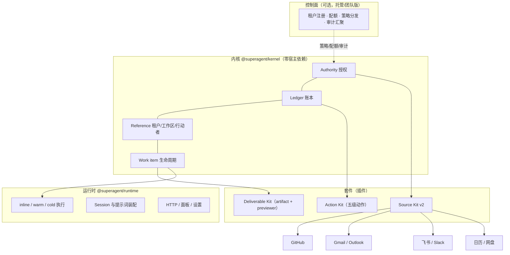
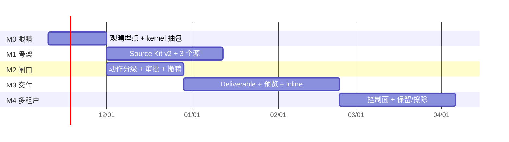

# 从单仓库智能体到「可托付的行动底座」

**dsh-superagent 平台演进方案 v1.0**

| 项 | 内容 |
| --- | --- |
| 状态 | 草案（Draft for review） |
| 日期 | 2026-11-06 |
| 读者 | 架构组、产品、平台工程、安全与合规 |
| 关联 | [`ARCHITECTURE-TOUR.zh.md`](../ARCHITECTURE-TOUR.zh.md)（现状讲解）、[`docs/001-domain.md`](001-domain.md)、[`docs/002-authorization.md`](002-authorization.md)、[`docs/003-execution.md`](003-execution.md) |
| 一句话 | 把「一个会干活的 agent」演进为「一个组织敢把权限交给它的行动平面」：内核只保留授权、账本、引用三件事，其余全部外置为插件。 |

> **进度注记（2026-11-06）**：阶段 0 第一刀已落地——领域层从 `packages/dsh/src/core/` 迁到 `packages/kernel/src/`（`@superagent/kernel`，提交 `3f7a158`），60 个测试文件 / 1200 个用例全绿，`tests/kernel-boundary.spec.ts` 已强制「kernel 只能引用自己与 `node:` 内建、且无任何依赖」。文中 `packages/dsh/src/core/...` 的旧引用按此映射阅读。
>
> **第二刀（同日）**：装配层也拆开了——`packages/dsh/src/app/assembly.ts` 的 `assemble()` 按显式依赖序构建 13 个协作者，`runtime.ts` 只剩状态目录锁、启动与关停（254 → 183 行）；`tests/layers.spec.ts` 把 docs/007 的分层规则变成断言（Sources 不得 import app、面板只拿类型与白名单值、`packages/` 只能经 `@superagent/kernel`、浏览器半不用 Node 内建），当前真实违规为 0；`.github/workflows/check.yml` 让这些守卫在 CI 上跑。提交 `5f8024d`。
>
> **迁出（2026-11-07）**：三个提交的树已复制到新仓库 `touch-agent/dsh-superagent`（private，阶段 1 提前落地，因为原仓库 `deepseek-ai/dsh-superagent-prototype` 对当前凭据只读）；`check` workflow 首次运行全绿（1m26s，含 `pnpm install --frozen-lockfile`），证明手写的 `packages/kernel` importer 与 workspace 形状成立。
>
> **第三刀 · T0-01（2026-11-07）**：观测的第一块地基——kernel 新增 `Span`/`SpanKind`（十段：ingest…report）与确定性 id（`traceId`/`spanId`），端口 `TraceSink` 只声明「记录一个阶段」；`packages/dsh/src/app/trace.ts` 的 `SqliteTraceSink` 把阶段写进新表 `span`（同一阶段重复记录保留第一行），`SCHEMA_VERSION` 升到 12（schema 12 不重写任何记录，只加表与索引，旧库 10/11 在打开时补齐）；`tests/trace.spec.ts` 8 个用例覆盖顺序、幂等、重开存活与 11→12 打开。62 个测试文件 / 1212 用例全绿，浏览器半仍不含 `node:crypto`。
>
> **第四刀 · T0-02 前半（2026-11-07）**：Engine 真的开始记流水——`EngineOptions.trace` 是可选端口，`receive` 记 `ingest`/`dedupe`/`enqueue`（排队发生在 `queueForEval`），`evaluateDue → Evals.start` 记 `gate`/`admission`（每一段写清 admitted/strength/via 或拒绝原因，admission 带 `evalId`）；`packages/dsh/src/app/assembly.ts` 把 `SqliteTraceSink` 注入 Engine，所以一次真实 receive 就有 trace。同时发现并修正计划里的一处想当然：`SPAN_KINDS` 的顺序应是 `ingest → dedupe → enqueue → gate → admission → …`——排队先于准入，因为 gate 是在 Eval 开始时按当时的线程与工单快照判的（这也正是 trace 有用的地方：能看到「排上了、却在门口被拒」）。新增 `tests/trace-stages.spec.ts`（7 用例，表驱动：五段顺序、重复、未监听、被拒、无 sink 时不记录）。63 个测试文件 / 1219 用例全绿。

> **第五刀 · T0-03（2026-11-07）**：四个健康数字落地在 `packages/dsh/src/app/metrics.ts` 并出现在面板概览的只读区与 `GET metrics`——① 判断耗时（Trigger 到首个 Decision 的中位/p90，24 小时）；② 重复发送（同一工单、同一会话、同样文字被回了多次，正常恒为 0，是回归报警）；③ 重启恢复（被 `restarted` 中断的 Assignment 到同工单下一次 Assignment 的中位间隔）；④ 判定吞吐（24 小时 Decision 数 / 24）。口径全部来自库里的行，没有样本时返回 `null` 而不是 0（面板显示 `—`），所以空库不会被误读成「一切正常」。64 个测试文件 / 1225 用例全绿，浏览器半仍不含 `node:crypto`。

---

## 0. 一页纸

### 0.1 结论

- **方向正确，位置偏窄。** 现有系统在代码域证明了「授权—记账—执行」这条链能跑通：一次 `accept` 在同一事务里写线程、工单、决定与副作用（`packages/dsh/src/core/engine.ts:109-121`），六种 effect 各有并发上限与重试曲线。这套治理结构在办公域**更稀缺、更值钱**——因为办公里的每个动作几乎都不可逆（发邮件、改共享文档、占别人时间）。
- **但它的三个核心假设是 GitHub 特有的**：终态可机器判定（PR merge）、动作可回滚（git）、授权来源是仓库协作者。办公域三条全不成立。
- **因此不是「加源」，是「换骨架」**：领域模型 1:1 可迁移，执行模型与终止模型必须重做。
- **护城河不是「能碰多少系统」，是「敢让它碰」**。连接器是三个月的工作，信任是三年的工作。

### 0.2 三条判断

1. **开发是办公的一种特例，不是相反。** 开发的三个性质（终态明确、动作可逆、权限粗粒度）恰好是办公**不具备**的。为办公设计的底座能覆盖开发；为开发设计的底座搬到办公会碎。
2. **现在的系统「治理理念领先半步、产品成熟度落后一代」。** 对标 WorkBuddy（腾讯，桌面工作台 + 连接器 + Skills + 积分）、Grok Bot（xAI，常驻智能体 + 共享云电脑 + 多 Bot 协作 + routine），差距不在模型能力，在开箱即用、连接器数量、交付物预览与企业合规。
3. **先修「敢用」，再修「能用」。** 出站闸门（send 需批准）与外部验收（人 > 规则 > 模型）必须先于连接器扩张落地。

> 外部参考（竞品观察，不构成产品承诺）：WorkBuddy — <https://www.workbuddy.ai/docs/zh/workbuddy/Overview>；Grok Bot（xAI，2026-08 上线，随 X Subscription 提供）— <https://x.ai/news/introducing-grok-bot>。

### 0.3 六个必须重写的机制

| # | 机制 | 现状（代码位置） | 目标 |
| --- | --- | --- | --- |
| 1 | 授权 | 名单 + 准入表 + gate（`packages/dsh/src/policy.ts:171-211`） | per-source 授权证据 → 强度确定性映射，动作时点 revalidate |
| 2 | 动作 | reply 自动发（`packages/dsh/src/app/outbox.ts:24`） | 五级动作 + `maxActionLevel` + 独立 Approval + 撤销窗口 |
| 3 | 账本 | 先记账、至多一次（`packages/dsh/src/app/effects.ts:61-74`） | 加幂等键 `(source, object, action, revision, actor)` + `recalled` 态 + 补偿 |
| 4 | 终止 | PR 全关 / 报告 ready（`packages/dsh/src/core/stage.ts`） | 外部 `Acceptance` 事件，模型不得自述结单 |
| 5 | 交付 | 只有 report 五态 | `Deliverable = artifact + previewer + 验收标准` |
| 6 | 执行 | 一工单一 Session 一目录 | inline / warm / cold 三层 + workspace handle + 轻量工单 |

### 0.4 路线（详见 §8）

| 里程碑 | 一句话 | 退出标准 |
| --- | --- | --- |
| **M0** 眼睛 | 观测 + kernel 抽包 + 契约测试 | 一条 trigger 一条 trace；kernel 对 DSH 零依赖；领域测试 < 2s |
| **M1** 骨架 | Source Kit v2 + 三个新源 | 新增一个源 ≤ 2 天，零手写表单 |
| **M2** 闸门 | 动作分级 + 出站审批 + 撤销 | 重复发送 = 0；误发可撤回 100% |
| **M3** 交付 | Deliverable + preview + inline 轻量工单 | 小活 p50 端到端 < 10s |
| **M4** 多租户 | 控制面 + 保留/擦除 | 租户故障隔离；擦除可验证 |

### 0.5 需要拍板的五个决策

| # | 决策 | 建议 | 代价 |
| --- | --- | --- | --- |
| D1 | 是否接受「默认不自动发送」 | 接受。send 以上默认人工批准，租户可显式放宽 | 自动化感知降低，但换来企业可用 |
| D2 | 是否把 kernel 拆成独立包 | 是。它是唯一能同时被办公与开发复用的资产 | 一次性拆包成本，约 2 周 |
| D3 | 是否放弃「一工单一 Session」 | 是。改为三层执行 + 轻量工单 | 需要新的审计粒度设计 |
| D4 | 是否自建预览器 | 先做 3 个（doc / sheet / mail），其余用通用文本 diff | 预览器是重活，容易吃人 |
| D5 | 单租户还是多租户优先 | 先单租户（进程 + stateDir），控制面只做元数据 | 销售时不能用「SaaS 多租户」话术 |

### 0.6 怎么读

- **只有 10 分钟**：§0 一页纸 + §12 决策记录。
- **要评审架构**：§3 现状四象限 → §6 六个机制 → §8 路线。
- **要评审风险**：§1.4 可托付定义 → §11 风险登记册。
- **要动手**：§4.2 包边界 + 附录 A 接口草案 + 附录 B 代码映射。

---

## 1. 问题定义

### 1.1 今天它是什么

`dsh-superagent` 是一个 DSH bundle：监听 GitHub（可选飞书）事件，把值得做的事变成**工单**，在自己的 Session 与目录里干完，回到原对话交付（通常是一个 PR）。核心不变量有三条：

- **模型只判断，不授权。** 授权由确定性 gate 产生，`Mandate` 由 `accept` 创建，只有人能 `stop` 撤回。
- **先记账，后干活。** 任何跨进程副作用先落 `effect` 行，再由 pass 认领执行，崩溃后能续。
- **一个状态一个写者。** `Engine` 是唯一写入口，五个 Part 通过角色化 `Pick` 暴露能力（`packages/dsh/src/core/engine.ts:261-270`）。

代码规模 111 文件 / 15205 行，59 个测试文件 / 1197 个用例全绿，`packages/dsh/src/core` 对 DSH 的依赖数为 0——这三条说明它已经具备「被抽成底座」的物理条件。

### 1.2 三个失败模式

| 失败模式 | 办公域的典型形态 | 现在的处理 | 缺口 |
| --- | --- | --- | --- |
| **不可逆误发** | agent 直接回复客户邮件、在群里 @ 全员、把草稿发给外部 | 只有 ticket 级 `stop`；`reply` effect 自动发 | 没有动作分级、没有审批对象、没有撤销窗口 |
| **不可解释** | 领导问「为什么它改了这个文档」，答不出 | SQLite 有事件，但无链路追踪 | 没有 trace、没有 per-action 审计视图 |
| **不可恢复** | 进程重启，正在写的周报丢了 / 重复发送 | effect 至少一次 + inbox 续投 | 幂等键是 ticket 级，跨 revision 重放会重复 |

### 1.3 目标与非目标

**目标（本方案要达成的）**

- G1 一个内核，两套 profile（开发 / 办公），共享同一套授权、账本、验收语义。
- G2 新增一个事件源的成本 ≤ 2 人日，且不需要改 UI、不改内核。
- G3 任何不可逆动作在被执行前都有一个可审计的批准点，执行后有一个撤销窗口。
- G4 一次工作的结束由外部验收决定，模型不能自述完成。
- G5 单租户故障不影响其他租户；删除请求可验证。

**非目标（明确不做）**

- N1 不做 no-code 工作流编排器（会被产品化需求拖死）。
- N2 不自造 agent 协议（MCP / A2A 已够）。
- N3 不做 computer-use 优先（仅作 fallback adapter）。
- N4 不自训模型。
- N5 不做通用长期记忆（记忆是 Source 的属性，不是平台的能力）。

### 1.4 「可托付」的操作性定义

一个系统可被组织托付，当且仅当下面四条都成立且**可被第三方验证**：

1. **授权可追溯**：每个动作能回答「谁在替谁、凭什么、到哪一步」。
2. **副作用可枚举**：不存在账本外的外部写入（包括 UI 上的「悄悄发出去」）。
3. **失败可恢复**：任意时刻断电，重启后不重复、不丢失、可解释。
4. **越权可阻断**：策略收紧后，已在跑的工作在下一个动作点被拦住，而不是等它跑完。

### 1.5 为什么开发是办公的特例

| 性质 | 开发（GitHub） | 办公（邮件/文档/日历/IM） |
| --- | --- | --- |
| 终态 | merge / close，机器可判定 | 无。发出去了不算完，改完不算完 |
| 可逆性 | 高（分支、revert） | 低（邮件收不回、群里已读） |
| 授权来源 | 仓库协作者，粗粒度且稳定 | 组织关系，细粒度且易变（项目成员、文档协作者、汇报线） |
| 交付物 | diff（天然可审） | 文档/表格/PPT/邮件，需要专门预览器 |
| 单位成本 | 一次任务 10 分钟–数小时 | 一次任务 30 秒–2 分钟 |

结论：**把办公当作最严格的档位来设计，开发自然被覆盖**。反之不成立。这就是本方案的排序依据。

---

## 2. 设计原则

| # | 原则 | 含义 | 违反时的症状 |
| --- | --- | --- | --- |
| P1 | **不变量优先于功能** | 授权、账本、引用三件事不允许插件化绕过 | 某个连接器自己发消息、自己判完成 |
| P2 | **模型只判断，不授权** | 模型输出候选与理由，授权由确定性代码给 | 提示词一改，权限跟着变 |
| P3 | **先记账，后发生** | 一切外部副作用先落账，再执行 | 崩溃后出现「做过但没记录」 |
| P4 | **可逆性分级** | 越不可逆的动作，越慢、越多确认 | 误发一次 = 一次事故 |
| P5 | **一个状态一个写者** | 每类状态只有一个模块能改 | 状态互相打架、无法复现 bug |
| P6 | **用证据代替身份** | 不建全局身份，每个源声明自己的授权证据 | 跨源身份映射无底洞 |
| P7 | **渐进演进** | 新内核与旧 Runtime 并行，feature flag 切换 | 大爆炸重写，半年不可用 |

> **2026-11-08 补充**：本节 P1–P7 是**平台机制层**的原则；产品面与组织层（注意力、组织内化、自我进化、可替换边界）另见 [011-design-principles.zh.md](011-design-principles.zh.md)。两者同时成立，冲突裁决见该文 §7；本文 §1.3 的 N5（不做通用长期记忆）与该文 C.5 的边界一致。

---

## 3. 现状评估

### 3.1 四象限

| 资产 | 判定 | 理由 | 目标位置 |
| --- | --- | --- | --- |
| `packages/dsh/src/core`（2088 行，零外部依赖） | **保留** | 纯领域库，端口注入，天然可抽包 | `@superagent/kernel` |
| `Engine` + 五 Part + 角色 Pick | **保留** | 单写入口是核心资产，不能动 | kernel |
| `stage.ts` 八条判定 | **改造** | 判定逻辑对，但终态语义要换成 acceptance | kernel（重写第 4/5 条） |
| `policy.ts` gate / admission / revalidate | **改造** | 形状对，输入从「名单」换成「证据」 | kernel + `AuthorityPort` |
| `effects.ts` 六种 kind + health | **保留** | 至少一次 + 并发上限 + 重试曲线的骨架很好 | kernel |
| `store.ts`（SQLite + SAVEPOINT + 生成列） | **保留** | 事务语义正确；表要扩，schema 要继续只增 | kernel（`StoreAdapter`） |
| `outbox.ts` reply effect | **改造** | 必须变成「需批准的动作」 | kernel Action + Approvals |
| `packages/dsh/src/sources/kind.ts` 描述符 | **删除重做** | 手工字段 + 手工 UI 的耦合点 | Source Kit v2（manifest 驱动） |
| `packages/dsh/src/app/runtime.ts` 装配器（13 个 new / 24 行关停） | **重写** | 手工装配不可扩展 | kernel 容器 + 生命周期钩子 |
| `packages/dsh/src/app/http.ts`（25 条手写路由） | **重写** | 手写 match + 手写 body 上限 | schema 驱动 router + `api.ts` 契约生成 |
| `packages/dsh/src/client`（29 文件，手抄 DSH primitives） | **改造** | 面板模型对，控件与设置页应归还宿主 | 独立 `@superagent/panel` |
| `packages/dsh/src/client/draft.tsx` + merge3（203 行） | **退役** | 用 schema 生成设置表单 | 宿主 settings |
| 两套 preset + `WORK_TOOLS` 白名单（三处重复） | **合并** | 工具面单一真相 | `@superagent/runtime` 常量表 |
| `docs/001–008`（编号依赖链） | **保留** | 少见的自洽文档集，是本项目最大软资产 | 随 kernel 走 |

### 3.2 债务清单（按修复成本排序）

| 债 | 影响 | 修法 |
| --- | --- | --- |
| 数据无界增长（全仓无删除 trigger/ticket/decision） | 长期跑必然爆盘 | 保留策略 + 归档表 + crypto-shredding（§6.7） |
| 单实例（文件锁 + loopback HTTP） | 无法 SaaS | 多租户形态（§6.7） |
| 无 E2E（59 个单测，0 条端到端） | 重构无安全网 | 契约测试 + 一条 golden path |
| 依赖 alpha 宿主（`^0.2.1-alpha.2`） | 宿主升级即断 | 契约测试 + 版本适配层 |
| `revalidate` 不比较 `mandate.policyVersion` | 语义与文档不符 | §6.1 一起修 |
| `atomic` 假设同步执行 | 未来换异步 store 会破 | 端口签名改为 async-ready |

### 3.3 插件化体检：边界合规，内部单体

先说结论：**它符合「一切皆插件」，但只是外壳合规、内部仍是单体。**

| 层 | 现状 | 判定 |
| --- | --- | --- |
| bundle | 一个 npm 包 = `cordis.patch.yml` 插 5 行（主插件、github、feishu、2 个 preset） | 合规 |
| Cordis 插件 | 主插件 `packages/dsh/src/index.ts:7` 提供 `orchestrator` 服务并 inject 11 个宿主服务；`packages/dsh/src/sources/github.ts:110`、`packages/dsh/src/sources/feishu.ts:130` inject `['orchestrator']`，用 `ctx.effect` 对称注册/注销、abort 传播、health claim | 合规 |
| 浏览器半 | `packages/dsh/src/client/index.tsx`，`__ModuleLoader__.load`，3 处 slot | 合规 |
| 内部装配 | `Runtime` 构造器 `packages/dsh/src/app/runtime.ts:98-157` 手写 `new` 13 个协作者，关停手写 24 行 `:229-253`，靠 getter 打破循环依赖 | **不合规** |

单体本身有正当理由——一次 `accept` 必须在同一 SAVEPOINT 里写线程、工单、决定与副作用（`packages/dsh/src/core/engine.ts:109-121`），拆太碎会失去原子性。要拆的不是领域层，是**装配层**。

**插件化改造清单（与里程碑对齐）**

| 优先级 | 项 | 证据 | 目标 | 里程碑 |
| --- | --- | --- | --- | --- |
| P0 | 装配器解耦 | `runtime.ts:98-157` 手写 new、`:229-253` 手写关停 | `runtime` 容器 + 生命周期钩子 | M0 |
| P0 | Store 服务化 | kernel 已有 `Repositories` 端口（`packages/dsh/src/core/ports.ts:106`），但 `runtime.ts` 写死 `new Store(...orchestrator.sqlite)` | kernel `store-adapter` | M0 |
| P0 | HTTP schema 驱动 | `http.ts` 247 行手写路由表 + 手写 match + 手写 body 上限；契约在 `api.ts` 52 行 | `runtime` schema-router | M1 |
| P0 | 设置页归还宿主 | `index.ts` 里 `settings.configure({auto:false})` 关掉自动设置页，又手写 `draft.tsx` 203 行 + merge3 | `panel` 只保留领域设置 | M3 |
| P1 | Source 契约独立成包 | `packages/dsh/src/sources/host.ts` 67 行，自造了第二套插件契约 | `source-kit` | M1 |
| P1 | 工具面单一真相 | 同一份白名单出现在 `sessions.ts:61`（`WORK_TOOLS`）、`:263`（7 个工具）、2 个 preset yml，共三处 | `runtime` 常量表 | M1 |
| P1 | 面板 push 化 | `provider.tsx:89` 5 秒轮询；`store.ts` 的 afterCommit 正好可以挂 SSE | `panel` | M3 |
| P2 | effect kind 建表 | 六种 kind 分散在 4 个文件注册 | kernel 注册表 | M2 |
| P2 | 单实例约束显式化 | 文件锁 + loopback HTTP 是隐式约束，没有错误提示 | `control` | M4 |


---

## 4. 目标架构

### 4.1 分层



### 4.2 包边界

| 包 | 职责 | 允许依赖 | 发布节奏 |
| --- | --- | --- | --- |
| `@superagent/kernel` | 领域模型、Engine、效果账本、授权判定、契约测试 | 无（只 node + zod） | 严格 semver，季度 |
| `@superagent/source-kit` | Source manifest 类型、adapter 基类、proof 校验工具、线程归并规则 | kernel | 月度 |
| `@superagent/deliverable-kit` | artifact 引用、previewer 接口、验收标准 DSL | kernel | 月度 |
| `@superagent/runtime` | 执行三层、session/提示词、工具面 | kernel + kits + DSH 服务 | 跟随宿主 |
| `@superagent/panel` | Web 面板（只读投影 + 动作按钮） | `api.ts` 契约 | 跟随 runtime |
| `@superagent/control` | 多租户元数据、配额、策略分发、审计汇聚 | kernel（只读契约） | 季度 |
| `@superagent/sources/*` | 具体连接器（github / gmail / feishu / calendar …） | source-kit | 周 |

**依赖规则（CI 强制）**

1. `kernel` 的 `package.json` 不允许出现任何 `@deepseek-ai/*`。
2. `source-kit` / `deliverable-kit` 不允许 import `runtime`。
3. 任何 adapter 不允许 import `panel`。
4. `kernel` 的公开面只有 `index.ts` 导出的类型与 `Engine` 方法；内部文件不 export。

### 4.3 部署形态

| 形态 | 隔离 | 适用 | 关键约束 |
| --- | --- | --- | --- |
| 个人版 | 一进程一 stateDir | 单开发者 | 现状即此，补观测即可 |
| 团队版（单租户） | 一进程一 stateDir + 共享面板 | 10–50 人团队 | 策略集中、审计导出 |
| 私有化 | 客户 VPC，一进程一 stateDir | 金融/政企 | 无外呼、模型可切本地 |
| 托管多租户 | 一租户一进程一 stateDir | SaaS | 控制面只存元数据，不存事件内容 |

---

## 5. 领域模型 v2

### 5.1 概念全景

保留原有 11 个概念（Source / Trigger / Thread / Correlation / Channel / Policy / Eval / Mandate / Ticket / Assignment / Subscription），新增 6 个：

| 新概念 | 定义 | 为什么必须有 |
| --- | --- | --- |
| **Tenant** | 计费与合规边界 | 多租户隔离、配额、数据驻留 |
| **Workspace** | 工作发生的场所句柄（仓库/目录/云盘/临时桶） | 执行环境不再假设「本地目录」 |
| **Actor** | 行动者（人 / bot / 系统）及其来源身份 | 替代被拒绝的全局 Principal，只做引用不做映射 |
| **Authority** | 一次授权：谁给谁、到哪级动作、多久、凭什么证据 | 比 `Mandate` 多出 `maxActionLevel` 与 `proofs` |
| **Action** | 一个有外部副作用的动作实例（级别/幂等键/可逆性） | 把「回复」从 effect 的一种变成一等对象 |
| **Deliverable** | 交付物：artifact 引用 + 预览器 + 验收标准 | 让 review 状态可成立 |
| **Acceptance** | 验收事件：谁、在哪个 revision、判了什么 | 终止信号 |
| **Approval** | 批准事件：谁、何时、批哪个 Action/revision | 出站闸门 |

### 5.2 映射表

| 旧 | 新 | 变化 |
| --- | --- | --- |
| `Mandate`（policyVersion/scope/strength/rules/basis） | `Authority` | **扩展**：+ `maxActionLevel`、`proofs[]`、`expiresAt` |
| `Eval`（gate + assessment） | 不变 | 输入增加「动作级别预判」：这个活需不需要 send？ |
| `Ticket` | `WorkItem`（两种形态） | **拆分**：tracked / lightweight |
| `Assignment` | `Run`（inline / warm / cold） | **泛化**：inline 没有独立 Session |
| `Subscription` | 不变 | 保留，仍用于「人的消息复活」 |
| `effect`（六种 kind） | `Effect` + `Action` | **分层**：effect 是调度单位，action 是副作用单位 |
| `report`（五态） | `report` + `Deliverable` | 报告说进展，交付物说结果 |
| — | `Acceptance` / `Approval` | 新增 |
| — | `Tenant` / `Workspace` / `Actor` | 新增（Reference 层） |

### 5.3 两种工单形态

| 维度 | tracked（重活） | lightweight（小活） |
| --- | --- | --- |
| 触发 | 需要多轮、跨小时、有交付物 | 30 秒–2 分钟、单动作 |
| 执行 | cold/warm Run，独立 Session + workspace | inline，主 Session 直接干 |
| 账本 | 完整 effect + action ledger | 仅 action ledger |
| 授权 | 完整 Authority | 单动作 Authority（可复用） |
| 验收 | Acceptance（人/规则） | 规则自动验收（如「已发送且无回退」） |
| 面板 | 出现在工单列表 | 折叠在「今日已完成」 |

Phase 0 的 inline 实现是运行时的 `InlineWork`（一次只读仓库查文件，最多 4 个路径），不是主 Session 直接执行；主 Session 仍只负责路由与选择 `form`。R5 仍禁止 inline 执行 `commit`/`send`/`spend`，需要这些动作的小活仍是 tracked。

### 5.4 生命周期 v2

```
proposed ──accept──▶ authorized ──start──▶ active
   │                    │                   │
   │                    │                report ready
   │                    │                   ▼
   │                    │           awaiting-acceptance
   │                    │              │        │
   │                    │        accept│        │reject
   │                    │              ▼        ▼
   │                    │          accepted   rejected
   │                    │              └────┬───┘
   └──ignore──▶ (none)  └──stop──▶ revoked  archived
```

与现状的差异：`ended` 被拆成 `accepted` / `rejected` / `archived`；`revoked` 独立（人的 stop）；复活路径（人的新消息）只对 `accepted` / `revoked` 开放，`archived` 不开放。

---

## 6. 六个机制

> 每个机制统一按「问题 → 设计 → 接口 → 取舍 → 验收」写。6.1–6.6 是六个**必须重写**的机制，6.7–6.8 是两项**支撑设施**（租户与观测）——后者不是可选项，但没有前者那么紧急。

### 6.1 Authority：用证据代替名单

**问题。** 现在是 `allowed` 名单 + 准入表（`packages/dsh/src/policy.ts:171-211`）。办公域里授权来源是组织关系，手工名单必然腐烂；而 `docs/001` 拒绝跨源身份映射的判断依然正确。

**设计。**

- 每个 Source 在把 Actor 带进域时，必须同时给出 **proof**：`{kind, subject, scope, evidence, issuedAt, ttl}`。例如 `feishu.group.member`（群成员快照）、`gmail.from.domain`（发件域验证）、`github.repo.collaborator`、`calendar.organizer`。
- 底座只做两件事：**证据 → 强度**的确定性映射（复用现有 gate 的形状，explicit / inferred / rejected），以及**动作时点的 revalidate**。
- 强度表（示例，可在租户级覆盖）：

| proof 类型 | 能给出 | 上限动作级 |
| --- | --- | --- |
| 直接 @ + 名单内 | explicit | send |
| 群成员 + 该群被授权 | explicit | commit |
| 邮件线程参与者 | inferred | draft |
| bot / CI 事件 | machine | draft（永不 send） |
| 无 proof | — | read |

**接口。**

```ts
export interface Proof {
  kind: string
  subject: ActorRef
  scope: Scope
  evidence: unknown        // 源侧原始证据，审计用
  issuedAt: number
  ttl: number
}

export interface Authority {
  id: string
  actor: ActorRef
  onBehalfOf: ActorRef
  scope: Scope
  maxActionLevel: ActionLevel
  strength: 'explicit' | 'inferred' | 'machine'
  proofs: Proof[]
  policyVersion: string
  expiresAt: number
}

export interface AuthorityPort {
  /** 纯函数：证据 → 强度，不允许 IO，不允许模型参与 */
  derive(input: DeriveInput): Authority | Rejection
  /** 动作时点重新校验：返回 false 则该动作必须被拒绝 */
  revalidate(authority: Authority, action: ActionSpec, at: number): boolean
}
```

**取舍。** 证据有时效，需要缓存与失效；不同源证据强度不可比，必须靠租户级强度表而不是硬编码排序。代价是配置复杂度上升，收益是新增源不需要改内核。

**验收。** 策略收紧后，在跑的工作在**下一个动作点**被拦住（单测：mock 时间推进 + 策略变更 → 下一个 action 返回 denied）。同时修掉 `revalidate` 不看 `policyVersion` 的偏差。

### 6.2 Action：五级动作与出站闸门

**问题。** `reply` 是排队自动发的（`packages/dsh/src/app/outbox.ts:24`，失败重试到 5 分钟）。代码域被 PR 兜住，办公域没人兜。

**设计。**

- **级别**：`read < draft < commit < send < spend`。`read` 无副作用；`draft` 只产生内部对象；`commit` 写共享工作区；`send` 离开系统边界；`spend` 花钱。
- **Authority 携带 `maxActionLevel`**，默认 `draft`；租户可放宽到 `commit`，`send` 永远需要显式策略开启。
- **`send` 以上必须有一个 `Approval`**：独立对象，记录 approver / 时间 / 通道 / 批的是哪个 revision / 批的正文哈希。
- **撤销窗口**：`send` 类动作先落 `pending-send`，窗口内（默认 30 秒，可配到 5 分钟）可 `cancel`；窗口结束才真正投递。Source 支持撤回的（飞书、Slack）额外提供 `recall`。
- **幂等**：`idempotencyKey = hash(source, objectId, action, revision, actor)`。

**接口。**

```ts
export type ActionLevel = 'read' | 'draft' | 'commit' | 'send' | 'spend'

export interface ActionSpec {
  kind: string                 // 'mail.reply' | 'doc.edit' | 'pr.merge' | ...
  level: ActionLevel
  reversible: 'undo' | 'delay' | 'none'
  idempotency: 'external-id' | 'content-hash'
  approval: 'none' | 'policy' | 'human'
}

export interface Action {
  id: string
  spec: ActionSpec
  subject: unknown             // 收件人/文档 id/PR 号
  revision: string
  payloadHash: string
  state: 'proposed' | 'approved' | 'pending-send' | 'sent' | 'recalled' | 'failed' | 'rejected'
  approvedBy?: ActorRef
}
```

**取舍。** 默认不自动发送会降低「魔法感」，但这是企业采购的硬门槛。撤销窗口增加 30 秒延迟，对邮件可接受，对 IM 需要租户配置为 0。

**验收。** 混沌测试：在 `pending-send` 窗口内杀进程，重启后要么发出一次、要么不发（不能两次）。重复发送率必须为 0。

### 6.3 Ledger：账本与补偿

**问题。** 现有 `effect` 是调度单位（六种 kind、并发上限、重试曲线、health），做得很好；但它不记录「业务副作用」，也没有补偿语义。

**设计。**

- 两层：**Effect**（调度，保留现状）+ **Action**（副作用，新）。
- 账本表 `action` 追加写，`state` 只能前进（`proposed → approved → sent → recalled`），任何回退都写成新行（append-only）。
- **补偿**：`reversible: 'undo'` 的动作在失败或超时后自动生成补偿 action；`delay` 的靠窗口取消；`none` 的进入人工待办。
- **at-most-once**：发送前先写 `pending-send` 行并提交（记账），再发送；发送结果回写。崩溃在中间 → 重启时按 `idempotencyKey` 向 Source 查询是否已生效（所有 send 类 Source 必须实现 `probe(key)`）。

**接口。**

```ts
export interface LedgerPort {
  append(action: Action): void
  transition(id: string, to: Action['state'], meta?: unknown): void
  find(key: string): Action | undefined
  /** 崩溃恢复：查询 Source 侧是否已生效 */
  reconcile(keys: string[]): Promise<Map<string, 'sent' | 'absent'>>
}
```

**取舍。** 要求每个 send 类 Source 实现 `probe`，这是对连接器的硬要求；做不到的连接器只能声明 `reversible: 'delay'` 并接受延迟发送。

**验收。** 断电注入测试 100 次，重复发送 0、丢失 0。

### 6.4 Acceptance：终止信号

**问题。** 现在工单靠「本工单开的 PR 全关」或「report ready」结束（`packages/dsh/src/core/stage.ts` 的 8 条判定 + `docs/003`）。办公没有 merge。

**设计。**

- `Acceptance` 三来源，优先级 **人 > 规则 > 模型**：
  - 人：显式点击「接受」/ 回复「可以了」。
  - 规则：`rule.accept` 声明可判定的条件（如「交付物已发送且 24h 内无回退」「PR 已 merge」）。
  - 模型：**不允许**。模型只能建议 `review`，不能写 `accepted`。
- 每个 WorkItem 在创建时由 Eval 声明 `acceptance` 标准（谁来验、验什么），存进工单。
- 超时（默认 7 天）转 `archived` 而不是 `accepted`。

**接口。**

```ts
export interface AcceptanceCriterion {
  kind: 'human' | 'rule'
  who?: ActorRef
  rule?: string                 // 规则 DSL，由 kernel 解释，不执行任意代码
  window?: number
}

export interface Acceptance {
  workItemId: string
  revision: string
  verdict: 'accepted' | 'rejected' | 'expired'
  by: ActorRef | 'rule'
  at: number
  note?: string
}
```

**取舍。** 工单生命周期变长，需要归档策略与「已归档不可复活」的明确边界。收益是「模型自述完成」这个最危险的行为被结构性禁止。

**验收。** 单测：任何 report `ready` 都不能直接产生 `accepted`；必须在 Acceptance 事件后状态才前进。

### 6.5 Deliverable：交付物与预览

**问题。** `person/review` 现在名不副实——人拿到「报告说 ready」，但看不到「到底改了什么、要发给谁」。PR 有 diff，办公没有。

**设计。**

- `Deliverable = { kind, artifactRef, previewer, criteria }`。
- **previewer 插件化**，按 MIME/类型注册：`text/redline`、`sheet/cell-diff`、`slides/page-diff`、`mail/draft`（收件人/正文/附件清单）、`calendar/slot`（冲突与占用）。
- 预览必须能回答三个问题：**变了什么 / 影响谁 / 能不能撤**。
- 预览不喜欢 → 结构化反馈（不是自由文本），回到工单作为新 Input。

**接口。**

```ts
export interface Deliverable {
  id: string
  kind: string
  artifactRef: string          // 对象存储 key / 文件句柄 / PR url
  preview: PreviewRef
  criteria: AcceptanceCriterion[]
  revision: string
}

export interface Previewer {
  kinds: string[]
  render(artifact: ArtifactRef): Promise<PreviewModel>  // 结构化，不是 HTML
}
```

**取舍。** 预览器是重活，每个类型一个。先做三个（doc / sheet / mail），其余降级为通用文本 diff。

**验收。** 面板上「review」状态必须带可渲染的 preview；缺失 preview 时不得进入 review 状态（结构性约束）。

### 6.6 Runtime：三层执行与 workspace handle

**问题。** 一工单一 Session、一目录、30 分钟后台预算。办公任务 30 秒级，Session 创建 + 提示词装配 + 首 token 的固定成本比任务本身还高。

**设计。**

| 层 | 触发 | 执行 | 成本 | 审计 |
| --- | --- | --- | --- | --- |
| inline | 单动作、小活 | 主 Session 直接用工具干 | ~0 | action ledger |
| warm | 已存在的 worker 可复用 | 复用 Session，只换 context | 低 | 完整 |
| cold | 需要隔离/长任务 | 新建 Session + workspace | 高 | 完整 |

- **workspace handle**：本地目录 / 云端工作区 / 临时桶，统一接口 `{ read, write, exec, url }`。
- 工单不再强制绑定 Session；`Run` 是 `{ workItemId, mode, sessionRef?, workspaceRef }`。
- 保持现有「提示词每次 model request 现算」与「策略 section 放最后」的设计（`packages/dsh/src/app/prompts.ts`），否则策略变更会让缓存的 prompt 前缀失效。

**取舍。** inline 路径绕过工单粒度 → 必须引入轻量工单（§5.3）承载 action ledger，否则审计断链。

**验收。** 小活 p50 端到端 < 10 秒（从 Trigger 入库到 reply 发出）；inline 工单在面板可查、可审计。

### 6.7 Tenant 与保留

**问题。** 单 stateDir + 文件锁 + loopback HTTP + 数据从不删除。前三样是合理取舍，第四样在办公客户眼里是合规债务。

**设计。**

- **租户 = 一进程 + 一 stateDir**（先别上共享表）。控制面只存：租户 id、配额、策略版本指针、审计摘要。
- **保留三类**：`transient`（输入、草稿，7–30 天）、`policy-bound`（授权、决定，随策略生命周期）、`audit`（动作账本，永久骨架）。
- **crypto-shredding**：audit 记录的 payload 用 **per-subject 密钥**加密；删除请求 = 销毁密钥 + 保留骨架（时间、actor、action kind、结果）。这样「日志永不删除」与「必须能响应删除」可以同时成立。

**取舍。** 密钥管理成为基础设施依赖（KMS 或本地 keyring）；跨租户查询只能在控制面做聚合，不能下钻内容。

**验收。** 删除演练：删除某 actor 后，历史记录仍可审计（骨架在），但无法还原内容（密钥已毁）。

### 6.8 Observability：第 0 步

**问题。** 现在没有任何能回答「为什么这封邮件没发出去」的埋点。

**设计。**

- **一条 Trigger 一条 trace**：`ingest → intake → gate → assess → decide → authorize → run → report → action → accept`，每段一个 span，带 `tenant / workItem / actor / policyVersion`。
- **四个基线指标**：TTFA（事件到首条回复）、duplicate-send rate、restart recovery rate、human decision throughput。
- 面板加一个「为什么」按钮：从任意状态跳到一个 span 时间线。

**验收。** 线上任意一条工单，能在 30 秒内回答「它在哪一步、卡在谁身上、为什么」。

---

## 7. 场景适配：办公 / 开发 / 混合

### 7.1 统一抽象

一句话：**工作 = 一个有交付物、需要授权、跨系统的意图。** 开发与办公的差别只是三个参数的取值不同——终态怎么判、动作多不可逆、授权证据从哪来。底座把这些参数化，不把场景写死。

### 7.2 两个 profile 对照

| 维度 | 开发 profile（GitHub） | 办公 profile（邮件/文档/日历/IM） |
| --- | --- | --- |
| 触发源 | PR、issue、review comment、CI 失败 | 邮件、@ 提及、文档评论、日历邀请 |
| 线程归并 | issue ↔ PR ↔ commit 天然归并 | 邮件主题链、文档段落、群话题，规则按源声明 |
| 授权证据 | `repo.collaborator` + 直接 @ | 群成员、文档协作者、发件域、日历组织者 |
| 默认动作级 | `commit`（推分支） | `draft`（出草稿），`send` 需批准 |
| 交付物 | diff / PR | 文档 redline / 表格 diff / 邮件草稿 / 日程 |
| 验收 | `rule: PR merged` | `human` 或 `rule: 已发送且 24h 无回退` |
| 执行层 | cold（长任务、需隔离） | inline 为主，长任务 warm/cold |
| 保留 | 30–90 天（代码在 git 里） | transient 7–30 天，audit 永久 |
| 面板主视图 | 工单 → PR 时间线 | 今日待我决定（按不可逆性排序） |

### 7.3 开发 profile 的映射（保持现状行为）

现有 GitHub 流程在新模型里的映射是**纯配置**，不改代码路径：

| 现在 | 新模型 |
| --- | --- |
| `accept` → `Mandate` | `accept` → `Authority(maxActionLevel: 'commit')` |
| 推分支 / 开 PR | `Action(kind: 'repo.commit', level: 'commit', reversible: 'undo')` |
| 回复评论 | `Action(kind: 'issue.comment', level: 'send')` → 默认走审批（可用租户策略放开） |
| PR 全关 → 工单结束 | `Acceptance(by: 'rule', rule: 'pr.closed')` |
| `report: ready` | 只能进 `awaiting-acceptance` |
| 后台 30 分钟预算 | `Run(mode: 'cold')` 的超时预算，保留 |

**关键**：办公能力上线后，开发 profile 的默认配置**必须保持现有体验**（否则老用户会觉得「变笨了」）。所以 `send` 类动作在开发 profile 里默认 `approval: 'policy'` 且策略显式允许——这是 profile 的默认值，不是内核的硬编码。

### 7.4 办公 profile 的分源配置

| 源 | 触发 | 动作（上限） | 交付物 | 验收 |
| --- | --- | --- | --- | --- |
| Gmail / Outlook | 新邮件、@ 我 | draft（默认）/ send（批准后） | 邮件草稿 | human |
| 飞书 / Slack | @ 提及、群话题 | reply（批准后）、doc edit | 消息草稿、文档段落 | human |
| 文档（飞书文档/Notion/Google Docs） | 评论、@ | commit（编辑） | redline | human |
| 表格 | 评论、定时 | commit | cell diff | rule（数值校验） |
| 日历 | 邀请、改期请求 | commit（建会议）→ spend（占他人时间） | 日程方案 | human |

**「占他人时间」也是 spend。** 这是办公域特有的洞察：约一个 10 人会议的成本，和花掉一笔钱同量级。所以日历动作默认走审批，且必须给出「为什么需要这个会 / 能不能异步」。

### 7.5 混合 profile

同一租户可以同时挂开发与办公源，但要**策略隔离**：不同源的 `maxActionLevel`、审批人、保留期分别配置。混合场景的典型价值是「需求讨论（IM）→ 代码（GitHub）→ 交付说明（文档）」这条跨源链路——`Correlation` 负责把同一意图在多个 Thread 里关联起来（只加背景、永不路由，与 `docs/001` 一致）。

---

## 8. 演进路线



> 关键排序理由：**M2（闸门）与 M1（骨架）并行，但 M2 必须先于「第 4 个源」**。连接器可以后补，信任不能后补。

### M0 眼睛（3 周）

- **目标**：能回答「为什么没发出去」；把 kernel 拆成可独立测试的包。
- **交付**：OTel trace（一条 trigger 一条）+ 四指标看板；`@superagent/kernel` 抽包（core 已有零依赖基础）；memory store 跑全套领域测试；架构规则进 CI（kernel 不允许 `@deepseek-ai/*`）。
- **退出标准**：领域测试 < 2 秒；任意工单 30 秒内定位卡点；`pnpm check` 全绿。
- **风险/回退**：抽包可能暴露隐式耦合（`store.ts` 的同步 `atomic`）→ 端口签名先改 async-ready，允许 `Promise | T`。

### M1 骨架（6 周）

- **目标**：新增一个源只需写 manifest + adapter，不改 UI、不改内核。
- **交付**：`SourceManifest` 类型 + 生成器（配置表单、权限表、健康项、限流全部派生）；三个新源（Gmail、飞书文档、日历）；adapter conformance suite（每个 adapter 必须通过同一套测试）。
- **退出标准**：新增一个源 ≤ 2 人日；零手写表单；`kind.ts` 退役。
- **风险/回退**：manifest 设计过窄会导致第二次重构 → 先写三个 adapter 再冻结 v1，且 manifest 保留 `extra` 逃生字段。

### M2 闸门（4 周，与 M1 并行）

- **目标**：不可逆动作有审批点与撤销窗口。
- **交付**：Action/Approval 对象；`maxActionLevel` 进 Authority；`pending-send` + 窗口取消 + Source `probe`；幂等键改造；面板「待我批准」视图。
- **退出标准**：断电注入 100 次重复发送 0；误发可撤回 100%（支持撤回的源）；审批延迟 p50 < 60 秒。
- **风险/回退**：审批会显著降低自动化感知 → 提供「租户级白名单 + 时间窗」自动批（如内部域内、工作时间内）。

### M3 交付（8 周）

- **目标**：review 状态真正可审；小活不再付 Session 冷启动成本。
- **交付**：Deliverable + 三个 previewer（doc/sheet/mail）；inline 执行 + 轻量工单；session 复用（warm）；workspace handle。
- **退出标准**：小活 p50 端到端 < 10s；review 页必须有 preview（结构性约束）；inline 工单可审计。
- **风险/回退**：previewer 是重活，容易拖 → 只做三个，其余用通用文本 diff + 原文链接。

### M4 多租户（6 周，可选前置）

- **目标**：能卖团队版/私有化。
- **交付**：控制面（注册、配额、策略分发、审计汇聚）；保留三类 + crypto-shredding；租户隔离健康检查。
- **退出标准**：单租户故障不影响其他；删除演练可验证；审计可导出为标准格式。
- **风险/回退**：密钥管理依赖 KMS → 私有化场景提供本地 keyring 方案。

**工作量估算**（4 人团队）：M0 3 周、M1 6 周、M2 4 周（并行）、M3 8 周、M4 6 周 → 约 5–6 个月到「可卖团队版」，其中 M0+M2 的 5 周是信任基础，不可压缩。

---

## 9. 度量

| 类型 | 指标 | 定义 | 目标 |
| --- | --- | --- | --- |
| 北极星 | **Accepted deliverables / week** | 每周被人或规则接受并归档的交付物数 | 逐季增长 |
| 护栏 | duplicate-send rate | 同一幂等键发送次数 > 1 的比例 | 0 |
| 护栏 | unauthorized action rate | 越过 maxActionLevel 被执行的次数 | 0 |
| 护栏 | reversal rate | 需要人工撤销/补偿的比例 | < 2% |
| 体验 | TTFA p50 | Trigger 入库 → 首条对外回复 | < 30s（小活）/< 5min（重活） |
| 体验 | false interrupt rate | 人点开但认为「不该打扰我」的比例 | < 10% |
| 体验 | decision throughput | 人每小时能处理的决策数 | 逐季增长 |
| 可靠 | restart recovery rate | 重启后无需人工介入即完成的比例 | > 95% |
| 成本 | cost per accepted deliverable | 模型 + 基础设施成本 / 北极星 | 逐季下降 |

**测量方法**：全部从 trace 与 ledger 派生，不做额外埋点；面板首屏直接展示这九个数字（对应 `docs/005` 的「系统健康吗」）。

---

## 10. 工程与组织

### 10.1 三道契约测试

1. **kernel 契约**：memory store 跑全套领域测试（< 2s），保证领域逻辑与存储解耦。
2. **adapter conformance**：每个 Source 必须通过同一套测试（proof 校验、游标回退、health claim、幂等 key 生成、`probe` 语义）。这是「支持 30 个源」的唯一可行办法。
3. **api 契约快照**：`api.ts` 生成 JSON Schema，客户端与 HTTP 层共用；路由由 schema 驱动，不再手写 match。

### 10.2 版本与兼容

| 对象 | 策略 |
| --- | --- |
| kernel | 严格 semver，破坏性变更走 major，季度节奏 |
| adapter | 声明 `kernel: ^1`，compat matrix 进 CI |
| 宿主（DSH） | 适配层隔离 `^0.2.x-alpha`，契约测试覆盖用到的每个服务 |
| 数据库 | `SCHEMA_VERSION` 只增，旧库拒启；迁移向前兼容一个 major |

### 10.3 迁移策略（strangler，不重写）

1. 新 kernel 包以依赖形式进入现有仓库，`Engine` 先做适配层（旧 `Runtime` 调用不变）。
2. feature flag 按租户切换新旧实现；两条路径共用同一 store，靠 schema 兼容。
3. 面板先加只读新视图，再替换写入路径。
4. 旧 `kind.ts` 与新 manifest 并存一个版本，靠 conformance suite 证明等价后删除。

**明确不做大爆炸重写**：现有 1197 个测试是资产，任何阶段都必须保持全绿。

### 10.4 团队拓扑

| 组 | 范围 | 节奏 |
| --- | --- | --- |
| Kernel 组（2 人） | 领域模型、Engine、账本、契约测试 | 长期，最稳定 |
| Connector 组（2 人） | source-kit + 各源 adapter | 双周一个源 |
| Runtime/产品面（2 人） | 执行三层、面板、审批流 | 跟随里程碑 |
| 平台/合规（1 人） | 多租户、保留、审计导出 | M4 起满负荷 |

### 10.5 质量门（CI）

`typecheck` → `lint` → `unit` → `conformance` → `arch-rules`（dependency-cruiser：kernel 零宿主依赖、kits 不依赖 runtime）→ `e2e golden path`（一条：issue → 授权 → 分支 → PR → merge → accepted）。

---

### 10.6 仓库策略

**结论：新建 monorepo，但不是现在——先在现仓库原地 monorepo 化，M0 结束再物理迁出。**

| 阶段 | 仓库 | 动作 | 判据 |
| --- | --- | --- | --- |
| 阶段 0（M0，约 1 周） | 现仓库 `dsh-superagent-prototype` | 加 `pnpm-workspace.yaml`，把 `packages/dsh/src/core` 挪成 `packages/kernel`，其余暂留原位；跑通 1197 个测试 | 领域测试 < 2s；CI 能拒绝 kernel 引入 `@deepseek-ai/*` |
| 阶段 1（M0 末，半天） | 新仓库 `dsh-superagent` | 复制 `packages/*` + `docs/` + `tests/`；新仓库初始提交；配置 changesets 与两段 CI | 新仓库能独立构建、独立跑 conformance |
| 阶段 2（M2 起） | 老仓库 | 打 tag `v0.1.0-prototype`，README 顶部加「已演进至 …」指针，archive | 两周 cherry-pick 窗口结束后归档 |

**为什么先原地、后迁出**：M0 的核心工作是「把领域逻辑从宿主里剥出来并保持测试全绿」，这一步必须频繁对照旧实现；跨库会让「改一处、跑两次 CI」成为日常，反而拖慢。而迁出本身是没有成本的——**当前仓库只有一个提交、没有 tag、没有 issue/PR 历史**，所以不存在「历史搬迁」问题，复制即完成。

**什么情况下不拆**：① M0 发现 kernel 与宿主耦合过深（比如 `store.ts` 的同步事务语义绑死 SQLite），说明边界还没找到，此时拆库只会放大耦合成本；② 团队 ≤ 2 人且 6 个月内不对外，单仓 monorepo 更省。这两种情况下把 `packages/` 留在现仓库即可，方案其余部分不受影响。

**必须避免的两种做法**：

- ❌ **两仓并行维护**（漂移是最贵的债）。split 当天老仓库必须 freeze，之后只接受同步过来的 bug 修复。
- ❌ **在老仓库上直接改定位**。它的对外语义是「research prototype（非官方产品）」，这个声明是资产；改成产品底座会让外部引用与预期同时失真。

## 11. 风险登记册

| # | 风险 | 概率 | 影响 | 缓解 | 触发信号 |
| --- | --- | --- | --- | --- | --- |
| R1 | 审批流让人嫌烦，用户关掉 | 高 | 高 | 白名单自动批 + 按不可逆性分级（draft 不打断） | 审批通过率 > 98% 且延迟 > 5 分钟 |
| R2 | previewer 吃光人力 | 高 | 中 | 只做三类，其余降级 | M3 超期 2 周 |
| R3 | 跨源授权证据不可比，策略难配 | 中 | 高 | 租户级强度表 + 默认保守 | 配置错误导致的拒绝率 > 20% |
| R4 | 宿主 alpha 升级打断 | 高 | 中 | 适配层 + 契约测试 | 每周升级失败 |
| R5 | 多租户共享进程导致串扰 | 中 | 高 | 一租户一进程，先不做共享表 | 内存/CPU 单点超限 |
| R6 | 「从不删除」与合规冲突 | 中 | 高 | crypto-shredding + 保留三类 | 客户安全问卷卡住 |
| R7 | 模型绕过授权（提示注入） | 中 | 高 | 授权在代码层，永不进模型上下文决策；外部文本永远是数据 | 出现「模型自称已批准」的日志 |

---

## 12. 决策记录（ADR）

| # | 决策 | 理由 | 代价 |
| --- | --- | --- | --- |
| ADR-01 | 内核只保留 Authority / Ledger / Reference | 三者跨源共享且不可绕过 | 内核演进慢，需严格 semver |
| ADR-02 | 不建全局 Principal，改 per-source proof | 跨源身份映射无底洞（`docs/001` 已论证） | 策略配置更复杂 |
| ADR-03 | 动作五级 + 默认 `draft` | 办公动作多不可逆 | 自动化感知下降 |
| ADR-04 | `send` 需独立 Approval 对象 | 布尔标志无法审计 | 多一张表、多一个 UI |
| ADR-05 | 终止只认 Acceptance，模型不得自述 | 「模型说完成了」是最危险的失败 | 生命周期变长 |
| ADR-06 | 交付物必须带 preview 才能进 review | 没有 diff 的 review 是假 review | previewer 是重活 |
| ADR-07 | 三层执行 + 轻量工单 | session-per-ticket 在办公域成本不可接受 | 审计粒度需重新设计 |
| ADR-08 | 租户 = 进程 + stateDir | 隔离最简单、故障域最小 | 不能用「共享集群」话术 |
| ADR-09 | 审计 append-only + per-subject 加密 | 同时满足「可审计」与「可删除」 | 依赖 KMS |
| ADR-10 | adapter 必须过 conformance suite | 否则源一多就失控 | 每个源多 1–2 天 |
| ADR-11 | manifest 驱动配置 UI | 手写表单是扩展性杀手 | 生成器本身要写一次 |
| ADR-12 | strangler 迁移，不重写 | 1197 个测试是资产 | 双路径并存期复杂度上升 |
| ADR-13 | 平台代码进新 monorepo，老仓库冻结为参考实现 | 单提交、无历史可搬；包边界只能靠物理分仓被 CI 强制；两个仓库对外承诺不同 | 需一次迁移与 freeze 纪律 |

---

## 13. 不做清单

- ❌ no-code 工作流编排器（画布、节点、连线）——会被产品化需求拖死。
- ❌ 自造 agent 协议（MCP / A2A 已够）。
- ❌ computer-use 优先——只做 fallback adapter，不把它当主路径。
- ❌ 自训模型 / 自建推理基础设施。
- ❌ 通用长期记忆——记忆是 Source 的属性（这个群的偏好、这个仓库的约定）。
- ❌ 「一键全自动」营销话术——与 ADR-03/05 直接冲突。

---

## 附录 A：kernel 公开面（草案）

```ts
export interface Kernel {
  // 事件入域（Source 调用）
  receive(trigger: Trigger): void
  bindThread(input: BindInput): void
  threadClosed(thread: string): void

  // 主 Session 调用
  candidate(input: CandidateInput): void
  decide(input: DecideInput): Decision
  attach(input: AttachInput): void
  requestStatus(workItemId: string): WorkItemView
  note(input: NoteInput): void
  reply(input: ReplyInput): void

  // 人调用
  stop(workItemId: string, by: ActorRef): void
  retry(workItemId: string): void
  reevaluate(thread: string): void
  unsubscribe(thread: string, workItemId: string): void
  dismiss(evalId: string): void
  accept(input: Acceptance): void          // 新增：验收
  approve(input: Approval): void           // 新增：批准

  // 执行器调用
  started(input: RunStarted): void
  report(input: Report): void
  actionResult(input: ActionResult): void  // 新增：动作结果
  handback(input: Handback): void

  // 扫描
  evaluateDue(now: number): void
  reconcile(keys: string[]): void          // 新增：崩溃恢复
}
```

## 附录 B：现状代码 → 目标归属

| 现状 | 行数 | 目标 |
| --- | --- | --- |
| `packages/dsh/src/core/*`（engine/part/model/tickets/evals/assignments/replies/intake/stage/policy/effects/ids/memory/ports） | 2088 | `kernel`（stage 与 policy 重写，effects 扩 action） |
| `packages/dsh/src/policy.ts` | 242 | kernel `authority.ts` + `AuthorityPort` |
| `packages/dsh/src/app/store.ts` | 291 | kernel `store-adapter`（SQLite 实现留在 runtime） |
| `packages/dsh/src/app/effects.ts` | 161 | kernel ledger（保留 kind/limit/retry 骨架） |
| `packages/dsh/src/app/runtime.ts` | 254 | runtime 容器（13 个 new → 依赖注入） |
| `packages/dsh/src/app/http.ts` | 247 | runtime `schema-router` |
| `packages/dsh/src/sources/kind.ts` | 115 | `source-kit` manifest v2（退役） |
| `packages/dsh/src/sources/{github,feishu}*` | 2059 | `@superagent/sources/*`（拆包） |
| `packages/dsh/src/executor/dsh.ts` | 673 | runtime 执行层（加 inline/warm） |
| `packages/dsh/src/app/sessions.ts` | 352 | runtime session（工具面单一真相） |
| `packages/dsh/src/app/prompts.ts` | 247 | runtime prompt 装配（保留顺序与版本） |
| `packages/dsh/src/client/*` | 4037 | `@superagent/panel`（设置页归还宿主） |
| `packages/dsh/src/app/tools/*` | 441 | runtime 工具面（14 + 6 保持不变） |

## 附录 C：术语表

| 中文 | 英文 | 一句话 |
| --- | --- | --- |
| 工单 | Work item | 一次被授权的工作（tracked / lightweight） |
| 授权 | Authority | 谁替谁、能干到哪级动作、多久、凭什么 |
| 证据 | Proof | 源侧给出的授权依据（成员快照、协作者角色等） |
| 动作 | Action | 一个有外部副作用的动作实例（含级别与幂等键） |
| 批准 | Approval | 人对某个动作/revision 的显式同意 |
| 验收 | Acceptance | 决定工作结束的事件（人 > 规则 > 模型） |
| 交付物 | Deliverable | artifact + 预览器 + 验收标准 |
| 账本 | Ledger | 只追加的副作用记录 |
| 补偿 | Compensation | 对失败动作的逆向动作或人工待办 |
| 轻量工单 | Lightweight item | 无 Session、只有 action ledger 的小活 |
| 租户 | Tenant | 计费与合规边界 |
| 工作区句柄 | Workspace handle | 统一的读写执行入口 |

---

## 结语

这份方案的核心只有两句话：

1. **把「回复」从自动改成需批准，把「完成」从模型自述改成外部验收。**
2. **把内核收窄到授权、账本、引用，其余全部外置成 manifest 驱动的插件。**

前者让它**敢用**，后者让它**能长大**。两者都做完，它才从「一个很聪明的 agent」变成「一个组织可以托付的底座」——而后者才是办公与开发两个市场共同认可的唯一形态。