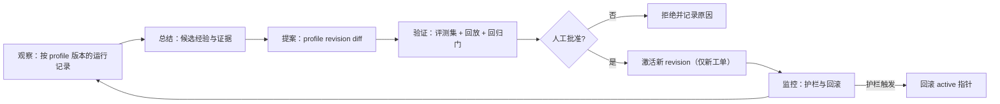

# 015 AgentProfile：可复用 agent 层设计

| 项 | 内容 |
| --- | --- |
| 状态 | 设计草案（Draft for review） |
| 日期 | 2026-11-10 |
| 基线 | `touch-agent/dsh-superagent` `main` `1b91fd8` |
| 关联 | [011 设计原则](011-design-principles.zh.md) C.1/C.3、[004 Prompts](004-prompts.md)、[003 Execution](003-execution.md)、[002 Authorization](002-authorization.md)、[013 工作空间](013-workspace-model.zh.md)、[TASK-PLAN](plan/TASK-PLAN.zh.md) T5-05/T5-07 |
| 一句话 | 把今天隐含在 `router`/`worker` 两个角色里的执行配置，显式化为**可版本化、可绑定、可观测**的 `AgentProfile`；权限仍只属于 Policy、Mandate 与动作闸门。 |

---

## 0. 结论

1. **现状不是「每次按任务动态装配、因此不可复用」，而是「两个角色级配置被所有工单复用，但没有身份、版本和运行证据」。** worker 的 prompt 由固定角色文本、团队段、环境与 Policy 段组成，工具是固定白名单，权限是固定的宿主 preset；按任务变化的只有 Input、目录、环境变量、Mandate 注记和子 Ticket 提示。真正缺的是「这是哪个 agent、哪一版、在哪些工单上、效果如何」，不是一套新的动态装配器。
2. **Eval 不是纯代码判定。** 它是「确定性 gate + 模型 assessment + 确定性校验与记账」的混合体：允许谁发起、以什么强度、是否准入、Mandate 的边界、接受模式，全部由代码决定；模型只回答「这条候选是否匹配某条已写下的规则、方向是否已定」，且它的输出还要经过 `assessmentOutcome` 的结构校验。**不能把确定性 Eval 换成 agent**；那会把「模型只判断、不授权」这条不变量反转。
3. **可复用 agent 层的价值不是「多几种 agent」，而是「让复用变得可比较、可回退、可被证伪」。** 两个角色今天已经在复用；如果 profile 只是把同一套配置换个名字，它只增加维护面。因此第一阶段的成功标准是能回答「哪个 profile 版本在什么任务类别上，成功/成本/延迟/返工是否真的不同」，并且允许结论是「没有可测差异，停止」。
4. **权限上限不进入 profile。** profile 只描述执行能力：角色、模型、工具白名单、prompt 引用、评测基准；`maxActionLevel`、审批策略、允许的发送者、Mandate 时长、动作等级等授权字段一律不进入 profile，schema 直接拒绝。工具白名单只是「角色能力上限的子集」，不是「能做什么」的授权。
5. **第一阶段只做薄层：注册表 + 绑定快照 + 遥测。** 不做自动 profile 选择、不做自动晋升、不做 profile 市场、不生成动态 DSH preset、不建第二套授权。提案回路放在 T5-05 的 profile 切片里，只有第一阶段产出可测差异后才值得投入。

---

## 1. 现状诊断

### 1.1 方法与基线

本文的结论来自 `main` `1b91fd8` 的代码与编号文档，而不是票面假设。四个命题逐条给出「成立 / 部分成立 / 否证」、证据和设计含义；证据以文件与函数为单位，便于复核。

### 1.2 四个命题

| # | 命题 | 判定 | 证据 | 设计含义 |
| --- | --- | --- | --- | --- |
| H1 | 系统只有 router/worker 两层 | **基本成立，但需限定** | `packages/dsh/src/app/prompts.ts` 只有 `type Role = 'orchestrator' \| 'worker'`；`packages/dsh/src/app/sessions.ts` 只有 `ROUTER_PRESET`/`WORKER_PRESET`；`cordis.patch.yml` 只声明这两个 agent preset | 不存在第三种持久 agent 角色；子 Ticket 与 subagent 是执行形态，不是第三套可复用角色 |
| H2 | Eval 是纯代码判定 | **否证** | `packages/dsh/src/app/assessment.ts` 的 `MasterAssessor` 把候选卡交给主 Session，由模型产出 `orchestrator_eval_decide`；`packages/dsh/src/policy.ts` 的 `assessmentOutcome` 再做确定性校验；`packages/kernel/src/evals.ts` 的 gate、`Engine.decide` 与 `Mandate` 决定接受 | 不能把 Eval 简化成「代码规则」或「模型判断」二选一；授权在代码，判断在模型，二者已经分层 |
| H3 | worker 每次按任务动态装配 prompt/工具/权限，因此不可复用 | **部分否证** | prompt 由 `Prompts.compose` 的固定角色段 + 团队段 + 环境 + Policy 生成；工具固定为 `WORK_TOOLS`（子 Ticket 另减 `CHILD_DENIED`）；权限统一 `danger-full-access`；`settings.eval.model`/`executor.model` 是角色级；只有环境、Input、Mandate 注记按工单变化 | 复用已经发生，但它是**隐式的全局复用**：改一次 prompt/model 会影响所有后续工单；没有 profile 身份、版本和逐工单证据 |
| H4 | 缺少对某个 agent 的持续观测与自进化 | **成立** | `packages/dsh/src/app/metrics.ts` 只有 ttfa、重复发送、重启恢复、判定吞吐、审批等待；`packages/kernel/src/trace.ts` 的 span 是 Trigger 级；没有按 agent/profile 聚合；代码中没有 token/成本采集；`T5-05` 仍是未开始 | 先补「按 profile 版本的运行记录与聚合」，再谈进化；否则任何「这个 agent 更好」的判断都没有基线 |

### 1.3 H1：两层角色，多于两种执行形态

`router`/`worker` 是仅有的两种**持久角色配置**：

- 主 Session 使用 `dsh-superagent-router` preset，工具被限制为路由所需的最小集合，prompt 是完整的主 Session 文本（`packages/dsh/src/app/sessions.ts` 的 `decorate`）。
- worker 使用 `dsh-superagent-worker` preset，工具被限制为 `WORK_TOOLS`，并且按子 Ticket 再减去 `subagent`、`send_message` 等（`workOnly`）。
- subagent 不作为第三种角色：它由 worker 的 `subagent` 工具创建，运行在 DSH 的 `standard` preset 下，工具仍受 worker 的 `workOnly` 约束（`limitSubagent`），没有自己的 profile、模型策略或评测基准。
- 子 Ticket 仍是 worker 角色，只是没有自己的 Mandate、不能直接找人、不能使用 `subagent`/`send_message` 等。

因此，**H1 的准确说法是「两种持久角色，多个执行实例」**。这让 profile 层不必先解决「任意角色编排」；它只需给这两个角色加上可版本化的配置身份。把子 Ticket/subagent 当成「第三层 agent」会误判范围，也会把授权问题错误地塞进 profile。

### 1.4 H2：Eval 是混合判定，授权仍在代码

一次 Eval 的实际路径是：

1. `Intake` 记录 Trigger，`Evals.start` 用 `policy.gate` 做确定性准入：发送者是否被允许、强度是 `explicit` 还是 `inferred`、依据是什么。准入失败直接产生 `ignore` 或 `unavailable`，模型没有机会改变。
2. 对 `inferred` 候选，`MasterAssessor` 把候选卡交给主 Session；模型只能通过 `orchestrator_eval_decide` 返回一个符合 schema 的 assessment：`decision`、逐条规则判定、`direction`、标题、scope、证据。`orchestrator_eval_read` 只提供有界上下文。
3. `assessmentOutcome` 在代码里校验：必须覆盖所有启用规则且每条恰好一次；接受必须方向已定、至少匹配一条规则、带 `intent_evidence`；`inferred` 候选只有在 `auto` 模式且规则允许时才接受，否则记为 `would_accept` 观察。
4. `Engine.decide` 在事务里写 `Decision`；只有 `accept` 才创建 Ticket 与 `Mandate`，`Mandate` 记录授权边界。`stop` 只能由人的消息触发；模型不能撤回 Mandate。
5. 动作时点还有独立的 `Action` 闸门、审批与 revalidate；prompt 文本改了也不会改这些检查（[004 Prompts](004-prompts.md) 明确写了这一点）。

结论：**H2 的「纯代码」不成立；但「授权是代码」成立。** 这两句话不矛盾，而且正是设计要守住的边界。可复用 agent 层可以改进 assessment 的质量，但不能把第 1、3、4、5 步交给 agent；那不是「更聪明的 Eval」，而是把授权来源从代码换成模型输出。

### 1.5 H3：复用已经存在，缺的是身份与版本

worker 的 prompt 组成（`packages/dsh/src/app/prompts.ts`）：

- 固定段：`runtime/shared`、`runtime/worker`、`subscriptions`、`replies`、`work`、`handoff/worker`。
- 团队段：`communication`、`scope`、`delivery`，全团队共享。
- 生成段：执行环境（工单目录、名字、id、被禁命令、Source 变量）和（仅主 Session）Policy 段。
- 追加：`Mandate` 的 `mandateInstructions`（仅 inferred 工单）和子 Ticket 提示。

工具组成（`packages/dsh/src/app/sessions.ts`）：

- 固定 `WORK_TOOLS`：文件读写、搜索、shell、job、web、skill、todo、subagent、Session 消息等。
- 子 Ticket 再减去 `subagent`、`list_subagent_models`、`send_message`、`list_agents`、`interrupt_agent`。
- 没有「按工单选择工具集」的路径；也没有「按工单选择模型」的路径。模型来自 `settings.eval.model`/`settings.executor.model`，只在 Session 创建时应用（[003 Execution](003-execution.md) §167）。

权限组成：

- 所有托管 Session 都被设为 `danger-full-access`（`Sessions.ensure`）；这是宿主执行权限。
- 业务授权在 `Mandate`、Action 闸门与 Approval；与 prompt/工具白名单是两条线。
- 因此「每次按任务装配权限」并不存在；存在的是「每次按任务记录授权边界」。

**H3 的准确说法是：prompt 与工具是角色级复用，环境与 Input 是任务级数据；系统缺少 profile 身份、不可变版本、逐工单快照和按 profile 的观测。** 这直接决定了设计方向：不要重写 assembly/executor 去做动态装配；在现有角色装配之上加一层薄的绑定与遥测。

### 1.6 H4：有 Trigger 级观测，没有 agent 级观测

现有观测能回答「这次 Trigger 走得顺不顺」：

- `span` 记录 ingest、dedupe、enqueue、gate、admission、assess、decide、attach、dispatch、action、report 等阶段（`packages/kernel/src/trace.ts`）。
- `metrics.ts` 给出判断耗时、重复发送、重启恢复、判定吞吐、审批等待。
- `KV.sessions.prompts` 记录每个 Session 实际用过的 prompt 版本，`Sessions.mayRead` 用它授权读 prompt 版本。

但它回答不了「worker 这个 agent 在这一类任务上表现如何」：

- 没有 profile id/revision 绑定到 Ticket 或 Assignment；`Execution` 只有 `name`/`directory`/`assignment`（`packages/kernel/src/model.ts`）。
- 没有按 profile 聚合的成功率、返工、延迟、review 发现；`metrics.ts` 的口径是整库/24 小时，不是 per-agent。
- 没有 token/成本数据；`grep` 不到任何 `usage`/`input_tokens`/`output_tokens` 的落库路径。成本只能显式标记为「未采集」，不能拿模型单价猜。
- 没有离线进化脚本；`scripts/` 只有 bundle 检查、tracking 检查、安装 E2E 和 service 脚本。T5-05 尚未开始。
- prompt 与模型是全局/角色级，改一次就会影响后续工单；这使「这个 profile 更好」的因果判断天然混杂。

### 1.7 三个「profile」概念不能再混

| 概念 | 归属 | 生命周期 | 今天在哪里 | 与本设计的关系 |
| --- | --- | --- | --- | --- |
| DSH 安装 profile | DSH 宿主 | 一个 `$DSH_HOME/profiles/<name>` 目录 | `dsh --profile web`、`dsh.profile.bundles`、`cordis.patch.yml` | 不是本设计的 `AgentProfile`；它决定装哪些插件 |
| DSH agent preset | DSH 宿主 | 进程内静态声明，session 创建时选择 | `cordis.patch.yml` 的两个 preset；`Sessions.ensure` | 提供工具/插件组合的**物理底座**；本设计的 profile 不动态生成 preset |
| `AgentProfile` | dsh-superagent | 版本化、按工单绑定 | 本设计新增 | 领域层的执行配置与观测单位；不是授权，不是安装配置 |

把三者混为一谈，会导致两个错误：把安装配置当授权（错），或者试图在运行时生成 DSH preset（当前宿主不提供这个能力，也没必要）。本设计的 profile **编译到现有 preset + 现有 Session 装饰**，不新增 preset 类型。

### 1.8 诊断结论

今天的问题不是「worker 不可复用」，而是：

- **不可识别**：同一套 worker 配置在跑所有工单，却说不清「是哪一个 agent 配置」。
- **不可比较**：prompt/model 是全局的，工单之间没有稳定的配置坐标；跨工单比较会被后续编辑污染。
- **不可回退**：改 prompt/model 后没有「只影响新工单」的版本边界；运行中的工单会读到新版本。
- **不可演进**：没有按配置聚合的样本，T5-05 的提案没有基线。

因此，设计目标不是「再造一个动态装配器」，而是给现有装配加四件事：**身份、版本、绑定、证据**。

---

## 2. 目标模型

### 2.1 定义

`AgentProfile` 是一个**命名、版本化、不可变的执行配置**，属于一个角色（`orchestrator` 或 `worker`）。它回答：

- 这个 agent 用什么模型策略；
- 它能使用角色的哪些工具（角色能力上限的子集）；
- 它读哪一版 prompt；
- 它用哪套评测基准来验证变更；
- 它由谁、在什么时候、为什么创建。

它**不回答**：谁可以发起工作、能做什么等级的动作、是否需要审批、能向谁发送、Mandate 多久有效。这些仍由 Policy、Eval、Mandate、Action 闸门与 Approval 回答。

### 2.2 字段

| 字段 | 必填 | 含义 | 约束 |
| --- | --- | --- | --- |
| `id` | 是 | 稳定 slug，如 `worker-default`、`worker-docs` | 小写 kebab-case；全局唯一；创建后不改 |
| `revision` | 是 | 单调递增的版本号 | 从 1 开始；一个 revision 一个不可变快照 |
| `role` | 是 | `orchestrator` 或 `worker` | 与现有两个角色一致；不新增角色 |
| `title` / `description` | 是 | 给人看的名字与用途 | 不进入 prompt；只用于面板与审计 |
| `status` | 是 | `draft` / `active` / `retired` | 只有 `active` 可被新工单绑定；`retired` 不影响已绑定工单 |
| `model` | 是 | `{ mode: 'inherit' \| 'pinned', provider?, model?, reasoningEffort? }` | `inherit` 只允许兼容 profile；`pinned` 必须完整；缺失/不可用即 fail closed |
| `tools` | 是 | 角色工具白名单 | 必须是角色能力上限的子集；空数组合法（只读 profile 可以没有写工具）；不得出现授权字段 |
| `prompt` | 是 | `{ mode: 'live' \| 'pinned', revision? }` | `live` 只允许兼容 profile；`pinned` 必须指向存在的 prompt revision |
| `evalBaseline` | 否 | 评测基准引用与门槛 | `{ evalSet: string, revision: number, gate: string }`；Phase 1 可空，Phase 2 启用 |
| `provenance` | 是 | 创建来源与理由 | `{ by, at, reason, source: 'builtin' \| 'panel' \| 'tool' \| 'import' }` |
| `contentHash` | 是 | 规范化内容的 hash | 计算得出；用于快照与漂移检测 |

**禁止字段（schema 必须拒绝，而不是忽略）**：`maxActionLevel`、`approval`、`allowed`、`blocked`/`allow` 发送者、`mandateMinutes`、`undoWindowSeconds`、`sources`、`permissionPreset`、`actionLevels`、任何凭据或密钥。工具白名单不是授权：它只决定「这个 agent 有没有这个工具」，不决定「这个动作允不允许」。

### 2.3 版本与激活

- **一个 profile 是一串不可变 revision**；修改任何字段都产生新 revision，不原地更新。
- **active 是指针，不是字段副本**：`activeRevision(id)` 指向当前对外提供的 revision；新工单绑定 active revision 的解析结果。
- **激活是人的动作**：像 prompts/settings 一样，通过管理面保存，记录 `by`、`at`、`reason`、`baseRevision`；不做自动晋升，不允许 worker 工具改 profile。
- **退役不删除**：`retired` 只阻止新绑定；历史快照仍可解析，保证审计可读。
- **内置 profile**：启动时播种 `orchestrator-default@1` 与 `worker-default@1`。它们是**兼容 profile**（`model.mode=inherit`、`prompt.mode=live`），逐字复现今天的行为；自定义 profile 必须 pin 模型与 prompt。
- **内容 hash**：对规范化 JSON（键排序、去空白）计算；快照与 trace 记录 hash，用来发现「id/revision 没变但内容变了」的漂移。

### 2.4 绑定快照

工单在 accept 时绑定一个**解析后的快照**，而不是只记 `profileId`：

```json
{
  "profile": { "id": "worker-docs", "revision": 3, "hash": "sha256:…" },
  "role": "worker",
  "model": { "mode": "pinned", "provider": "deepseek", "model": "deepseek-v4.1", "reasoningEffort": "medium" },
  "tools": ["read", "write", "edit", "glob", "grep", "bash", "skill", "todo_write"],
  "prompt": { "mode": "pinned", "revision": 42, "hash": "sha256:…" },
  "boundAt": "2026-11-10T06:33:42.000Z",
  "boundBy": { "source": "dsh-superagent", "id": "eval" },
  "reason": "rule:docs"
}
```

落点建议：

- **`Ticket.execution.profile`**：与 `name`/`directory` 同级，accept 时写入一次，之后不变；旧工单没有该字段即视为 `legacy` 快照，不重写。
- **`Assignment` 不重复存快照**：Assignment 属于 Ticket，重试/重启沿用同一快照；这样「同一工单的多次尝试」共享配置坐标，返工也可归因。
- **子 Ticket**：默认继承根 Ticket 的快照；父 owner 可以为子 Ticket 提案一个同角色、同授权根内的子 profile，但必须经过确定性校验并记录在子 Ticket 的 `execution.profile`。不允许通过换 profile 扩大工具或动作范围。
- **trace**：复用已有 `dispatch` span 的 `data`，写入 `profile.id`、`profile.revision`、`profile.hash`、`prompt.revision`、`toolsHash`（工具名排序后的集合 hash）；Phase 1 不新增 span kind，避免改 `SPAN_KINDS` 契约与现有 trace 测试。
- **Session 记录**：现有 `KV.sessions.prompts` 继续记录每个 Session 实际用过的 prompt revision；profile 绑定的 prompt revision 是「起点」，如果发生显式 rebind，再追加新记录。

**比较单位**：两个工单只有在 `(profile.id, profile.revision, prompt.revision, toolsHash, model)` 完全一致时才可归为同一配置；否则只能分层比较。这是后面所有指标的前提。DSH 版本、provider 的模型标识与仓库基线不是 profile 版本的一部分，但必须随运行记录一起保存，并在比较时作为分层维度；否则会把宿主升级或仓库难度误算成 profile 效果。

### 2.5 复用语义

- **定义复用**：多个工单可以绑定同一个 profile revision；这是默认路径。
- **版本隔离**：新 revision 只影响新工单；运行中的工单继续用绑定快照。想改运行中工单的配置，必须显式 rebind（记录原因与操作者），不能靠「保存即生效」。
- **可回退**：把 active 指针指回上一 revision，只影响新工单；已绑定工单不变。紧急情况下可以用 `profile.resolve=legacy` 让所有工单回退到今天的全局解析，见 §6.5。
- **不可变不是不可修**：发现某 revision 有问题时，不修改它；新建 revision 修复，并把有问题的 revision 标为 `retired`。历史工单仍能解释自己当时用了什么。

### 2.6 权限边界（本设计的硬约束）

| 问题 | 归属 | 是否进入 profile |
| --- | --- | --- |
| 谁可以发起工作、以什么强度 | Policy gate / admission | 否 |
| 是否接受、创建 Mandate | Eval + `Engine.decide` | 否 |
| 能做哪一级动作、是否需要审批 | Mandate + Action gate + Approval | 否 |
| 能向谁发送、发送窗口 | Policy / Approval | 否 |
| 宿主执行权限（文件/网络/OS） | DSH permission preset + deployment | 否 |
| 这个 agent 能用哪些工具 | Profile（角色上限的子集） | 是，但只是能力 |
| 这个 agent 用哪个模型、哪版 prompt | Profile | 是 |
| 这个 agent 的评测基准 | Profile | 是，但只是证据 |

**有效工具 = 角色能力上限 ∩ profile 白名单 ∩ 宿主实际可用工具。** 三步都在代码里；profile 不能通过工具白名单获得角色上限之外的工具，也不能通过工具改变 `Mandate`、`maxActionLevel`、审批或验收。工具缺失时 fail closed（见 §6.6），不静默降级。

---

## 3. 分层与边界

### 3.1 分层

| 层 | 负责 | 不负责 | 与 profile 的关系 |
| --- | --- | --- | --- |
| Source / Intake | 记录 Trigger、Thread、身份 | 授权、执行配置 | 不读 profile |
| Eval | gate、assessment、Decision、Mandate | 执行工具、模型选择 | 可以**提案** profile，但不能授权 |
| Authorization | Mandate、Action 闸门、Approval、验收 | agent 配置 | 不读 profile；profile 不是授权输入 |
| Execution | Executor、Assignment、Session、工作目录 | 授权、配置治理 | 读取绑定快照，按快照创建 Session |
| Profile | 注册表、版本、激活、绑定、快照 | 授权、动作等级、审批 | 只描述执行能力 |
| Evolution | 观察、总结、提案、回放、回归门 | 自动应用、改授权 | 以 profile 版本为聚合单位，只产出提案 |

依赖方向：`Execution → Profile → (只读) Policy/Ticket`；`Eval → (可选) Profile 提案`；`Authorization` 不依赖 Profile。任何反向依赖（Profile 读 Mandate 来放宽工具、Execution 用 profile 绕过 Action 闸门）都是设计违规。

### 3.2 确定性与 agent 的分工

| 决定 | 谁做 | 形态 | 是否可由 agent 替代 |
| --- | --- | --- | --- |
| 是否准入、强度、规则匹配校验 | 代码 + 模型 assessment | gate + `assessmentOutcome` | 否 |
| 是否接受、创建 Ticket/Mandate | 代码 | `Engine.decide` | 否 |
| 动作等级、审批、发送 | 代码 | Action gate/Approval | 否 |
| 规模判定（tracked/lightweight） | agent 提案，代码校验 | assessment `form` | 只能提案 |
| 拆分（多工单） | agent 提案，代码按 dispatch 模式解析 | dispatch items | 只能提案 |
| 选 profile | agent 可提案，代码按映射/校验决定 | `profile` 提案 + selector | 只能提案 |
| 升级建议（换 profile/模型/工具） | agent/人提案，人批准 | evolution proposal | 只能提案 |
| 验收 | 规则或人 | Acceptance | 否 |

### 3.3 提案必须留痕、可驳回

提案不是命令，必须是一个可查询的记录：

| 字段 | 含义 |
| --- | --- |
| `kind` | `profile`、`form`、`split`、`escalation` 等 |
| `subject` | 针对的工单/Trigger/profile |
| `proposed` | 建议值（如 `{ profileId, revision }`） |
| `evidence` | 支持证据的引用（规则、上下文、历史指标），不是全文 |
| `confidence` | `low` / `medium` / `high`，低置信只记录 |
| `by` | 提案者（Session/Eval/人） |
| `at` | 时间 |
| `decision` | `accepted` / `rejected` / `ignored` / `superseded` |
| `decidedBy` | 代码规则或人 |
| `reason` | 拒绝/接受原因；拒绝也必须写 |

落点：

- **Eval 内的 profile 提案**：写进 `Decision.audit.profileProposal`（现有 `audit` 已是自由 JSON，不改 schema）；接受时同时写 `Ticket.execution.profile`，拒绝时写 `rejected` 与原因。
- **执行中的升级建议**：写进 worker 的 Report/Attention 或 evolution 提案队列；不能直接改 profile。
- **Phase 2 的 profile 变更提案**：单独的只读/可批准记录，见 §4。

**关键不变量**：`accepted` 只表示「这个提案被采纳为执行配置」，不表示「授权被扩大」。授权仍只在 Mandate 与 Action 闸门里。

### 3.4 agent 能否替代确定性 Eval

不能。理由不是「模型不够聪明」，而是四条结构性约束：

1. **不变量会被反转。** 平台原则 P2 是「模型只判断，不授权」（[012](012-platform-evolution.zh.md) §2）。如果 agent 同时产出 assessment 并决定 accept，授权来源就从代码变成了模型输出；prompt 一改，权限就跟着改。
2. **不可复现。** 模型有采样、provider 切换、上下文截断和版本变化；同一 Trigger 在不同时间可能得到不同的 accept。确定性 gate + `policyVersion` 才有可复核的准入。
3. **可注入。** Source 文本是不可信输入；模型会被其中的指令影响。gate 在读取消息内容之前就决定了发送者能否发起工作，这条防线不能交给会被文本影响的组件。
4. **审计与可用性。** 代码能给出稳定的 reason code、规则匹配、policy version；模型只能给理由文本。模型超时/欠费/限流时，确定性 gate 仍能让系统做「拒绝/排队」的安全决定，而不是把准入也一起停掉。

可以交给 agent 的是**判断质量**：规则是否匹配、方向是否已定、候选是否值得做、该用哪个 profile、是否建议升级。这些都以提案形式进入代码校验；代码保留接受、拒绝、记录和回退的权力。

### 3.5 profile 选择的边界

- **按任务事实选，不按身份选。** selector 的输入是规则 id、`form`、Source kind、任务类别等任务事实；不读 actor、组织成员、付费等级或「这个人是管理员」。同一个人在 docs 任务和 code 任务上可以得到不同 profile，因为任务不同，不是因为他「级别更高」。
- **不建「管理员 profile」。** 高权限不是 profile 的属性；如果某类任务需要更高动作等级，那由 Policy/Mandate/Approval 决定，profile 只能决定「用哪些工具、哪个模型、哪版 prompt」。
- **Phase 1 不做自动选择。** 新工单绑定 `worker-default@1`（兼容 profile）；自定义 profile 通过显式设置/人工绑定进入。Phase 2 才允许 agent 提案 + 代码 selector。
- **fallback 可审计。** 如果选中的 profile 不可用，回退到默认 profile 并记录 `reason=profileUnavailable`；该工单在遥测中标记为 fallback，不混入被比较的 profile 组。默认 profile 自身不可用则 accept 失败（fail closed），不静默跑一个未知配置。

---

## 4. 演进闭环

### 4.1 闭环



原则（对齐 [011](011-design-principles.zh.md) C.1）：

- **独立于执行 worker**：观察者/分析者不是当前工单的 worker；它读多个工单，不顺手改自己的配置。
- **默认只提案**：版本化、可回滚；不自动改授权、代码、schema 或生产配置。
- **人工批准**：激活由人完成；agent 不能自批，bot 不能代批。
- **前后指标**：没有基线和最小样本，不采纳。

### 4.2 观察什么

以**一个工单的一次绑定**为基本样本；同一工单的多次 Assignment 归入同一 profile revision，返工单独计数。

| 指标 | 定义 | 数据来源 | 今天是否可得 |
| --- | --- | --- | --- |
| 成功率 | 工单以 `completed`/`merged` 结束，且 review 未被拒绝/退回 | `Ticket.ended`、`Review`、`Assignment.report` | 可得（需 profile 绑定） |
| 返工 | 同一工单 Assignment 数 >1、子 Ticket `return_child`、review revision >1、ready 后重新打开 | `Ticket.assignments`、`Delegation.dispositions`、`Review` | 部分可得 |
| 阻塞/失败/停止 | `blocked`/`failed`/`stopped` 的工单数与原因码 | `Assignment.report`、`Ticket.ended` | 可得 |
| 延迟 | 决策→首次 dispatch、dispatch→首次 ready、ready→merge 的 p50/p90 | `Decision.at`、`Assignment.startedAt`、`Report.at`、`Thread` 关闭时间 | 可得 |
| 成本 | token 用量（输入/输出）与模型调用数；没有采集时为 `null` | DSH session events / provider usage | **今天不可得**；不得用单价估算冒充 |
| review 发现 | 工单 PR 上的人类 review comment 数、机器 comment 数、human criterion 确认/拒绝 | GitHub review triggers、`Review.confirmations` | 部分可得；非 PR 交付物可能没有 |
| 注意力 | 每个结果的对外通知数（可选） | `activity`/outbox | 可得，Phase 1 可不做 |

口径：成功率的分母是已绑定、已结束的工单；人在开始前 `stop` 的工单不计入成功率，`dropped` 单列，`blocked`/`failed` 计为未成功；review 先拒后接受计为返工，不重复计为失败。延迟按 tracked 工单计算；lightweight 没有 Assignment/dispatch，单列或不计入。review 发现只统计工单自己 PR 线程上的评论，不把其他 Thread 的评论算进来。

聚合规则：

- 按 `(profile.id, profile.revision)` 分组；再按任务类别/规则 id/`form`/Source 分层，避免把不同任务混在一起。
- 每个分组报告 `n`、缺失字段数、fallback 数；`n < 5` 只显示「样本不足」，不显示比例，避免从小样本和个体工单反推隐私。
- 只存聚合与引用，不存 prompt 全文、消息全文或 review 正文。
- 观察集与验证集分开；验证集是 holdout，不参与提案生成（见 §4.4）。

### 4.3 总结与提案

总结的产物是**候选经验**，不是直接改配置：

| 字段 | 要求 |
| --- | --- |
| 假设 | 一句话，可证伪，例如「docs 任务用只读工具集可把返工率降到 X 以下」 |
| 证据 | 引用的 profile 版本、任务类别、样本量、指标、时间窗；不含私密全文 |
| 置信度 | `low`/`medium`/`high`；低置信只记录，不提案 |
| 适用范围 | 哪类任务、哪个 Source、哪个角色；不写「所有任务」除非有证据 |
| 预期效果 | 主要指标与护栏指标的方向/幅度 |
| 风险 | 可能的漂移、权限误解、评测污染 |
| 回滚 | 指回上一 active revision 的条件与操作 |

提案是**一个 profile revision diff**，不是自然语言建议。Phase 2 的提案记录至少包含：`baseRevision`、`proposedRevision`、字段 diff、证据引用、评测计划、批准人、回滚条件。没有这些字段的提案不进入批准队列。

### 4.4 评测集与回归门

**评测集（eval set）**是一个版本化 manifest：

- `evalSetId` + `revision`；
- 任务条目：输入 fixture、任务类别、期望验收（规则或人评 rubric）、回放允许的动作等级（这是测试沙箱约束，不是生产授权）、超时、是否 holdout；
- 环境指纹：DSH 版本、模型 provider/model、工具清单、仓库基线；
- 私密与副作用限制：不包含不应进入 Git 的私密内容；回放不得对外发送、推送、合并或改共享文档。

**回放模式**（按风险从低到高）：

1. `dry`：只读，产出 diff/草稿，不执行外部写；适合 code/docs 的初筛。
2. `sandbox`：一次性工作树/分支，允许本地写与测试，不 push、不 send、不 merge；适合 code。
3. `human`：产出草稿或预览，由人按 rubric 评分；适合办公类、无法机器判定的任务。

**回归门**（在候选 revision 激活前）：

- 主要指标：成功率不低于基线（非劣效边界预先登记），或在一个明确的任务类别上显著更好。
- 护栏：返工率、阻塞率、p90 延迟、成本（若可得）、review 发现数不得恶化超过预先登记的阈值。
- 样本：每个比较组至少 `n`（建议 20 次运行或 10 对配对样本；不足则只记录，不晋升）；报告置信区间，不把噪声当效果。
- holdout：验证只用未参与提案的 holdout；holdout 成员 hash 记录在提案里；一个候选只允许有限次「看结果再改」，避免过拟合。
- 人工批准：批准人看到指标、样本、护栏、回滚条件后签字；没有自动应用路径。
- 灰度：新 revision 只绑定新工单；可先 10% 流量；护栏触发即回滚 active 指针，运行中工单不受影响。

**结论可以是「不采纳」。** 如果没有可测收益，保留当前 profile；这是默认结果，不是失败。R13（M5 范围过大）要求这条闭环能随时停下，不拖住 M4。

### 4.5 「复用是否真带来可观测收益」的检验

这是本设计最容易被跳过、也最需要被挑战的一步。可证伪的检验：

- **零假设 H0**：profile 版本之间的差异，在按任务类别分层后，对成功率/返工/延迟/成本没有超出噪声的影响。
- **备择 H1**：至少一个任务类别上，某个 profile revision 的主要指标优于基线，且护栏不恶化。
- **停止条件**：Phase 1 遥测显示任务类别解释了大部分方差、profile 之间差异落在置信区间内，或没有足够样本；此时不做 Phase 2 的自动提案，保留现有两角色配置。
- **最小可测差异**：在 Phase 1 开始前登记「值得继续」的最小效应（例如成功率 +5 个百分点，或 p90 延迟 -20%）；不要在看过结果后下调。

如果做不到这个检验，profile 层就只是「把同一套配置换个名字」，应当停止，而不是继续堆功能。

---

## 5. 风险与反模式

| # | 风险/反模式 | 症状 | 护栏 | 检测 | 回退 |
| --- | --- | --- | --- | --- | --- |
| R1 | profile 漂移 | id/revision 未变但内容变了；运行中读到了未登记的工具/prompt/model | 内容 hash；激活前 preflight；运行时不读 active 指针，只读快照 | 快照 hash 与注册表 hash 不一致告警；trace 中 hash 抽查 | 回滚 active 指针；重建 revision |
| R2 | 把权限写进 profile | profile 出现 `maxActionLevel`、`allowed`、`approval`、`mandateMinutes` | schema `.strict()` 拒绝未知/禁止字段；review checklist；测试 | 注册表扫描；PR 检查 | 拒绝保存；已保存的版本标 retired，不用于新工单 |
| R3 | 按身份而非任务授权 | 按 actor/角色名选 profile；「管理员 profile」工具更多 | selector 只读任务事实；禁止 actor 字段；工具 ⊆ 角色上限 | 代码审查 + selector 单测 | 删除映射；回到默认 profile |
| R4 | 评测集污染 | 提案生成用过 holdout；反复看结果调阈值 | holdout 冻结、成员 hash、使用预算、时间切分 | 提案记录中的 evalSet hash/使用记录 | 该轮结论作废；换 holdout 重跑 |
| R5 | profile 泛滥/重复 | 每个小任务一个 profile；同一配置多份 | 上限（如 8 个）；owner/用途；90 天未用提示退役；优先合并 | 注册表统计；人工 review | 合并/退役；不删除历史 |
| R6 | 快照腐烂 | 工具/模型/prompt 在宿主升级后消失 | 激活前/preflight；缺工具 fail closed；快照记录版本 | 启动检查；运行失败原因 | 修 profile 新 revision；紧急回退 legacy |
| R7 | 错误归因 | 把任务难度、Source、reviewer 差异算成 profile 效果 | 按任务类别分层；配对/同期比较；报告 n 与 CI | 指标面板；评审 | 不采纳；补样本 |
| R8 | 遥测泄露隐私 | 聚合里出现消息全文、review 正文、个人识别 | 只存指标与引用；n<5 抑制；保留期 | 数据检查；review | 删除超范围字段；只保留聚合 |
| R9 | 过拟合评测集 | 在 holdout 上反复调参 | holdout 轮换；一次性评估预算；预登记 | 提案历史 | 作废该轮；重跑 |
| R10 | 运维复杂度 | 团队不知道用哪个 profile；激活/回滚需要改代码 | 默认兼容 profile；只读面板；一条命令回退；Phase 1 不做自动选择 | 使用率/告警 | 关闭 profile 绑定，回 legacy |
| R11 | 把宿主变化当 profile 效果 | DSH/provider 升级与 profile 变更同时发生 | 快照记录 DSH 版本、provider/model、工具清单；变更分开上线 | 环境指纹对比 | 隔离变更；重跑基线 |
| R12 | 提案变成事实授权 | 提案被自动应用；无人复核 | 只提案；人工批准；提案记录不可变 | 批准队列审计 | 回滚；撤销自动路径 |
| R13 | profile 成为第二套上下文装配 | 在 profile 里塞组织/用户/群组上下文，绕过 T5-04 | profile 只放角色/模型/工具/prompt 引用；上下文归 T5-04 | 字段 review | 删除上下文字段，回到装配层 |
| R14 | 「兼容 profile」被当成自定义配置 | 用 `live` prompt/inherit model 做 A/B，结果不可比 | 只有 `worker-default`/`orchestrator-default` 可用兼容模式；自定义必须 pin | 注册表校验 | 强制 pin 或拒绝激活 |

**反模式清单**（出现即应在 review 中拒绝）：

- 「profile 就是权限包」：把 `maxActionLevel`、审批、发送白名单放进 profile。
- 「按人建 profile」：Alice 用高级模型，Bob 用低级模型；这是身份授权，不是任务配置。
- 「每个工单一个 profile」：没有复用，只有版本爆炸。
- 「profile 里写组织/群组上下文」：越过 T5-04 的装配表。
- 「自动晋升」：一周指标好看就自动切 active。
- 「用单价估算成本」：没有 token 数据就写 `null`，不要伪造。
- 「把 subagent 当第三角色」：subagent 没有独立 profile；它继承 worker 的工具上限。
- 「运行时动态生成 DSH preset」：当前宿主不提供，且会把配置治理变成插件管理。

---

## 6. 分阶段最小落地

### 6.1 阶段划分

| 阶段 | 内容 | 交付 | 是否改行为 |
| --- | --- | --- | --- |
| Phase 0 | 本文：定义、边界、指标、回滚 | 设计文档 + 计划任务 | 否（docs-only） |
| Phase 1（T5-07） | 注册表、内置兼容 profile、绑定快照、Session 解析、trace/API、按 profile 聚合 | 运行时与测试 | 默认无；自定义 profile 显式开启 |
| Phase 1.5（可选） | 只读面板 E2、fallback 审计展示 | 面板/小改动 | 只读 |
| Phase 2（T5-05 扩展） | profile 维度的观察→总结→提案→回放→回归门→人工批准→灰度；含 selector 提案 | 离线脚本 + 批准队列 | 只影响新工单 |

**Phase 1 是本文承诺的最小落地；Phase 2 不新开任务**，作为 T5-05 的 profile 切片，只有 Phase 1 产出可测差异且人工决定继续时才做。这样避免 M5 任务膨胀（R13）。

### 6.2 Phase 1（T5-07）范围

- **注册表**：`Profiles` 服务，存储 profile 定义与 active 指针；内置播种 `orchestrator-default@1`、`worker-default@1`（兼容模式）；schema 严格拒绝禁止字段；内容 hash；乐观并发（`baseRevision`）。
- **绑定**：accept 路径解析 profile 并写 `Ticket.execution.profile` 快照；子 Ticket 默认继承根快照；旧工单无字段即 `legacy`；fallback 写原因。
- **Session 解析**：`Sessions.ensure` 接受可选快照；模型、prompt、工具白名单从快照解析；角色 preset 不变；子 Ticket/subagent 继续用现有上限；缺工具/缺 prompt revision fail closed。
- **trace/审计**：`dispatch` span data 写 profile id/revision/hash、prompt revision、tools hash；`Decision.audit` 可写 profile 提案/fallback；不新增 span kind。
- **遥测**：`GET profiles`、`GET profiles/:id`、`GET profiles/:id/metrics` 只读；聚合从 Ticket/Assignment/Report/Review/trace 派生；成本为 `null`；n<5 抑制；不新增表。
- **特性开关**：新增 `profile` 设置块（`enabled`、`resolve: snapshot|legacy`、`telemetry`）；`enabled=false` 时新工单走 legacy，已绑定工单保留快照；`resolve=legacy` 时所有工单回退全局解析（紧急回退）。
- **文档**：更新 004（prompt 绑定语义）、003（Session 解析）、007（模块/测试表，若新增文件）、本文件。

**明确不做**：自动选择 profile、自动晋升、profile 市场、动态 preset、成本估算、per-profile 模型价格表、跨租户。

### 6.3 对现有 assembly/executor/session 的影响

| 位置 | 变更 | 不变量 |
| --- | --- | --- |
| `packages/kernel/src/model.ts` | `Execution` 增加可选 `profile?: ProfileSnapshot`（类型） | 不影响 Mandate/Action/Stage；旧记录无字段仍合法 |
| `packages/dsh/src/app/profiles.ts`（新） | 注册表、schema、hash、active 指针、内置 profile | 不 import 宿主授权实现；只读 Policy/Ticket |
| `packages/dsh/src/app/prompts.ts` | `compose` 接受 profile 的 prompt 引用（`live` 或 `pinned`） | prompt 文本不改变 gate/工具检查 |
| `packages/dsh/src/app/sessions.ts` | `ensure`/`decorate` 接受快照；模型/prompt/工具从快照解析 | 角色 preset 与工具上限不变；worker 仍需通过 `workOnly` |
| `packages/dsh/src/executor/dsh.ts` | 启动/唤醒时传快照；preflight 校验工具/prompt/model | 生命周期、并发、重试不变 |
| `packages/dsh/src/app/tickets.ts` | accept 时绑定快照；子 Ticket 继承/校验 | 只有 Eval 创建授权根 Ticket；不新增授权路径 |
| `packages/dsh/src/app/assessment.ts` + `tools/main.ts` | 可选提案字段与审计（Phase 1 可只留接口，Phase 2 启用） | 提案不改变 accept 的确定性校验 |
| `packages/dsh/src/app/metrics.ts` 或新 `profile-metrics.ts` | 按 profile 聚合 | 不替代现有 metrics；空样本 `null` |
| `packages/dsh/src/app/assembly.ts` | 装配 `Profiles`，注入 Sessions/Executor | 依赖顺序显式；不产生循环 |
| 面板（Phase 1.5） | E2 只读 profile/指标 | E0 不出现 profile/内部 id |

**Preset 不变**：worker/router preset 仍是 DSH 的静态组合；profile 只做「选哪个模型、哪版 prompt、允许哪些已有工具」。这样避免了「运行时生成 preset」的宿主依赖，也让回退简单。

### 6.4 迁移

- **旧工单**：没有 `execution.profile` 的工单一律按 `legacy` 处理：模型用 `settings.eval.model`/`executor.model`，prompt 用当前 revision（与今天一致），工具用角色上限。读取时可以合成一个 `legacy` 视图用于展示/审计，但它是**解析规则，不是不可变快照**（prompt 显示为 `live`），且**不写回** Ticket。
- **运行中的工单**：部署 Phase 1 时默认 `profile.enabled=false`；已存在的 Ticket 不受影响。开启后，只有新 accept 绑定快照。
- **prompt 编辑**：兼容 profile 保持 `live`，团队编辑 prompt 仍立即影响后续模型请求（今天的行为）。自定义 profile 必须 `pinned`；编辑 prompt 不会自动改自定义 profile，需要新建 profile revision 或显式 repin，面板/工具应显示「当前 prompt revision 与 profile 引用不一致」。
- **模型设置**：兼容 profile `inherit` 继续跟随 `eval.model`/`executor.model`；自定义 profile `pinned` 不随设置变化。切换设置只影响兼容 profile 的新 Session。
- **无 schema 迁移**：Phase 1 只用 KV（profile 定义/active 指针）与 Ticket JSON（快照），`SCHEMA_VERSION` 不变；这样回退不需要降级数据库。
- **健康与失败**：注册表损坏、active revision 缺失、prompt revision 不存在、工具不在宿主时，启动/激活报 health error；新 accept 回退默认 profile 并记录；默认 profile 不可用则 accept 失败，不静默。

### 6.5 回退

| 场景 | 操作 | 影响 |
| --- | --- | --- |
| 新配置有问题，想停止扩散 | `profile.enabled=false` | 新工单不绑定 profile，回到 legacy；已绑定工单保留快照 |
| 已绑定快照也要回退 | `profile.resolve=legacy` | 所有工单按今天的全局解析运行；快照保留供审计。这是回到角色上限，可能让自定义 profile 的窄工具面变宽，需人明确开启 |
| 单个 revision 有问题 | 把 active 指针指回上一 revision | 只影响新工单；运行中工单不变 |
| 注册表写坏 | 从 KV 快照/内置 seed 恢复；health 报错 | 不删除历史；不回写 Ticket |
| 面板/API 故障 | 关闭 `profile.telemetry`/面板入口 | 执行路径不依赖遥测 |

回退原则：**快照只增不删，解析可切换，运行中工单不因管理操作被静默改配置。**

### 6.6 失败关闭（fail closed）

- profile 引用的工具在宿主不可用：该工单在 launch 时 `blocked`，原因写清「profile 要求 X，宿主没有」；不用剩余工具偷偷跑。
- profile 引用的 prompt revision 不存在：激活/绑定失败；不拿当前 revision 顶替。
- 模型 provider/model 不可用：沿用现有 transient/failed 处理，不静默换模型；人可改 profile 新 revision 或回退 legacy。
- 默认 profile 不可用：accept 失败并给出原因；不创建无配置的 worker。
- 遥测缺失：指标显示 `null` 与样本数，不显示 0，不推断「健康」。

### 6.7 验收（T5-07）

- 注册表：版本不可变、active 指针、hash、禁止字段拒绝、并发保存冲突、内置 profile 可复现当前行为。
- 绑定：新工单有快照；旧工单 legacy；子 Ticket 继承；fallback 记录；运行中工单在 active 变更后不变。
- Session：模型/prompt/工具来自快照；工具是角色上限子集；缺工具/缺 prompt fail closed；legacy 路径与今天一致。
- 授权：`Decision`/`Mandate`/`Action`/`Approval` 的测试不变；profile 不能改变 `maxActionLevel`、审批、允许发送者；没有第二授权路径。
- 遥测：按 `(id,revision)` 聚合；n<5 抑制；成本 `null`；fallback 单列；指标可由测试构造的 Ticket 复核。
- 文档/计划：本文件、004/003/007（如涉及）、TASK-PLAN/TRACKING 一致；`pnpm check`（或 docs/tracking 定向测试）通过。
- 观察：至少用 `worker-default@1` 跑一组历史/合成工单，产出基线；没有基线不进入 Phase 2。

### 6.8 估时、依赖、泳道

- **T5-07**：6 人日，Kernel + Runtime。
- **依赖**：T3-10（子 Ticket，已完成）；T5-02 仅面板 E2 需要；本文件。
- **回退**：见 §6.5；Phase 1 无 schema 迁移，回退成本低。
- **T5-05 扩展**：Phase 2 的 profile 维度并入 T5-05；T5-05 的首轮可以先做 Ticket 级闭环，profile 维度等 T5-07 的遥测。

---

## 7. 独立评审

本节只记录评审必须回答的问题与本设计的立场；完整评审结论见本 PR 的 review 评论。评审者应独立核对代码与文档，而不是接受本文的结论。

### 7.1 挑战一：agent 能否替代确定性 Eval

**立场：不能。** 见 §1.4 与 §3.4。评审应核对：

- `policy.gate` 是否在模型之前决定准入/强度；
- `assessmentOutcome` 是否真的拒绝越权/缺证据的 assessment；
- `Engine.decide` 是否只有代码路径能写 Mandate；
- 如果把 accept 交给模型，`policyVersion`、`reason`、`stop` 与 revalidate 是否还成立。

如果评审发现任何一条「模型输出可以直接改变授权」的路径，本设计应被判为不合格，而不是用 profile 包装它。

### 7.2 挑战二：复用是否真带来可观测收益

**立场：尚未证明，必须可证伪。** 见 §4.5。评审应核对：

- 现有两角色复用是否已经足够；profile 是否只是重命名；
- Phase 1 的指标是否真的能区分 profile 与任务难度；
- 停止条件是否明确、是否允许「不采纳」；
- 成本不可得时，是否仍能做出可信结论（不能）；
- 是否会把观测数据当成授权或自动晋升的依据。

如果评审认为「没有证据表明 profile 能带来收益」，正确结论是保留设计但降低优先级/缩小 Phase 1，而不是扩大范围。

### 7.3 评审发现与处理

> 本节在独立评审后补全：逐条记录发现、严重度、处理（修改/接受/不采纳）与理由。评审评论是本节的输入，不代替本节。

---

## 8. 开放问题

| # | 问题 | 现状/建议 | 谁决定 |
| --- | --- | --- | --- |
| Q1 | 自定义 profile 是否必须 pin prompt？ | 建议必须；兼容 profile 用 `live` 以不改变今天的工作流 | 设计/团队 |
| Q2 | 谁批准 profile 激活？ | 单一团队 owner/operator；记录 actor/time/reason；不做多人会签 | 团队 |
| Q3 | profile 管理面放哪里？ | 设置侧（E2），worker 工具不可写；Phase 1 可先 API | 产品/平台 |
| Q4 | 子 Ticket 是否可换 profile？ | 默认继承；父 owner 可提案同角色、同授权根内的子 profile；不得扩权 | 设计 |
| Q5 | router 是否也要 profile？ | 是同一模型，但 Phase 1 不做逐工单绑定；router 的配置按进程/settings 记录 | 设计 |
| Q6 | 成本怎么采？ | 需要 DSH session usage 落库；没有就显示 `null`，不估算 | 平台/宿主 |
| Q7 | 评测集从哪来？ | 历史工单 + 合成 fixture；先 code/docs，再办公；holdout 冻结 | 平台 |
| Q8 | 任务类别怎么分？ | 先用规则 id/`form`/Source，不新造类别；与 T5-03 的群组维度分开 | 设计 |
| Q9 | 是否允许 per-profile 上下文默认值？ | Phase 1 不允许；上下文归 T5-04，避免第二套装配 | 设计 |
| Q10 | profile 数量上限？ | 建议 8 个 active；超过需合并/退役 | 运维 |

---

## 9. 非目标

- 不用 agent 替代确定性 Eval、授权、审批或验收。
- 不把 `maxActionLevel`、审批策略、允许发送者、Mandate 时长写进 profile。
- 不按人/组织身份选择 profile，不建「管理员 profile」。
- 不做运行时动态生成 DSH preset 或插件。
- 不做 profile 市场、跨租户共享、自动晋升。
- 不做通用长期记忆；profile 不成为第二套上下文/记忆库。
- 不在 Phase 1 采成本估算或模型价格表；没有用量数据就留空。
- 不要求所有工单迁移；旧工单按 legacy 解释，不重写。

---

## 附录 A：快照与注册表示例

```json
// 注册表：worker-docs@3（示意）
{
  "id": "worker-docs",
  "revision": 3,
  "role": "worker",
  "title": "文档与设计任务",
  "description": "读写仓库文档、运行 docs 测试；不包含 web fetch 与 subagent",
  "status": "active",
  "model": { "mode": "pinned", "provider": "deepseek", "model": "deepseek-v4.1", "reasoningEffort": "medium" },
  "tools": ["read", "write", "edit", "glob", "grep", "bash", "skill", "todo_write"],
  "prompt": { "mode": "pinned", "revision": 42 },
  "evalBaseline": { "evalSet": "docs-v1", "revision": 2, "gate": "docs-regression-v1" },
  "provenance": { "by": "local-user", "at": "2026-11-10T06:00:00.000Z", "reason": "docs 任务需要比默认 worker 更窄的工具面", "source": "panel" },
  "contentHash": "sha256:…"
}
```

```json
// 工单快照：绑定后不可变
{
  "profile": { "id": "worker-docs", "revision": 3, "hash": "sha256:…" },
  "role": "worker",
  "model": { "mode": "pinned", "provider": "deepseek", "model": "deepseek-v4.1", "reasoningEffort": "medium" },
  "tools": ["read", "write", "edit", "glob", "grep", "bash", "skill", "todo_write"],
  "prompt": { "mode": "pinned", "revision": 42, "hash": "sha256:…" },
  "boundAt": "2026-11-10T06:33:42.000Z",
  "boundBy": { "source": "dsh-superagent", "id": "eval" },
  "reason": "rule:docs"
}
```

## 附录 B：profile schema 的拒绝清单（实现时必须测试）

- 未知字段：`.strict()` 拒绝，不静默丢弃。
- 授权字段：`maxActionLevel`、`approval`、`allowed`、`mandateMinutes`、`undoWindowSeconds`、`sources`、`permissionPreset`。
- 身份字段：`actor`、`userId`、`roleLevel`、`admin`。
- 凭据字段：任何 `token`、`secret`、`key`、`password`、`env`。
- 工具：不在角色上限内的名字；重复工具；空字符串。
- prompt：`pinned` 但缺 `revision`；revision 不存在；`live` 用于自定义 profile。
- model：`pinned` 但缺 provider/model；`inherit` 用于自定义 profile。
- 版本：`revision` 与已存在 revision 冲突；`baseRevision` 过期（乐观并发冲突）。

## 附录 C：评审 checklist

- [ ] 现状四条命题的判定有代码/文档证据，不是复述票面。
- [ ] Eval 的确定性部分没有被 profile 或 agent 绕过；`policyVersion`/Mandate/stop/revalidate 仍成立。
- [ ] profile 没有授权字段；工具是角色上限子集；没有第二授权路径。
- [ ] 快照不可变、按工单绑定、旧工单不重写；active 变更不影响运行中工单。
- [ ] prompt/model/tool 缺失时 fail closed，不静默降级。
- [ ] 指标按 `(id,revision)` 聚合，有 n/缺失/fallback；成本不可得不伪造。
- [ ] 评测集与 holdout 分离；回归门预登记；人工批准；可回滚。
- [ ] 停止条件明确，允许「不采纳」；没有把 profile 层当成必然收益。
- [ ] 计划/TRACKING 与本文一致；Phase 1 没有新增 schema。