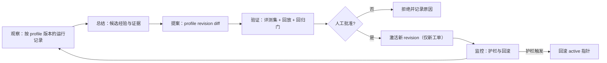

# 016 AgentProfile：可复用 agent 层设计

| 项 | 内容 |
| --- | --- |
| 状态 | 设计草案（Draft for review） |
| 日期 | 2026-11-10 |
| 基线 | `touch-agent/dsh-superagent` `main` `1b91fd8` |
| 关联 | [011 设计原则](011-design-principles.zh.md) C.1/C.3、[004 Prompts](004-prompts.md)、[003 Execution](003-execution.md)、[002 Authorization](002-authorization.md)、[013 工作空间](013-workspace-model.zh.md)、[TASK-PLAN](plan/TASK-PLAN.zh.md) T5-05/T5-07 |
| 一句话 | 把今天隐含在 `router`/`worker` 两个角色里的执行配置，显式化为**可版本化、可绑定、可观测**的 `AgentProfile`；权限仍只属于 Policy、Mandate 与动作闸门。 |

---

## 0. 结论

1. **现状不是「每次按任务动态装配、因此不可复用」，而是「两个角色级配置被所有工单复用，但没有身份、版本和运行证据」。** worker 的 prompt 由固定角色文本、团队段与环境段组成（Policy 段只在主 Session），工具是固定白名单，权限是固定的宿主 `danger-full-access`；按任务变化的只有 Input、目录、环境变量、Mandate 注记和子 Ticket 提示。真正缺的是「这是哪个 agent、哪一版、在哪些工单上、效果如何」，不是一套新的动态装配器。
2. **Eval 不是纯代码判定。** 它是「确定性 gate + 模型 assessment + 确定性校验与记账」的混合体：允许谁发起、以什么强度、是否准入、Mandate 的边界、接受模式，全部由代码决定；模型提议处置（`accept`/`ignore`/`unavailable`、`form`、标题、scope）并回答规则是否匹配、方向是否已定；代码用 `assessmentOutcome` 限定可接受的处置、校验规则覆盖与证据，并只由代码写 `Decision`/`Mandate`。**不能把确定性 Eval 换成 agent**；那会把「模型只判断、不授权」这条不变量反转。
3. **可复用 agent 层的价值不是「多几种 agent」，而是「让复用变得可比较、可回退、可被证伪」。** 两个角色今天已经在复用；如果 profile 只是把同一套配置换个名字，它只增加维护面。因此 Phase 1 先把快照、归因与基线做到可复核；它本身**不证明**收益。价值判断放到 Phase 2 的对照实验，并明确允许结论是「没有可测差异，停止」。
4. **权限上限不进入 profile。** profile 只描述执行能力：角色、模型、工具白名单、prompt 引用、评测基准；`maxActionLevel`、审批策略、允许的发送者、Mandate 时长、动作等级等授权字段一律不进入 profile，schema 直接拒绝。工作工具白名单只是「角色工作能力上限的子集」，不是「能做什么」的授权。
5. **第一阶段只做薄层：worker 注册表 + 绑定快照 + 遥测。** 不做自动 profile 选择、不做自动晋升、不做 profile 市场、不做运行时动态 preset、不建第二套授权。Phase 1 只用兼容 profile 与显式人工绑定；对照实验与提案回路放在 T5-05 的 profile 切片里，且先过可观测性门。

---

## 1. 现状诊断

### 1.1 方法与基线

本文的结论来自 `main` `1b91fd8` 的代码与编号文档，而不是票面假设。四个命题逐条给出「成立 / 部分成立 / 否证」、证据和设计含义；证据以文件与函数为单位，便于复核。

### 1.2 四个命题

| # | 命题 | 判定 | 证据 | 设计含义 |
| --- | --- | --- | --- | --- |
| H1 | 系统只有 router/worker 两层 | **基本成立，但需限定** | `packages/dsh/src/app/sessions.ts` 的 `ensure(..., role: 'orchestrator' \| 'worker')`、`ROUTER_PRESET`/`WORKER_PRESET` 与 `cordis.patch.yml` 的两个 superagent preset；`prompts.ts` 的 `type Role` 只是 prompt 组装参数 | 不存在第三种 superagent 持久角色；子 Ticket 与 subagent 是执行形态，subagent 另用宿主 `standard` preset，不是第三套可复用角色 |
| H2 | Eval 是纯代码判定 | **否证** | `assessment.ts` 的 `MasterAssessor` 把候选卡交给主 Session，模型经 `orchestrator_eval_decide` 产出含 `decision/form/title/scope` 的 assessment；`policy.ts` 的 `assessmentOutcome` 限定可接受处置并校验规则/方向/证据；`kernel/src/evals.ts` 的 gate、`decide` 与 `Mandate` 只由代码写 | 不能简化成「代码规则」或「模型判断」二选一；模型**提议**处置，代码**限定并授权**，二者已经分层 |
| H3 | worker 每次按任务动态装配 prompt/工具/权限，因此不可复用 | **部分否证** | `Prompts.compose` 用固定角色段 + 团队段 + 环境（Policy 仅主 Session）；工具固定为 `WORK_TOOLS`（子 Ticket 另减 `CHILD_DENIED`）；权限统一 `danger-full-access`；模型来自 `settings.eval.model`/`executor.model`，且只在新建 Session 时应用；只有环境、Input、Mandate 注记按工单变化 | 复用已经发生，但它是**隐式的全局复用**：prompt 每请求读最新版本，模型只在新 Session 生效；没有 profile 身份、有效配置快照和逐工单证据 |
| H4 | 缺少对某个 agent 的持续观测与自进化 | **成立** | `metrics.ts` 只有 ttfa、重复发送、重启恢复、判定吞吐、审批等待；`trace.ts` 的 span 是 Trigger 级；没有按 agent/profile 聚合；宿主 session event 有可选 `usage`，但 superagent 未落库，货币成本不可得；`T5-05` 仍是未开始 | 先补「按 profile 版本的有效配置与运行记录聚合」，再谈进化；否则任何「这个 agent 更好」的判断都没有基线 |

### 1.3 H1：两层角色，多于两种执行形态

`router`/`worker` 是仅有的两种**持久角色配置**：

- 主 Session 使用 `dsh-superagent-router` preset，工具被限制为路由所需的最小集合，prompt 是完整的主 Session 文本（`packages/dsh/src/app/sessions.ts` 的 `decorate`）。
- worker 使用 `dsh-superagent-worker` preset，工具被限制为 `WORK_TOOLS`，并且按子 Ticket 再减去 `subagent`、`send_message` 等（`workOnly`）。
- subagent 不作为第三种 superagent 角色：它由 worker 的 `subagent` 工具创建，运行在 DSH 的 `standard` preset 下（这是宿主 preset，不是第三套 superagent 角色），工具仍受 worker 的 `workOnly` 约束（`limitSubagent`），没有自己的 profile、模型策略或评测基准。
- 子 Ticket 仍是 worker 角色，只是没有自己的 Mandate、不能直接找人、不能使用 `subagent`/`send_message` 等；它复制父的执行位置，但今天的代码不会复制 profile，本设计必须补上（见 §2.6、§6.3）。

因此，**H1 的准确说法是「两种持久角色，多个执行实例」**。这让 profile 层不必先解决「任意角色编排」；Phase 1 先给 worker 加上可版本化的配置身份，router 的配置仍按进程/角色固定，Phase 2 再评估。把子 Ticket/subagent 当成「第三层 agent」会误判范围，也会把授权问题错误地塞进 profile。

### 1.4 H2：Eval 是混合判定，授权仍在代码

一次 Eval 的实际路径是：

1. `Intake` 记录 Trigger，`Evals.start` 用 `policy.gate` 做确定性准入：发送者是否被允许、强度是 `explicit` 还是 `inferred`、依据是什么。准入失败直接产生 `ignore` 或 `unavailable`，模型没有机会改变。
2. 对 `inferred` 候选，`MasterAssessor` 把候选卡交给主 Session；模型通过 `orchestrator_eval_decide` 返回 assessment：`decision`（`accept`/`ignore`/`unavailable`）、`form`、逐条规则判定、`direction`、标题、scope、证据。`orchestrator_eval_read` 只提供有界上下文；模型是在**提议**处置，不是在授权。
3. `assessmentOutcome` 在代码里限定处置：必须覆盖所有启用规则且每条恰好一次；接受必须方向已定、至少匹配一条规则、带 `intent_evidence`；只有 `strength=inferred` 且 `eval.mode !== auto` 时才把本可接受的 assessment 记为 `would_accept` 观察（`policy.ts`），其他不匹配/方向未定/缺证据各有自己的 `ignore` 或抛错。
4. `Engine.decide` 在事务里写 `Decision`；只有 `accept` 才创建 Ticket 与 `Mandate`，`Mandate` 记录授权边界。`stop` 需要一条被 gate 判为 `explicit` 强度的真人消息；代码校验强度，**不校验这条消息的语义是否真的要求停止**，所以模型可以在这条 explicit 消息上选择停止某个 Ticket，但不能凭空撤回 Mandate。
5. 动作时点还有独立的 `Action` 闸门、审批与 revalidate；prompt 文本改了也不会改这些检查（[004 Prompts](004-prompts.md) 明确写了这一点）。

结论：**H2 的「纯代码」不成立；但「授权是代码」成立。** 准确说法是：模型提议处置（包括 accept/ignore），代码限定可接受的处置、写入 Decision/Mandate 并保留动作闸门。可复用 agent 层可以改进 assessment 的质量，但不能把第 1、3、4、5 步交给 agent；那会把授权来源从代码换成模型输出。

### 1.5 H3：复用已经存在，缺的是身份与版本

worker 的 prompt 组成（`packages/dsh/src/app/prompts.ts`）：

- 固定段：`runtime/shared`、`runtime/worker`、`subscriptions`、`replies`、`work`、`handoff/worker`。
- 团队段：`communication`、`scope`、`delivery`，全团队共享。
- 生成段：执行环境（工单目录、名字、id、被禁命令、Source 变量）；Policy 段只加在主 Session。
- 追加：`Mandate` 的 `mandateInstructions`（仅 inferred 工单）和子 Ticket 提示。

工具组成（`packages/dsh/src/app/sessions.ts`）：

- 固定 `WORK_TOOLS`：文件读写、搜索、shell、job、web、skill、todo、subagent、Session 消息等。
- 子 Ticket 再减去 `subagent`、`list_subagent_models`、`send_message`、`list_agents`、`interrupt_agent`。
- 没有「按工单选择工具集」的路径；也没有「按工单选择模型」的路径。模型来自 `settings.eval.model`/`settings.executor.model`，只在 Session 创建时应用（[003 Execution](003-execution.md) §167）。

权限组成：

- 所有托管 Session 都被设为 `danger-full-access`（`Sessions.ensure`）；这是宿主执行权限。
- 业务授权在 `Mandate`、Action 闸门与 Approval；与 prompt/工具白名单是两条线。
- 因此「每次按任务装配权限」并不存在；存在的是「每次按任务记录授权边界」。

**H3 的准确说法是：prompt 与工具是角色级复用，环境与 Input 是任务级数据；系统缺少 profile 身份、不可变版本、逐工单快照和按 profile 的观测。** 这直接决定了设计方向：不要重写 assembly/executor 去做动态装配；在现有角色装配之上加一层薄的绑定与遥测。

### 1.6 H4：有 Trigger 级观测，没有 agent 级观测

现有观测能回答「这次 Trigger 走得顺不顺」：

- `span` 记录 ingest、dedupe、enqueue、gate、admission、assess、decide、attach、dispatch、action、report 等阶段（`packages/kernel/src/trace.ts`）。
- `metrics.ts` 给出判断耗时、重复发送、重启恢复、判定吞吐、审批等待。
- `KV.sessions.prompts` 记录每个 Session 实际用过的 prompt 版本，`Sessions.mayRead` 用它授权读 prompt 版本。

但它回答不了「worker 这个 agent 在这一类任务上表现如何」：

- 没有 profile id/revision 绑定到 Ticket 或 Assignment；`Execution` 只有 `name`/`directory`/`assignment`（`packages/kernel/src/model.ts`）。
- 没有按 profile 聚合的成功率、返工、延迟、review 发现；`metrics.ts` 的口径是整库/24 小时，不是 per-agent。
- 宿主 session event 的 `assistant/message.usage` 是可选字段；superagent 没有把它落库，货币成本也没有定价表。因此 token 用量要标「可能缺失」，货币成本只能标「不可得」，不能用单价猜。
- 没有离线进化脚本；`scripts/` 只有 bundle 检查、tracking 检查、安装 E2E 和 service 脚本。T5-05 尚未开始。
- prompt 是全局/角色级且每次请求读最新版本；模型只在新建 Session 时应用。二者都缺少逐工单的有效配置记录，使「这个 profile 更好」的因果判断天然混杂。

### 1.7 三个「profile」概念不能再混

| 概念 | 归属 | 生命周期 | 今天在哪里 | 与本设计的关系 |
| --- | --- | --- | --- | --- |
| DSH 安装 profile | DSH 宿主 | 一个 `$DSH_HOME/profiles/<name>` 目录 | `dsh --profile web`、`dsh.profile.bundles`、`cordis.patch.yml` | 不是本设计的 `AgentProfile`；它决定装哪些插件 |
| DSH agent preset | DSH 宿主 | 进程内静态声明，session 创建时选择 | `cordis.patch.yml` 的两个 preset；`Sessions.ensure` | 提供工具/插件组合的**物理底座**；本设计的 profile 不动态生成 preset |
| `AgentProfile` | dsh-superagent | 版本化、按工单绑定 | 本设计新增 | 领域层的执行配置与观测单位；不是授权，不是安装配置 |

把三者混为一谈，会导致两个错误：把安装配置当授权（错），或者把运行时动态生成 preset 当成默认路线。宿主公开了 `agentPresets.register()`，技术上可以动态注册；本设计**选择不做**，而是把 profile 编译到现有 preset + 现有 Session 装饰，换取可回退与更小的宿主耦合。

### 1.8 诊断结论

今天的问题不是「worker 不可复用」，而是：

- **不可识别**：同一套 worker 配置在跑所有工单，却说不清「是哪一个 agent 配置」。
- **不可比较**：prompt/model 是全局的，工单之间没有稳定的**有效配置**坐标；跨工单比较会被后续编辑、宿主升级和 skills 变化污染。
- **不可回退**：prompt 在运行中会读到新版本；模型只在新 Session 生效，重建后可能换模型；没有「只影响新工单」的配置边界。
- **不可演进**：没有按配置聚合的样本，T5-05 的提案没有基线。

因此，设计目标不是「再造一个动态装配器」，而是给现有装配加四件事：**身份、版本、绑定、证据**。

---

## 2. 目标模型

### 2.1 定义

`AgentProfile` 是一个**命名、版本化、不可变的执行配置**，属于一个角色（Phase 1 只启用 `worker`；`orchestrator` 只保留类型位）。它回答：

- 这个 agent 用什么模型策略；
- 它能使用角色的哪些工具（角色能力上限的子集）；
- 它读哪一版 prompt；
- 它用哪套评测基准来验证变更；
- 它由谁、在什么时候、为什么创建。

它**不回答**：谁可以发起工作、能做什么等级的动作、是否需要审批、能向谁发送、Mandate 多久有效。这些仍由 Policy、Eval、Mandate、Action 闸门与 Approval 回答。

### 2.2 字段

| 字段 | 必填 | 含义 | 约束 |
| --- | --- | --- | --- |
| `id` | 是 | 稳定 slug，如 `worker-default`、`worker-docs` | 小写 kebab-case；全局唯一；创建后不改 |
| `revision` | 是 | 单调递增的版本号 | 从 1 开始；一个 revision 一个不可变内容 |
| `role` | 是 | Phase 1 只接受 `worker` | `orchestrator` 保留类型位，但 Phase 1 不激活、不绑定；见 Q5 |
| `title` / `description` | 是 | 给人看的名字与用途 | 不进入 prompt；只用于面板与审计 |
| `model` | 是 | `{ mode: 'inherit' \| 'pinned', provider?, model?, reasoningEffort? }` | `inherit` 只允许兼容 profile；`pinned` 必须完整且命中部署已批准的 provider/model 列表；缺失/未批准/不可用在 launch 时 fail closed，不阻塞 accept |
| `tools` | 是 | **工作工具**策略：`{ mode: 'inherit' \| 'list', names?: string[] }` | `inherit` 只允许兼容 profile，跟随角色工作上限；`list` 必须是角色工作上限的子集，空数组只表示没有工作工具，**不等于只读**；协议工具不由 profile 控制；不得出现授权字段 |
| `prompt` | 是 | `{ mode: 'live' \| 'pinned', revision? }` | `live` 只允许兼容 profile；`pinned` 必须指向存在的 prompt revision |
| `evalBaseline` | 否 | 默认评测基准引用 | `{ evalSet: string, revision: number }`；只是声明，不是激活门；实验用自己的 manifest，见 §4.4；修改它产生新 `contentHash` 供审计，但不改变 `effective.hash` 或运行配置 |
| `provenance` | 是 | 创建来源与理由 | `{ by, at, reason, source: 'builtin' \| 'panel' \| 'tool' \| 'import' }` |
| `contentHash` | 是 | 规范化内容的 hash | 只覆盖 revision 内容；不覆盖运行时环境，后者见快照的 `effective.hash` |

**生命周期不在 revision 里。** `status` 不进入 revision 内容；profile head 保存 `activeRevision`、`retiredRevisions`、`lastBoundAt`、`updatedBy`。这样「revision 不可变」和「退役/激活」不会互相打架。

**禁止字段（schema 必须拒绝，而不是忽略）**：`maxActionLevel`、`approval`、`allowed`、`blocked`/`allow` 发送者、`mandateMinutes`、`undoWindowSeconds`、`sources`、`permissionPreset`、`actionLevels`、任何凭据或密钥。工具白名单不是授权：它只决定「这个 agent 有没有这个工作工具」，不决定「这个动作允不允许」。

### 2.3 版本与激活

- **一个 profile 是一串不可变 revision**；修改任何 revision 字段都产生新 revision，不原地更新。
- **head 是可变元数据**：`activeRevision(id)` 指向当前对外提供的 revision；`retiredRevisions` 记录被撤下的 revision；`lastBoundAt` 用于运维提示。head 不是 profile 内容，不参与 `contentHash`。
- **激活是人的动作**：通过管理面保存，记录 `by`、`at`、`reason`、`baseRevision`；不做自动晋升，不允许 worker 工具改 profile。
- **退役不删除**：从 active 指针撤下并写入 `retiredRevisions`；历史快照仍可解析，保证审计可读。退役不是修改 revision。
- **内置 profile**：Phase 1 只播种 `worker-default@1`，它是**兼容 profile**（`model.mode=inherit`、`prompt.mode=live`、`tools.mode=inherit`），逐字复现今天 worker 的行为；`tools.mode=inherit` 跟随 `WORK_TOOLS` 的未来变化，而不是冻结一份今天工具名清单。`orchestrator-default` 在 Phase 1 不播种、不绑定；主 Session 的工具与模型仍按现有角色配置固定，避免把 `orchestrator_route`/`eval_decide`/`settings_save` 当成可被 profile 选择的“能力”。
- **自定义 profile 必须 pin 模型与 prompt，并用 `tools.mode=list` 显式列出工作工具**；兼容 profile 是唯一允许 `inherit`/`live` 的例外，且被标记为 `moving`（见 §2.4）。
- **内容 hash**：对规范化 JSON（键排序、去空白、排除 `contentHash` 自身；`tools.names` 先排序）计算；`contentHash` 包含 `provenance.at/by/reason` 与 `evalBaseline`，以便审计变更可追踪。`effective.hash` 只覆盖运行时字段（model/tools/prompt），**不包含** title/description、`provenance`、`evalBaseline`，避免换评测声明被误判成执行配置漂移。`prompt.hash` 由 prompt revision 的内置文本计算，不只 hash revision 号。

### 2.4 绑定快照

工单在创建时绑定一个**解析后的快照**，而不是只记 `profileId`：

```json
{
  "id": "worker-docs",
  "revision": 3,
  "hash": "sha256:…",
  "role": "worker",
  "selection": { "by": "code", "source": "manual", "reason": "profile:worker-docs", "moving": false, "valid": true },
  "model": { "mode": "pinned", "provider": "deepseek", "model": "deepseek-v4.1", "reasoningEffort": "medium" },
  "tools": ["read", "write", "edit", "glob", "grep", "bash", "skill", "todo_write"],
  "toolsMode": "list",
  "prompt": { "mode": "pinned", "revision": 42, "hash": "sha256:…" },
  "effective": {
    "promptRevision": 42,
    "promptHash": "sha256:…",
    "toolsHash": "sha256:…",
    "model": { "provider": "deepseek", "model": "deepseek-v4.1", "reasoningEffort": "medium" },
    "dshVersion": "0.2.1-rc.5",
    "policyVersion": "sha256:…",
    "skillsHash": "sha256:…",
    "hash": "sha256:…"
  },
  "boundAt": "2026-11-10T06:33:42.000Z",
  "reason": "rule:docs"
}
```

落点建议：

- **`Ticket.profile`**（顶层，与 `execution` 同级）：在 `Tickets.create`/`delegate` 写入一次，之后不变。**不放在 `execution` 里**，因为 `DshExecutor.prepare` 会用 `ticketExecution` 重建 `execution`（`name`/`directory`/`assignment`），放进去会被覆盖；顶层字段也能让 `prepareTicket` 的 spread 自然保留。旧工单没有该字段即视为 `legacy` 解析规则，不重写。
- **`Assignment` 不重复存快照**：Assignment 属于 Ticket，重试/重启沿用同一快照；这样「同一工单的多次尝试」共享配置坐标，返工也可归因。
- **子 Ticket 只继承、不覆盖**：`delegate` 不增加 profile 参数；子 Ticket 复制根 Ticket 的快照。Phase 1 不允许父 owner 给子 Ticket 换 profile。若 Phase 2 要允许，必须满足「子有效工作工具 ⊆ 父有效工作工具」且模型/prompt 不更宽；这是能力收紧，不是扩权。
- **subagent**：它没有自己的 profile；`limitSubagent` 必须从根/父 Ticket 的快照解析有效工作工具，而不是固定 `WORK_TOOLS`。如果 profile 是 `pinned` 模型，则 subagent 的 `modelSelection` 必须关闭或强制使用父模型；做不到就不允许该 profile 使用 `subagent`。
- **trace**：复用已有 `dispatch` span 的 `data`，写入 `profile.id`、`profile.revision`、`profile.hash`、`effective.hash`、`prompt.revision`、`toolsHash`；Phase 1 不新增 span kind。
- **Session 记录**：现有 `KV.sessions.prompts` 继续记录每个 Session 实际用过的 prompt revision；`effective` 快照记录绑定时的起点。每次 Session/请求还要记录 `run.effectiveHash`（用实际 prompt revision/model/工作工具/DSH/Policy/skills 重算）；`moving` 工单按 run hash 分组，且不进入因果比较。

**有效配置与比较单位。** 两个工单只有在 `effective.hash` 一致时才可归为同一配置；仅 `(profile.id, revision)` 一致不够。`effective.hash` 覆盖：

- profile 运行时字段 hash（model/tools/prompt；不含 title/description、provenance、evalBaseline）；
- 实际 prompt revision + prompt 配置 hash（内置文本 + 团队段）；
- 排序后的工作工具集合 hash；
- 实际模型标识与 `reasoningEffort`；
- DSH 版本、Policy 版本、skills hash。

`live`/`inherit` 的兼容 profile 在绑定后仍可能移动：prompt 每请求读最新版本，模型在新 Session 重建时可能变，`tools.mode=inherit` 也可能随宿主工具集变化。快照必须标记 `selection.moving=true`，记录**实际** prompt revision/model/工具集；这类工单只用于基线描述，不进入因果比较（见 §4.5）。DSH 版本、仓库基线与任务难度是分层维度，不是 profile 版本内容；但必须随运行记录保存，否则会把宿主升级或任务难度误算成 profile 效果。

### 2.5 复用语义

- **定义复用**：多个工单可以绑定同一个 profile revision；这是默认路径。
- **版本隔离**：新 revision 只影响新工单；已绑定工单继续用快照。自定义 profile 的 pinned prompt/model 在运行中不变；兼容 profile 的 `live` prompt 仍按现有行为读最新版本，`inherit` model 只在新建 Session 时解析，因此它**不是稳定坐标**。
- **可回退**：把 active 指针指回上一 revision，只影响新工单；已绑定工单不变。紧急情况下用 `profiles.config.resolve=legacy`，但它只影响新 Session/新请求，运行中的工具与模型不变，详见 §6.5。
- **不可变不是不可修**：发现某 revision 有问题时，不修改它；新建 revision 修复，并把有问题的 revision 放入 `retiredRevisions`。历史工单仍能解释自己当时用了什么。

### 2.6 权限边界（本设计的硬约束）

| 问题 | 归属 | 是否进入 profile |
| --- | --- | --- |
| 谁可以发起工作、以什么强度 | Policy gate / admission | 否 |
| 是否接受、创建 Mandate | Eval + `Engine.decide` | 否 |
| 能做哪一级动作、是否需要审批 | Mandate + Action gate + Approval | 否 |
| 能向谁发送、发送窗口 | Policy / Approval | 否 |
| 宿主执行权限（文件/网络/OS） | DSH permission preset + deployment | 否 |
| 这个 agent 能用哪些**工作**工具 | Profile（角色工作上限的子集） | 是，但只是能力 |
| 这个 agent 用哪个模型、哪版 prompt | Profile | 是 |
| 这个 agent 的评测基准 | Profile 的声明引用 | 是，但不是运行时授权 |

**有效工作工具 = 角色工作能力上限 ∩ profile 工作策略（inherit 取上限，list 取名单）∩ 宿主实际可用工具。** 再加上一组**固定的协议工具**（如 `orchestrator_ack`、`orchestrator_report`、`orchestrator_child` 与 thread/trigger 相关工具），它们由 executor 注册、不可被 profile 移除，因为 worker 必须有办法汇报和结束。具体名单以 `tools/executor.ts` 为准，文档不把主 Session 专用工具算进来。`tools.names: []` 只表示没有工作工具，不表示只读；只读要通过真正的只读工具集/权限实现。

Phase 1 **只激活 worker profile**；`orchestrator_route`、`orchestrator_eval_decide`、`orchestrator_settings_save`、`orchestrator_prompts_save` 等主 Session 工具不进入 profile 白名单，仍由角色固定。子 Ticket 的有效工作工具必须 ⊆ 根 profile 的有效工作工具；subagent 同理。任何一层都不能通过 profile 获得角色上限之外的工具，也不能改变 `Mandate`、`maxActionLevel`、审批或验收。工具缺失时在 launch 阶段 fail closed（见 §6.6），不静默降级。

---

## 3. 分层与边界

### 3.1 分层

| 层 | 负责 | 不负责 | 与 profile 的关系 |
| --- | --- | --- | --- |
| Source / Intake | 记录 Trigger、Thread、身份 | 授权、执行配置 | 不读 profile |
| Eval | gate、assessment、Decision、Mandate | 执行工具、模型选择 | 可以**提案** profile，但不能授权 |
| Authorization | Mandate、Action 闸门、Approval、验收 | agent 配置 | 不读 profile；profile 不是授权输入 |
| Execution | Executor、Assignment、Session、工作目录 | 授权、配置治理 | 读取绑定快照，按快照创建 Session |
| Profile | 注册表、版本、激活、绑定、快照 | 授权、动作等级、审批 | 只描述执行能力 |
| Evolution | 观察、总结、提案、回放、回归门 | 自动应用、改授权 | 以 profile 版本为聚合单位，只产出提案 |

依赖方向：`Execution → Profile → (只读) Policy/Ticket`；`Eval`/`Authorization` 不依赖 Profile 的可用性。Profile 解析失败**不得回滚已记录的 Decision**；它只影响 launch，见 §6.6。任何反向依赖（Profile 读 Mandate 来放宽工具、Execution 用 profile 绕过 Action 闸门）都是设计违规。

### 3.2 确定性与 agent 的分工

| 决定 | 谁做 | 形态 | 是否可由 agent 替代 |
| --- | --- | --- | --- |
| 是否准入、强度、规则匹配校验 | 代码 + 模型 assessment | gate + `assessmentOutcome` | 否 |
| 是否接受、创建 Ticket/Mandate | 代码 | `Engine.decide` | 否 |
| 动作等级、审批、发送 | 代码 | Action gate/Approval | 否 |
| 规模判定（tracked/lightweight） | agent 提案，代码校验 | assessment `form` | 只能提案 |
| 拆分（多工单） | agent 提案，代码按 dispatch 模式解析 | dispatch items | 只能提案 |
| 选 profile | 代码/人按任务事实选择；agent 只可提案 | 代码 selector + 可驳回提案 | 只能提案 |
| 升级建议（换 profile/模型/工具） | agent/人提案，人批准 | evolution proposal | 只能提案 |
| 验收 | 规则或人 | Acceptance | 否 |

### 3.3 提案必须留痕、可驳回

提案不是命令，而且**不能放在模型可控的自由 JSON 里**。`Decision.audit` 的内容来自 assessment（`policy.ts` 的 `audit`），模型可以填任意字段；因此 profile 的绑定、接受、回退、hash 绝不能用 `audit` 作为事实来源。

Phase 1 **不接受模型提交 profile 提案**；绑定只由代码按内置兼容 profile 或管理员显式配置完成。Phase 2 若要接收提案，必须是**代码拥有的 typed 记录**，与 `Decision` 分开：

| 字段 | 谁写 | 含义 |
| --- | --- | --- |
| `kind` | 代码 | `profile`、`form`、`split`、`escalation` 等 |
| `subject` | 代码 | 针对的工单/Trigger/profile |
| `proposed` | 提案者 | 建议值（如 `{ profileId, revision }`），只读 |
| `evidence` | 提案者 | 支持证据的引用（规则、上下文、历史指标），不是全文 |
| `confidence` | 提案者 | `low` / `medium` / `high`，低置信只记录 |
| `by` / `at` | 代码 | 提案者身份与时间，代码从 Session/Trigger 绑定，不接受自由文本冒充 |
| `decision` | 代码或人 | `accepted` / `rejected` / `ignored` / `superseded` |
| `decidedBy` / `decidedAt` | 代码或人 | 谁、何时作出决定 |
| `reason` | 代码或人 | 拒绝/接受原因；拒绝也必须写 |

落点：

- **工单绑定**：只写 `Ticket.profile`，字段 `selection.by` 固定为 `code` 或 `human`；不写 `Decision.audit`。
- **执行中的升级建议**：写进 worker 的 Report/Attention 或独立的 evolution 提案队列；不能直接改 profile。
- **Phase 2 的 profile 变更提案**：单独的代码拥有记录，见 §4.3。

**关键不变量**：`accepted` 只表示「这个提案被采纳为执行配置」，不表示「授权被扩大」。授权仍只在 Mandate 与 Action 闸门里。任何选择逻辑都只读任务事实和管理员配置，不读模型 assessment 的 `audit`。

### 3.4 agent 能否替代确定性 Eval

不能。理由不是「模型不够聪明」，而是四条结构性约束：

1. **不变量会被反转。** 平台原则 P2 是「模型只判断，不授权」（[012](012-platform-evolution.zh.md) §2）。模型可以**提议** accept，但代码必须限定可接受的处置并写 Mandate；如果模型直接决定授权，来源就从代码变成模型输出，prompt 一改，权限就跟着改。
2. **不可复现。** 模型有采样、provider 切换、上下文截断和版本变化；同一 Trigger 在不同时间可能得到不同的 accept。确定性 gate + `policyVersion` 才有可复核的准入。
3. **可注入。** Source 文本是不可信输入；模型会被其中的指令影响。gate 在读取消息内容之前就决定了发送者能否发起工作，这条防线不能交给会被文本影响的组件。
4. **审计与可用性。** 代码能给出稳定的 reason code、规则匹配、policy version；模型只能给理由文本。模型超时/欠费/限流时，确定性 gate 仍能让系统做「拒绝/排队」的安全决定，而不是把准入也一起停掉。`stop` 也要精确：代码只校验消息是 explicit 真人消息，不校验语义是否真的要求停止；这是现有行为，不应被描述成「代码校验了停止意图」。

可以交给 agent 的是**判断质量**：规则是否匹配、方向是否已定、候选是否值得做、建议哪个 profile、是否建议升级。这些都以可驳回的提案进入代码校验；代码保留接受、拒绝、记录和回退的权力，且不得把提案当作授权或绑定事实。

### 3.5 profile 选择的边界

- **按任务事实选，不按身份选。** selector 的输入是规则 id、`form`、Source kind、任务类别等任务事实；不读 actor、组织成员、付费等级或「这个人是管理员」。同一个人在 docs 任务和 code 任务上可以得到不同 profile，因为任务不同，不是因为他「级别更高」。
- **不建「管理员 profile」。** 高权限不是 profile 的属性；如果某类任务需要更高动作等级，那由 Policy/Mandate/Approval 决定，profile 只能决定「用哪些工具、哪个模型、哪版 prompt」。
- **Phase 1 只启用 worker profile，且不做自动选择。** 新工单绑定 `worker-default@1`（兼容 profile）；自定义 profile 只能由管理员显式绑定。`orchestrator` 的 profile 不激活，主 Session 的路由/评估/设置工具保持角色固定。
- **fallback 只发生在绑定前，且可审计。** 如果选中的 profile 整体不可用（被删除/未激活），绑定 `legacy` 并记录 `reason=profileUnavailable`；该工单在遥测中标记为 fallback，不混入被比较的 profile 组。已经绑定到某个自定义 profile、但运行时缺工具/缺 prompt 的工单**不在 launch 时静默回退**，而是 `blocked` 并写清原因（§6.6）。Profile 解析失败不能让 `Decision` 失败或回滚。

---

## 4. 演进闭环

### 4.1 闭环



原则（对齐 [011](011-design-principles.zh.md) C.1）：

- **独立于执行 worker**：观察者/分析者不是当前工单的 worker；它读多个工单，不顺手改自己的配置。
- **默认只提案**：版本化、可回滚；不自动改授权、代码、schema 或生产配置。
- **人工批准**：激活由人完成；agent 不能自批，bot 不能代批。
- **前后指标**：没有基线和最小样本，不采纳。

### 4.2 观察什么

以**一个根工单的一次绑定**为基本样本；子 Ticket 与 lightweight 单列，不混入根工单的成功率。同一工单的多次 Assignment 仍属于同一配置坐标，返工与运维重试分开计数。

| 指标 | 定义 | 数据来源 | 今天是否可得 |
| --- | --- | --- | --- |
| 成功率 | 根工单以 `Ticket.ended.outcome` 为 `completed` 或 `merged`；`closed` 是关闭未合并，**不算成功** | `Ticket.ended` | 可得（需 profile 绑定） |
| 返工 | 同一工单出现新的 `Assignment`（`attempt` 增加且不是运维重试）、父 owner `return_child`、`ready` 后收到 `TicketInput kind='resumed'`、或接受后 `Report.accepted.reviewRevision` 变化 | `Ticket.assignments`、`Delegation.attempt/dispositions`、`Ticket.inputs`、`Report.accepted` | 部分可得 |
| 阻塞/失败/停止 | `Assignment.report.state` 为 `blocked`/`failed`，或 `Ticket.ended.outcome` 为 `stopped`/`dropped`；原因码单列 | `Assignment.report`、`Ticket.ended` | 可得 |
| 延迟 | 决策→首次 dispatch、dispatch→首次 `ready`、`ready`→end 的 p50/p90；tracked 才有 | `Decision.at`、`Assignment.startedAt`、`Report.at`、`Ticket.ended.at` | 可得 |
| token 用量 | 输入/输出/cache/reasoning token；宿主 event 可选，superagent 未落库时为 `unknown` | `assistant/message.usage`（若适配器提供） | **可能缺失**；Phase 1 先采，采不到就标 unknown |
| 货币成本 | 需要定价表；今天没有 | — | **不可得**；不得用单价估算冒充 |
| review 发现 | 交付物被接受/退回（`Report.accepted`，含 `reviewRevision`）；PR 评论数 | `Report.accepted`；`Review` 只有 criteria，不记录拒绝；PR 评论需 Source 另取 | `Report.accepted` 可得；PR 评论 Phase 1 不可得 |
| 注意力 | 每个结果的对外通知数 | `activity`/outbox | 可得，Phase 1 可不做 |
| 子 Ticket 成功 | 父 owner `Delegation.resolution.kind='accepted'`，不是人的 Review | `Delegation.resolution` | 可得；与根工单成功率分开 |
| lightweight 成功 | `Ticket.ended.outcome`；没有 Assignment/Session | `Ticket.ended` | 可得；延迟/返工不适用 |

口径必须写清，否则指标不可复核：

- **分母**：成功率分母是「已绑定、已结束的根工单」；分析截止时仍 open 的工单是 censored，单列，不插补。`dropped`/`stopped` 不计入成功率，单独报告；`closed` 计为未成功。
- **重试 vs 返工**：host restart、崩溃恢复、launch 失败后的新 Assignment 是运维重试，按 `Assignment.endedReason` 等单列；只有「有交付/判定之后再次做」才算返工。
- **review revision 不是 review 次数**：它是内容 hash；不能把 `reviewRevision` 变化次数当作 review comment 数。review 评论只能从 GitHub API/Trigger 另取，Phase 1 标「不可得」。
- **子 Ticket**：父 owner 接受是子 Ticket 的成功；它不是人的 Review，也不能把子 Ticket 的 `completed` 加到根工单成功里。
- **lightweight**：没有 Assignment/Session，延迟与返工不适用；单独报告成功率。
- **n<5 抑制**：只用于面板展示，防止小样本反推隐私；**不是分析规则**，分析使用全部样本并报告 n/CI。
- **profile 分组**：冻结配置按绑定 `effective.hash`，`live`/`inherit` 按每次运行的 `run.effectiveHash`；再按任务类别/规则 id/`form`/Source 分层。仅按 `(id,revision)` 分组不够，`moving` 组不能进入因果比较（见 §2.4）。

聚合规则：

- 每个分组报告 `n`、缺失字段数、censored 数、fallback 数；`n < 5` 只显示「样本不足」，不显示比例。
- 只存聚合与引用，不存 prompt 全文、消息全文或 review 正文。
- 观察集与验证集分开；验证集是 holdout，不参与提案生成（见 §4.4）。

### 4.3 总结与提案

总结的产物是**候选经验**，不是直接改配置：

| 字段 | 要求 |
| --- | --- |
| 假设 | 一句话，可证伪，例如「docs 任务用只读工具集可把返工率降到 X 以下」 |
| 证据 | 引用的 `effective.hash`、任务类别、样本量、指标、时间窗；不含私密全文 |
| 置信度 | `low`/`medium`/`high`；低置信只记录，不提案 |
| 适用范围 | 哪类任务、哪个 Source、哪个角色；不写「所有任务」除非有证据 |
| 预期效果 | 主要指标与护栏指标的方向/幅度、MDE |
| 风险 | 可能的漂移、权限误解、评测污染、选择偏差 |
| 回滚 | 指回上一 active revision 的条件与操作 |

提案是**一个 profile revision diff**，不是自然语言建议，也不是 `Decision.audit`。Phase 2 的提案记录至少包含：`baseRevision`、`proposedRevision`、字段 diff、证据引用、评测计划（eval set/holdout/分配机制/MDE/样本量）、批准人、回滚条件。没有这些字段的提案不进入批准队列。提案记录由代码拥有；模型只能填 `proposed/evidence/confidence`，不能填 `decision/decidedBy`。

### 4.4 评测集与回归门

**评测集（eval set）**是一个版本化 manifest：

- `evalSetId` + `revision`；
- 任务条目：输入 fixture、任务类别、期望验收（规则或人评 rubric）、回放允许的动作等级（这是测试沙箱约束，不是生产授权）、超时、是否 holdout；
- 环境指纹：DSH 版本、模型 provider/model、工具清单、仓库基线；
- 私密与副作用限制：不包含不应进入 Git 的私密内容；回放不得对外发送、推送、合并或改共享文档。评测集的存放位置、访问权限与保留期必须在 manifest 中写明；`source=import` 的 profile 不得把仓库/飞书内容路由到未批准的 provider。

**回放模式**（按风险从低到高）：

1. `dry`：只读，产出 diff/草稿，不执行外部写；适合 code/docs 的初筛。
2. `sandbox`：一次性工作树/分支，允许本地写与测试，不 push、不 send、不 merge；适合 code。
3. `human`：产出草稿或预览，由人按 rubric 评分；适合办公类、无法机器判定的任务。

**回归门**（在候选 revision 激活前）：

- **主指标与 MDE 预登记**：只选一个主指标（默认根工单成功率），先写下最小可测效应（MDE）、α、power、非劣边界。例：基线 80%、MDE +5pp 的两比例检验约需 1,000+/组；基线 50% 时约 1,500/组；分层后更多。「20 次运行/10 对样本」只能做 pilot，不能作为晋升证据。
- **分配机制**：在同一任务类别内做并发随机/交替分配，或对同一历史工单做候选/基线配对回放；不能按任务难度让某一 profile 只接容易的活。selector 决定生产默认，**实验分配独立于 selector**；否则 profile 与分层共线，组内没有对比。
- **护栏**：返工率、阻塞率、p90 延迟、token 用量（可得时）、review 发现（可得时）不得恶化超过预登记阈值；货币成本在不可得时**不作为门**。
- **分析**：ITT（fallback 单列但保留在原组）、censoring 单列、报告 95% CI；多重比较只允许一个预登记主指标，其他为探索性；序贯/提前停止需预登记。
- **holdout**：验证只用未参与提案的 holdout；holdout 成员 hash 记录在提案里；一个候选只允许有限次「看结果再改」。
- **人工批准**：批准人看到指标、样本、护栏、回滚条件后签字；没有自动应用路径。
- **灰度**：新 revision 只绑定新工单；可先 10% 流量；护栏触发即回滚 active 指针，运行中工单不受影响。

**结论可以是「不采纳」。** 如果没有可测收益，保留当前 profile；这是默认结果，不是失败。R13（M5 范围过大）要求这条闭环能随时停下，不拖住 M4。

### 4.5 「复用是否真带来可观测收益」的检验

先把两个门分开，避免用同一个「能回答」掩盖：

- **Phase 1 可观测性门**：能回答「这个工单绑定了哪个 profile、有效的 prompt/model/工具/DSH 版本是什么、结果如何」，并能按 `effective.hash` 聚合。它**不证明** profile 更好，只证明归因可用。
- **Phase 2 价值门**：在预登记实验里，候选 profile 相对基线有超出噪声的改善，或者明确「没有差异」。没有对照，Phase 2 不得启动。

可证伪的检验：

- **零假设 H0**：在任务类别分层后，profile 版本之间对主指标（默认成功率）的差异不超过预登记 MDE；护栏不恶化。
- **备择 H1**：至少一个预登记任务类别上，候选 profile 的主指标优于基线且超过 MDE，护栏不恶化。
- **分配**：并发随机/交替，或同工单配对回放；profile 必须与任务类别有重叠；不能拿 selector 的规则当处理变量，也不能让 profile 只接某类任务。
- **基线**：legacy 工单单独标 `legacy`；`worker-default@1` 基线单独采，不把历史工单重标成 `worker-default@1`。两者不能混在一个对照组里。
- **样本与停止**：先按基线率和 MDE 算样本量；达到预登记样本后看结果。若 CI 排除 MDE 且方向不利，停止；若 CI 很宽、样本不足，是「证据不足，延长观察」，不是「无差异，停止」。不能因为 n<5 或分层格子空就宣称没有收益。
- **成本**：token 用量可得时作为护栏；货币成本不可得时从价值门移除，不写「成本更低」的结论。
- **替代方案**：如果目标只是「给工单记录 prompt revision/model/tools/DSH 版本」，一个 `Ticket.profile.effective` 快照 + 现有 trace/metrics 就可能够，不必先引入完整 registry。registry 的正当性是「固定自定义 profile + 可回退 + 选择器」；Phase 1 必须证明这些治理能力值得，而不是假设。

如果做不到对照实验，正确结论是「profile 层只是给现有角色配置改名」，应停止在 Phase 1，而不是继续堆功能。

**落地（2026-11-12，T5-05 Phase 2）**：`scripts/evolution/core.ts` 的 `gate()` 保留本节预登记与回归门；新增 `valueGateOf()`/`valueGate()` 只做四结局分类（`improvement`、`no-difference`、`guardrail-regression`、`insufficient-evidence`），只有「未舍入的主指标 ≥ MDE 且区间下界 >0、p<α」并且所有可用护栏不恶化时才给 `recommendation=adopt`。指标覆盖成功率、返工、review 发现、p90 延迟与 token 成本；缺失值保持 `unknown`，货币成本始终 `unknown` 且不进价值门。它没有写路径，不改变本节任何样本量、停止点、α/MDE 或 holdout 规则。详见 [020 §2.6](020-evolution-loop.zh.md)。

---

## 5. 风险与反模式

| # | 风险/反模式 | 症状 | 护栏 | 检测 | 回退 |
| --- | --- | --- | --- | --- | --- |
| R1 | profile 漂移 | id/revision 未变但实际 prompt/model/工具变了；`live`/`inherit` 让同一 revision 跑出不同配置 | `contentHash` + `effective.hash`；激活前 preflight；运行中只读快照；`moving` 不参与因果比较 | 快照 hash 与 trace 抽查；effective hash 分组 | 回滚 active 指针；重建 revision |
| R2 | 把权限写进 profile | profile 出现 `maxActionLevel`、`allowed`、`approval`、`mandateMinutes` | schema `.strict()` 拒绝未知/禁止字段；review checklist；测试 | 注册表扫描；PR 检查 | 拒绝保存；已保存 revision 放入 `retiredRevisions`，不用于新工单 |
| R3 | 按身份而非任务授权 | 按 actor/角色名选 profile；「管理员 profile」工具更多 | selector 只读任务事实；禁止 actor 字段；工具 ⊆ 角色上限 | 代码审查 + selector 单测 | 删除映射；回到默认 profile |
| R4 | 评测集污染 | 提案生成用过 holdout；反复看结果调阈值 | holdout 冻结、成员 hash、使用预算、时间切分 | 提案记录中的 evalSet hash/使用记录 | 该轮结论作废；换 holdout 重跑 |
| R5 | profile 泛滥/重复 | 每个小任务一个 profile；同一配置多份 | Phase 1 不强制数量上限；owner/用途/`lastBoundAt` 提示；优先合并 | 注册表统计；人工 review | 合并/退役；不删除历史 |
| R6 | 快照腐烂 | 工具/模型/prompt 在宿主升级后消失 | 激活前/preflight；缺工具 fail closed；快照记录版本 | 启动检查；运行失败原因 | 修 profile 新 revision；紧急回退 legacy |
| R7 | 错误归因 | 把任务难度、Source、reviewer 差异算成 profile 效果 | 按任务类别分层；配对/同期比较；报告 n 与 CI | 指标面板；评审 | 不采纳；补样本 |
| R8 | 遥测泄露隐私 | 聚合里出现消息全文、review 正文、个人识别 | 只存指标与引用；n<5 抑制；保留期 | 数据检查；review | 删除超范围字段；只保留聚合 |
| R9 | 过拟合评测集 | 在 holdout 上反复调参 | holdout 轮换；一次性评估预算；预登记 | 提案历史 | 作废该轮；重跑 |
| R10 | 运维复杂度 | 团队不知道用哪个 profile；激活/回滚需要改代码 | 默认兼容 profile；只读面板；一条命令回退；Phase 1 不做自动选择 | 使用率/告警 | 关闭 profile 绑定，回 legacy |
| R11 | 把宿主变化当 profile 效果 | DSH/provider 升级与 profile 变更同时发生 | `effective.hash` 记录 DSH 版本、provider/model、工具/技能清单；变更分开上线 | 环境指纹对比 | 隔离变更；重跑基线 |
| R12 | 提案变成事实授权 | 提案被自动应用；无人复核 | 只提案；人工批准；提案记录不可变 | 批准队列审计 | 回滚；撤销自动路径 |
| R13 | profile 成为第二套上下文装配 | 在 profile 里塞组织/用户/群组上下文，绕过 T5-04 | profile 只放角色/模型/工具/prompt 引用；上下文归 T5-04 | 字段 review | 删除上下文字段，回到装配层 |
| R14 | 「兼容 profile」被当成自定义配置 | 用 `live` prompt/inherit model 做 A/B，结果不可比 | 只有 `worker-default` 可用兼容模式；自定义必须 pin；`moving` 工单不进入 A/B | 注册表校验 | 强制 pin 或拒绝激活 |
| R15 | 子 Ticket/subagent 绕过父 profile | 父排除了 `web_fetch`/`bash`，子仍拿到；subagent 另选模型 | 子只复制根快照；有效工作工具 ⊆ 根；subagent 从快照解析并禁用 `modelSelection` 或强制父模型 | 测试「父排除，子/子代理也拿不到」；trace 校验 | 拒绝 delegate/禁用 subagent；回退 legacy |
| R16 | 旧二进制读新配置 | 新增 settings 块或 ticket 字段导致回滚失败 | flags 放独立 KV，不进 strict `SettingsSchema`；ticket 字段可选、旧代码忽略 | 旧 schema 解析新数据测试；回滚演练 | 移除 KV/字段；回到 legacy |
| R17 | 模型输出变成配置事实 | `Decision.audit` 里的 `accepted/fallback` 被信任 | 提案是代码拥有记录；绑定只由代码/人写；assessment 不携带绑定事实 | 测试「assessment 伪造 accepted 被忽略」 | 删除相关字段；重新绑定 |

**反模式清单**（出现即应在 review 中拒绝）：

- 「profile 就是权限包」：把 `maxActionLevel`、审批、发送白名单放进 profile。
- 「按人建 profile」：Alice 用高级模型，Bob 用低级模型；这是身份授权，不是任务配置。
- 「每个工单一个 profile」：没有复用，只有版本爆炸。
- 「profile 里写组织/群组上下文」：越过 T5-04 的装配表。
- 「自动晋升」：一周指标好看就自动切 active。
- 「用单价估算成本」：没有 token 数据就写 `unknown`，不要伪造；货币成本不作为价值门。
- 「`tools.names: []` = 只读」：协议工具仍在，只读要靠真正的只读工具集/权限。
- 「把 `live`/`inherit` 当稳定坐标」：它们只能做兼容基线，不能做 A/B 的处理组。
- 「把 subagent 当第三角色」：subagent 没有独立 profile；它继承 worker 的工具上限。
- 「运行时动态生成 DSH preset」：宿主能注册，但本设计选择不做；它会把配置治理变成插件管理。

---

## 6. 分阶段最小落地

### 6.1 阶段划分

| 阶段 | 内容 | 交付 | 是否改行为 |
| --- | --- | --- | --- |
| Phase 0 | 本文：定义、边界、指标、实验设计、回滚 | 设计文档 + 计划任务 | 否（docs-only） |
| Phase 1（T5-07） | worker 注册表、兼容 profile、有效配置快照、Session 解析、trace/API、按 profile 聚合、token 用量尝试采集 | 运行时与测试 | 默认无；自定义 profile 显式开启 |
| Phase 1.5（可选） | 只读面板 E2、fallback 审计展示 | 面板/小改动 | 只读 |
| Phase 2（T5-05 扩展） | 预登记对照实验、profile 维度的观察→总结→提案→回放→回归门→人工批准→灰度 | 离线脚本 + 实验/批准队列 | 只影响新工单；人工批准 |

**Phase 1 是本文承诺的最小落地。** Phase 1 的成功是**可观测性门**，不是「profile 更好」；Phase 2 是**价值门**，需要对照实验。Phase 2 不另开任务，作为 T5-05 的 profile 切片，T5-05 的估时和验收相应扩大（§6.8）；只有 Phase 1 的可观测性门通过且人决定继续时才做。

### 6.2 Phase 1（T5-07）范围

- **注册表**：`Profiles` 服务，存储 profile revision 内容与 head 元数据（`activeRevision`、`retiredRevisions`、`lastBoundAt`）；Phase 1 只播种 `worker-default@1`（`model/prompt/tools` 均为继承模式）；schema 严格拒绝禁止字段；`contentHash`；乐观并发（`baseRevision`）。`source=import` 的 `id/title/description` 需人工审核，不把个人身份写进 id，也不进入 prompt。
- **绑定**：在 `Tickets.create` 与 `Tickets.delegate` 解析 profile 并写 `Ticket.profile` 快照；子 Ticket 只复制根快照；旧工单无字段即 `legacy`。选中的 profile **整体**缺失/未激活时回退 `legacy` 并记录 fallback；profile 存在但内容无效（缺 prompt/tool/model）时保留绑定并写 `selection.valid=false`，把错误写进 `selection.reason`，留给 launch fail closed；两种都不回滚 Decision。
- **Session 解析**：`Sessions.ensure`/`decorate` 接受可选快照；模型、prompt、工作工具从快照解析；协议工具固定；角色 preset 不变；子 Ticket/subagent 使用根快照的有效工作工具；缺工具/缺 prompt 在 launch 时 `blocked`。**pinned 必须真的 pin**：pinned prompt 要按 revision 读取（不能静默用 `current()`），pinned 模型若与已存在的 Session 不符，要么新建 Session，要么记录实际模型并标 non-compliant；做不到就在激活时拒绝该 profile，不能只把 pin 写进快照。
- **trace/审计**：`dispatch` span data 写 profile id/revision/hash、`effective.hash`、实际 prompt revision、`toolsHash`；不新增 span kind；不写 `Decision.audit`。
- **遥测**：`GET profiles`、`GET profiles/:id`、`GET profiles/:id/metrics` 只读，读取权限与设置/审计面一致；聚合从 Ticket/Assignment/Report/Review/trace 派生；token 用量从宿主 session event 尝试采集，采不到标 `unknown`；货币成本 `unknown`；n<5 只抑制展示；不新增表。
- **特性开关**：新增独立 KV 配置 `profiles.config`（`enabled`、`resolve: snapshot|legacy`、`telemetry`），**不加入 strict `SettingsSchema`**；`enabled=false` 时新工单绑定 legacy，已绑定工单保留快照；`resolve=legacy` 只影响新 Session/新请求（§6.5）。
- **文档**：更新 004（prompt 绑定语义）、003（Session 解析）、007（模块/测试表，若新增文件）、本文件。

**实现落点（2026-11-10）**：

- `packages/kernel/src/profile.ts` 只放 `AgentProfile`/`ProfileSnapshot`/`ProfileBinder` 与 `profileSpan` 纯类型；`Ticket.profile` 是顶层可选字段，`Tickets.create` 绑定、`Tickets.delegate` 复制父快照，绑定异常只留 legacy，不抛给 accept。`dispatch` span 写 profile id/revision/hash、`effectiveHash`、实际 prompt revision 与 `toolsHash`。
- `packages/dsh/src/app/profiles.ts` 是注册表与校验边界：`.strict()` 拒绝 `maxActionLevel`、`approval`、`permissionPreset`、`mandateMinutes`、`sources`、凭据等字段；revision 不可变，`baseRevision` 冲突显式报错；`contentHash` 覆盖 revision 内容，`effective.hash` 只覆盖运行时字段。`problem()` 把内置 profile 的启动问题交给 `profiles` health entry。
- `packages/dsh/src/app/sessions.ts` 从快照取 prompt/模型/工作工具：pinned prompt 用 `version(revision)`，pinned 模型在新建 Session 时应用、已存在 Session 不匹配时记录 `modelCompliant=false`；子 Ticket 与 subagent 从根快照解析并继续减 `CHILD_DENIED`；pinned 模型不开放 subagent 控制工具。协议工具仍由 `tools/executor.ts` 固定注册。
- `packages/dsh/src/app/profile-metrics.ts` 按 `effective.hash`（冻结）或 `run.effectiveHash`（moving）聚合；n<5 只把 rate 置空，计数保留；token 可得/unknown 两态，货币成本恒为 unknown；fallback、censored、closed、child、lightweight 分开计数。`GET profiles`、`GET profiles/:id`、`GET profiles/:id/metrics` 只读，不新增表、不改 `SCHEMA_VERSION`。
- `profiles.config` 仍在独立 KV：`enabled=false` 默认、`resolve=snapshot|legacy`、`telemetry=true`；不在 strict `SettingsSchema` 中。

**明确不做**：自动选择 profile、自动晋升、profile 市场、运行时动态 preset、货币成本估算、per-profile 模型价格表、跨租户、orchestrator profile 激活。

### 6.3 对现有 assembly/executor/session 的影响

| 位置 | 变更 | 不变量 |
| --- | --- | --- |
| `packages/kernel/src/profile.ts`（新） | `AgentProfile`/`ProfileSnapshot` 纯类型与 `effective.hash` 输入 | 不依赖 dsh/宿主；kernel 只放类型，schema 在 dsh |
| `packages/kernel/src/model.ts` | `Ticket` 增加可选顶层 `profile?: ProfileSnapshot`（不放进 `Execution`） | 不影响 Mandate/Action/Stage；`DshExecutor.prepare` 重建 `execution` 时不会丢快照；旧记录无字段仍合法 |
| `packages/kernel/src/tickets.ts` | `create` 写根快照；`delegate` 复制根快照，不增加 profile 参数；`prepareTicket`/`DshExecutor.prepare` 必须保留顶层快照 | 子 Ticket 无独立授权；不新增扩权路径 |
| `packages/dsh/src/app/profiles.ts`（新） | 注册表、schema、hash、head、内置 profile、KV flags | 不 import 宿主授权实现；只读 Policy/Ticket |
| `packages/dsh/src/app/prompts.ts` | 解析 `live`/`pinned` 为实际 revision + 配置 hash | prompt 文本不改变 gate/工具检查 |
| `packages/dsh/src/app/sessions.ts` | `ensure`/`decorate` 接受快照；协议工具固定，工作工具按快照 mask；subagent 从根快照解析 | 角色 preset 与工具上限不变；子/子代理不能更宽 |
| `packages/dsh/src/executor/dsh.ts` | 启动/唤醒时传快照；preflight 校验工具/prompt/model | 生命周期、并发、重试不变 |
| `packages/dsh/src/app/assessment.ts` + `tools/main.ts` | Phase 1 **不加** profile 提案/绑定字段 | 提案不改变 accept 的确定性校验；模型不写配置 |
| `packages/dsh/src/app/metrics.ts` 或新 `profile-metrics.ts` | 按 `effective.hash` 聚合 | 不替代现有 metrics；未知值 `unknown` |
| `packages/dsh/src/app/assembly.ts` | 装配 `Profiles`，注入 Sessions/Executor | 依赖顺序显式；不产生循环 |
| 面板（Phase 1.5） | E2 只读 profile/指标 | E0 不出现 profile/内部 id |

**Preset 不变**：worker/router preset 仍是 DSH 的静态组合；profile 只做「选哪个模型、哪版 prompt、允许哪些已有工作工具」。宿主能 `agentPresets.register()`，但本设计选择不做运行时动态 preset，换取可回退与更小的宿主耦合。

### 6.4 迁移

- **旧工单**：没有 `profile` 的工单一律按 `legacy` 处理：模型用 `settings.eval.model`/`executor.model`，prompt 用当前 revision（与今天一致），工作工具用角色上限。读取时可以合成一个 `legacy` 视图用于展示/审计，但它是**解析规则，不是不可变快照**（prompt 显示为 `live`），且**不写回** Ticket。
- **运行中的工单**：部署 Phase 1 时默认 `profiles.config.enabled=false`；已存在的 Ticket 不受影响。开启后，只有新创建/新委派的 Ticket 绑定快照。
- **prompt 编辑**：兼容 profile 保持 `live`，团队编辑 prompt 仍立即影响后续模型请求（今天的行为）。自定义 profile 必须 `pinned`；编辑 prompt 不会自动改自定义 profile，需要新建 profile revision 或显式 repin，面板/工具应显示「当前 prompt revision 与 profile 引用不一致」。
- **模型设置**：兼容 profile `inherit` 继续跟随 `eval.model`/`executor.model`；自定义 profile `pinned` 不随设置变化。切换设置只影响兼容 profile 的新 Session。
- **无数据库 schema 迁移**：Phase 1 只用 KV（profile 定义/head/flags）与 Ticket JSON（可选快照），`SCHEMA_VERSION` 不变；**不新增 settings 块**，所以旧二进制不会因 strict `SettingsSchema` 解析失败。旧二进制读到带顶层 `profile` 的 Ticket 会忽略未知字段并按 legacy 运行；这是行为回退，不是数据损坏。
- **健康与失败**：注册表损坏、active revision 缺失、prompt revision 不存在、工具不在宿主时，启动/激活报 health error；只有选中的 profile 整体不可用时新工单才绑定 `legacy`，内容无效的 profile 保留绑定并在 launch `blocked`（§6.6）。

### 6.5 回退

| 场景 | 操作 | 影响 |
| --- | --- | --- |
| 新配置有问题，想停止扩散 | `profiles.config.enabled=false` | 新工单绑定 legacy；已绑定工单保留快照 |
| 已绑定快照也要回退解析 | `profiles.config.resolve=legacy` | 只影响新 Session/新请求；运行中的工具/模型不变；prompt 仍可能读最新版本；需要完全一致时重启 Session |
| 单个 revision 有问题 | 把 active 指针指回上一 revision，并写入 `retiredRevisions` | 只影响新工单；运行中工单不变 |
| 注册表写坏 | 从 KV 快照/内置 seed 恢复；health 报错 | 不删除历史；不回写 Ticket |
| 面板/API 故障 | 关闭 telemetry/面板入口 | 执行路径不依赖遥测 |

回退原则：**快照只增不删，解析可切换，运行中工单不因管理操作被静默改配置。** `resolve=legacy` 是回到角色上限，可能让自定义 profile 的窄工具面变宽，需人明确开启并接受这个已知副作用。

### 6.6 失败关闭与决策矩阵

先区分阶段，避免把 profile 健康变成授权前置条件：

| 阶段 | profile 整体不可用 | 快照要求的工作工具缺失 | prompt revision 缺失 | 模型不可用 |
| --- | --- | --- | --- | --- |
| accept/Decision | **不失败，也不解析 profile** | 不检查 | 不检查 | 不检查 |
| Ticket 创建 | 绑定 legacy 并记录 fallback；若 legacy 解析也异常，记录错误，Ticket 仍存在 | 保留绑定并写 `selection.valid=false`，允许创建，launch 再判 | 保留绑定并写 `selection.valid=false`，允许创建，launch 再判 | 保留绑定并写 `selection.valid=false`，允许创建，launch 再判 |
| launch | legacy 解析 | `blocked`，原因「profile 要求 X，宿主没有」 | `blocked`，不拿当前 revision 顶替 | 沿用现有 transient/failed，不静默换模型 |
| 运行中 | 快照固定；active 变更不影响 | 不中途换工具 | prompt `live` 可继续读新版本；pinned 不变 | 现有重试/失败路径 |
| 重试/重建 | 同一快照；不重新解析 active | 同一快照；仍缺则再次 `blocked` | 同一快照 | 人可改 profile 新 revision 或回退 legacy |

- **accept 永不因 profile 失败**：`Decision`/`Mandate` 已记录，profile 只影响后续执行；这保持 §3.1 的「Authorization 不依赖 Profile」。
- **fallback 只发生在绑定前**：选中的 profile 整体缺失/未激活时用 legacy，并标记 fallback；已绑定自定义 profile 的工单在 launch 缺工具时 fail closed，不静默用角色上限顶替。
- **默认 profile 不可用**：同样绑定 legacy；不创建无配置 worker，也不回滚 Decision。
- **子 Ticket/subagent**：缺工具同样 `blocked`；不能退回到父的更宽工具集，也不能另选模型。
- **遥测缺失**：指标显示 `unknown` 与样本数，不显示 0，不推断「健康」。

### 6.7 验收（T5-07）

- **注册表/head**：revision 不可变；head 的 active/retired 指针可回滚；`contentHash`/`effective.hash` 可复算；禁止字段拒绝；并发保存冲突可解释；只播种 `worker-default@1`。
- **绑定/继承**：新根工单有快照；旧工单 legacy；子 Ticket 复制根快照且不增加 profile 参数；subagent 从根快照解析；fallback 记录；运行中工单在 active 变更后不变。
- **Session/工具**：模型/prompt/工作工具来自快照；pinned prompt 按 revision 读取，pinned 模型与现有 Session 不符时新建或标 non-compliant；协议工具固定；有效工作工具 ⊆ 角色上限；子/子代理 ⊆ 根；`tools.names: []` 仍有协议工具，不宣称只读；缺工具/缺 prompt 在 launch `blocked`。
- **授权不被绕过**：`Decision`/`Mandate`/`Action`/`Approval` 测试不变；profile 不能改变 `maxActionLevel`、审批、允许发送者；`Decision.audit` 不参与绑定；模型不能写 `selection`。
- **兼容/回退**：旧二进制 settings 解析不因 profile 失败；旧 Ticket 无快照按 legacy；`resolve=legacy` 只影响新 Session/新请求；重启后 pinned 不变。
- **遥测**：冻结配置按 `effective.hash`、moving 按 `run.effectiveHash` 聚合；n<5 只抑制展示；token 用量可得/unknown 两态；货币成本 unknown；fallback 单列；censored/closed/child/lightweight 口径可复核。
- **文档/计划**：本文件、004/003/007（如涉及）、TASK-PLAN/TRACKING 一致；`pnpm check`（或 docs/tracking 定向测试）通过。
- **门**：Phase 1 只过「可观测性门」——能用 `worker-default@1` 产出基线，且快照/trace/指标可复核。**不得**在 Phase 1 声称 profile 带来收益；价值门见 §4.5，需要 Phase 2 对照实验。

### 6.8 估时、依赖、泳道

- **T5-07**：7 人日，Kernel + Runtime。工作项包括 registry/head、绑定、Session 解析、子/子代理约束、trace/API、token 用量尝试、测试与文档；6 人日偏乐观，已上调。
- **T5-05 扩展**：从 5 人日调到 8 人日，纳入预登记对照实验、eval set/holdout、配对回放、回归门与批准队列；profile 维度在这里，不再用「并入」掩盖范围。
- **M5**：T5-01…07，35 人日；全计划约 212 人日（新增 62 人日），即 25 + 7 + 3 的增量。
- **依赖**：T3-10（子 Ticket，已完成）；T5-02 仅面板 E2 需要；T5-05 的 profile 切片依赖 T5-07 的可观测性门。本文件。
- **回退**：见 §6.5；Phase 1 无数据库 schema 迁移、无 settings 块；回退成本低。

---

## 7. 独立评审

本节只记录评审必须回答的问题与本设计的立场；完整评审结论见本 PR 的 review 评论。评审者应独立核对代码与文档，而不是接受本文的结论。

### 7.1 挑战一：agent 能否替代确定性 Eval

**立场：不能。** 见 §1.4 与 §3.4。评审应核对：

- `policy.gate` 是否在模型之前决定准入/强度；
- `assessmentOutcome` 是否真的拒绝越权/缺证据的 assessment；
- `Engine.decide` 是否只有代码路径能写 Mandate；
- 模型已经在提议 `decision`/`form`；代码是否仍限定可接受处置并写 Mandate。
- `stop` 只校验 explicit 真人消息，是否被误读成「代码校验了停止意图」。
- 如果把 accept 交给模型，`policyVersion`、`reason`、`stop` 与 revalidate 是否还成立。

如果评审发现任何一条「模型输出可以直接改变授权」的路径，本设计应被判为不合格，而不是用 profile 包装它。

### 7.2 挑战二：复用是否真带来可观测收益

**立场：尚未证明，必须可证伪。** 见 §4.5。评审应核对：

- 现有两角色复用是否已经足够；profile 是否只是重命名；
- Phase 1 的指标是否真的能区分 profile 与任务难度；
- 停止条件是否明确、是否允许「不采纳」；
- 成本不可得时，是否把它从价值门移除，而不是用 `null` 假装有结论；
- 是否会把观测数据当成授权或自动晋升的依据。

如果评审认为「没有证据表明 profile 能带来收益」，正确结论是保留设计但降低优先级/缩小 Phase 1，而不是扩大范围。

### 7.3 评审发现与处理

独立评审（PR #47 review comment）提出 9 项必须修改。本文已按下列方式处理：

| # | 发现 | 处理 |
| --- | --- | --- |
| M1 | 子 Ticket/subagent 可绕过父 profile 的工具/模型上限 | 已修：子只复制根快照，`delegate` 不加 profile 参数；subagent 从根快照解析工作工具，pinned 模型时关闭 `modelSelection` 或强制父模型；测试矩阵写入 §6.7 |
| M2 | `tools` 不覆盖本地 executor 工具；空数组≠只读；orchestrator 授权邻近工具不能当能力 | 已修：拆成固定协议工具 + 工作工具；Phase 1 只激活 worker profile；orchestrator 工具不进入 profile；删除「空数组=只读」 |
| M3 | `live`/`inherit` 快照语义未定义，缺 effective config hash | 已修：快照加 `effective` 与 `effective.hash`，覆盖 prompt revision/hash、模型、工具、DSH/Policy/skills；`moving` 只做兼容基线，不进入因果比较 |
| M4 | `status` 字段与不可变 revision 冲突 | 已修：revision 不含 `status`；head 保存 active/retired/lastBoundAt |
| M5 | 新增 settings 块破坏旧二进制回退 | 已修：flags 放独立 KV `profiles.config`，不加入 strict `SettingsSchema`；Ticket 字段可选，旧二进制忽略并按 legacy 运行 |
| M6 | `Decision.audit` 是模型可控自由 JSON，不能承载绑定事实 | 已修：删除 audit 方案；Phase 1 不接受模型 profile 提案；Phase 2 用代码拥有的 typed 提案记录，绑定只写 `Ticket.profile.selection.by=code/human` |
| M7 | Phase 1 无法证伪价值，样本/成本/selector 混淆 | 已修：拆成 Phase 1 可观测性门与 Phase 2 价值门；预登记 MDE/样本量/随机或配对分配/ITT/censoring；selector 与实验分配分离；legacy 单列；货币成本移出价值门，token usage 尝试采集 |
| M8 | fallback、fail-closed、accept 依赖语义冲突 | 已修：accept 永不因 profile 失败；绑定前 fallback，launch 缺工具/缺 prompt fail closed；`resolve=legacy` 只影响新 Session/新请求 |
| M9 | 指标未落到现有字段，review/返工口径不可复核 | 已修：§4.2 给出指标→字段→分母/censoring；`closed` 不算成功；重试与返工分开；review revision 不是 review 次数；子/轻量单列 |

采纳的建议：`evalBaseline` 降为声明引用；T5-05 扩到 8 人日并把实验纳入验收；T5-07 上调 7 人日；`ProfileSnapshot` 纯类型放 kernel；Phase 1 不激活 orchestrator；hash 规范化；不强制 profile 数量上限；测试矩阵补齐旧 Ticket/子/子代理/回退/失败矩阵。没有对 finding 提出「不采纳」。

---

## 8. 开放问题

| # | 问题 | 现状/建议 | 谁决定 |
| --- | --- | --- | --- |
| Q1 | 自定义 profile 是否必须 pin prompt？ | 必须；兼容 profile 用 `live` 但标 `moving`，只做基线，不进入 A/B | 设计/团队 |
| Q2 | 谁批准 profile 激活？ | 单一团队 owner/operator；记录 actor/time/reason；不做多人会签 | 团队 |
| Q3 | profile 管理面放哪里？ | 设置侧（E2），worker 工具不可写；Phase 1 可先 API | 产品/平台 |
| Q4 | 子 Ticket 是否可换 profile？ | Phase 1 只继承、不换；Phase 2 若允许，只能收紧（子有效工作工具 ⊆ 父），不能扩权 | 设计 |
| Q5 | router 是否也要 profile？ | Phase 1 不激活；主 Session 的模型/工具/授权邻近工具保持角色固定。Phase 2 再评估，不能把 `route/eval_decide/settings_save` 当 profile 能力 | 设计 |
| Q6 | 成本怎么采？ | 先从宿主 `assistant/message.usage` 采 token；货币成本要定价表，Phase 1 不做；缺失标 `unknown`，不用单价估算 | 平台/宿主 |
| Q7 | 评测集从哪来？ | 历史工单 + 合成 fixture；先 code/docs，再办公；holdout 冻结 | 平台 |
| Q8 | 任务类别怎么分？ | 先用规则 id/`form`/Source，不新造类别；与 T5-03 的群组维度分开 | 设计 |
| Q9 | 是否允许 per-profile 上下文默认值？ | Phase 1 不允许；上下文归 T5-04，避免第二套装配 | 设计 |
| Q10 | profile 数量上限？ | Phase 1 不强制；用 owner/用途/`lastBoundAt` 提示合并/退役，避免用未实现的硬上限做承诺 | 运维 |

---

## 9. 非目标

- 不用 agent 替代确定性 Eval、授权、审批或验收。
- 不把 `maxActionLevel`、审批策略、允许发送者、Mandate 时长写进 profile。
- 不按人/组织身份选择 profile，不建「管理员 profile」。
- 不做运行时动态生成 DSH preset 或插件。
- 不做 profile 市场、跨租户共享、自动晋升。
- 不做通用长期记忆；profile 不成为第二套上下文/记忆库。
- 不在 Phase 1 采货币成本估算或模型价格表；token 用量尝试采集，缺失标 `unknown`。
- 不要求所有工单迁移；旧工单按 legacy 解释，不重写。

---

## 附录 A：快照与注册表示例

```json
// 注册表：worker-docs@3（示意）
{
  "id": "worker-docs",
  "revision": 3,
  "role": "worker",
  "title": "文档与设计任务",
  "description": "读写仓库文档、运行 docs 测试；不包含 web fetch 与 subagent",
  "model": { "mode": "pinned", "provider": "deepseek", "model": "deepseek-v4.1", "reasoningEffort": "medium" },
  "tools": { "mode": "list", "names": ["read", "write", "edit", "glob", "grep", "bash", "skill", "todo_write"] },
  "prompt": { "mode": "pinned", "revision": 42 },
  "evalBaseline": { "evalSet": "docs-v1", "revision": 2 },
  "provenance": { "by": "local-user", "at": "2026-11-10T06:00:00.000Z", "reason": "docs 任务需要比默认 worker 更窄的工具面", "source": "panel" },
  "contentHash": "sha256:…"
}
// head（可变，不在 revision 内容里）
{
  "activeRevision": 3,
  "retiredRevisions": [2],
  "lastBoundAt": "2026-11-10T06:33:42.000Z",
  "updatedBy": "local-user"
}
```

```json
// 工单快照：绑定后不可变
{
  "id": "worker-docs",
  "revision": 3,
  "hash": "sha256:…",
  "role": "worker",
  "selection": { "by": "code", "source": "manual", "reason": "profile:worker-docs", "moving": false, "valid": true },
  "model": { "mode": "pinned", "provider": "deepseek", "model": "deepseek-v4.1", "reasoningEffort": "medium" },
  "tools": ["read", "write", "edit", "glob", "grep", "bash", "skill", "todo_write"],
  "toolsMode": "list",
  "prompt": { "mode": "pinned", "revision": 42, "hash": "sha256:…" },
  "effective": {
    "promptRevision": 42, "promptHash": "sha256:…", "toolsHash": "sha256:…",
    "model": { "provider": "deepseek", "model": "deepseek-v4.1", "reasoningEffort": "medium" },
    "dshVersion": "0.2.1-rc.5", "policyVersion": "sha256:…", "skillsHash": "sha256:…", "hash": "sha256:…"
  },
  "boundAt": "2026-11-10T06:33:42.000Z",
  "reason": "rule:docs"
}
```

## 附录 B：profile schema 的拒绝清单（实现时必须测试）

- 未知字段：`.strict()` 拒绝，不静默丢弃。
- 授权字段：`maxActionLevel`、`approval`、`allowed`、`mandateMinutes`、`undoWindowSeconds`、`sources`、`permissionPreset`。
- 身份字段：`actor`、`userId`、`roleLevel`、`admin`。
- 凭据字段：任何 `token`、`secret`、`key`、`password`、`env`。
- 工具：`mode=list` 但缺 `names`；不在角色上限内的名字；重复工具；空字符串；自定义 profile 用 `mode=inherit`。
- prompt：`pinned` 但缺 `revision`；revision 不存在；`live` 用于自定义 profile。
- model：`pinned` 但缺 provider/model；`inherit` 用于自定义 profile。
- 版本：`revision` 与已存在 revision 冲突；`baseRevision` 过期（乐观并发冲突）。

## 附录 C：评审 checklist

- [ ] 现状四条命题的判定有代码/文档证据，不是复述票面。
- [ ] Eval 的确定性部分没有被 profile 或 agent 绕过；`policyVersion`/Mandate/stop/revalidate 仍成立。
- [ ] profile 没有授权字段；工具是角色上限子集；没有第二授权路径。
- [ ] 快照不可变、按工单绑定、旧工单不重写；active 变更不影响运行中工单。
- [ ] 子 Ticket/subagent 的工作工具 ⊆ 根 profile；pinned 模型不被 subagent 另选；协议工具固定。
- [ ] `live`/`inherit` 标 `moving`，有 `effective.hash`，不进入因果比较。
- [ ] accept 不因 profile 失败；launch 缺工具/prompt fail closed。
- [ ] 指标冻结配置按 `effective.hash`、moving 按 `run.effectiveHash` 聚合，有分母/censoring/fallback；closed/child/lightweight/重试分开；token 缺失标 unknown。
- [ ] 评测集与 holdout 分离；回归门预登记；人工批准；可回滚。
- [ ] Phase 1 只过可观测性门；Phase 2 有预登记 MDE/样本量/随机或配对分配；允许「不采纳」。
- [ ] 没有把 `Decision.audit` 或模型输出当作绑定事实。
- [ ] 计划/TRACKING 与本文一致；Phase 1 没有新增数据库 schema/表，只有可选 Ticket JSON 字段。