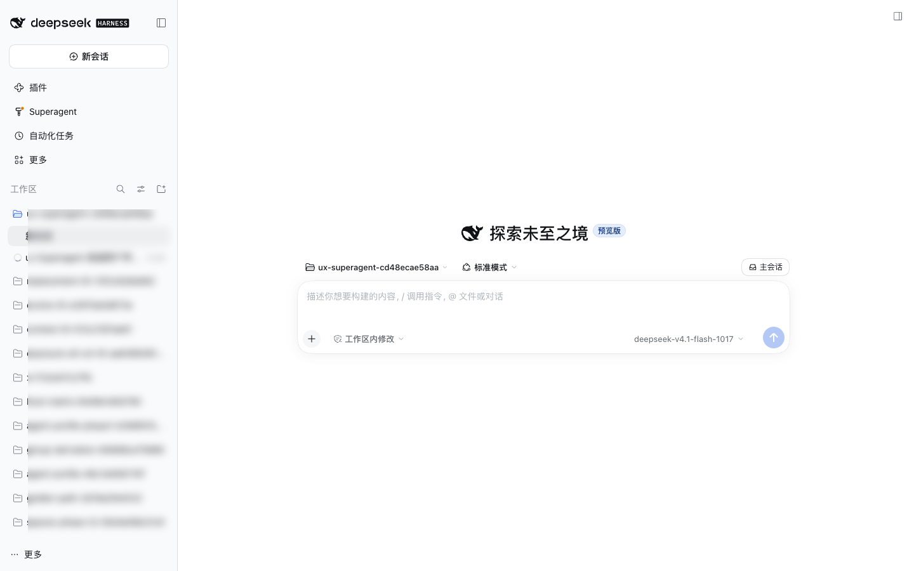
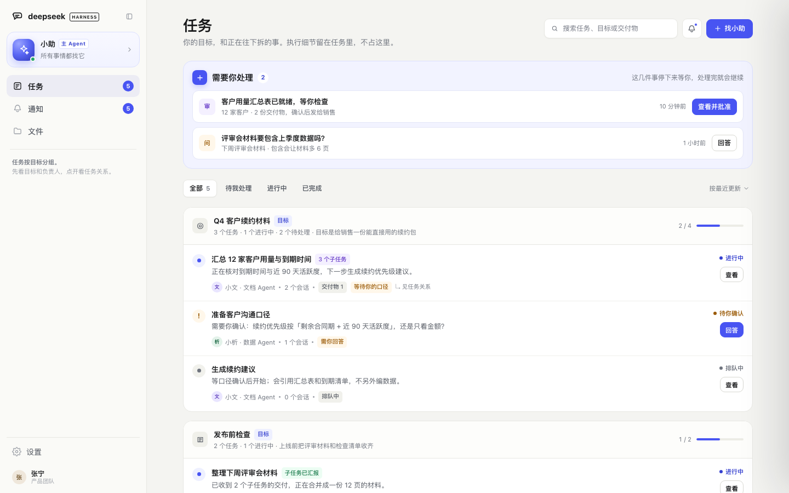
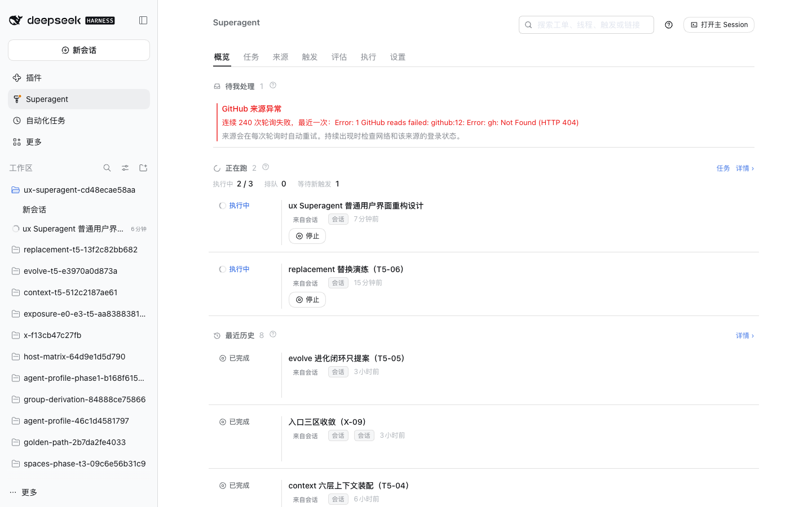
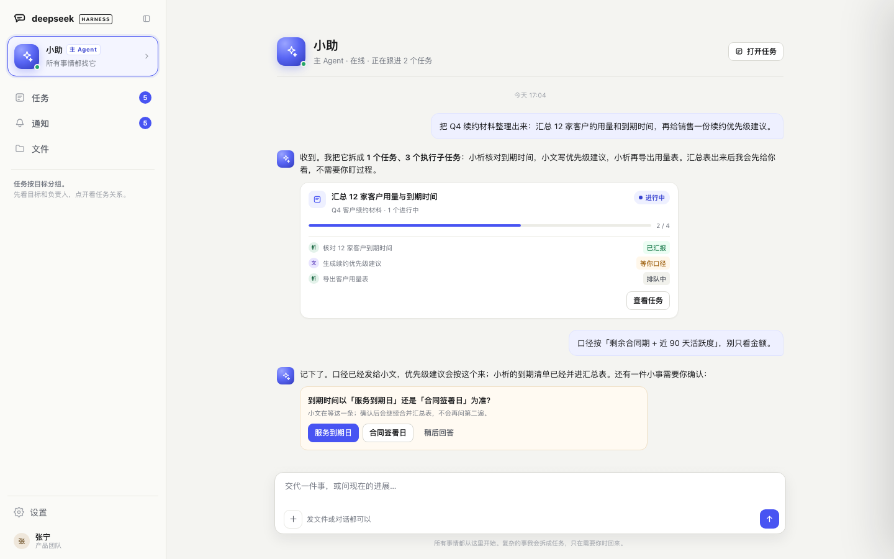
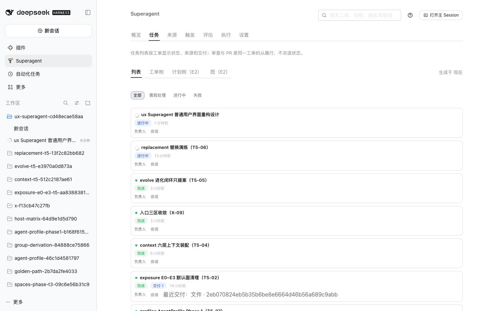
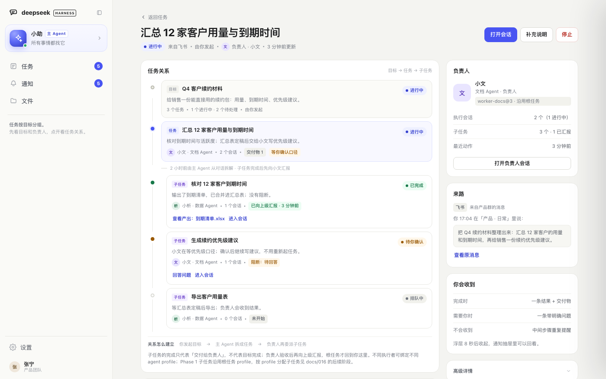
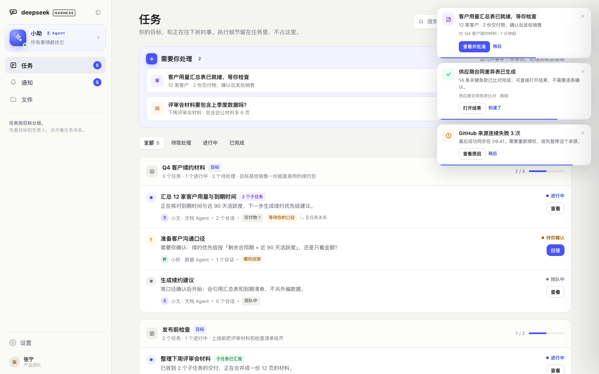
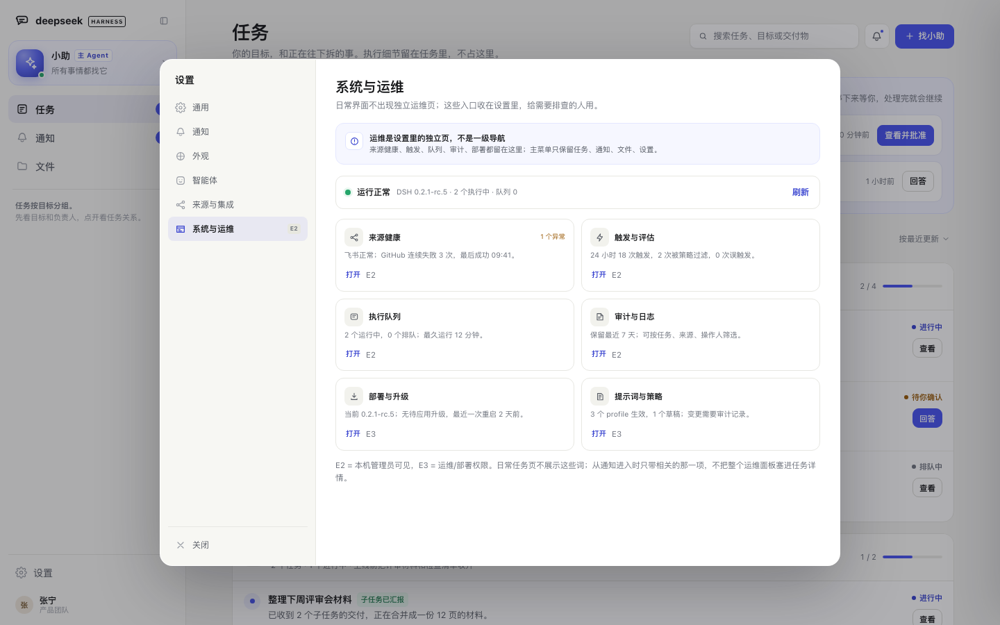

# Superagent 界面设计修订：主 Agent、任务层级与通知（提案）

> **状态**：设计修订提案；2026-11-14 路线修订为“插件即主页面”，应用外壳已实现，见 §0.4 与 `docs/028-plugin-main-page.zh.md`。本文替代 021 的初版方向（2026-11-11，PR #58）：初版保留「置顶主会话 + 工作区 + 任务收件箱」三套入口；本版按新的产品判断重做主 Agent 入口、任务层级、通知和主菜单。本文其余部分保留 2026-11-11 的设计记录，不随路线修订改写历史。
>
> **来源**：PR #58 的评审反馈（主会话应成为主 Agent、工作区应成为任务视图、任务需要负责人/会话/汇报/产出/阻断的关系），以及工单 `955add1f…` 的「重新做界面设计」。反馈原文在 GitHub 评审线程，本文只归纳设计结论。
>
> **基线**：`touch-agent/dsh-superagent` @ `280766e`（PR #58 头），宿主 DSH `0.2.1-rc.5`。本修订的文档分支为 `agent/ux-agent-955add1f2430`，PR 基于 `agent/docs-4278b3bed607` 叠加。
>
> **证据**：Before 为当前运行实例的真实截图（1440×900，浅色，`2026-11-11`）；After 为可交互原型（同视口、同主题、合成数据），见 [`prototypes/ux-redesign.html`](prototypes/ux-redesign.html) 与 [`images/ux-redesign/`](images/ux-redesign/)。**原型不是已实现界面；After 截图不能当作上线证据。** 本轮没有用户测试。
>
> **一句话**：**用户不需要先理解工作区、会话或工单；打开界面先找「小助」，再看「任务」，结果和需要决定的事会自己回来。**

---

## 0. 结论

### 0.1 五条设计决定

1. **主 Agent 是主菜单的第一入口，不是工作区里的一条会话。** 默认名「小助」，可改名、可换头像；语义是「所有事情都找它」。它在主菜单最上方，以人格化入口出现，不进入工作区、不与执行会话同列。
2. **工作区即任务视图。** 默认面是「目标 → 任务」两层；任务往下才是执行子任务。工作区不再是一个需要用户理解的目录/会话集合，而是任务层级的容器。
3. **任务详情回答「谁在做、做到哪、下面还有谁、产出在哪、卡在哪、向谁汇报」。** 用一张任务关系图串起目标、任务、子任务、负责人、会话、交付物和阻断；子任务完成后先向父任务负责人汇报，父任务验收后再向上级汇报。
4. **通知分两层：右侧浮动卡片 + 侧边抽屉。** 浮层最多 3 条、项间 10px、约 8 秒自动收起；另有右侧抽屉回看全部。通知按「需要你 / 进展 / 系统」分组，中间步骤不弹浮层。
5. **主菜单统一为任务、通知、文件、设置。** 取消独立的运维/概览一级页面；来源健康、触发、队列、审计、部署、策略收进设置弹窗里的独立「系统与运维」页。

### 0.2 和初版的关键差别

| 维度 | 初版（PR #58） | 本修订 |
| --- | --- | --- |
| 主入口 | 主对话固定置顶在会话列表里 | 主 Agent 是主菜单最上方的人格入口，不与会话混排 |
| 工作区 | 工作区/会话列表保留，任务收件箱另做一页 | 工作区就是任务视图；目录与会话不进默认导航 |
| 任务层级 | 任务行 + 详情里一段进展 | 目标 → 任务 → 执行子任务；每级有负责人、会话、产出、阻断、汇报 |
| 通知 | 右栏「事件」tab + 面板徽标 | 右侧浮动卡片 + 抽屉；通知项有间距、自动收起 |
| 主菜单 | 任务；运维收进一个入口 | 任务 / 通知 / 文件 / 设置；运维进设置页 |
| 落地口径 | 主要按插件内可做来承诺 | 明确区分「插件内可做 / 需宿主增强」；不把目标态说成已可落地 |

### 0.3 可落地性先说清楚

本设计的目标态里，**任务视图、任务详情、通知浮层/抽屉、文件页、设置里的运维页**都能落在现有 DSH 插件扩展点内；但**「主 Agent 大卡置顶」「移除宿主的新会话/插件行/工作区会话列表」**不是插件能单独完成的。它们需要宿主增强（新的 sidebar 席位或替换 sidebar/workspace 组合），或在插件内用降级形态先上。

本文把这两类分开写：§8 给逐项映射，§8.4 给插件内降级与宿主增强的取舍。**不把宿主改动混进本期插件承诺。**

### 0.4 2026-11-14 路线修订：插件即主页面（已实现）

改 DSH 上游或宿主 sidebar 组合的成本过大，因此不再等待宿主增强，改为**不改 shell，让点开 Superagent 直接进入主对话**：插件面板挂载后打开现有主 Session；任务、通知、文件、设置从主对话页头的四个图标进入，每个辅助页都有“返回主对话”。主对话本身是宿主现有页面，插件不自绘第二套聊天。

这条路线**放弃**了本文原先的宿主级目标，而不是把它们继续列为待办：

- 把主 Agent 卡放到宿主“新会话”按钮之上；
- 删除/重排/改名宿主的“新会话、插件、工作区、会话”行；
- 用插件任务页替换宿主 workspace region，或成为宿主默认主视图；
- 替换宿主设置弹窗、宿主原生通知中心或宿主一级导航；
- 跨设备同步主 Agent 名字与头像。

放弃的理由不是“优先级低”，而是这些都必须改插件之外的宿主组合；本路线明确不改上游、不改 shell。宿主左侧插件列表、工作区/会话列表、宿主页头与设置入口继续存在，是外部环境，不伪装成插件能力。

插件内已落地：点开即自动打开主对话、主对话页头四图标、任务/通知/文件/设置辅助页与返回条、`ux.appShell.v1` 逐项回退。实现记录、开关与证据见 `docs/028-plugin-main-page.zh.md`。

§8.4 的“建议”由本节取代：不再先做插件内降级、再等宿主增强；插件内形态就是本路线的最终形态。历史映射保留，用于解释哪些能力确实需要宿主。

---

## 1. 为什么重做

### 1.1 三条反馈

1. **主会话要像主 Agent，而不是工作区里的一个会话。** 现在左栏是「插件 / 工作区 / 会话」的目录模型；主会话即使置顶，仍然只是会话列表中的一行，用户不知道该找哪一个。
2. **工作区应当是任务视图。** 用户关心的是「我的目标、任务、下一步」；目录名和每个任务的执行会话不是用户的工作单位。任务应当先有一级/二级视图，再往下拆子任务。
3. **任务需要关系。** 一个任务有负责人（可以是不同 agent profile），有一个或多个会话；子任务完成后向上级汇报；任务页要能进入各任务会话、看每级产出物与阻断需求。

这三条不是视觉细节，而是**信息架构**：入口是谁、默认页是什么、任务如何组织、结果如何回来。

### 1.2 初版为什么不够

初版仍然把「主对话」放在会话模型里：它被 pin 在最上面，但旁边还是工作区、执行会话和「新会话」。它解决了「主会话被淹没」，没有解决「主会话为什么存在」。初版的任务页也仍以收件箱为主，任务之间的父子关系、负责人、汇报链没有成为页面骨架。

### 1.3 用户实际只问五个问题

1. **我现在要做什么？**（需要你处理 + 一个动作）
2. **我的任务到哪了？**（在做什么、下一步、谁负责）
3. **这件事下面还有谁？**（子任务、会话、产出、卡在哪）
4. **结果在哪？**（交付物、哪个任务产出的）
5. **刚刚发生了什么？**（通知；不打断时也能回看）

**10 秒测试**：打开首屏，10 秒内能否说出「我现在要做什么、我的任务到哪了、所有事情该找谁」。本设计以此作为验收口径。

---

## 2. 目标与原则

### 2.1 目标

- 把「找小助」变成唯一稳定的起点，而不是让用户先选工作区或会话。
- 把「工作区」从导航对象改为任务视图；默认只呈现人关心的两层，执行细节在任务内部。
- 让任务关系可见、可进入、可解释：负责人、会话、交付、阻断、汇报。
- 让通知有存在感但不占据常驻空间：浮层负责打断，抽屉负责回看。
- 主菜单只保留用户对象；运维/系统词退出默认面，进入设置。
- 每一面都能指出落在哪个插件扩展点；做不到的单独列出，不假装。

### 2.2 原则

| # | 原则 | 具体做法 |
| --- | --- | --- |
| A | 一个入口 | 主 Agent 唯一、稳定、可改名；所有事情从它开始 |
| B | 任务优先 | 默认页是任务；不把目录、会话、工单编号当导航 |
| C | 关系可见 | 目标 → 任务 → 子任务；负责人、会话、交付、阻断都在关系里 |
| D | 默认面只放 E0/E1 | 目标、状态、需决定、结果、负责人、交付、阻塞；原始会话与日志进 E2/E3 |
| E | 通知有度 | 需要你/结果就绪才弹；中间进展只进抽屉；同任务聚合 |
| F | 运维后置 | 运维是设置里的一个独立页，不是一级导航 |
| G | 插件优先，边界诚实 | 先给插件内形态；宿主增强单列，不混入承诺 |

### 2.3 非目标

- 不改变 Ticket、Mandate、Approval、Acceptance 的授权语义；不新增第二套任务实体。
- 不把执行空间（`Execution.directory` / 写租约）并进任务树；[docs/013](013-workspace-model.zh.md) 仍然成立：空间是执行侧 locator，不是任务层级。
- 不在本期实现「每个子任务自由换 profile」；按 [docs/016](016-agent-profile.zh.md)，Phase 1 子任务继承根任务，Phase 2 才讨论子任务覆盖。
- 不新建通知服务、不改变现有 outbox/relay 语义；通知是投影与展示层。
- 不做依赖图、甘特图、看板拖拽；任务树是解释结构，不是项目管理的全套。

---

## 3. 信息架构

### 3.1 结构

```
主 Agent（小助）                  ← 主菜单第一入口，人格化，不占工作区
  └─ 任务                         ← 默认页；原「工作区」的用户面
       ├─ L1 目标 / 工作线         ← 用户命名的结果（TaskCategory 或根 Ticket 分组）
       │    └─ L2 任务             ← 根 Ticket；负责人、会话、交付、阻断
       │         └─ L3 执行子任务  ← 子 Ticket；完成后先向父负责人汇报
       │              └─ L4 …      ← 更深，默认折叠
       ├─ 通知                     ← 浮层 + 抽屉；主菜单有未读
       ├─ 文件                     ← 按任务归档的交付物；执行目录不在这里
       └─ 设置                     ← 含「系统与运维」独立页；无独立运维一级页
```

### 3.2 层级与页面职责

| 层 | 用户问题 | 页面 | 默认显示 | 暴露级别 |
| --- | --- | --- | --- | --- |
| 主 Agent | 所有事情找谁 | 对话 | 小助、任务卡、提问卡、结果 | E0 |
| L1 目标 | 我在忙哪条线 | 任务视图分组 | 目标名、进度、任务数 | E0 |
| L2 任务 | 这件事到哪了 | 任务视图行 / 任务详情 | 状态、负责人、会话数、交付、阻断 | E0/E1 |
| L3 子任务 | 下面谁在做 | 任务详情的任务关系 | 子任务、负责人、汇报、产出 | E1 |
| 会话/Assignment | 具体怎么做的 | 任务详情「执行会话」→ 会话 | 会话数、负责人；原始内容按需 | E2/E3 |
| 运维 | 系统为什么异常 | 设置 › 系统与运维 | 来源健康、触发、队列、审计、部署 | E2/E3 |

### 3.3 主菜单

| 主菜单项 | 用户问题 | 目标形态 | 说明 |
| --- | --- | --- | --- |
| 小助 · 主 Agent | 所有事情找谁 | 顶部人格入口 + 对话 | 不是会话行；可改名/换头像 |
| 任务 | 我的目标到哪了 | 任务视图（L1/L2） | 默认页；原工作区 |
| 通知 | 有什么需要我 | 抽屉 + 浮层 | 未读数；不是右栏 tab |
| 文件 | 结果在哪 | 交付物/任务文件 | 按任务归档 |
| 设置 | 怎么配置/排查 | 设置弹窗 | 运维是其中一个独立页 |

**不出现的词/入口**：工作区、概览、来源、触发、评估、执行、工单、计划编号、Session 名、Assignment、Worker 槽位。它们只在设置/高级详情/会话里出现。

### 3.4 「工作区」这个词怎么处理

用户说的「工作区即任务视图」是 **UI 信息架构**：原来的工作区导航被任务视图替代。它不等于把 [docs/013](013-workspace-model.zh.md) 的执行空间并入任务树：

- **UI 工作区**：退役。默认面只有任务；不再有「工作区 › 会话」的左栏。
- **执行空间**：保留为执行侧 locator；只在任务详情的高级详情或 E2/E3 出现，不成为导航层级，也不与新任务树混排。
- **文件页的「任务文件」**：是按任务归档的交付物，不是执行空间；不叫工作区。

这条区分必须在实现时保留，否则会把「目录」重新带回默认面。

### 3.5 一级/二级视图怎么落地

- **一级**：任务视图的 L1 目标分组（目标名 + 进度 + 任务数）。
- **二级**：L2 任务行（状态、负责人、会话数、交付/阻断、下一步）。
- **三级**：点进任务详情，才看到 L3 执行子任务与关系图。
- 任务详情不是主菜单的第四个一级页面；它是任务的选中态/下钻，返回任务视图。这样主菜单保持四项，任务关系不丢。

> 数据上，L1 优先用 `TaskCategory`（见 `docs/tasks-view-architecture.zh.md`）；没有类别覆盖层时，按 `rootTicketId`/根 Ticket 分组。L2 是根 Ticket，L3 是子 Ticket。**不新增任务实体。**

---

## 4. 主 Agent

### 4.1 语义

主 Agent 是**唯一稳定的人格入口**：用户不必判断「这是新会话还是任务」；所有事情都可以对它说。它负责：

- 接住一句话/文件/问题；
- 判断是聊天、查资料，还是要拆成任务；
- 拆目标、建根任务、委派给负责人；
- 在需要人决定或结果就绪时回来；
- 把执行细节留在任务里，不把对话变成日志。

它不负责：替每个任务执行；替负责人验收子任务；直接把 Session、Assignment、计划编号暴露给用户。

### 4.2 入口形态

- **位置**：主菜单最上方，品牌之下、任务/通知/文件之上。
- **默认名**：小助。
- **角色标签**：主 Agent。
- **副标题**：所有事情都找它。
- **状态**：在线/处理中；不显示「worker-…」。
- **可改名**：只改显示名，不改会话 id、不改授权。
- **可换头像**：默认是一个可识别的角色头像；换头像不改变菜单结构。
- **点击行为**：进入同一个主会话；不是新建会话，不是工作区，不是任务列表。

### 4.3 主 Agent 页面

- 顶部：头像、名字、主 Agent 角色、在线状态、「打开任务」。
- 对话流：用户消息；主 Agent 的任务卡（目标、进度、子任务、负责人、查看任务）；提问卡（一个明确问题 + 选项）；结果卡。
- 输入区：一句话/文件都进主 Agent；不要求用户先选「新建任务」。
- 任务卡只放人关心的：目标、当前进度、子任务负责人/状态、「查看任务」。不放 Session id、Assignment、日志。
- 提问卡只问一个决定；回答后继续，不重复问。
- 主 Agent 不主动播报中间步骤；中间进展只进通知抽屉/任务详情。

### 4.4 主 Agent 的状态

| 状态 | 表现 | 说明 |
| --- | --- | --- |
| 空闲 | 在线，输入区可用 | 默认 |
| 处理中 | 状态点 + 一句当前动作 | 不显示工具/Session |
| 需要你 | 提问卡 + 通知浮层 | 一个问题一个动作 |
| 离线/异常 | 顶部说明 + 重试 | 不把堆栈丢到默认面 |
| 已改名 | 新名字 + 主 Agent 标签 | 会话 id 不变 |

### 4.5 主 Agent 与任务负责人的关系

- 主 Agent 是**路由/组织者**；任务负责人是 **worker/owner**（当前 owner 与 worker 同为一个执行会话，字段分开是为未来「负责人 ≠ 执行者」留位）。
- 一个根任务有**一个负责人**；不同根任务可以绑定不同 `AgentProfile`。同一根任务下的子任务在 Phase 1 继承根 profile，Phase 2 才允许子任务换 profile。
- 主 Agent 默认不承担任务执行；它保持入口/路由角色。若未来允许它接任务，必须作为该任务的负责人显式绑定，而不是默认兼做。
- 子任务向父负责人汇报，不直接找主 Agent，也不直接找人；根任务完成后由根负责人向人给出结论。主 Agent 在对话里转述根结果。

### 4.6 插件内能做到什么

- **能做**：`conversation.hero.options` 里加入「找小助」入口；`sidebar.panellist` 增加一条「小助 · 主 Agent」面板行，自定义头像图标；点开面板后通过 `uiWorkspace.openSession(masterId)` 跳到主 Session；`pinSession` + `sidebar.session.row.leading` 让主 Session 在宿主会话列表里可识别；`conversation.session.header.utilities` 放「待你处理 N」。
- **不能做**：把这条面板行做成原型里的大卡（副标题、角色标签、状态点、40px 头像）；把它放在宿主「新会话」按钮之上；移除宿主「新会话」、「插件」行和工作区/会话区域。这些需要宿主新增 sidebar 席位或替换 sidebar 组合。
- **降级形态**：面板行 label 写「小助 · 主 Agent」，图标用头像；副标题「所有事情都找它」放进 tooltip/面板头部；点开先进入一个极简「正在打开小助」面板，再跳主 Session；失败时保留按钮与说明。
- **取舍**：降级形态行为成立、视觉弱于目标；宿主增强能拿到目标视觉，但升级/替换成本高，且要维护宿主分支。

---

## 5. 任务视图与任务详情

### 5.1 任务视图（默认页）

从上到下：

1. **页面头**：任务 + 一句说明；搜索、通知、主 Agent 入口。
2. **需要你处理 N**：只放停下来等人的事；每条一句人话标题 + 一个主动作；为空时整块消失。
3. **筛选**：全部 / 待我处理 / 进行中 / 已完成；默认全部，排序固定「需要你 → 进行中 → 最近完成」。
4. **L1 目标分组**：目标名、进度（例如 2/4）、任务数、一句目标说明；组内是 L2 任务行。
5. **L2 任务行**：标题、当前动作、负责人（头像+名字+角色）、会话数、交付物/阻断 chip、子任务数、状态、查看/回答。
6. **最近完成**：结果 + 交付物 + 时间；完成的任务不占进行中位置。
7. **空状态**：没有出现的任务，直接问小助；不制造「是不是漏了」的焦虑。

**行里不放**：计划编号、`负责人：会话`、Assignment、Session id、目录、Trigger/Eval。需要排查时从任务详情的高级详情或设置进入。

### 5.2 任务层级

| 层 | 用户叫法 | 数据 | 负责人 | 会话 | 产出 | 汇报 |
| --- | --- | --- | --- | --- | --- | --- |
| L1 | 目标 / 工作线 | `TaskCategory` 或根 Ticket 分组 | 无独立负责人（类别）；进度由任务派生 | 无 | 目标级交付物（聚合） | 不适用 |
| L2 | 任务 | 根 Ticket | 有；绑定 profile | 一个或多个 Assignment 会话 | 任务级交付物 | 根负责人向人 |
| L3 | 子任务 | 子 Ticket（`parentTicketId`） | 有；Phase 1 继承根 profile | 自己的会话 | 子任务交付物 | 先向父负责人；父验收后再向上 |
| L4+ | 更深子任务 | 子 Ticket | 有 | 有 | 有 | 逐级向上；默认折叠 |

**关系怎么建立**：

1. 用户在对话里提出目标；主 Agent 判断需要任务化。
2. 根 Ticket 由 Eval 创建（授权根唯一）；主 Agent 不直接创建授权根。
3. 根负责人可在执行中通过 `delegate_ticket` 请求 Engine 创建子 Ticket；子 Ticket 没有自己的 Mandate/Decision，继承根授权。
4. 子任务完成后向父负责人报告；父负责人可以接受、退回、自己执行或再委派。
5. 只有父任务自己的目标完成时，才向自己的上级报告；根负责人向人给出最终结论。
6. 父负责人缺位/已结束时，报告不得丢失：先恢复父，再升级到最近的在世祖先/人一次（沿用现有审查链语义）。

**关系不是拖拽出来的**：没有依赖数据就不画箭头；没有子任务就不编造子节点；subagent 不冒充子 Ticket。

### 5.3 任务行状态

| 领域状态 | 默认面 | 颜色 | 主动作 |
| --- | --- | --- | --- |
| `queued` | 排队中 | 灰 | 无 |
| `working` | 进行中 | 蓝 | 查看 / 停止 |
| `person`（answer） | 待你确认 · 待回答 | 琥珀 | 回答 |
| `person`（review） | 待你确认 · 审阅 | 紫 | 查看并批准 / 退回 |
| `blocked` | 被卡住 | 琥珀/红 | 查看原因 / 补充 |
| `failed` | 未完成 | 红 | 重试 / 查看原因 |
| `ended`（完成） | 已完成 | 绿 | 打开结果 |
| `ended`（停止/取消） | 已取消 | 灰 | 查看记录 |

子任务完成只代表「交付给父负责人」，不等于目标完成；默认面用「已汇报给上级」而不是「已完成」来区分。

### 5.4 任务详情

**头部**：人能读的标题 + 状态 + 来源 + 发起人 + 负责人 + 最近更新；动作：打开会话 / 补充说明 / 停止（审阅类换成批准/退回）。

**左栏**（主内容）：

1. **任务关系**：目标 → 任务 → 子任务；每个节点显示标题、状态、负责人、会话数、交付/阻断；节点间写关系（由对话拆解、委派、已完成并汇报）。
2. **现在在做什么**：一句当前动作 + 三步进度 + 预计时间；进度是用户步骤，不是内部状态机。
3. **阻断与需求**：只放需要人决定的事；带明确问题和选项；没有时整块消失。
4. **各层产出物**：目标级/任务级/子任务级分组；生成中显示预计时间；已完成可直接打开/预览。
5. **汇报记录**：只记决定与交付，不记中间步骤；显示「谁向谁汇报」「接受/退回」。
6. **执行会话**：默认折叠；显示负责人、会话状态、进入会话；会话内容是 E3。

**右栏**：

- **负责人**：头像、名字、角色、profile（例如 `worker-docs@3`）、会话数、子任务数、最近动作。profile 在 Phase 1 只读；子任务继承根任务；子任务单独换 profile 是 Phase 2。
- **来路**：来自对话/飞书/GitHub；原文引用 + 查看原消息。来源不是层级。
- **你会收到**：完成时一条结果 + 交付物；需要你时一条带明确问题；不会收到中间步骤重复提醒。
- **高级详情**：Ticket/Root/Profile/Session/目录；默认折叠；E2/E3。

**关系图的读法**：

```
目标（L1）
  └─ 任务（L2，负责人 A，2 个会话）
       ├─ 子任务（L3，负责人 B）：已完成 → 已向 A 汇报
       ├─ 子任务（L3，负责人 A）：待你确认（阻断）
       └─ 子任务（L3，负责人 B）：排队中
```

- 每个节点都可以「进入会话」「查看产出」；不是所有节点都必须有会话（排队/未开始可以为 0）。
- 父任务可以没有子任务；没有就不画空节点。
- 子任务的产出归子任务；父任务详情按级聚合展示，父验收后才算父级交付。

### 5.5 任务详情不做什么

- 不做聊天记录堆叠；会话是链接，不是默认内容。
- 不做完整计划树/甘特图；默认 3 层，更深折叠。
- 不显示 `worker-`、`ticket_`、`session_`、Assignment、Disposition；这些只在 E2/E3 折叠区。
- 不把「子任务完成」写成「任务完成」；不把父负责人的接受写成人的验收。
- 不把来源（飞书/GitHub/对话）当分组；来源只是来路。

### 5.6 响应式

- **1440×900**：左栏 268px；任务视图内容 1040px；任务详情双栏（主栏 + 314px 右栏）。
- **1024**：左栏收窄到 232px；详情右栏下移为两列卡片；搜索独占一行。
- **768**：左栏收为 76px 图标轨（保留 tooltip/aria-label）；详情单栏；文件双列。
- **390**：左栏 64px；任务筛选换行；目标进度移到标题下方；通知/抽屉全宽；设置单列。
- 原型已在 1440/1024/768/390 验证无横向溢出；这不等同于真实宿主在所有断点的验证。

---

## 6. 通知

### 6.1 两个面，各司其职

| 面 | 位置 | 作用 | 生命周期 |
| --- | --- | --- | --- |
| 实时浮层 | 右上角浮层 | 打断：需要你决定 / 结果就绪 | 8 秒自动收起；悬停/聚焦暂停 |
| 通知抽屉 | 右侧抽屉 | 回看：全部/需要你/进展/系统 | 手动打开；未读清零 |

**不做的**：不在页面底部堆通知流；不把通知做成常驻右栏 tab；不让红点数量成为焦虑源；不做「通知中心」一级页面（抽屉就是全部）。

### 6.2 浮层规格

- 宽度 372px（移动端 `calc(100vw - 24px)`），距顶 18px，距右 18px。
- 最多 3 条；项间 10px；圆角 14px；1px 边框；轻阴影；不抢主内容。
- 每条：图标（类型色）+ 标题 + 一句说明 + 任务名 + 主动作 + 稍后/关闭。
- 底部 2px 进度条；8 秒走完自动收起；鼠标悬停或键盘聚焦暂停；关闭/稍后立即收起。
- 新通知从上方滑入 220ms；`prefers-reduced-motion` 关闭动画与进度动画。
- 同一任务同一结果只弹一次；更多同类进抽屉；第 3 条之后的排队，不无限堆叠。
- 图标用 SVG，不用 emoji；类型色只在图标底色，不做左侧色条。
- `aria-live="polite"`；浮层可键盘到达；关闭按钮有 `aria-label`。

### 6.3 抽屉规格

- 右侧 424px（移动端全宽），全高；背景遮罩；`role="dialog"` + `aria-modal`；Esc 关闭。
- 头部：通知 + 未读数 + 全部标为已读 + 关闭。
- 分组：需要你（2）/ 进展（2）/ 系统（1）；tab 过滤；每项 10px 间距。
- 每项：类型图标、标题、说明、任务名、时间、就地动作；未读有圆点，不清零不消失。
- 底部：浮层 8 秒收起说明 + 通知设置。
- 空状态：没有需要你的事；进展不会打扰你。
- 系统项可操作：查看原因 / 停用来源 / 重新登录；不写「检查网络」这种空话。

### 6.4 什么进哪一层

| 组 | 什么进来 | 浮层 | 抽屉 | 默认动作 |
| --- | --- | --- | --- | --- |
| 需要你 | 审阅、提问、审批、阻塞、失败需人 | 是 | 是 | 就地批准/回答/补充 |
| 进展 | 阶段变化、交付物就绪、子任务汇报 | 否 | 是 | 打开任务 |
| 系统 | 来源持续失败、部署/登录问题 | 持续失败才弹 | 是 | 查看原因/停用/重登 |

- 中间进展不弹浮层；需要你/结果就绪才弹。
- 同一任务的多条进展合并；子任务汇报不单独成为人的通知主体；以父任务进展呈现。
- 未读数在「通知」菜单上；打开抽屉后可按「全部标为已读」清零；清零是本地游标，不改变任务状态。

### 6.5 通知的入口

- 主菜单「通知」：未读数；打开抽屉。
- 页面头部铃铛：打开抽屉；有未读时圆点。
- 浮层动作：直接进入任务/批准/回答；不要求先找任务。
- 设置 › 通知：浮层开关、结果/需要你/中间进展/系统异常偏好、自动收起时长。
- 通知设置里的「自动收起」默认 8 秒；可关闭自动收起（改为手动），但默认不关闭。

### 6.6 插件内能做到什么

- **能做**：`shell.overlay` 是 frame 级 list，专门允许 toast stack / 抽屉；条目自己接管 pointer events，点击穿透；浮层计时、悬停暂停、间距、移动端都由插件控制。
- **部分**：主菜单「通知」一级入口如果要做成宿主原生 nav，不可得；插件可以用 `sidebar.panellist` 增加一个通知面板行，或在页面头部放铃铛。抽屉本身是插件 overlay，不依赖宿主通知中心。
- **不能做**：替换宿主原生通知/未读体系；跨设备同步未读（需要服务端）；在宿主窗口外弹系统通知（除非宿主提供对应 API）。
- **降级**：没有 `shell.overlay` 的宿主，浮层退化为插件主面板内的固定右上角区域；抽屉退化为右栏 tab；不改变通知规则。

---

## 7. 主菜单、文件、设置

### 7.1 主菜单

目标形态：

```
品牌
小助 · 主 Agent      ← 人格入口，第一项
任务                  ← 默认
通知                  ← 未读
文件
（弹性空间）
设置
账号
```

- 不再有「新会话」按钮、「插件」行、工作区/会话列表、独立运维/概览入口。
- 设置在主菜单底部；账号在其下。
- 窄栏折叠为 64–76px 图标轨；保留 tooltip/aria-label；主 Agent 头像与任务/通知/文件图标仍可达。

**宿主现实**：宿主 sidebar 里「新会话」在 panel list 之上，「插件」是固定 panel，工作区/会话区域在 panel list 之下；插件不能删除或重排这些。目标形态需要宿主新增「主 Agent 席位」或替换 sidebar 组合；插件内只能做到「插件 panel 行 + 主会话跳转 + 置顶/徽标」的降级形态。详见 §8.4。

### 7.2 文件

- 页面回答：**结果在哪、哪个任务产出的**。
- 最近交付：文件卡（类型、任务、负责人、时间、打开）。
- 任务文件：按任务归档的文件夹/列表；不是执行空间，不是会话列表。
- 打开过：最近文件。
- 文件内容按 E3；默认面只给元数据与打开入口。
- 不把「工作区」作为文件页的一级结构；如果宿主已有文件侧栏，插件页不重复其目录树，只做任务归档视图。

### 7.3 设置

设置是宿主已有的弹窗/页面；插件只能增加一个 `settings.section` 页，不能整体替换弹窗。下列导航是目标态，除「系统与运维」外由宿主决定，插件不承诺改其布局。目标导航：

```
通用 / 通知 / 外观 / 智能体 / 来源与集成 / 系统与运维
```

- **通用**：启动页、语言、时间显示（宿主页；目标态不再列工作区入口）。
- **通知**：浮层、结果、需要你、中间进展、系统异常；自动收起时长。
- **外观**：主题、密度、减少动效。
- **智能体**：主 Agent 名称/头像、默认负责人 profile、任务负责人（Phase 2）。
- **来源与集成**：飞书、GitHub、本地目录、连接状态。
- **系统与运维**：独立页；来源健康、触发与评估、执行队列、审计与日志、部署与升级、提示词与策略。

**运维页规则**：

- 顶部一句「日常界面不出现独立运维页；这些入口收在设置里」。
- 运行状态条：版本、执行中、队列；异常时给链接。
- 六张卡：来源健康 / 触发与评估 / 执行队列 / 审计与日志 / 部署与升级 / 提示词与策略；每张有打开入口与 E2/E3 标记。
- 从通知的「查看原因」进入时，只带相关的那一项，不把整个运维面板塞进任务详情。
- 取消独立运维一级页；旧七 tab（概览/任务/来源/触发/评估/执行/设置）不再作为默认面板的一部分。
- 权限：E2 本机管理员；E3 运维/部署。没有权限的项不显示或只读，不用灰色假按钮。

---

## 8. 插件扩展点与宿主边界

### 8.1 口径

- 只使用宿主实际声明的 slot/API；本文提到的 `sidebar.panellist`、`main`、`shell.overlay`、`settings.section`、`sidebar.workspaces`、`sidebar.settings`、`conversation.hero.options`、`conversation.session.header.utilities`、`sidebar.session.row.leading`、`pinSession` 都来自当前宿主或插件契约。
- **插件内**：不改宿主包、不 fork，只注册 slot/调用公开 API。
- **部分**：能做行为，但视觉/位置/宿主固定项受限。
- **需宿主**：必须新增/替换宿主席位、sidebar 组合或设置外壳。
- 不把「部分/需宿主」写成「插件内可做」。

### 8.2 逐面映射

| 界面 / 元素 | 扩展点 / API | 可行性 | 说明 / 回退 |
| --- | --- | --- | --- |
| 主 Agent「小助」入口 | `sidebar.panellist` + `main` | 部分 | 面板行 + 头像图标 + 打开主 Session；大卡/副标题/第一项位置不可得。回退：hero 入口 + pin + 徽标 |
| 任务 / 文件 | `sidebar.panellist` ×2 + `main` keyed panels | 插件内 | 每个 id 对应一个 main 面板；`order` 控制插件行顺序；宿主「插件」行与工作区区域仍在 |
| 任务视图 | `main` 面板 | 插件内 | 整页插件渲染；分组读 `TaskCategory`/根 Ticket |
| 任务详情 | `main` 面板 | 插件内 | 关系树、交付、阻断、汇报读现有投影；不新增实体 |
| 任务关系 | `parentTicketId` / `rootTicketId` 读模型 | 插件内 | 关系字段已有；UI 只画树，不改变授权 |
| 负责人 / profile | `AgentProfile` 投影 | 部分/阶段依赖 | 根任务可按 016 Phase 1 绑定；子任务继承；子任务换 profile 是 Phase 2 |
| 任务会话 | Assignment/Session 投影 + 宿主会话跳转 | 插件内 | 默认只显示数量和入口；会话内容是 E3 |
| 任务交付 / 阻断 / 汇报 | Deliverable / Report / person stage 投影 | 插件内 | 父接受≠人的验收；子任务汇报先到父 |
| 右侧浮层通知 | `shell.overlay` list | 插件内 | frame 级、click-through；栈/间距/计时/暂停由插件控制 |
| 通知抽屉 | `shell.overlay` + 插件状态 | 插件内 | 全高抽屉；未读游标本地；跨设备需服务端 |
| 主菜单「通知」 | `sidebar.panellist` 面板行 | 部分 | 可有插件行；不是宿主原生 nav；不能用它替换宿主通知中心 |
| 未读数字/红点 | 面板图标 SVG 内绘制 | 插件内 | 行没有 badge 属性；数字画在 16px 图标里，或只用圆点 |
| 文件页 | `main` 面板 + 插件文件读模型 | 插件内 | 任务归档视图；宿主自己的文件侧栏仍存在，不重复目录树 |
| 设置触发/外壳 | `sidebar.settings` | 沿用 | 归 ui-settings；插件不替换 |
| 设置 › 系统与运维 | `settings.section` | 插件内 | 独立页；不能替换整个设置弹窗/删除宿主的其他分区 |
| 取消独立运维页 | 插件自身路由 | 插件内 | 默认面板不再有旧七 tab；运维只在设置页 |
| 主 Agent 大卡置顶 | 宿主 sidebar seat / 替换组合 | 需宿主 | 插件行只能做到「第一条插件行」；不能到「新会话」之上 |
| 移除新会话/插件行/工作区列表 | 宿主 sidebar 组合；`sidebar.workspaces`（ui-workspace 独占） | 需宿主 | 「新会话」/「插件」由宿主组合固定；workspace/会话列表由 ui-workspace 独占；插件不能移除/过滤/重排。回退：归档执行会话、改名、任务链接 |
| 工作区降级为任务视图 | 宿主 workspace region 替换 | 需宿主 | 插件可把任务面板设为默认，但宿主区域仍在；完整形态需替换组合 |
| 设置弹窗整体重做 | 宿主设置外壳 | 需宿主 | 插件只加页；原型里的导航/布局是目标态 |

### 8.3 插件不可行项（单列）

| # | 不可行/部分可行项 | 为什么 | 插件内替代 | 目标态需要的宿主改动 | 取舍 |
| --- | --- | --- | --- | --- | --- |
| 1 | 主 Agent 大卡置顶、副标题/状态点、在「新会话」上方 | `sidebar.panellist` 行由宿主渲染；位置在「新会话」之后；不能自定义整行 | 面板行 label「小助 · 主 Agent」+ 头像图标 + 主 Session 跳转 + pin/徽标 | 新 `sidebar.agent` 席位或替换 sidebar 组合 | 行为先成立，视觉弱；宿主增强要维护分支/升级 |
| 2 | 移除「新会话」、固定「插件」行 | 宿主 sidebar 组合固定 | 不点/忽略；用主 Agent 入口替代「新会话」 | 宿主组合调整或替换 sidebar | 插件不能保证用户不看到旧入口 |
| 3 | 隐藏运行中的执行会话、移除/重排工作区/会话列表 | `sidebar.workspaces` 由 ui-workspace 独占；运行中会话仍需宿主可寻址 | 归档已结束会话、改任务名、加「在任务中查看」；运行中的会话不能从宿主列表消失 | 替换 ui-workspace 或提供隐藏/过滤 API | 会话仍会出现；任务视图与旧列表并存；不能用「隐藏」掩盖正在执行的事实 |
| 4 | 工作区完全降级为任务视图 | 同上 | 任务面板设为默认；workspace 区域保留 | 宿主 workspace region 替换 | 新旧 IA 并存，用户可能仍被目录吸引 |
| 5 | 全局原生通知/一级导航 | 宿主没有原生 nav/通知中心 | 通知面板行 + 页面铃铛 + `shell.overlay` 抽屉 | 宿主通知中心/导航席位 | 插件内可满足「有入口、能回看」，但不是原生集成 |
| 6 | 设置弹窗整体替换/删除宿主分区 | ui-settings 拥有外壳 | 新增「系统与运维」页；其他分区沿用 | 宿主设置外壳改动 | 原型视觉不能 1:1 复刻；导航项可能更多 |
| 7 | 跨设备未读同步 | 当前未读是本地/客户端状态 | 本地游标；抽屉内标记已读 | 服务端通知游标/账户同步 | 首版单设备；多设备会重复提醒 |
| 8 | 每个子任务自由换 profile | 016 Phase 1 只允许继承 | 根任务绑定 profile；子任务显示继承 | 016 Phase 2（能力收紧约束） | 本期不承诺子任务级 profile |

### 8.4 插件内形态 vs 宿主增强形态

| 面 | 插件内（可先上） | 宿主增强（目标态） |
| --- | --- | --- |
| 主 Agent | 面板行 + 头像 + 主 Session 跳转 + 置顶/徽标 + hero 入口 | 主菜单最上方大卡（名字/角色/副标题/状态/头像） |
| 主菜单 | 插件行：任务/通知/文件；宿主新会话/插件/工作区仍在 | 任务/通知/文件/设置四项；无新会话/工作区列表 |
| 任务视图 | 作为插件 main 面板；默认打开 | 作为宿主默认主视图；workspace region 替换 |
| 通知 | 面板行 + 铃铛 + `shell.overlay` 浮层/抽屉 | 宿主原生未读/通知中心（可选） |
| 设置 | 新增系统与运维页 | 设置外壳/导航按目标态调整 |
| 文件 | 插件文件页 + 任务归档 | 与宿主文件表面统一 |

~~**建议**：先用插件内形态验证「任务视图 + 通知 + 运维进设置」；主 Agent 大卡与主菜单重排作为宿主增强单独立项，不阻塞前三项。~~ 2026-11-14 路线修订（§0.4）取代此建议：插件内形态就是最终形态，宿主增强项已放弃。

### 8.5 读模型

不新增持久化实体。插件侧新增一个展示投影：

```
TaskGoal {                 // L1：TaskCategory 或根 Ticket 分组
  id, title, progress, taskCount
}
TaskNode {                 // L2/L3：Ticket
  ticketId, parentTicketId, rootTicketId,
  title, state, owner: { name, role, profile? },
  sessions: { count, activeCount },
  deliverables: [...], blockers: [...], reports: [...]
}
NotificationItem {
  id, kind: attention|progress|system,
  title, detail, taskId?, actions[], createdAt, read
}
```

来源：Ticket/Assignment/Deliverable/Report/person stage 的现有投影；`TaskCategory` 若不存在，按根 Ticket 分组；通知来自 activity/outbox 投影。**不新增表，不改变授权/结束条件。**

### 8.6 开关与回退

| 开关（建议） | 默认 | 关闭后 |
| --- | --- | --- |
| `ux.agentEntry.v1` | 开 | 隐藏主 Agent 面板行，保留 hero/置顶 |
| `ux.taskView.v1` | 开 | 回旧任务 tab / 列表 |
| `ux.taskHierarchy.v1` | 开 | 详情不显示关系树，保留任务基本信息 |
| `ux.notifyOverlay.v1` | 开 | 回右栏事件 tab；抽屉仍可用 |
| `ux.opsInSettings.v1` | 开 | 运维入口回到旧面板 tab |
| `ux.filesByTask.v1` | 开 | 文件页只列最近交付，不按任务归档 |

回退不丢数据：通知未读是本地状态；归档会话可恢复；任务关系是现有 Ticket 字段，不改存储。

---

## 9. E0–E3 暴露级别

沿用 [docs/018](018-exposure-levels.zh.md)：E0 结果、E1 审查、E2 诊断、E3 原始。**E0–E3 是展示分级，不是授权级别。**

| 面 | E0 | E1 | E2 | E3 |
| --- | --- | --- | --- | --- |
| 主 Agent | 名字/角色、当前状态、任务卡、提问、结果 | 任务卡里的负责人/进度 | 会话状态/来源健康（按需） | 原始对话/工具调用 |
| 任务视图 | 目标、状态、需决定、结果 | 负责人、会话数、交付、阻塞 | 计划编号/触发/评估/审计链接 | — |
| 任务详情 | 目标、当前动作、待你决定、结果 | 负责人/profile、子任务、每级交付、汇报、阻塞 | Ticket id、Assignment、时间线、来源锚点 | Session/日志/目录/逐轮对话 |
| 通知浮层 | 需要你/结果就绪 + 一个动作 | 任务名 | — | — |
| 通知抽屉 | 需要你/结果 | 进展/同任务聚合 | 系统详情/重试次数 | 原始事件 |
| 文件 | — | 文件元数据、所属任务、交付状态 | 版本/审阅记录 | 文件内容/目录 |
| 设置›运维 | — | — | 来源健康、触发、队列、审计摘要 | 日志、部署、原始配置 |

**规则**：

- E0/E1 不出现 `worker-`、`ticket_`、`session_`、Assignment、Disposition；内部 id 只在 E2/E3 折叠区。
- 子任务完成在 E1 显示「已向父负责人汇报」，不写成「已完成」；父接受不等于人的验收。
- 运维页只从设置或通知的「查看原因」进入，不占据默认面。

---

## 10. 前后对照与证据

### 10.1 对照表

| 场景 | Before（当前真实实例） | After（本修订原型） |
| --- | --- | --- |
| 打开界面，先找谁 |  |  |
| 任务很多时，先看什么 |  |  |
| 任务往下拆成什么 |  |  |
| 通知 | 当前在右栏「事件」tab，无浮层 |  |
| 设置/运维 | 当前七个 tab，五个运维 |  |

> **Before** 是 `2026-11-11` 当前实例的真实截图（会话名已脱敏），1440×900、浅色。
> **After** 是设计原型，1440×900、浅色、合成 Q4 场景；不是已实现界面。
> **不是同一数据的像素对照**：当前实例没有同一份 Q4 数据；两边是同一视口/主题/「用户来找任务」场景下的结构对照。像素级对照要等实现 PR。
> PR #58 的 `after-plugin-*.png` 是**上一版提案**，不是当前 Before，也不是本版 After；不要拿它当基线。

### 10.2 补充证据

- 任务详情完整版（1440×2200，补充交付/汇报/会话）：`images/ux-redesign/after-redesign-detail-full.png`。
- 通知抽屉：`images/ux-redesign/after-redesign-drawer.png`。
- 文件页：`images/ux-redesign/after-redesign-files.png`。
- 扩展点标注（原型工具）：`images/ux-redesign/after-redesign-extensions.png`。
- 移动端 390×844：`images/ux-redesign/after-redesign-mobile.png`。

### 10.3 验证记录

- 关键屏在 headless Chrome 1440×900 截图；任务视图另在 1024×900 / 768×900 / 390×844 验证；各状态 `documentElement.scrollWidth === innerWidth`，无横向溢出。
- 控制台无 JS 异常（加载、切换页面、打开抽屉/设置/扩展点）。
- 原型交互：页面切换、任务行 → 详情、通知抽屉、全部已读、浮层自动/手动关闭、设置 tab、扩展点弹窗、Esc 关闭。
- 未验证：真实宿主里的 sidebar/overlay 行为、真实数据、屏幕阅读器全流程、用户测试。**不能把原型通过当作实现通过。**

### 10.4 证据局限

- After 不是实现；没有真实 Ticket、Session、通知数据。
- Before 与 After 不是同一数据状态；当前实例的会话名已脱敏，任务数据不同。
- 主 Agent 大卡/主菜单重排的视觉在插件内不能 1:1 实现；原型展示的是目标态，§8 已列降级形态。
- 没有用户测试；10 秒测试是设计自检，不是可用性结论。

---

## 11. 分阶段落地

### Phase 0 — 设计修订（本 PR，0.5–1 天）

- 更新本文、原型、截图、README/索引。
- 评审重点：五条 IA 决定是否成立；插件内降级是否可接受；宿主增强是否值得立项。
- 不写业务代码；不改 PR #58 分支。

### Phase 1 — 插件内先成立（约 1 周，可拆）

1. **任务视图**：`main` 面板；目标分组 + 任务行；读现有 Ticket/交付/阻断投影。
2. **任务详情**：关系树 + 负责人/会话/交付/汇报；会话入口到 E3；高级详情折叠。
3. **通知**：`shell.overlay` 浮层 + 抽屉；未读本地游标；设置页开关。
4. **主 Agent 降级入口**：`sidebar.panellist` 面板行 + 头像 + 主 Session 跳转；hero 入口 + pin + 徽标。
5. **文件页**：任务归档视图；插件文件读模型。
6. **运维进设置**：`settings.section` 独立页；旧默认面板去掉七 tab。
7. **开关**：§8.6；默认开，可回退。

**验收**：任务视图能回答「目标/任务/负责人/交付/阻断/下一步」；详情能进入会话与看汇报；通知浮层 8 秒收起/悬停暂停/抽屉回看；设置能进运维页；插件内不出现宿主无法支持的承诺。

### Phase 2 — 宿主增强（另立项，需评审）

- 新增主 Agent sidebar 席位（或替换 sidebar 组合）：大卡、第一项、副标题/状态。
- 替换/隐藏 workspace region 与「新会话」/固定「插件」行：任务视图成为默认，旧会话列表退到设置/高级。
- 统一设置外壳/导航（可选）。
- 原生未读/通知中心（可选；没有也不阻塞）。

**前置**：宿主/组合维护者同意；升级/回退成本评估；不 fork 的前提下能否用替换包实现。**Phase 2 未批准前，Phase 1 的降级形态就是交付形态。**

### Phase 3 — 深化（按需）

- 子任务级 profile（依赖 016 Phase 2）。
- 多会话/重试的更强时间线。
- 跨设备未读同步。
- 更多断点/真实用户测试。

### 每阶段回退

- Phase 1 全开关可关；关后回旧任务 tab/事件 tab/运维页。
- 任务关系是读取现有字段，不迁移数据；关掉只是不画。
- Phase 2 的宿主改动要能通过配置回旧 sidebar；不能回退就不做。

---

## 12. 开放问题

1. **L1 目标用 TaskCategory 还是根 Ticket 分组？** 建议优先 TaskCategory；没有覆盖层时按根 Ticket 分组。需要产品确认目标命名/合并规则。
2. **主 Agent 改名/换头像的来源**：session label、面板 label、头像配置三处如何同步？建议显示层统一，会话 id 不变；需要确认是否允许按用户/团队不同。
3. **主 Agent 是否承担任务负责人？** 当前设计让主 Agent 做路由，负责人做执行；如果主 Agent 也接任务，需要避免「所有事都找它」变成「所有事都它做」。
4. **子任务换 profile 的时间**：016 Phase 2 的能力收紧约束是否满足？本期只读展示。
5. **通知未读游标放本地还是服务端？** 首版本地；跨设备再评估。
6. **宿主增强的投入**：主 Agent 大卡与移除工作区列表需要宿主改动；是否值得为视觉目标维护替换 sidebar？这是本设计最大的开放决策。
7. **文件页与宿主文件侧栏的关系**：插件页只做任务归档，还是逐步替代宿主文件入口？本期不替代。

---

## 附录

### A. 原型

- 文件：[`prototypes/ux-redesign.html`](prototypes/ux-redesign.html)（单文件、离线、无外部字体/图片）。
- 参数：
  - `?screen=tasks|agent|detail|files`
  - `?clean=1` 隐藏原型工具条
  - `?toast=1&static=1` 显示浮层并冻结进度（截图用）
  - `?drawer=1` 打开通知抽屉
  - `?settings=1&tab=system|notify|...` 打开设置
  - `?extensions=1` 打开扩展点标注
- 工具条可切换页面、打开通知/设置/扩展点；不进入生产。

### B. 证据清单

| 文件 | 内容 | 视口 |
| --- | --- | --- |
| `before-01-home.png` | 当前真实实例：工作区/会话混排 | 1440×900 |
| `before-02-overview.png` | 当前真实实例：概览/七 tab/告警 | 1440×900 |
| `before-03-tasks.png` | 当前真实实例：平铺任务 tab | 1440×900 |
| `after-redesign-tasks.png` | 新任务视图（主 Agent + 目标分组） | 1440×900 |
| `after-redesign-agent.png` | 主 Agent 对话/任务卡/提问卡 | 1440×900 |
| `after-redesign-detail.png` | 任务详情（首屏关系图） | 1440×900 |
| `after-redesign-detail-full.png` | 任务详情完整版 | 1440×2200 |
| `after-redesign-notifications.png` | 右侧浮层（3 条） | 1440×900 |
| `after-redesign-drawer.png` | 通知抽屉 | 1440×900 |
| `after-redesign-files.png` | 文件页 | 1440×900 |
| `after-redesign-settings-ops.png` | 设置 › 系统与运维 | 1440×900 |
| `after-redesign-extensions.png` | 扩展点标注 | 1440×900 |
| `after-redesign-mobile.png` | 任务视图移动端 | 390×844 |

### C. 相关文档

- [005 面板](005-panel.md)、[011 设计原则](011-design-principles.zh.md)、[013 工作空间模型](013-workspace-model.zh.md)、[016 AgentProfile](016-agent-profile.zh.md)、[018 暴露级别](018-exposure-levels.zh.md)
- 任务视图架构（`docs/tasks-view-architecture.zh.md`）、[SESSION-ENTRY](plan/SESSION-ENTRY.zh.md)
- [TASK-PLAN](plan/TASK-PLAN.zh.md) T5-02、[TRACKING](plan/TRACKING.zh.md)
- 旧版 021 与 PR #58：初版方向，已被本修订替代；旧截图 `after-plugin-*.png` 仅作历史提案，不是当前 After。

### D. 变更记录

- 2026-11-11：初版 021（主对话置顶 + 任务收件箱 + 右栏通知 + 运维入口）。
- 2026-11-11：本修订（主 Agent 入口、工作区=任务视图、任务关系、浮层+抽屉、主菜单四项、运维进设置）；工单 `955add1f…`。