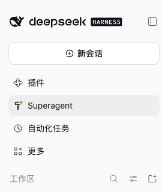
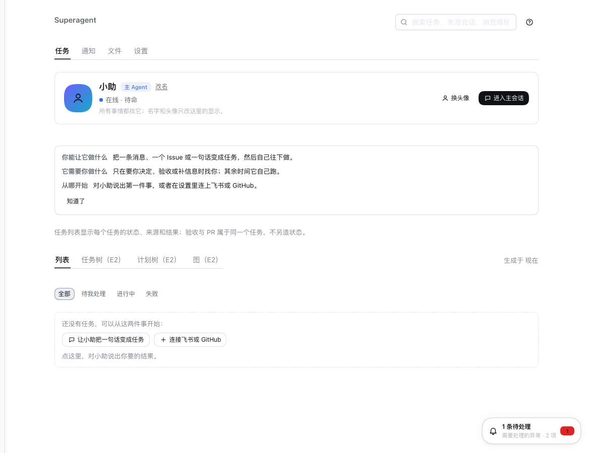
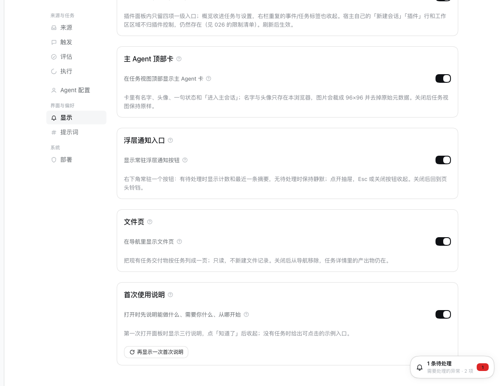
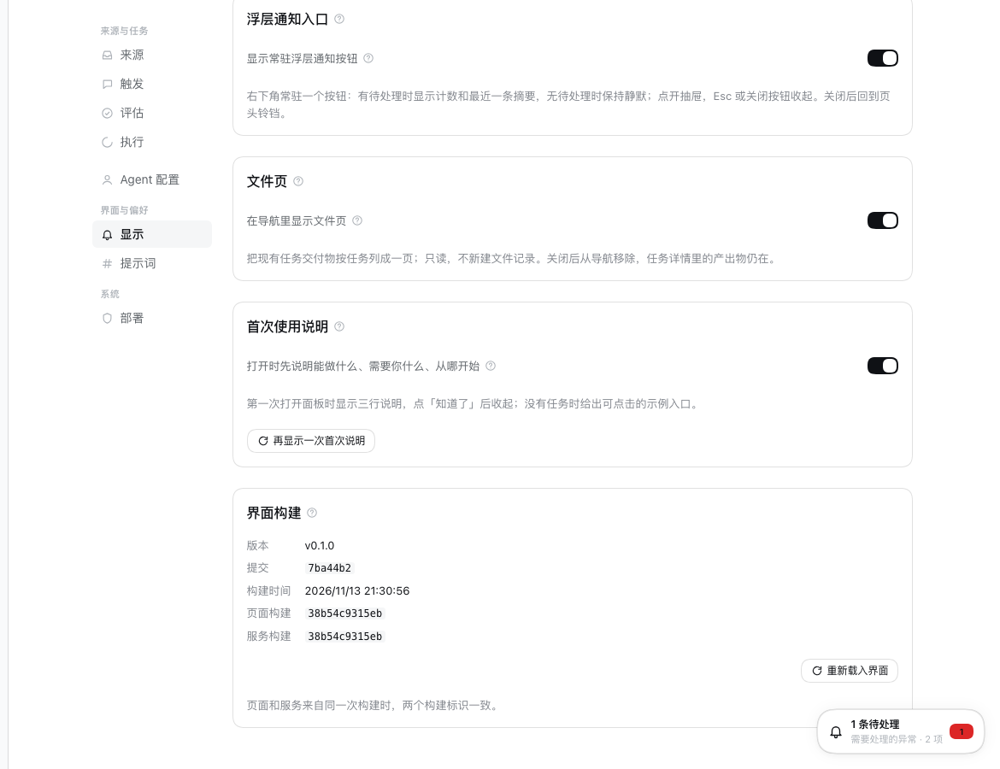

# 升级后核对面板：实际运行的产物、旧页面的来源与检查清单

本文回答一个具体的运维问题：`git pull`、重新构建并重启之后，浏览器里“还是旧界面”时，究竟哪一层没有更新。
它给出 2026-11-13 这台机器上的实际证据、四个默认开关的位置，以及一份重启后按屏幕核对的清单。第 5 节新增的
“界面构建”块和旧客户端提示，是这次为下一次排查留下的工具；它不是对界面设计的改动。

## 1. 结论

这次不是构建产物没有替换，也不是服务加载了错误的包：

- 运行中的进程加载的是 `~/.dsh/profiles/superagent`，它的 `dsh-superagent` 链接指向
  `/Users/steven/projects/open-git/dsh-superagent`；该目录在 `2f457a5`（包含 #63、#70、#78），
  `lib/client.js` 构建于 17:13:47，大小 788,311 字节。
- 服务端返回的启动 HTML 引用 `rev=64dc09ecf89e`，返回的客户端 bundle 就是这份构建（多出 71 字节的
  `sourceMappingURL` 注释，因此 788,382 字节）；其中含 `ux.navFour.v1`、`ux.masterCard.v1`、
  `ux.noticeButton.v1`、`ux.filesPage.v1` 等全部新开关。
- 用一个全新的浏览器配置（空 localStorage）打开 3082，点侧栏 `Superagent`，看到的是新面板：
  `任务 / 通知 / 文件 / 设置` 四个入口、`小助` 主 Agent 卡片和浮动的通知按钮。
- Chrome 的 `Profile 1` 缓存里同时留着两份页面文档：10:52:16 的旧文档引用 `rev=30a716717295`，对应
  737,378 字节的旧 bundle（没有 `navFour`/`masterCard`）；17:13:47 的新 bundle 和 20:17:15 的新文档引用
  `rev=64dc09ecf89e`。**一个从 10:52 起就没有刷新的标签页，会继续执行旧文档里的旧 bundle；重启服务不会
  替换已经打开的页面。**
- 左侧栏的 `插件 / Superagent / 自动化任务 / 更多` 和工作区列表是 DSH 宿主外壳，不由插件渲染；按
  [026](026-ux-third-batch.zh.md) 的 L1–L8，插件只能改面板内部。外壳不变是预期行为，不是这次升级失败。

所以“还是旧界面”最可能是以下三种情况之一，而不是构建失败：

| 现象 | 原因 | 处理 |
| --- | --- | --- |
| 左侧栏仍是 `插件 / Superagent / 自动化任务 / 更多`，工作区仍在 | 看的是宿主外壳；插件无法替换它 | 点侧栏 `Superagent` 进入插件面板；外壳保持原样是 [026](026-ux-third-batch.zh.md) L1–L8 的限制 |
| 面板打开后仍是 `概览 / 任务 / 设置`，没有四个入口 | 该浏览器把 `ux.navFour.v1` 设成了 `off`（或更早的批次开关被关掉） | 在 `设置 › 显示` 打开对应开关；见第 4 节 |
| 面板是新的，但看起来像更早的版本；或改了代码后仍是旧行为 | 标签页从升级前一直开着，或 HTML 缓存仍指向旧 `rev` | 强制刷新（`Ctrl/⌘+Shift+R`）；第 5 节的“界面构建”会显示页面实际运行的构建 |

## 2. 运行实例实际加载了什么

以下值在 2026-11-13 21:2x 采集，服务进程没有重启（本次工作不能重启承载会话的 3082 实例）。

| 证据 | 值 |
| --- | --- |
| 进程 | PID 41386，`node .../bin/dsh --profile superagent --no-open`，启动于 20:16:59 |
| Profile | `~/.dsh/profiles/superagent`；`dsh-superagent` 依赖为 `link:/Users/steven/projects/open-git/dsh-superagent` |
| 链接目标 | `node_modules/dsh-superagent -> /Users/steven/projects/open-git/dsh-superagent` |
| 链接仓库 | `2f457a5`，工作区干净；`lib/client.js` 修改时间 17:13:47，788,311 字节 |
| 客户端构建哈希 | `sha256 84ae4247f0a0b712074061eab5ea9ca2bc5270b5e0d424a04ff677c78b747b90` |
| 启动 HTML | `plugins/??dsh-superagent/client.js&rev=64dc09ecf89e` |
| 服务返回的 bundle | 788,382 字节，`sha256 0c6b75fb3444657dd2e32db0d0a9a4af1a687afcbdd0a3a8da315de012ea7009`；末尾是 `//# sourceMappingURL=??dsh-superagent/client.js.map&rev=64dc09ecf89e` |
| 新开关是否存在 | `ux.navFour.v1`、`ux.masterCard.v1`、`ux.noticeButton.v1`、`ux.filesPage.v1`、`ux.taskHierarchy.v1` 等均出现在该 bundle 中 |
| 新界面是否真的能渲染 | 全新浏览器配置、空 localStorage、1440×900、浅色、中文；点 `Superagent` 后为四个入口、`小助` 卡片和浮动通知按钮 |

构建时间 17:13:47 晚于 #78 合并的 17:02:36；17:13:45 的 `git pull --ff-only` 更新了链接仓库，HEAD 为 `2f457a5`，
所以这份构建包含第三批 UX 的插件内部分。`lib/client.js` 比服务返回的字节少 71，正好是服务附加的
`sourceMappingURL` 行；两份内容除这一行外相同。

## 3. 浏览器到底加载了哪一份客户端

Chrome 的 HTTP 缓存（`~/Library/Caches/Google/Chrome/Profile 1/Cache/Cache_Data`）提供了直接对照：

| 缓存对象 | 修改时间 | 大小 | 引用/内容 |
| --- | --- | --- | --- |
| `d2e7c19cca4b9a4c_0` | 10:52:16 | 737,378 | 旧 HTML，`rev=30a716717295`；旧 bundle，含 `taskHierarchy`，不含 `navFour`/`masterCard` |
| `aca53138312b89fa_0` | 17:13:47 | 788,825 | 新 bundle，`rev=64dc09ecf89e`；含 `navFour`、`masterCard`、`taskHierarchy`（缓存条目含响应头，字节数不等于响应体） |
| `5edd0ff1a6d4a117_0` | 20:17:15 | 38,653 | 新 HTML，引用 `rev=64dc09ecf89e`；同一条目还留有 `8cb6b9b1676c` |

一个从 10:52 打开后未刷新的标签页，其文档仍然是第一份；服务端在 20:16:59 重启、磁盘上的 bundle 在 17:13:47
已经更新，都不会改变这个已经加载的文档。相反，20:17 的新文档和 17:13 的新 bundle 证明新构建本身可以正常送达。
全新浏览器配置下的截图进一步排除了“新构建渲染不出来”的可能。

因此这里没有“产物没替换”或“客户端入口没更新”的证据；能复现的是**旧页面留着旧 bundle**。第 5 节的构建标识
就是为了让下一次能在一屏内区分“页面没刷新”和“构建没更新”。

## 4. 四个入口与相关开关的默认值、位置

这些开关只决定浏览器渲染哪个只读表面，不改变授权、通知预算或记录。默认值都是**开**；只有 localStorage 里
显式写入 `off` 才会回退。`设置 › 显示` 的开关会写入或删除这些键。

| 表面 | localStorage 键 | 默认 | 关闭后 |
| --- | --- | --- | --- |
| 四入口导航（任务/通知/文件/设置） | `ux.navFour.v1` | 开 | 回到 `概览/任务/设置`；若 `ux.opsInSettings.v1` 也关，则回到旧的七标签 |
| 主 Agent 卡片 | `ux.masterCard.v1` | 开 | 任务页不再显示 `小助` 卡片，任务列表不变 |
| 浮动通知按钮 | `ux.noticeButton.v1` | 开 | 回到标题栏的铃铛；通知抽屉和页面仍在 |
| 文件页 | `ux.filesPage.v1` | 开 | 移除 `文件` 入口；任务详情里的产出物仍可打开 |
| 运营页收进设置 | `ux.opsInSettings.v1` | 开 | `来源/触发/评估/执行` 回到第一级标签 |
| 任务层级详情 | `ux.taskHierarchy.v1` | 开 | 回到紧凑的任务行 |
| 任务详情第二批 | `ux.taskDetail.v2` | 开 | 回到第一批的详情 |
| 首次说明 | `ux.firstUse.v1` | 开 | 不显示首次说明与空状态入口 |
| Agent 配置页 | 无开关 | 始终显示 | 在 `设置 › Agent 配置` |

`Agent 配置` 不是实验开关，`设置` 导航在 `ux.opsInSettings.v1` 打开时固定包含它。`设置 › 显示` 本身不受这些
开关影响，因此即使四个入口被关掉，也仍可从 `设置`（旧导航下的 `设置` 标签）进入并恢复。

## 5. 新增的构建标识与旧客户端提示

为了让“页面到底跑的是哪份构建”不用再靠缓存目录推断，这次加了三处：

1. **构建时写入标识。** `tsdown.config.ts` 对 `packages/dsh/src` 和 `packages/kernel/src` 做 SHA-256，取前 12 位
   作为 `buildId`，连同根 `package.json` 的版本、`git rev-parse --short HEAD`、构建时间和是否有未提交改动，
   通过 `define` 同时写进运行时与浏览器 bundle。源码直接运行时（测试、`tsx`）这些常量不存在，回退为
   `dev`/`unknown`，不抛错。
2. **服务端返回。** `GET state` 增加 `build`：`version`、`commit`、`buildId`、`builtAt`、`dirty`。它是运行中
   服务端产物的身份，也是管理 API 的公开字段。
3. **面板显示。** `设置 › 显示` 底部新增“界面构建”：版本、提交、构建时间、页面构建 ID、服务构建 ID，以及
   “重新载入界面”。页面与服务来自不同构建时，页面顶部还会出现一条提示和同一个重载按钮；提示只在两个
   `buildId` 都是真实构建时出现，测试/开发构建不会误报。

“重新载入界面”先用 `fetch(..., { cache: 'reload' })` 重新取当前地址的 HTML，再 `location.reload()`；这样浏览器
不会继续用缓存里的旧 `rev`。它不能替代强制刷新，但能覆盖最常见的“HTML 还在缓存”的情况。

同一临时实例、同一状态目录、同一 1440×900 视口、浅色中文，只把 `dsh-superagent` 链接从旧构建 `2f457a5`
（17:13:47）换成新构建 `7ba44b2`（21:30:56），再滚动到 `设置 › 显示` 的底部：

左侧导航在两张图中相同，说明变化只在页面底部新增的块，不影响已有的显示开关和宿主外壳。

**限制：** 旧客户端本身没有这段代码，所以它不会显示不匹配提示；只有至少加载过一次新客户端之后，提示才会在
下一次服务端更新时出现。判断旧页面仍要依靠 `设置 › 显示` 的构建时间/ID，或直接强制刷新。宿主外壳、侧栏行和
工作区列表仍由 DSH 渲染，插件不能替换，详见 [026](026-ux-third-batch.zh.md) 的 L1–L8。

## 6. 重启后看哪一屏

先分清两个区域；旧界面的报告经常把宿主外壳当成了插件页面：

| 区域 | 归属 | 能否由插件改变 |
| --- | --- | --- |
| 左侧栏的 `新会话 / 插件 / Superagent / 自动化任务 / 更多`、下方工作区与会话列表 | DSH 宿主外壳 | 不能；[026](026-ux-third-batch.zh.md) L1–L8 明确保留 |
| 点侧栏 `Superagent` 之后的 `任务 / 通知 / 文件 / 设置`、页头、任务卡、右栏和浮层 | 插件面板 | 能；受第 4 节开关控制 |
| `设置` 内的来源、触发、评估、执行、Agent 配置、显示、提示词、部署 | 插件页面 | 能；`ux.opsInSettings.v1` 决定它们是否在设置里 |

按顺序核对，任何一步不符合就先停在那一步：

| 步骤 | 屏幕 | 应该看到 | 不符合时 |
| --- | --- | --- | --- |
| 1 | 浏览器地址栏 | 打开带 token 的 `http://127.0.0.1:3082/?token=…`；已有标签页先 `Ctrl/⌘+Shift+R` | 401 时重新用带 token 的地址；不要只刷新旧标签页 |
| 2 | 宿主主页面左侧栏 | `插件 / Superagent / 自动化任务 / 更多`，下方是工作区列表 | 这是宿主外壳，按 [026](026-ux-third-batch.zh.md) L1–L8 保持原样；不是失败 |
| 3 | 点侧栏 `Superagent` | 面板顶部四个入口：`任务 / 通知 / 文件 / 设置`；默认在 `任务` | 只有 `概览/任务/设置`：检查 `设置 › 显示` 的四入口开关，或 localStorage 的 `ux.navFour.v1` |
| 4 | `任务` | 顶部 `小助` 主 Agent 卡片（名称可改、头像可选）；下方任务列表；右下角浮动通知按钮 | 没有卡片：检查 `ux.masterCard.v1`；没有浮动按钮：检查 `ux.noticeButton.v1` |
| 5 | `通知` / `文件` | 通知收件箱；按任务分组的只读产出物列表 | `文件` 不存在：检查 `ux.filesPage.v1`；通知为空是正常状态 |
| 6 | `设置` | 左侧分组：`来源 / 触发 / 评估 / 执行 / Agent 配置 / 显示 / 提示词 / 部署` | 缺少 `触发` 或运营页回到第一级：检查 `ux.opsInSettings.v1` |
| 7 | `设置 › 显示` | 底部“界面构建”：版本 `0.1.0`、提交、构建时间、页面构建 ID、服务构建 ID；两个 ID 相同；第三批的四个回退开关均为开（其它批次的开关也默认开） | 两个 ID 不同：点“重新载入界面”；仍不同则强制刷新并检查服务进程加载的链接目录与构建时间 |

第 7 步是这次新增的判据。只要“页面构建”和“服务构建”一致，且构建时间晚于最后一次 `git pull`/`pnpm build`，
旧界面就不可能来自旧 bundle；剩下的差异只可能来自宿主外壳或某个被关掉的开关。

## 7. 证据与复现

- **链接仓库**：`git -C /Users/steven/projects/open-git/dsh-superagent rev-parse --short HEAD` → `2f457a5`；
  `stat` 与 `shasum -a 256 lib/client.js` 见第 2 节。
- **服务实际返回**：带 token 和 cookie 请求 `/`，从 HTML 中取出 `plugins/??dsh-superagent/client.js&rev=…`，
  再请求该 URL；比较字节数与 `sourceMappingURL`。
- **新构建**：在工单工作区 `pnpm build`，`lib/client.js` 约 795 KB（这次新增构建块后的本地构建），
  `grep` 可见 `version: "0.1.0"`、`commit: "…"`、`buildId: "…"`。
- **全新浏览器配置 + 临时实例**：临时 profile（3099，空状态）、空 localStorage、1440×900、浅色、中文，
  打开同一构建，点 `Superagent`；截图见 `images/post-upgrade-verification/panel-tasks.png`。
- **宿主外壳**：同一个临时 profile 的主页面；截图见 `images/post-upgrade-verification/host-shell.png`。
- **改动前后**：同一临时 profile、同一状态目录、同一视口/主题，只把链接目标从旧构建换成新构建，再截
  `设置 › 显示`：`panel-display-before.png`（没有构建块）与 `panel-display-after.png`（有构建块，两个 ID 相同）。
- **测试**：`tests/build-info.spec.ts` 覆盖开发回退与不匹配比较；`tests/panel-settings.spec.tsx` 断言
  `设置 › 显示` 渲染构建块；`tests/runtime.spec.ts` 断言 `GET state` 带 `build`。

## 8. 没有做的事

- 没有重启承载本会话的 3082 实例；它继续运行 17:13 的构建。上面的“新界面”证据来自独立的临时实例和全新
  浏览器配置，不依赖改动这个进程。
- 没有读取或修改用户浏览器 `Profile 1` 的 localStorage；`Local Storage/leveldb` 在当前 macOS 权限下不可读，
  AppleScript 的 JavaScript 执行也被关闭。因此“用户当时的四个开关值”没有被直接取证；本文用缓存中的旧文档
  和新文档、以及全新配置下的渲染结果来区分“旧页面”与“旧构建”。第 5 节的构建块让下一次可以直接在界面上读到
  页面自己的构建身份，不需要再读浏览器存储。
- 没有修改宿主侧栏、工作区列表或宿主设置；这些不在插件的扩展点内。