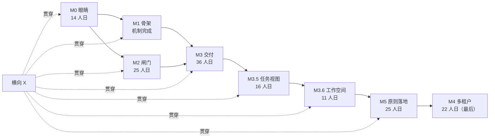

# TASK-PLAN — 从原型到可托付底座：任务分解与排期

> 基线：`touch-agent/dsh-superagent`（private）· `main` `19b8c3d`（PR #31 合并后）· CI `check` 全绿
> 依据：`../012-platform-evolution.zh.md`（下称「方案」）、`../011-design-principles.zh.md`（下称「原则」）、`../tasks-view-architecture.zh.md`（下称「任务视图」，PR #26）· 本文只做**任务分解**，不重复方案里的取舍论证
> 日期：2026-11-07；重评估 2026-11-08 · 状态：执行中；任务状态、PR 与验收证据见 [TRACKING.zh.md](TRACKING.zh.md)

---

## 0.0 进度（2026-11-07 晚）

M0 已收官。下表是 2026-11-07 的完成快照，验收命令都在 CI 上跑过；当前状态见 [TRACKING.zh.md](TRACKING.zh.md)。

| 任务 | 状态 | 落地 | 验收证据 |
| --- | --- | --- | --- |
| T0-01 trace 端口 + `span` 表 + schema 12 | 完成 | `fcbae91` | 62 files / 1212 tests；schema-11 库升 12，13 版库被拒 |
| T0-02 十段埋点 | 完成 | `7f11e0d`、`ab8f6c5` | 一条 trace 从 intake 到首次报告十段齐全，重复发生各自成行 |
| T0-03 四指标 + `GET metrics` | 完成 | `1377989` | `tests/metrics.spec.ts`；空样本给 `null` 不给 0 |
| T0-04 面板只读健康区 | 完成 | `1377989` | Overview 页「运行健康」四个数字 + 中断/恢复提示 |
| T0-05 changesets + 体积门 + 两段 CI | 完成 | `894c1a5` | `pnpm changeset status` 两包各一 minor；`release` dry-run 18s |
| T0-06 runbook + 演练 + trace 读取面 | 完成 | `492e668`、`a3809b1` | 三次查找 36–50 ms；`../runbooks/why-not-sent.md` |

**M1 前置已动**：X-07（包切分）于 2026-11-07 落地——`src/`、`skills/`、`prompts/` 迁入 `packages/dsh`（`@superagent/dsh`），根包成为 meta（patch + locale + 三个 re-export 入口）；patch 行名与子路径不变（D7）。X-08 于 2026-11-08 落地（见 §13）；X-11 也已落地，状态见 [TRACKING.zh.md](TRACKING.zh.md)。

基线随之变化：65 个 spec / 1232 个测试（13.2s），领域子集 496 个 / 549 ms，`src` + `packages` 代码量见 `git show --stat`；CI 三个工作流（`check` / `changesets` / `release`）均已实跑通过。

**M1.6 入口已动一部分**：S-01（事件分级 + `activity` 表，schema 13 + `GET activity`）、S-02（单一通知预算）、S-03（`<stateDir>/system` 主会话根与 `<stateDir>/system/work` 默认工单根）随同批 PR 落地；S-04…S-08 等宿主界面任务。设计与宿主核验见 [`SESSION-ENTRY.zh.md`](SESSION-ENTRY.zh.md)。

---

## 0.0.1 重评估（2026-11-08）

> 输入：原则 v1.0（docs/011）、任务视图提案与联合 review 结论（PR #26/#32）、[TRACKING.zh.md](TRACKING.zh.md) 的真实进度。
> 一句话：机制底座已过 M0/M2；原计划继续「扩源 → 多租户」的顺序，会把还没有默认面的目标层、任务树与原则检查点推到后面。重评估把顺序改为 **M3 收尾 → M3.5 任务视图 → M3.6 工作空间 → M5 原则落地 → M4 多租户**，T1 剩余两个源与工程卫生项后置。

### 0.0.1.1 真实进度

| 里程碑 | 真实状态 | 依据 |
| --- | --- | --- |
| M0 眼睛 | 完成 | T0-01…06 均有验收证据 |
| M1 骨架 | 机制完成；剩余两个源后置 | T1-01…06、T1-08、T1-11、T1-12 完成；T1-07/T1-09/T1-10 未开始 |
| M1.5 会话派活 | 完成 | T1-13…17 |
| M1.6 入口 | 完成 | S-01…08 |
| M2 闸门 | 完成 | T2-01…10；PR #18 补上了审批生产方，T2-08 的「策略已有、生产者未接」缺口已关 |
| M3 交付 | 进行中（5/8） | T3-01/02/03/07 完成；T3-05 Phase 0 完成；T3-04/06/08 未开始 |
| M3.5 任务视图 | 未开始（新增） | PR #26 Phase 1/2 尚无实现 |
| M5 原则落地 | 未开始（新增） | 原则 B/C/D 的检查点尚无任务 |
| M4 多租户 | 未开始 | — |
| X 横向 | 部分完成 | X-07/08/11 完成；X-12 随 PR #31 合并（本次改为已完成）；其余未开始 |

**M2 收尾结论**：T2-01…10 全部有合并 PR；`tests/chaos.spec.ts` 的 100 轮断电注入与 `pnpm drill:withdraw` 的撤退演练是 M2 退出证据。T2-08 在旧快照里写「PR #16 待审查」，实际后由 PR #18 接线，审批队列不再为空；本表不再把 M2 列为待办。

### 0.0.1.2 与原则冲突或价值降低的任务

1. **T1-07 / T1-09（Gmail、日历）**：manifest 机制已由 T1-08（飞书文档）与 T1-11（manifest 驱动设置页）证明，继续加源是容量问题，不是学习问题。按「信任先于连接器」后置到 M3.5/M5 之后；有真实接入需求时再单独排。
2. **T1-10（`kind.ts` 退役）**：清理项，没有用户可见价值；跟随最后一个源一起做，不单独占关键路径。
3. **T4-01…06（多租户）**：原表把 M4 写成「可前置」，与原则 A/B/D 的顺序冲突。多租户会把尚未定型的默认面、任务视图与上下文装配复制到多份；改为 M5 之后的最后一项。只有真实租户合同才提前做 T4-01/T4-03 的接口层。
4. **T3-06（warm session）**：内部执行优化。M3 的「小活 p50 < 10s」已由 T3-05 的 inline 路径承担；T3-06 后移到 M3.5 之后，除非指标证明冷启动仍是瓶颈。
5. **X-01 / X-02 / X-04（lint、依赖规则、JSON Schema）**：工程卫生，价值真实但不改变「人能否托付」；作为并行维护项，不占 M3/M3.5/M5 的关键路径。
6. **与原则 B 冲突的现有默认面**：事件栏首次自动打开、管理面板七个 tab、把计划树当任务主视图，都会把 E2 组织细节推到默认面。不删记录，新增 T5-02 统一 E0–E3 并把默认面收紧；计划树降为 E2 回退。
7. **与原则 A 冲突的缺口**：计划没有「目标层」，E0 只能从 Ticket 标题猜目标。新增 T5-01，Goal 是只读投影，不新增授权聚合。
8. **M1 退出标准失真**：原文要求「三个新源 + `kind.ts` 退役」；真实进度是「一个新增源 + 机制已被两个已有源与设置页证明」。本重评估改口径，不把剩余两个源算作 M1 未完成的机制债。

### 0.0.1.3 新增任务（补原则与任务视图的缺口）

| 任务 | 补什么 | 里程碑 |
| --- | --- | --- |
| T3-09 | 任务视图 Phase 1：右栏只读任务视图（tracked；lightweight 前向兼容） | M3.5 |
| T3-10 | 任务树 Phase 2a：子 Ticket 运行时、父 owner 审查链与结束门 | M3.5 |
| T3-11 | 任务树 Phase 2b：子 Ticket 树视图、父审阅与交付聚合 | M3.5 |
| T5-01 | 目标层建模：Goal 只读投影（不新增授权聚合） | M5 |
| T5-02 | E0–E3 暴露级别与默认面清理（B） | M5 |
| T5-03 | 群组派生：从 Channel/Thread/Subscription 派生群组维度（不建 Membership） | M5 |
| T5-04 | 可组合六层上下文装配：装配表、快照、fail closed（C） | M5 |
| T5-05 | 观察→总结→进化→验证闭环（离线、只提案）（C） | M5 |
| T5-06 | 组织观测与替换演练（D） | M5 |
| X-13 | TRACKING 自动化：计划↔跟踪表↔PR 证据一致性 | X |

**任务树 Phase 0 不是新任务**：它就是 T3-05 的剩余部分（生产 `InlineExecutor`、Eval 选择 `form`、<10s 验收）。本重评估只把 T3-05 的验收口径写清，不重复开任务。

### 0.0.1.4 重排后的顺序与依赖

1. **M3 收尾**：T3-05（Phase 0）→ T3-04（mail previewer）→ T3-08（时间线）；T3-06 后移。T3-04 必须先于任何「review 必有 preview」的对外声称，否则邮件类交付没有预览。
2. **M3.5 任务视图**：T3-09 → T3-10 → T3-11。任务视图 Phase 1 是纯读、可先落地；Phase 2a 是本轮评论要求的核心（子 Ticket + 每个 tracked 节点 owner/worker + 父 owner 审查链）；Phase 2b 把父审阅与交付聚合接到界面。类别归纳（Phase 3）不在本轮，等目标层与使用数据。
3. **M3.6 工作空间**：T3-12 → T3-13。先把 `execution.directory` 投影成只读空间视图，再做写租约与子 Ticket 独立空间；设计见 [docs/013](../013-workspace-model.zh.md)。
3. **M5 原则落地**：T5-01 → T5-02 → T5-03 → T5-04 → T5-05 → T5-06。先有目标层，才能定义 E0 默认面；先有 E0–E3，群组/上下文装配才知道什么能进 prompt；先有观测与边界，进化闭环才不会变成拍脑袋；最后做替换演练，验证 D。
4. **M4 多租户**：M5 之后，最后启动；不改变单租户语义。
5. **X 优先级**：X-13（跟踪自动化）立即；X-03（E2E golden path）在 M3.5 前，给任务视图与父审阅一条端到端证据；X-09（入口三区）在 T5-02 前；X-10（宿主矩阵）在 M4 前；X-01/02/04 并行维护；X-06 继续守领域测试 <2s。
6. **T1 剩余项**：T1-07/T1-09/T1-10 在 M3.5/M5 之后，或按真实接入需求插队；插队不改变「M2 先于第 4 个源」的信任顺序。

**为什么不是先做 M2 收尾**：M2 已经收尾，剩下的是证据归档与状态表修正，不是新机制。**为什么任务视图先于 M5**：E1 审查面需要一个稳定的任务读模型；没有它，目标层与 E0 只能对着一堆 Ticket 标题做。**为什么 M5 先于 M4**：原则 D 的替换演练与原则 B 的默认面必须先定型，否则多租户会把旧默认面复制 N 份。**为什么 C 最后**：原则 §8 的顺序是 A→B→D→C；没有 A/B/D 的观测与边界，进化闭环没有基线。

### 0.0.1.5 重评估引入的风险

新增风险已并入 §11 的风险登记册（R8–R13）：任务膨胀、Goal 变成第二授权聚合、子 Ticket 变成第二授权路径、清理默认面误删诊断、连接器后置错过窗口、M5 范围拖住 M4。回退动作与触发信号见 §11。

---

## 0. 今天在哪里

> 以下是 2026-11-07 的建仓快照，保留作历史；当前状态见 §0.0.1 与 [TRACKING.zh.md](TRACKING.zh.md)。

| 维度 | 现状 | 证据 |
| --- | --- | --- |
| 仓库 | 新仓库已立，原仓库只读（`deepseek-ai/dsh-superagent-prototype`，`push:false`） | `gh repo view` |
| 提交 | 原型 + kernel 抽包 + 装配器拆解 + CI，共 4 个 | `git log --oneline` |
| 测试 | 61 个 spec 文件 / 1204 个测试，全绿 15.6s；领域 + 守卫子集 479 个 / 641ms | `vitest run` |
| 代码量 | `packages/dsh/src/` + `packages/` 共 111 文件 / 15293 行 | `find` + `wc -l` |
| 依赖面 | kernel 包零依赖；全部 `@deepseek-ai/*` 走 peerDependencies | `packages/kernel/package.json` |
| CI | 一段 `check`：typecheck → test → build；`--frozen-lockfile` 验 workspace 形状 | `.github/workflows/check.yml` |
| 源 | 2 个 kind（GitHub、Feishu），Feishu 默认 `disabled: true` | `packages/dsh/src/sources/kind.ts` |
| 存储 | 单 SQLite，`SCHEMA_VERSION = 11`，`OLDEST_SCHEMA = 10` | `packages/dsh/src/app/migration.ts:20-22` |

**相对方案 §8 的完成度**：M0 六项任务全部完成（见 §0.0）；M1 尚未开始。

**仍然缺的能力**（= 后面所有任务的来源）：源只能手写、动作不分级、没有审批与撤销、没有交付物与预览、单租户单实例。trace 与指标已补齐（§0.0）。

---

## 1. 这份计划怎么用

### 1.1 任务编号与字段

任务定义写在本文；任务的状态、PR、验收证据与最后更新只记在 [TRACKING.zh.md](TRACKING.zh.md)。本文里带日期的「进度」段落是历史快照，不随状态变化追改。

`T<里程碑>-<序号>`，每个任务给六件事，缺一不成立：

| 字段 | 含义 | 不合格的样子 |
| --- | --- | --- |
| 目标 | 一句话说清为什么做 | 「优化性能」 |
| 交付 | 落在哪些文件/表/端点 | 「加个监控」 |
| 验收 | 可执行的检查（测试名或演练动作） | 「感觉能用」 |
| 估时 | 人日，按「熟手、含测试」 | 「大概几天」 |
| 依赖 | 前置任务或决策 | 空着 |
| 泳道 | Kernel / Connector / Runtime / Platform | 「大家一起」 |

### 1.2 四条排序原则

1. **信任先于连接器**：M2（闸门）必须早于「第 4 个源」。源可以后补，审计与撤销不能。
2. **kernel 变更先有契约**：任何改 `packages/kernel` 的任务，必须先有或同时有 `tests/kernel-*.spec.ts` 覆盖，否则不允许合并。
3. **每个任务自带回退**：新路径与旧路径并存，靠 feature flag 切换；方案 §10.3 的 strangler 四步是硬约束。
4. **全量测试任何时刻必须绿**：当前 1500+ 个测试（以 CI 为准），任何任务把 `vitest run` 弄红超过一个工作日，就算该任务失败，回退。

### 1.3 泳道与假设

按 4 人（Kernel 1 + Connector 1 + Runtime 1 + Platform 0.5 + 我）估算，每人 5 人日/周。若只有 1–2 人，顺序不变、时间 ×2.5，且 M1 的三个新源砍到一个。

估时只覆盖**里程碑退出标准所需的最小实现**：源按 3 个计，每多一个源 +4~6 人日；previewer 每个 +3~6 人日。

### 1.4 重评估后的排序（2026-11-08）

1. **先把已有机制收口**：M3 收尾 + M3.5 任务视图；不再用新源/多租户掩盖默认面缺口。
2. **原则落地排在容量扩张之前**：M5 的 A/B/C/D 检查点先于 M4 与 T1 剩余源。
3. **任何新增任务必须能回答**：它服务于哪条原则、哪个里程碑退出标准、没有它谁会受影响；答不出就不加。

---

## 2. 里程碑总表

| 里程碑 | 目标 | 任务 | 估时 | 前置 | 退出标准 | 方案章节 |
| --- | --- | --- | --- | --- | --- | --- |
| M0 眼睛 | 能回答「为什么没发出去」 | T0-01…06 | 14 人日 | — | 任意工单 30 秒定位卡点；领域测试 < 2s | §6.8、§8 |
| M1 骨架 | 新源只写 manifest + adapter（机制） | T1-01…12 | 39 人日 | M0 | 机制已由 T1-08/T1-11 证明；新源 ≤ 2 人日；零手写表单 | §6、§7.4 |
| M1.6 入口 | 主会话=体系入口，页内看体系、右侧看事件；目录分级 | S-01…08 | 14.5 人日 | M1.5 | 主会话单例；目录根 `<stateDir>/system`；一个结果一条通知 | §10.2、`SESSION-ENTRY.zh.md` |
| M2 闸门 | 不可逆动作有审批与撤销窗口 | T2-01…10 | 25 人日 | M0（与 M1 并行） | 断电注入 100 次重复发送 0；可撤回源 100% | §6.2、§6.3 |
| M3 交付 | review 真可审；小活不付 Session 冷启动 | T3-01…08 | 36 人日 | M1、M2 | 小活 p50 < 10s；review 页必有 preview | §6.4–6.6 |
| M3.5 任务视图 | 右栏任务视图；子 Ticket 树与父 owner 审查链（任务视图 Phase 1/2） | T3-09…11 | 16 人日 | M3 | tracked 任务在右栏可读；父 owner 可拆/审/停子 Ticket；子 Ticket 不是授权主体 | 任务视图 §9 |
| M3.6 工作空间 | 空间可观测；同一空间写者唯一；子 Ticket 独立空间 | T3-12…13 | 11 人日 | M3.5 | 空间投影/E2 视图可用；两个 Ticket 不并发写同一空间；旧 worktree 可收养 | 013 §8 |
| M5 原则落地 | 目标层、E0–E3、群组/六层上下文、进化闭环、替换演练 | T5-01…06 | 25 人日 | M3.6 | E0 只给目标/状态/决定/结果；装配快照可审查；进化只提案；替换演练等价 | 原则 §8 |
| M4 多租户 | 能卖团队版/私有化 | T4-01…06 | 22 人日 | M5 | 单租户故障不影响他人；删除演练可验证 | §6.7 |

> 重排后约 204 人日（新增 54 人日；M1 剩余两个源与 M4 计入但后置）≈ 10 周（4 人）。这是「机制可用」的估算，不含 30 个源、产品化打磨与合规认证；方案 §8 的「5–6 个月」含这些。

---

## 3. M0 收尾：观测（T0-01…06）

**判断标准（唯一）**：给一个卡住的工单，30 秒内能说出它停在哪一段、为什么。做不到就不算 M0 完成。

### T0-01 Trace 端口与 span 存储 · Kernel · 3 人日

- **目标**：领域层能产 trace，但不认识 OTel、不新增依赖。
- **交付**：`packages/kernel/src/trace.ts`（`Tracer` / `Span` 端口 + `NoopTracer`）；`packages/dsh/src/app/trace.ts` 适配器（写 SQLite）；`packages/dsh/src/app/store.ts` 建 `span` 表（`trace_id, span_id, parent_id, name, at, ms, attrs`）+ 索引；`migration.ts` `SCHEMA_VERSION` 11 → 12 与 11→12 迁移。
- **验收**：`tests/trace.spec.ts`：一次 `accept` 恰好 1 条 traceId；父子 span 可还原成树；重启后 span 仍在；11→12 迁移可回放。
- **依赖**：无。**回退**：NoopTracer 是默认值，关掉即回到现状。

### T0-02 十个阶段埋点 · Runtime · 4 人日

- **目标**：方案 §6.8 的十段每段一个 span：`ingest → intake → gate → assess → decide → authorize → run → report → action → accept`。
- **交付**：在 `packages/dsh/src/core/engine.ts` 的角色方法边界与 `packages/dsh/src/app/effects.ts` 的 dispatch 处开 span；属性至少 `tenant / workItem / actor / policyVersion / effectKind`。
- **验收**：`tests/trace-journey.spec.ts`：一条真 trigger 走完 ≥9 段；故意让 gate 拒绝时，trace 停在第 3 段且带 reason；缺段能被测试断言出来（防止埋点悄悄丢）。
- **依赖**：T0-01。**回退**：`machine.trace.enabled` 配置，默认开，可关。

### T0-03 四指标派生 · Runtime · 3 人日

- **目标**：TTFA、duplicate-send rate、restart recovery rate、decision throughput，全部从 span + ledger 派生，不新增埋点。
- **交付**：`packages/dsh/src/app/metrics.ts`（纯 SQL 查询 + 计算）；HTTP `GET /metrics`（同源只读，复用 `http.ts` 的检查链）；主 Session 一个只读工具 `orchestrator_metrics`。
- **验收**：`tests/metrics.spec.ts` 用合成 ledger：TTFA 取「trigger.at → 首条 outbox.sent」的 p50/p95；重复发送率 = 同幂等键多条 sent / sent 总数；重启恢复率 = 被 host restarted 结束且续跑成功的工单占比；决策吞吐 = 每小时 accept+stop 数。
- **依赖**：T0-02。**回退**：`/metrics` 是只读端点，删掉不影响任何写入路径。

### T0-04 面板只读健康页 · Runtime · 2 人日

- **目标**：方案 §9 的九个数字里先上四个，加上「按工单看 span」的入口。
- **交付**：`packages/dsh/src/app/views/overview.ts` 增一块；`packages/dsh/src/client/` 增一个 `Trace` 视图（列表 + 时间轴），走 `api.ts` 的类型契约。
- **验收**：面板显示真实数字；无数据时整块不显示（`../005-panel.md`「默认安静」）；`tests/panel.spec.ts` 覆盖空态与有数据态。
- **依赖**：T0-03。**回退**：视图独立，隐藏即回退。

### T0-05 changesets 与两段 CI · Platform · 1 人日

- **目标**：阶段 1 的欠账——包版本可独立发布。
- **交付**：`.changeset/config.json`（`@superagent/kernel` 独立版本、其余 private）；`release.yml`（仅 main，先 dry-run，不真发 npm）。
- **验收**：CI 里 `pnpm changeset status` 通过；`packages/kernel` 版本与 changelog 由 changeset 驱动。
- **依赖**：能装依赖的环境（本机 pnpm 因 corepack EPERM 不可用，见 §11 R6）。**回退**：删 workflow，配置无害。

### T0-06 M0 退出标准验证 · Lead · 1 人日

- **目标**：把「30 秒定位卡点」变成一次演练，而不是一句口号。
- **交付**：`../runbooks/why-not-sent.md`（从 trace 读的三步法）+ 一份演练记录。
- **验收**：随机抽 3 个历史工单，按 runbook 在 30 秒内说出卡点；`pnpm check` 绿；领域测试 < 2s。
- **依赖**：T0-01…05。

---

## 4. M1 骨架：Source Kit v2（T1-01…12）

**判断标准**：加一个源 = 写一个 manifest + 一个 adapter + 一份 conformance 测试，**不碰** `packages/dsh/src/app`、不碰内核、不手写表单。

**重评估（2026-11-08）**：M1 的机制已由 T1-08（飞书文档）与 T1-11（manifest 驱动设置页）证明；T1-07/T1-09 是容量，T1-10 是清理，均后置到 M3.5/M5 之后。M1 的退出标准改为「机制可复现」，不再要求三个新源都合并。

### T1-01 `SourceManifest` 类型与校验 · Kernel · 2 人日

- **交付**：`packages/kernel/src/manifest.ts`：声明式的 `SourceManifest`（`id / title / description / auth / fields / health / limits` 与 `extra`）；`Localized` 与 `FieldSpec` 从 runtime 迁入并 re-export，全仓只留一份定义。**行为与准入**（`schema`、`channel`、`threadContext`、`policy`（含准入行与 explicit）、`environment`、`find`、`repliesTo`）留在 runtime 的 adapter，不进 manifest（D9、D10）。zod 校验放 `packages/dsh/src/sources/manifest-schema.ts`（D6，kernel 零依赖不放宽）。
- **验收**：`tests/manifest.spec.ts`：合法 manifest 通过；缺 `scope`、`id` 冲突、auth 字段未声明、字段 key 重复、`limits` 非法时均给出带路径的错误。
- **依赖**：无。

### T1-02 manifest → 表单/健康项/限流 生成器 · Connector · 2 人日

- **交付**：`packages/dsh/src/sources/manifest-form.ts`：`manifestForm(manifest)` 产出面板模型——fields 保持顺序（含 `advanced`）；auth 的字段 key 解析为字段本身；health 成为健康条目名；limits 成为轮询默认值。准入表（rows + explicit）由 adapter 的 policy part 提供给面板（D10），不进表单模型。React 渲染留给 T1-11。
- **验收**：`tests/manifest-form.spec.ts`：生成结果与手写的 `githubKind` 的 fields / health 一致；auth 引用未声明字段时抛错；结果可 JSON 往返。
- **依赖**：T1-01。

### T1-03 registry 按 manifest 装配 · Runtime · 2 人日

- **交付**：`packages/dsh/src/sources/registry.ts` 的登记单元改为 `{ manifest, adapter }`：新增 `registerDefinition`（注册时用 `SourceManifestSchema` 校验 manifest），`register(kind)` 作为迁移期兼容入口（T1-10 删除）；`kind()` 从登记项合成扁平视图供面板与视图读取；`resolve` 仍保证一 id 一实例。`kind.ts` 拆出 `SourceAdapter` 与 `SourceDefinition`，`SourceKind` 继承 adapter。
- **验收**：`tests/registry.spec.ts` 覆盖定义注册：kind 视图、配置校验、scope、health claim/release、非法 manifest 的路径错误、两入口的 id 冲突；现有 GitHub/Feishu 行为不变（全量绿）。
- **依赖**：T1-01。

### T1-04 / T1-05 GitHub、Feishu adapter 迁到 manifest · Connector · 各 3 人日

- **状态**：已完成（2026-11-07）。
- **交付**：`github.ts` / `feishu.ts` 各自导出 `*Manifest`（声明式数据，含 auth/scope/health/limits）、`*Adapter`（schema/scope/channel/threadContext/find/repliesTo/policy/environment/facts）与 `*Definition = { manifest, adapter }`；插件改用 `registerDefinition` 注册，`kind.ts` 的扁平类型仍在，两个 `*Kind` 只是从 manifest + adapter 合成、供面板与测试读取，T1-10 删除。
- **验收**：全量测试绿；`sources.spec` 断言“registry 从 definition 合成的扁平视图与手写 kind 深度相等”，作为无行为差异的等价证明。
- **依赖**：T1-02、T1-03。

### T1-06 adapter conformance suite · Connector · 4 人日

- **目标**：方案 §10.1 的第 2 条契约测试——这是「支持 30 个源」的唯一可行办法。
- **交付**：`tests/conformance/`：一组可被任何 adapter 复用 `describe` 的用例：幂等键生成、游标回退 5 秒、health claim 命名、`probe` 语义、scope 裁决、出站 `sent/gone` 两态。
- **验收**：GitHub 与 Feishu 都跑通；故意写错幂等键的假 adapter 必须失败。
- **依赖**：T1-04、T1-05。
- **状态**：实现完成（2026-11-07，PR #1 关闭后由 main 承接；状态见 [TRACKING.zh.md](TRACKING.zh.md)）。`tests/conformance/suite.ts` 由任何 Source 的 fixture 驱动；GitHub 与 Feishu 各有一个 spec，`tests/conformance/suite.spec.ts` 证明写错幂等键、漏掉 5 秒游标回退、丢掉出站幂等键的假 adapter 必红。probe 用例已接入三个 fixture。

### T1-07 / T1-08 / T1-09 三个新源：Gmail、飞书文档、日历 · Connector · 5 / 5 / 6 人日

- **交付**：每个 = manifest + adapter + 环境变量注册 + conformance 通过。
- **验收**：新增一个源的总改动 ≤ 2 人日可复现（用 T1-09 的日历作为计时样本）；面板无手写表单。
- **依赖**：T1-06。
- **状态**：T1-08 实现完成（2026-11-07；状态见 [TRACKING.zh.md](TRACKING.zh.md)）。`feishu-doc` = manifest `feishuDocManifest` + adapter `feishuDocAdapter` + 两个环境变量 + `tests/conformance/feishu-doc.spec.ts`；新插件 `./feishu-doc-watch` 在 `cordis.patch.yml` 里默认关闭，沿用飞书来源配置的机器人。未改 app 与内核。T1-07、T1-09 未开始。

### T1-10 `kind.ts` 退役与等价证明 · Connector · 2 人日

- **交付**：删 `packages/dsh/src/sources/kind.ts`（或缩成 manifest 的 re-export）；`../007-architecture.md` 与 `../001-domain.md` 同步。
- **验收**：全量绿 + conformance 覆盖新旧两版；diff 里没有行为改动。
- **依赖**：T1-07…09。

### T1-11 源配置页由 manifest 驱动 · Runtime · 3 人日

- **交付**：`packages/dsh/src/client/source.tsx`（字段渲染在 `settings-kit.tsx`）改为渲染生成器产物；权限提示、健康条目、限流说明都从 manifest 读。
- **验收**：加一个假源（测试 fixture）只改 manifest，面板自动出现正确的字段与标签。
- **依赖**：T1-02。
- **状态**：实现完成（2026-11-08；状态见 [TRACKING.zh.md](TRACKING.zh.md)）。`SourceRegistry.form()` 把 manifest 经 `manifestForm` 交给设置视图与健康视图；`source.tsx` 从它渲染字段、登录方式提示、健康项和轮询默认；`tests/fixtures/fake-source.ts` 只声明 manifest，设置页与状态页即出现该来源。`kind()` 仍供运行时读取，扁平 kind 走等价回退。

### T1-12 文档：新增源 30 分钟指南 · Platform · 1 人日

- **交付**：`../010-adding-a-source.md`；`docs.spec.ts` 的文档表同步。
- **验收**：按指南从零写一个假源（noop），全程无 `packages/dsh/src/app` 改动。
- **状态**：实现完成（2026-11-08，PR #25；状态见 [TRACKING.zh.md](TRACKING.zh.md)）。009 这个编号已被会话任务文档占用，指南落在 `../010-adding-a-source.md`；README 文档表补齐 009/010，`tests/docs.spec.ts` 新增“README 按序列全每个编号文档”的检查，`../007-architecture.md` 的 Sources 一节改为描述 `SourceDefinition` 注册路径。按指南在干净 worktree 里从零加了临时 noop 源（manifest + adapter + 插件入口 + 运行时/包入口、导出、patch 行、tsconfig/vitest 子路径、007 表与两个精确行测试）：`pnpm typecheck`、89 个文件 / 1504 个测试、`pnpm build`、体积门通过，`packages/dsh/src/app` 无改动；该练习补出了 `tests/dump-config.spec.ts` 也要同步这一条，已写进指南。

---

## 5. M2 闸门：动作分级与审批（T2-01…10）

**判断标准**：断电 100 次，重复发送 0；能撤回的源，撤回成功率 100%。

### T2-01 Action 五级与类型 · Kernel · 2 人日

- **交付**：`packages/kernel/src/action.ts`：`read / draft / commit / send / spend`；`Action` 对象带 `source / objectId / revision / actor / level / idempotencyKey`。
- **验收**：`tests/action.spec.ts`：五级的幂等键互不相同；`spend` 必须带金额或时间成本字段（日历占他人时间也映射到 spend）。
- **依赖**：无（可与 M0 并行）。
- **状态**：实现完成（2026-11-07，PR #5；状态见 [TRACKING.zh.md](TRACKING.zh.md)）。`packages/kernel/src/action.ts` 导出五级、`Action`（kind / source / objectId / revision / actor / level / idempotencyKey）、`actionKey` 与 `createAction`；`ActionCost` 分 money/time 两种，日历占他人时间用 time 表达；`tests/action.spec.ts` 覆盖五级键互异、键随身份各部分变化与成本拒绝。

### T2-02 `Approval` 对象与状态机 · Kernel · 3 人日

- **交付**：`approval` 表 + 迁移；状态 `requested → approved / denied / expired / revoked`；与 Ticket 一对多。
- **验收**：`tests/approval.spec.ts`：状态不可跳变；过期后 approve 被拒；同一 action 重复 approve 幂等。
- **依赖**：T2-01。
- **状态**：实现完成（2026-11-07，PR #7；状态见 [TRACKING.zh.md](TRACKING.zh.md)）。`packages/kernel/src/approval.ts` 导出 `Approval`、五态与 `createApproval` / `approve` / `deny` / `expire` / `revoke`；id 由 Ticket 与 Action 幂等键派生，同一工单的同一 action 只有一条审批，重复批准幂等；`approval` 表随 schema 14 增量迁移，Store 与 MemoryRepositories 提供按 Ticket 和待批准查询；`tests/approval.spec.ts` 覆盖状态跳变、过期后批准被拒、重复批准幂等与迁移。

### T2-03 `maxActionLevel` 进 Authority 与 revalidate · Kernel · 2 人日

- **交付**：`policy.ts` 的 mandate 增加 `maxActionLevel`；`revalidate` 时同时校验等级（当前只校验规则与 strength）。
- **验收**：政策把等级从 send 降到 draft 后，在跑的工单下一动作被拒并记 reason；`tests/policy.spec.ts` 覆盖。
- **依赖**：T2-01、T2-02。
- **状态**：实现完成（2026-11-08，PR #8；状态见 [TRACKING.zh.md](TRACKING.zh.md)）。Mandate 增加 `maxActionLevel` 与可选 `expiresAt`；Policy 增加 `maxActionLevel`（默认 `draft`）与 `mandateMinutes`；`revalidate(mandate, at, action?)` 每次都校验授权过期，动作时点再按 Mandate 记录上限与当前 Policy 上限中更严者校验等级，返回 `mandateExpired` / `actionLevelExceeded` / `revoked` 原因；记录了上限的 Mandate 不会因 Policy 放宽而变宽（旧 Mandate 无记录时跟随当前 Policy）。`tests/policy.spec.ts` 覆盖 send 降到 draft 后的下一动作拒绝，`tests/action.spec.ts` 覆盖等级比较。

### T2-04 outbox `pending-send` + 撤销窗口 + `recalled` 态 · Runtime · 3 人日

- **交付**：`packages/dsh/src/core/outbox.ts`（或 ticket part）引入 `pending` 状态与窗口计时；`effect` 增 `recalled` 终态；`delivery` 的 `limit` 与窗口关系写清。
- **验收**：`tests/outbox.spec.ts`：窗口内 recall → 外发 0 次；窗口后 recall → 拒绝并说明原因。
- **依赖**：T2-01。
- **状态**：实现完成（2026-11-08，PR #12；状态见 [TRACKING.zh.md](TRACKING.zh.md)）。`packages/dsh/src/app/outbox.ts` 的 `send` 把收据与 `reply` effect 一起写入，effect 的 `due` 设为窗口结束；`receipts.recall` 只在 `dueAt` 前把待发送收据置为 `recalled` 并取消 effect，`withdraw` 退化为 best-effort；窗口由 Policy 的 `undoWindowSeconds` 控制（0–300 秒，默认 30，IM 租户可设 0），收据记录 `dueAt/windowMs`。管理 API 的 `POST outbox/:id/recall` 暴露撤回（`unknownReply` 404，`replySettled`/`undoClosed` 400）。`tests/outbox.spec.ts` 覆盖窗口内 recall 外发 0 次、到期发送、窗口后 recall 拒绝并给出 `undoClosed` 原因、重复 ID 不重发与冻结窗口；`tests/runtime.spec.ts` 覆盖默认窗口下 ack 返回 `pending`，`tests/http.spec.ts` 覆盖撤回路由。

### T2-05 幂等键改造 · Kernel + Runtime · 2 人日

- **交付**：键从 `(kind,key)` 语义扩展为 `(source, objectId, action, revision, actor)` 派生；`effects.enqueue` 的 UPSERT 语义同步。
- **验收**：同一 action 两种 revision 产生两条 effect；同一 revision 重复触发只有一条。断电注入测试见 T2-09。
- **依赖**：T2-01。

- **状态**：实现完成（2026-11-08，PR #13；状态见 [TRACKING.zh.md](TRACKING.zh.md)）。`packages/kernel/src/action.ts` 新增 `outboundAction`、`acknowledgementAction`、`OUTBOUND_KINDS` 与 `OUTBOX_ACTOR`：外发消息成为 `send` Action，key 由 `(source, objectId, kind, revision, actor)` 派生；`OutboundSend` 交给 Outbox，收据 id 与 `reply` effect key 同源，`effects.enqueue` 的 UPSERT 因此按同一 key 合并。ack、answer/result、attention、PR 终态通知分别构造 Action；撤回 attention 用同一派生 key；旧收据保留原 `kind` 可读。`tests/outbox.spec.ts` 覆盖同一 action 两个 revision 产生两条 effect、同一 revision 重复只有一条；`tests/action.spec.ts` 覆盖外发 Action 的 key 随各字段变化。Approval id 仍由 `ticketId` 与 action key 派生（`key('approval', ticketId, actionKey)`），与收据使用同一 action key。

### T2-06 Source `probe` 语义 · Connector · 3 人日

- **交付**：manifest 增 `probe(idempotencyKey)`：源能回答「这条消息发出去了吗」；支持 probe 的源在撤回/重试时用它校验。
- **验收**：conformance 增 probe 用例；假源返回 unknown 时必须走「保守不重发」分支。
- **依赖**：T1-06。
- **状态**：实现完成（2026-11-08，PR #14；状态见 [TRACKING.zh.md](TRACKING.zh.md)）。`SourceChannel.probe` 由 `SourceRegistry.probe` 转发；GitHub、飞书、飞书文档各自实现（读回发送时写入的不可见标记，读失败为 `unknown`）；Outbox 在首次尝试后记录 `attemptedAt`，重试先 probe，`sent` 直接落定、`unknown` 保持 pending 不重发、`gone` 才重发；conformance 三个 fixture 与 `tests/outbox.spec.ts` 覆盖。

### T2-07 面板「待我批准」视图 · Runtime · 3 人日

- **状态**：实现完成（2026-11-08，PR #10；状态见 [TRACKING.zh.md](TRACKING.zh.md)）；Overview 顶部队列，批准可降为更低等级并记在 `grantedLevel`，24 小时审批延迟进「运行健康」。
- **交付**：新 tab 或 Overview 顶部队列：动作、对象、后果、一键批准/拒绝/改等级。
- **验收**：审批延迟（requestedAt → decidedAt）进 T0-03 的指标；空态安静。
- **依赖**：T2-02。

### T2-08 审批白名单与时间窗自动批 · Runtime · 2 人日

- **交付**：租户级/源级白名单（内部域、工作时间内）自动批准；每条自动批留痕为 approval 而非跳过。
- **验收**：`tests/approval-policy.spec.ts`：白名单外仍需人工；自动批不能用于 spend。
- **依赖**：T2-07。
- **状态**：实现完成（2026-11-08，PR #16 待审查）。`Approval` 增可选 `target`（动作到达的地址，如邮件收件人，存储前 trim）；Policy 的 `approval` 块配置租户级与源级内部域白名单、工作时段（星期、本地起止、IANA 时区，源级规则优先于租户）或显式 `always` 全天豁免；有域但既无时段也无 `always` 的规则会被拒绝，避免漏写时段变成全天自动批。`packages/dsh/src/app/approvals.ts` 的 `requestApproval` 创建审批并交由 `evaluateAutoApproval` 判定：命中时以 `policy/auto-approval` 记一条普通 `approved` 记录（含原因与决定时间），不跳过；spend 永不自动批，白名单外、时段外、多收件人/带 Cc 的 mailto 或无法读出一个域的目标仍为 `requested`；同一 Action 的重复请求只有 target 相同才返回原记录，否则拒绝，已过期请求记录过期后报错。白名单配置不进 Policy 版本，不影响已有 Mandate。**当前没有生产动作路径调用 `requestApproval`**：本任务交付策略命令与测试，动作/投递侧的审批生产者是后续接线工作，面板队列在其落地前保持为空。`tests/approval-policy.spec.ts` 覆盖上述验收、时区/子域/大小写、源级覆盖、target 不匹配、过期、SQLite 持久化与 pending 队列。

- **状态补充（2026-11-08）**：审批生产方接线完成（PR #18）。`packages/dsh/src/app/action-gate.ts` 的 `requestActionApproval` 在运行时外发路径前按 Action 等级重校验 Mandate，再以 target 与精确 revision 调用 `requestApproval`；`Outbox.send` 对外部 Channel 的 Ticket 消息先过闸，未批准的收据保持 `pending` 且不排 `reply` effect，面板批准后由 `reconcile` 再次校验 Mandate 后释放，拒绝/过期/降级/撤回分别落为 `approvalDenied`/`approvalExpired`/`approvalLevelInsufficient`/`approvalRevoked` 并记录原因；同 revision 不会在拒绝后重跑，新 revision 才会重新申请。内置 conversation Source 属于本地面板、无 Ticket 的系统写入均不经过闸门。`reconcile` 在 pass、`sent` 与审批路由中执行；`tests/approval-producer.spec.ts` 覆盖待批队列、批准落地、拒绝不落地、降级、撤回、过期、Mandate 拒绝、白名单自动批、spend 不自动批、释放时 Policy 变化拒绝与过期后撤回。外部无工单的人发回答由 `ticketlessReply` 拒绝，内置 conversation 仍直发。Policy 默认 `maxActionLevel=draft`，升级后需显式抬到 `send` 才能外发。

### T2-09 断电注入测试 · Platform · 3 人日

- **交付**：`tests/chaos.spec.ts`：在 enqueue → sent 的每个可中断点注入 abort/重启，100 轮；断言重复发送 0。
- **验收**：100 轮 0 重复；失败时能打印幂等键与 trace。
- **依赖**：T2-05。
- **状态**：实现完成（2026-11-08，PR #17；状态见 [TRACKING.zh.md](TRACKING.zh.md)）。`tests/chaos.spec.ts` 覆盖四个持久化可中断点：收据与 effect 已入队但未派发、已记录 `attemptedAt` 但未写远端、已写远端但未落收据、收据已 `sent` 但 effect 未删；每点 25 轮，共 100 轮。每轮在重启前断言确实处于该点的状态（pending/sent、`attemptedAt`、远端写入数、effect 行），重启后重放同一 send Action，断言远端总写入恰为 1 且就是该 id、outbox 收据恰为 1 条、收据为 `sent`、`reply` effect 已清；失败时输出幂等键、全部远端写入、收据、effect 行与 Channel 调用序列。`after-write` 轮次依赖 T2-06 的 probe：重启后先读回 `sent`，因此不重发。

### T2-10 撤回演练 · Platform · 2 人日

- **交付**：演练脚本：对支持撤回的源（邮件草稿、日历邀请）发→撤→验；不支持撤回的源给出「不可撤回」提示。
- **验收**：演练记录进 `../runbooks/`；撤回失败有明确 reason。
- **状态**：实现完成（2026-11-08，PR #17；状态见 [TRACKING.zh.md](TRACKING.zh.md)）。`SourceChannel` 增加可选 `withdraw`，返回 `withdrawn` / `gone` / `refused`（带原因）；`SourceRegistry.withdraw` 转发，未声明 adapter 的源返回 unsupported，不伪装成功。GitHub 按投递标记找到评论、用其 id 删除，删除后用 `probe` 复核；飞书明确拒绝，因为 `lark-cli im messages delete` 是 high-risk-write，需人工 `--yes` 确认。`tests/withdraw-drill.spec.ts`（`pnpm drill:withdraw`）对 mail-draft / calendar-invite / already-gone fixture、GitHub、飞书与无撤回源验证发→撤→验、`gone` 与 refusal 原因；GitHub 读取返回 404 时按拒绝处理而不是谎报 `gone`；`../runbooks/withdraw.md`、`withdraw.drill.md` 记录演练与限制。

---

## 6. M3 交付：交付物、预览、执行三层（T3-01…08）

**判断标准**：review 状态的工单**必须**有 preview 才能被批准；小活 p50 端到端 < 10s。

**重评估（2026-11-08）**：T3-05 只按 Phase 0 剩余验收（生产 `InlineExecutor`、Eval `form`、<10s），完成后才算 T3-05 完成；T3-04 与 T3-08 留在 M3，T3-06 后移。任务视图的 Phase 1/2 拆到 §6.1，不塞进 M3 的退出标准。

### T3-01 `Deliverable` 类型与验收标准 · Kernel · 3 人日

- **交付**：`packages/kernel/src/deliverable.ts`：`artifact`（文件/文档/表格/邮件草稿/日历邀请）+ `previewRef` + `acceptanceCriteria[]`（机器可判的才算）。
- **验收**：`tests/deliverable.spec.ts`：没有 previewRef 的 review 工单被拒绝；criteria 不可判时降级为「人工确认」并记原因。
- **依赖**：M2（Approval 复用）。
- **状态**：实现完成（2026-11-08，PR #21 已合并）。`packages/kernel/src/deliverable.ts` 导出 `Deliverable`（artifact 五类 + `previewRef` + `acceptanceCriteria`）、`enterReview` 与工件/预览/规则的校验；缺交付物、缺预览或预览属于另一修订时分别以 `deliverableMissing` / `deliverablePreviewMissing` / `deliverablePreviewStale` 拒绝。`pr.merged` / `artifact.sent` / `artifact.unchanged`（正的小时窗口）之外的规则、缺失的规则与缺窗口的窗口规则降级为人工确认，保留可本地化的 `reason` 与 `degradedRule`；`values.match` 在带上期望值载荷前不算机器可判。`tests/deliverable.spec.ts` 覆盖上述两类验收、五类工件/预览、拒绝码与边界。运行时的交付与 review 页见 T3-07。

### T3-02 doc previewer（redline）· Runtime · 6 人日

- **交付**：`packages/dsh/src/app/preview/doc.ts`：解析 docx/markdown 的段落 diff，产出结构化 hint（增/删/改/移动）。
- **验收**：固定 fixture 三份文档，diff 结果稳定；`tests/preview-doc.spec.ts`。
- **回退**：解析失败降级为通用文本 diff + 原文链接（方案 D4）。
- **状态**：实现完成（2026-11-08，PR #22 已合并）。`packages/dsh/src/app/preview/doc.ts` 把 Markdown 与 Word `.docx` 解析为段落块，按 LCS 对齐产出增/删/改/移动；改动的段落附带 token 级 inline redline。Markdown 的标题、列表、引用、代码与表格保留块类型；docx 的标题、列表保留块类型，表格摊平为单元格段落，文本框不读取但保留其所在段落。解析失败（非 ZIP、缺 `word/document.xml`、文档或段落未闭合、过大）降级为 `text/diff`：对调用方给的纯文本、可解码字节或另一侧已解析的段落文本做行 diff，保留原文链接与解析错误码及失败侧（D4）。`tests/preview-doc.spec.ts` 用三组固定对照 fixture（Markdown、真实 deflate 的 `.docx`、伪装成 `.docx` 的文本）断言精确变更列表、summary 与 inline redline，另有 ZIP-stored、文本框、大纲、实体与结构损坏的包 fixture。预览器注册表仍未实现；review 页见 T3-07。

### T3-03 sheet previewer · Runtime · 6 人日

- **交付**：`preview/sheet.ts`：按行列 diff，标注公式变化与数值变化两类。
- **验收**：公式改动不会被误报为数值改动；大表（1 万行）耗时 < 2s。
- **状态**：实现完成（2026-11-08，PR #23）。`packages/dsh/src/app/preview/sheet.ts` 读 CSV 与 `.xlsx`（工作簿、共享字符串、内联字符串、共享公式），按行列对齐后逐格比较：公式改动记 `formula`，同一公式下的缓存值改动记 `value`，公式改动即使缓存值一起变也不重复记 `value`；公式按单元格相对引用归一化，插入行不会把随位置平移的公式误报为公式改动；列插入若改变公式与引用之间的相对列偏移，会按公式变化标出（公式文本本身已被改写）；整表新增/删除单独列出。`tests/preview-sheet.spec.ts` 覆盖 CSV 引号与公式、共享公式展开、公式/数值分类、行列表格增删、无法解析时的 `text/diff` 降级，以及 1 万行 CSV、60 列 CSV 与 1 万行 `.xlsx` 均低于 2s；唯一行锚点使大量改动加一次插入仍保持结构，只有一侧不可读时另一侧按单元格生成行 diff。previewer registry 与 review 表面接线仍属于后续任务。

### T3-04 mail previewer · Runtime · 4 人日

- **交付**：`preview/mail.ts`：收件人/主题/正文/附件四段 diff + 「将发给谁」的显式清单。
- **验收**：抄送/密送差异必须显式显示（这是最容易出事故的地方）。
- **状态**：实现完成（2026-11-09，PR #35 待审查合并）。`packages/dsh/src/app/preview/mail.ts` 对两个结构化草稿做收件人/主题/正文/附件四段 diff：收件人按地址归并，To/Cc/Bcc 之间的移动记一条 `changed`（含最危险的移入 Bcc），`recipients.audience` 逐条列出 after 修订将送达的地址（含 Bcc）并标记角色，`bccHidden`/`movedToBcc`/`duplicateRecipient`/`noRecipients` 警告标出事故高发情形；把多个带名地址拼成一项的输入直接拒绝，主题含换行也按调用方错误拒绝。正文按可读文本做行 diff，先裁掉公共前后缀，只有超大中段才按位置配对并用 `alignment: 'position'` 明示；附件按名称比较内容指纹（SHA-256）、大小、类型与内联标记，只有一侧有指纹时保守记为 `content`，无法比较内容的附件列入 `unverified`。`tests/preview-mail.spec.ts` 覆盖固定 fixture 的四段结果、双向 Cc/Bcc 移动、仅 Bcc 的新增与删除、地址解析、重复与空收件人、正文 CRLF/行配对/大正文退化，以及附件内容哈希与调用方错误；fixture 见 `tests/fixtures/mail-preview/`。预览器注册表与 review 表面接线仍属于后续任务。

### T3-05 inline 执行层（无 Assignment 的轻量工单）· Runtime · 6 人日

- **交付**：`packages/dsh/src/core/tickets.ts` 增 `tracked / lightweight` 两种形态；lightweight 不进 Session，走 inline 执行器；审计粒度 = action 序列。
- **验收**：小活（改一个单元格、发一封草稿）端到端 < 10s；`tests/lightweight.spec.ts` 保证也写 disposition 与 trace。
- **依赖**：T0-01（trace 是轻量工单唯一的审计来源）。
- **状态（2026-11-09，Phase 0 完成）**：kernel 契约先由 PR #29 合入（`TicketForm`/`ticketForm`/`InlineExecutor` 端口）；Phase 0 由 PR #36 收尾：`packages/dsh/src/executor/inline.ts` 的 `InlineWork` 注入 `assembly.ts` 的 `EngineOptions.inline`，从 origin 与未读 follow-up 中取最多 4 个仓库路径，逐个 `repository.read`，以有界摘录结束 `completed`；无路径或全部读取失败则 `dropped`。Eval（`orchestrator_eval_decide`）、`orchestrator_route` 的 accept 和 `orchestrator_dispatch` 的 item 都可写 `form: lightweight`；不写即 tracked，`executor.lightweight`（默认 true）可全局回退 tracked。lightweight 仍不建 Assignment/worker Session/workspace，也不能 commit/send/spend。
- **Phase 0 能力边界**：inline 小活限定为一次只读仓库查文件；验收示例里的“改一个单元格、发一封草稿”仍走 tracked，因为 R5 不允许 lightweight 执行 `commit`/`send`/`spend`。生产 session 重启不恢复进行中的 inline run；结束后新到的 follow-up 会以同一 Mandate 再启动一次 inline run。
- **验收证据**：`tests/inline-work.spec.ts` 覆盖路径提取、读取、失败、停止、follow-up 与 SQLite trace；`tests/runtime.spec.ts` 走真实 Store/Engine/`InlineWork`/`Commands` 装配并在 accept 后断言无 worker、无 workspace、有 action/report、`< 10_000 ms`。真实小活实测（`docs/003-execution.md`，真实 `gh api` 读取 `touch-agent/dsh-superagent`）：943 ms，复测 918 ms 与 928 ms，均 < 10 s。

### T3-06 workspace handle 与 warm session 复用 · Runtime · 5 人日

- **交付**：`sessions.ts` 增 warm 池（N 个空闲 worker，超时回收）；Assignment 复用同 Session 时不再 `create`。
- **验收**：连续 5 个小活（同 Ticket 的 Session 复用；跨 Ticket 需 T3-13 后另验），第 2 个起冷启动耗时为 0；池泄漏测试（回收后进程数回落）。
- **设计约束**：workspace handle 的模型见 [docs/013](../013-workspace-model.zh.md)；本任务只负责 warm 池本身与同 Ticket 的 Session 复用。跨 Ticket 的 5 小活验收依赖 T3-13：先释放写租约、reset 空间、重置 Session，否则不得把带旧目标/历史的 Session 直接指到新空间。若 T3-06 先做，只按同 Ticket 复用验收，跨 Ticket 部分移到 T3-13 之后。

### T3-07 review 页的结构性约束 · Runtime · 3 人日

- **交付**：`views/tickets.ts` 在 stage=person/review 时强制渲染 preview；缺 preview 显示「无法审核」而不是「批准」按钮。
- **验收**：`tests/panel-execution.spec.tsx` 断言无 preview 时 approve 按钮不存在。
- **状态**：实现完成（2026-11-08，PR #24；状态见 [TRACKING.zh.md](TRACKING.zh.md)）。`orchestrator_report` 接受可选 `deliverable`，`Assignments.report` 用 `enterReview` 归一化并随 Report 保存；`ticketDetail` 在 `person/review` 投影交付物、修订、预览与验收标准，`TicketPage` 只在有 preview 时显示批准并调用 `POST tickets/:id/approve`，缺 preview 显示「无法审核」；`Engine.reviewTicket` 记录批准人，不结束工单。`tests/core-engine.spec.ts`、`tests/views.spec.ts`、`tests/http.spec.ts`、`tests/panel-execution.spec.tsx` 覆盖有/无 preview 两条路径。预览器注册表仍未实现，本任务只渲染 worker 提供的 `previewRef`，不调用 T3-02 的结构化预览。

### T3-08 工单时间线（审计视图）· Runtime · 3 人日

- **交付**：按 trace + disposition + approval 合成一条人类可读时间线。
- **验收**：任意工单的每个动作都能回答「谁、凭什么、改了什么」。

---

## 6.1 M3.5 任务视图（T3-09…11）

> 依据 `../tasks-view-architecture.zh.md`（PR #26）与联合 review 结论。只做 Phase 1 与 Phase 2；Phase 3（类别归纳）等 T5-01 目标层与真实使用数据，Phase 4/5 硬化随实现推进。

### T3-09 任务视图 Phase 1：右栏只读任务视图 · Runtime · 3 人日

- **目标**：让人从任务视角看到跨源事件最终归到哪些任务、执行者/交付/状态是什么，同时不新增写路径。
- **交付**：`sidebarRightTabs.register` 的「任务」tab + body/title 槽；`app/tasks.ts` 投影补 `form`/`kind`/`reviewedTicketId`/`review`/`deliverables`/`inline`（加法）；`GET tasks` 与状态页共用；`client/tasks.tsx` 紧凑列表；`EventsTab` 支持按任务筛选并共享选中；计划树保留为回退。tracked 显示 owner 角色（根/子 Ticket owner；不再用“父 worker”旧术语），lightweight 显示「轻量」但不伪造 worker/交付。
- **验收**：360px 右栏无横向滚动；列表与状态页/事件筛选状态一致；无新增写接口；无 preview 的交付不显示空卡片；`tests/tasks-view.spec.ts`、`tests/panel-tasks.spec.tsx` 覆盖 form、空态与错误态。
- **估时**：3 人日。**依赖**：T3-01、T3-07（均已完成）、M3 的 review 表面。**回退**：feature flag `taskView.v1`，关闭回旧计划树。
- **泳道**：Runtime。

### T3-10 任务树 Phase 2a：子 Ticket 运行时、父 owner 审查链与结束门 · Kernel + Runtime · 8 人日

> 设计修订（2026-11-09）：任务树节点统一为 `Ticket` 自引用，不再建独立 `Subtask` 类型/表。子 Ticket 只有 `parentTicketId`/`rootTicketId`/`delegation`，没有自己的 Mandate/Decision；授权根唯一，对外动作只走根 Approval/outbox。设计见 `../tasks-view-architecture.zh.md` §3.4、§4.3、§4.6、§6、§9.2、§10。

- **目标**：每个 tracked Ticket 节点有自己的 owner/worker；父 owner 能动态创建子 Ticket，负责最终目标、子交付审查、合并与冲突解决，并把结论逐层上报；子 Ticket 不另开授权，父接受不等于人确认。
- **交付**：`Ticket` 加 `parentTicketId`/`rootTicketId`/`delegation`（根/子 union；根才有 Mandate/Decision；子复用生命周期字段但 channels/answers 为空、follows/attention 缺省，undelivered 只承载 child-report/end-gate，共享路径按 parentTicketId 分支）；schema 15 只加 `ticket.parent`/`ticket.root` 生成列与索引，**不建 `subtask` 表**；`tickets.list/open/active()` 默认根过滤，新增 `childrenOf`/`subtree`/内部 `allActive`，并让 WorkerSlots/shutdown/session cleanup 用不过滤的 `allOpen`/`allList`/`allActive`（子 worker 占 slot、关停时取消子 session）。Engine 的 `delegate_ticket`（父/根存活、同 root、根 `maxActionLevel`、深度 ≤5、单节点 ≤8、单根活跃子 Ticket ≤32、无环、`parentTicketId` 不可改）；子 owner 复用 `worker-<ticketId>` + 受限执行配置（网络/remote/gh、bash 策略、cwd jail、无 subagent、state 目录/SQLite 不可写（host sandbox/OS 路径权限或专用 preset）、无根 Ticket）；**子 Ticket 的 `Assignments.report` ready/dropped 只写 child-report，不调用 `Tickets.end`**，只有 `accept_child`/`cancel_child`/祖先停止能结束子；父 owner 的 `accept_child`/`return_child`/`cancel_child`、`TicketInput.kind='child-report'`、`ChildReportDisposition`/`Delegation.dispositions`、逐层上报与 trace（`delegation.report/review/delegate/self-work/report-up`）；父结束门覆盖 ready/dropped/人停止/PR 合并，`ready` 未结束子 Ticket 返回 `unfinishedChildTickets` 且不写报告，PR/线程关闭写 `endPending` + `end-gate`；`POST /tickets/:id/retry|stop` 只接受根；停止级联、失败/孤儿/重启恢复、迟到 attempt；`ActivityRecord.subject` 不新增 `subtask`，子事件按根聚合；Approval/outbox `ticketId` 为根并记录 `requestedForTicketId`/`originTicketId`。
- **验收**：`tests/delegation.spec.ts` 与 `tests/delegation-contract.spec.ts` 覆盖 `../tasks-view-architecture.zh.md` §9.2：父 owner 能建 2 个子 Ticket 且 owner/worker 不同；子报告回到父 owner，父能接受/退回/自干/再委派并逐层上报；未结束子 Ticket 时父 `ready` 被拒（`unfinishedChildTickets`）；停止级联 5 秒内；深度/宽度/配额报错；子 owner 不能创建授权根 Ticket、直接找人、提动作等级、写 state DB 或外发，但可请求同根下级子 Ticket；根/子 Approval 与 outbox 归属测试；子 `ready`/`dropped` 不自行结束、子 stop/retry 被拒、子 worker 占 slot 且关停时取消；重启恢复先父后子，孤儿子 Ticket 交人一次；迟到 attempt 被拒；`pendingEnd`/`endPending` 语义；旧库行当根、旧二进制拒绝 schema 15；独立 review 核对「子节点不成为授权主体」并写成 PR review 评论。
- **估时**：8 人日。**依赖**：T3-09（共享投影）、T3-01、T2（均已完成）。**回退**：feature flag `taskView.childTickets`；schema 15 为前向迁移，回滚需 down migration/备份（`../tasks-view-architecture.zh.md` §10）。
- **泳道**：Kernel + Runtime。
- **限制**：子 owner 的受限执行配置是运行时要求。Phase 2a 落在工具级 guard（无 subagent/send，bash 拒绝 gh/git remote/curl/sqlite/state 路径），不是 OS sandbox；部署仍是 `danger-full-access`。因此不能声称对对抗性命令有强隔离，专用 OS 账户或受限 preset 仍是部署工作；父审阅必须覆盖子交付。

### T3-11 任务树 Phase 2b：子 Ticket 树视图、父审阅与交付聚合 · Runtime · 5 人日

- **目标**：把 Phase 2a 的父子契约接到任务视图与 review 面：树默认一层、父 owner 审查/上报可见、子确认不丢、终态不冒充 live。
- **交付**：列表/树（默认一层，L4+ 折叠）；`TaskView` 加 `parentTicketId`/`rootTicketId`/`depth`/`owner`/`worker`/`parentOwner`/`delegation`/`children`/`childSummary`，不新增 `SubtaskView`；选中统一 `{kind:'ticket', id}`，没有 subtask 选中类型；根详情用 `TaskReviewView` 按 `artifact.kind:ref:revision` 去重根与已接受子 Ticket 交付，聚合 `confirmations` 并以 `reviewRevision` 绑定最终批准；`pendingEnd` 展示；子 Ticket 状态直接用 `activityStatusOf`（`waiting→idle` 展示、`dropped/stopped→done/failed+terminal`、取消用 `Delegation.resolution`），attention 只从根 person-stage 与子 failed/orphaned/blocked（父不可用）计算，待父审阅不计入人的 attention；右栏只显示一层子 Ticket。
- **验收**：父 owner 创建 2 个子 Ticket 在树中可见且各有 owner；父接受/退回/自干/再委派与逐层上报在详情可见（父目标完成时才上报，只接受一个子不得提前上报）；父接受/退回后交付聚合不重复；子 Ticket `HumanCriterion` 在最终根 review 中仍出现；`dropped`/`stopped`/取消不出现在「进行中」；`waiting` 不算 blocked；`待父审阅` 不计入人的“需处理”；500 根 Ticket/2000 子 Ticket 投影 p95 ≤400ms 且无 N+1；360px 右栏不展开深层。
- **估时**：5 人日。**依赖**：T3-10。**回退**：同 T3-10。
- **泳道**：Runtime。
- **实现状态（2026-11-09，PR #42）**：Phase 2b 已落地。`TaskView` 增加父子/delegation/childSummary/pendingEnd，`GET tasks` 一次读取全部 Ticket 并在内存建父子索引（触发器、activity 也批量读取），`GET tasks/:id?depth=1..5` 按需加载；`TaskReviewView`/`ReviewAggregate` 按 `artifact.kind:ref:revision` 去重根与已接受子交付，`POST tickets/:id/approve` 带 `reviewRevision`，过期返回 409 `reviewStale`；子 `waiting` 显示为 idle，`dropped`/`stopped` 保持终态，父接受不写入人的确认；右栏一层子工单、360px 不横向滚动，状态页树 L4+ 默认折叠。测试见 `tests/review-aggregate.spec.ts`、`tests/tasks-children.spec.ts`、`tests/panel-tasks.spec.tsx`（500 根/2000 子投影 p95 ≤400ms，且无逐行 Ticket 查询）。同场景 Before/After（1280×900、同一临时状态库、359px 右栏）见 `docs/images/tasks-view/phase2b-before-tasks-360.png` 与 `phase2b-after-tasks-360.png`、`phase2b-before-review.png` 与 `phase2b-after-review.png`。独立 review 核对 `docs/011` E1 与本节并写在 PR review 评论。

## 6.1.1 工作空间（T3-12…13）

> 依据 [docs/013](../013-workspace-model.zh.md)。只做 Phase 1 只读投影与 Phase 2 写租约/独立子空间；Phase 3 复用/回收与 warm 池随 T3-06，Phase 4 provider 不排期。

### T3-12 工作空间模型 Phase 1：空间只读投影与 E2 视图 · Runtime · 4 人日

- **目标**：把现有 `execution.directory` 事实投影为可观测的空间引用，回答「哪个空间、谁在用、是否旧布局」；不改变执行路径、不新增 schema、不引入租约写行为。
- **交付**：`Execution` 的只读投影 `workspace`（`kind`/`name`/`locator`/`branch`/`state`/`holder`/`legacy`，从 execution、Assignment 与 Session 派生，lightweight 不伪造）；`GET spaces` 只读端点（管理 API）；E1 任务详情「空间」区块与 E2 管理面板「空间」只读列表（筛选、按空间分组）；feature flag `workspace.view`；`docs/003`、`docs/006` 补「目录即空间 locator」与配置说明；`tests/spaces.spec.ts`、`tests/panel-spaces.spec.tsx`。
- **验收**：根/子/旧嵌套/lightweight 四类投影正确；E0 不出现空间，360px 右栏不出现空间视图；无 schema 变化、无写接口、无租约行为；`pnpm check`；实现 UI 时 PR 附同场景 Before/After。
- **估时**：4 人日。**依赖**：T3-09、T3-10（均已完成）、[docs/013](../013-workspace-model.zh.md) 的 Phase 1。**回退**：feature flag `workspace.view`，关闭即回旧界面。
- **泳道**：Runtime。

### T3-13 工作空间模型 Phase 2：写租约与子 Ticket 独立空间 · Kernel + Runtime · 7 人日

- **目标**：同一空间同一时刻只有一个写者；子 Ticket 默认拥有与父分离的检出；冲突可解释、重启可恢复、旧布局可兼容。
- **交付**：additive `space`/`space_lease` 表（只加表与索引，不改旧记录）；执行器在 prepare 后获取写租约、Ticket 结束时释放；`spaceLeaseHeld` 排队与 stale/epoch 恢复；租约按 Ticket 持有，Assignment 只更新当前 holder 元数据；`identityKey` 判重与旧目录收养；子 Ticket 新空间放执行根下的兄弟目录（平铺；旧嵌套按 legacy 收养，不搬迁；prepare cwd 变化要迁移并演练）；prepare 后置校验（分支、脏状态、无其他写者、`verifyDirectory`）；E2 释放/回收/复用（需确认、审计）；`docs/003`、`docs/006` 更新；`tests/spaces.spec.ts`、`tests/runtime-concurrency.spec.ts`、`tests/migration.spec.ts`、`tests/panel-spaces.spec.tsx`。
- **验收**：两个 Ticket 指向同一空间（同 `identityKey`）时第二个排队、不覆盖；同一 Ticket 重入；父子默认不同目录且父清理不删子空间；子空间 prepare cwd 为执行根；重启后 stale 恢复且父先于子；子 Ticket 仍不能推送/开 PR；旧库/旧 worktree 迁移演练无重复 prepare；`pnpm check`。
- **估时**：7 人日。**依赖**：T3-12、[docs/013](../013-workspace-model.zh.md) 的 Phase 2。**回退**：两个独立 flag——`workspace.lease` 关闭回到路径模式，`workspace.childSibling` 关闭保留旧嵌套布局；additive 表保留，不影响旧读。
- **泳道**：Kernel + Runtime。

## 6.2 M5 原则落地（T5-01…06）

> 执行顺序：M3.5 之后、M4 之前。依据原则 §8 的 A→B→D→C 顺序；C 放在后面不是不重要，而是没有 A/B/D 的观测与边界，进化会变成拍脑袋。

### T5-01 目标层建模（Goal 读模型）· Kernel + Runtime · 4 人日

- **目标**：让 E0 能稳定回答「目标是什么、现在到哪、要不要我决定、结果在哪」，而不是从 Ticket 标题猜。Goal 是 Ticket/Mandate/Deliverable 的只读投影，不是第二 Task/Ticket 授权聚合。
- **交付**：领域文档与读模型：`Goal`（目标陈述、来源、状态、需决定、结果链接、验收摘要）从 Ticket 标题、Mandate scope、状态、Report 与 Deliverable 派生；`GET goals`/`GET goals/:id` 只读端点；主会话结果卡与任务行使用同一投影；不新增 schema/授权；若需要持久化目标陈述，走 additive migration 独立评审。
- **验收**：任意 Ticket 能回答四问；E0 不出现 Assignment/worker/Session id；删除 Goal 投影不影响 Ticket；`tests/goals.spec.ts` 覆盖空态、无交付、需决定三种；原则 C1.1 的 10 秒走查记录。
- **估时**：4 人日。**依赖**：M3（Ticket/Deliverable 读模型）、T3-09。**回退**：纯读模型，删除端点与视图即回退。
- **泳道**：Kernel + Runtime。

### T5-02 E0–E3 暴露级别与默认面清理 · Platform · 4 人日

- **目标**：把原则 B 的展示分级落成可检查的默认面：E0 只给目标/状态/需决定/结果；E1 按需审查；E2 诊断；E3 原始记录。
- **交付**：E0–E3 清单（每个默认 UI 元素归一层、替代关系、注意力成本）；主会话/结果卡/审批行 E0 文案；任务视图与任务详情 E1；管理面板 Trigger/Eval/Execution 与事件栏 E2；Session/日志 E3；事件栏首次自动打开改为设置项、稳定期默认关闭；计划树降为 E2 回退。
- **验收**：C1.1/C2.1/C2.2/C2.4 截图走查；默认面无 `worker-`/`Assignment`/Session id；`tests/panel-*.spec.tsx` 覆盖自动打开默认值；每个新增默认 UI 在 PR 写明注意力成本与替代项；10 秒测试记录。
- **估时**：4 人日。**依赖**：T5-01（E0 词汇）、T3-09（E1 任务视图）、X-09（入口三区，未开始）。**回退**：设置项 + feature flag；只改默认可见性，不删 E2 入口与记录。
- **泳道**：Platform。

### T5-03 群组派生（上下文群组维度）· Connector + Runtime · 3 人日

- **目标**：按原则 C.3 rule 10，从 Source 的 Channel 地址与 Thread/Subscription 派生群组维度；不建 `Membership`/`Group` 领域实体，不用类别冒充群组。
- **交付**：`contextGroup` 派生投影：共享空间地址、可见范围、群组约定来源；只在群组存在时参与装配；私聊缺席；离开共享空间后移除，不追溯已产生任务；不产生成员名单、不进入授权；可选只读 `GET contexts/groups`。
- **验收**：私聊 Ticket 无群组维度；进入群组后才出现；离开后不把群组内容带入后续私聊；群组不进类别、不进 `TaskPlacement`；`tests/context-groups.spec.ts`；C3.3/C3.4 走查。
- **估时**：3 人日。**依赖**：T1-17（已完成）、M3。**回退**：纯派生，关闭即回到仅组织/用户/任务维度。
- **泳道**：Connector + Runtime。

### T5-04 可组合六层上下文装配 · Runtime · 6 人日

- **目标**：把原则 C.3 的六层从文档落成装配器：按存在过滤、条目级合并、约束优先、缺席不装配、组合不产生授权、私有默认不上升、fail closed。
- **交付**：`packages/dsh/src/app/context-assembly.ts`（宿主侧装配器，不改 kernel 授权）；条目字段 `key/source/scope/strength/inheritance/truncation`；Assignment 开始时生成只读快照，manifest 与缺席维度写入 trace；约束冲突/必需维度缺席/来源不可读生成 attention；轻量 Ticket 只有任务维度；注入路径与 Mandate/Action 闸门分离。
- **验收**：`tests/context-assembly.spec.ts` 覆盖无群组、无子 Ticket、离开群组、轻量 Ticket、约束 > 默认、同强度比 scope、约束冲突升级、worker 读不到别 Ticket；快照可审查；C3.3/C3.7。
- **估时**：6 人日。**依赖**：T5-03、T5-01、T3-10（子 Ticket 维度）。**回退**：装配层 feature flag，关闭回现有 prompt。
- **泳道**：Runtime。

### T5-05 观察→总结→进化→验证闭环（离线）· Platform · 5 人日

- **目标**：按原则 C.1 建一条独立于执行 worker 的进化闭环：观察决策/报告/验收/阻塞/返工，产出带证据的版本化提案，人工验证后才可能应用；不自动改授权、代码或生产配置。
- **交付**：`scripts/evolution/` 离线流程：样本集（脱敏、只读）、提案格式（证据/置信度/范围/版本/回滚）、人工批准队列（先 KV/文档，不接生产写入）、前后指标（验收率、返工率、阻塞、审阅时长、每结果通知数）；首轮用最近 10 个可复核的历史 Ticket 跑通（不足则全部）。
- **验收**：产出 ≥1 条带证据与范围的提案；提案不含私密全文；没有自动应用路径；`tests/evolution.spec.ts` 或等价脚本测试；C3.1/C3.2/C3.5/C3.6。
- **估时**：5 人日。**依赖**：T5-02、M0 指标（已完成）。**回退**：纯离线脚本，删除即回退。
- **泳道**：Platform。

### T5-06 组织观测与替换演练 · Platform · 3 人日

- **目标**：在删除/折叠任何组织层之前，先能看见「替换有没有改变结果」（原则 D.3/D.4）。
- **交付**：组织成本指标（层级深度、活跃子 Ticket、父审阅时长、孤儿子 Ticket）、注意力成本指标（每结果通知数、自动打开关闭率、默认面点击深度）、替换证据演练（同一任务隐藏任务视图/压平组织，比较结果/审计/通知）；记录进 `../runbooks/`。
- **验收**：指标可从 trace/activity/metrics 独立读取，不依赖被替换 UI；C4.2/C4.3/C4.4；演练报告含任务、前后结果、通知数、验收；删除类别/子 Ticket 后 Ticket 仍可解释。
- **估时**：3 人日。**依赖**：T3-10（子 Ticket 数据）、T5-02。**回退**：只读指标与演练，不改代码。
- **泳道**：Platform。

---

## 7. M4 多租户（最后一项，T4-01…06）

> **重评估（2026-11-08）**：M4 不是「可选前置」，而是 **M5 之后的最后一项**。原因：多租户会复制尚未定型的默认面与任务视图，且原则 D 要求先证明可替换。只有真实租户合同才提前做 T4-01/T4-03 的接口层。

**判断标准**：一个租户的故障不影响另一个；删除演练可验证；审计可导出。

| ID | 任务 | 泳道 | 人日 | 交付与验收要点 |
| --- | --- | --- | --- | --- |
| T4-01 | `Tenant` 对象与 stateDir 布局 | Kernel | 4 | 一进程多 stateDir；`tests/tenant.spec.ts` 断言跨租户查询不可能 |
| T4-02 | 控制面：注册、配额、策略分发 | Platform | 5 | 控制面只做元数据，不碰业务数据；配额超限被拒且可解释 |
| T4-03 | 审计汇聚与标准格式导出 | Platform | 3 | 导出 OCSF/CEF 之一；字段可映射 |
| T4-04 | 保留三类与 crypto-shredding | Kernel | 5 | transient / policy-bound / audit；per-subject 密钥删除即不可读 |
| T4-05 | 隔离健康检查与演练 | Platform | 3 | 单租户故障注入，其他租户 TTFA 不受影响 |
| T4-06 | 私有化密钥（本地 keyring） | Platform | 2 | 无 KMS 时可跑；密钥轮换有 runbook |

---

## 8. 横向任务（贯穿所有里程碑）

| ID | 任务 | 人日 | 为什么现在做 |
| --- | --- | --- | --- |
| X-01 | lint（oxlint 或 eslint）+ CI | 2 | 全量测试没有 lint，风格债会随并行开发放大 |
| X-02 | dependency-cruiser 架构规则 | 2 | 现有 `tests/layers.spec.ts` 是自己写的扫描器，规则一多就该换工具；两者并存一个版本 |
| X-03 | E2E golden path（fake host 先行） | 5 | 方案 §10.5 的最后一道门；真宿主依赖 DSH 环境，先用 fake host 跑通 issue→授权→PR→accepted |
| X-04 | `api.ts` → JSON Schema 单一真相 | 3 | 现在路由、类型、面板三处手写，是 25 条路由的主要维护成本 |
| X-05 | 文档-代码一致性检查扩展 | 1 | `docs.spec.ts` 已强制「每个 spec 都在表里」，再扩到「每个 manifest 字段都有文档」 |
| X-06 | 性能基线守住 | 1 | 领域测试 < 2s 是方案 §10.1 的第 1 条契约，加一个 CI 计时断言 |
| X-07 | 包切分：`@superagent/dsh` + meta 包 | 3 | 详见 `../../PLUGIN-PACKAGING.zh.md` §3；必须在 M1 前完成，否则 source-kit 会落错包 |
| X-08 | 安装/卸载 E2E：临时 `DSH_HOME` → `dsh plugin add` → 起进程 → 面板可用 → 卸载后 stateDir 仍在 | 5 | 这是「能被组织安装」的唯一证据；M1 结束前 |
| X-09 | 入口首页三区（待我处理 / 正在跑 / 最近历史）+ 侧边栏角标 | 5 | 详见 `../../PLUGIN-PACKAGING.zh.md` §4；M3 前 |
| X-10 | 宿主兼容矩阵：CI 跑两个 alpha 版本，断言必需服务齐备 | 3 | 对应 R7；每个里程碑跑一次 |
| X-11 | `dump-config` 断言：patch 6 行齐全 | 2 | 防「装了没生效」的静默失败；随 X-07 一起做 |
| X-12 | 文档结构与计划跟踪：011/012 入 `docs/`、计划文档入 `docs/plan/`、跟踪表校验 | 1 | 文档与计划分散在仓库根，引用与状态易漂移；由 `tests/docs.spec.ts` 固定结构和格式 |
| X-13 | TRACKING 自动化：计划↔跟踪表↔PR 证据一致性 | 2 | 防止「合并即更新」靠人记；把状态漂移变成 CI 红灯 |

**X-07 与 X-11 曾是 M1 的前置**（5 人日，均已完成）：M1 要写 `SourceManifest` 与新源，这些代码落在哪个包取决于切分结果；切晚了等于搬两次。X-08 是 M1 的退出证据——没有它，M1 交付的「三个源」只在本机跑过。

**优先级（2026-11-08 重评估）**：X-13 立即；X-03 在 M3.5 前；X-09 在 T5-02 前；X-10 在 M4 前；X-12 已完成（PR #31）；X-01/X-02/X-04 作为并行维护项，不占关键路径；X-06 继续守领域测试 <2s。

### X-13 TRACKING 自动化 · Platform · 2 人日

- **目标**：把「合并即更新」从人工纪律变成可验证的检查：计划任务、跟踪表行、PR 状态三者一致，漂移在 CI 变红。
- **交付**：`scripts/check-tracking.mjs`（或 `tests/tracking.spec.ts`）：计划任务集 = 跟踪表行集（沿用 `docs.spec.ts`）；状态/证据语义（`进行中` 必须有 PR 或显式原因，`已完成` 的 PR 在 CI 可查询时必须是 merged，`未开始` 不得有 PR/证据）；可选 `gh` 查询 PR 状态，本地无网络时跳过并给出提示；输出可直接修表的差异。
- **验收**：故意制造缺行、`进行中` 无 PR、`已完成` 指向 open PR、坏日期四类错误时 CI 红；无网络环境本地测试仍可跑；`tests/docs.spec.ts` 与新增检查同时绿。
- **估时**：2 人日。**依赖**：X-12（已完成）。**回退**：脚本独立，移除即回退；不自动改状态表。
- **泳道**：Platform。
- **实现（2026-11-09，PR #34 进行中）**：`scripts/check-tracking.mjs` 做离线语义检查（任务集、五字段、状态、证据、日期、PR 链接格式），`--check-prs` 用 GitHub token 查询存在性与 merge 状态；`tests/tracking.spec.ts` 覆盖缺行、`进行中` 无 PR、`已完成` 指向 open PR、坏日期与豁免路径。`pnpm check` 接入离线检查，CI `tracking` job 接入联网检查；豁免清单 `docs/plan/TRACKING-EXEMPTIONS.json` 当前为空，格式与规则见 [`README.md`](README.md) 的「显式豁免」。

---

## 9. 第一个 sprint（2 周，4 人 + 我）

目标只有一个：**让 M0 的「30 秒定位卡点」在第二周周五能演示**。

| 周 | Kernel（1） | Runtime（1） | Connector（1） | Platform（0.5） | Lead |
| --- | --- | --- | --- | --- | --- |
| W1 | T0-01 trace 端口 + span 表 + 迁移 12 | T0-02 前五段埋点（ingest→authorize） | T1-01 `SourceManifest` 类型（只写类型与 zod） | T0-05 changesets（先本地） | 冻结 D1–D5；review 每个 PR 的测试增量 |
| W2 | T0-01 迁移回放 + T2-01 Action 五级（设计稿） | T0-02 后五段 + T0-03 四指标 | T1-02 表单生成器（只做 3 种字段） | X-01 lint 选型 | T0-06 runbook + 演练 |

**第二周周五的验收动作**：随便挑一个被 gate 拒掉的 trigger，打开面板 → 点进 trace → 看到「停在 gate 第 3 段，reason=not_a_member」→ 全程 < 30 秒。

**这个 sprint 明确不做**：新源、审批、previewer、多租户。理由是它们都依赖 trace 或 Authority，现在做等于把返工写进计划。

### 9.1 开工包：前三个 PR（可以直接照着建 issue）

这三个 PR 是 T0-01…T0-04 的展开，目的是第一周结束就能看到「一条 trigger 的完整轨迹」。

| PR | 标题 | 改哪些文件 | 验收（跑什么、看什么） |
| --- | --- | --- | --- |
| PR-1 | kernel: trace 端口 + `span` 表 + schema 12 | `packages/kernel/src/ports.ts`（新增 `TraceSink` / `SpanContext`，只有接口）、`packages/kernel/src/trace.ts`（`SpanKind` 十个枚举 + `TraceId`）、`packages/dsh/src/app/trace.ts`（`SqliteTraceSink`，实现端口）、`packages/dsh/src/app/store.ts`（`span` 表 + `trace_id`/`kind` 索引）、`packages/dsh/src/app/migration.ts`（`SCHEMA_VERSION = 12`，11→12 迁移）、`../007-architecture.md`（表清单 + Modules 两行）、`tests/trace.spec.ts`、`tests/migration.spec.ts` | `tsc --noEmit`；`vitest run`（新增 ≥8 个断言：span 树可按 trace_id 取回、迁移 11→12 后可读旧 trigger、`OLDEST_SCHEMA` 仍为 10、旧库拒启文案不变）；`Makefile`/CI 无改动 |
| PR-2 | runtime: 前五段埋点（ingest → authorize） | `packages/dsh/src/core/engine.ts`（`receive` / `evaluateDue` 用注入的 `TraceSink` 开 span，不 import 实现）、`packages/dsh/src/core/intake.ts`、`packages/dsh/src/core/evals.ts`、`packages/kernel/src/part.ts`（`queueForEval` 里带 span）、`tests/trace-stages.spec.ts`（表驱动：断言一次 receive 产生且仅产生 `ingest / dedupe / gate / admission / enqueue` 五段，名字与顺序固定） | `vitest run tests/core-engine.spec.ts tests/trace-stages.spec.ts`；`grep -rn "trace" packages/kernel/src/*.ts` 只出现类型引用、无实现 |
| PR-3 | panel: 四指标 + 只读健康页 | `packages/dsh/src/app/metrics.ts`（TTFA / duplicate-send / restart-recovery / decision-throughput 四条 SQL 或增量派生）、`packages/dsh/src/app/http.ts`（`GET /metrics`）、`packages/dsh/src/app/views/overview.ts`（或新 `health.ts`）、`packages/dsh/src/client/panels/health.tsx`、`packages/dsh/src/client/locales.ts`、`tests/metrics.spec.ts` | `curl -s localhost:3082/api/metrics` 返回四个数字齐全；空库返回 0 而不是 `NaN`/`null`；面板在空库、有数据、查询失败三态都渲染过 |

**三个 PR 的共同约束**：kernel 仍然零依赖；每个 PR 自带迁移或不动 schema；不动 `../007-architecture.md` 的表结构描述就会红（`docs.spec.ts` 强制）。

---

## 10. 决策门（D1–D5 对任务的影响）

| # | 决策 | 阻塞哪些任务 | 未拍板时的默认动作 | 最晚拍板 |
| --- | --- | --- | --- | --- |
| D1 | 默认不自动发送 | T2-04、T2-07、T2-08 | 按「默认人工批准」实现，白名单留空即可反向 | M2 开始前 |
| D2 | kernel 独立包 | 已执行（`packages/kernel` 存在） | — | 已定 |
| D3 | 放弃一工单一 Session | T3-05、T3-06 | 先把 `tracked/lightweight` 类型加上，不切默认行为 | M3 开始前 |
| D4 | 自建预览器只做 3 个 | T3-02…T3-04 | 只做 doc/sheet/mail，其余用通用 diff | M3 第 2 周 |
| D5 | 单租户优先 | T4-01…T4-06 | M4 整体后置，控制面只留接口 | M3 中期 |
| D6 | manifest 的类型与校验分处两包 | T1-01、T1-02 | A（已定）：kernel 只放纯类型，zod 校验放 `@superagent/dsh`；kernel 零依赖不变 | 已定（2026-11-07） |
| D7 | 切包后 patch 行名是否改 | X-07、X-11 | 不改：保留 `dsh-superagent` 与三个子路径 exports，已装 profile 不受影响 | 已定（2026-11-07） |
| D9 | manifest 是否包含宿主能力 | T1-01…T1-05 | 不含：manifest 只放声明式数据，函数能力留 adapter——函数无法被 zod 校验，且会把宿主类型拖进 kernel | 已定（2026-11-07） |
| D10 | 准入表（rows + explicit）放 manifest 还是 policy | T1-01、T1-02、T1-11 | 放 policy part：行由配置决定（飞书每个群一行），且随 Policy 版本走；manifest 只放与配置无关的声明，避免第二份真相 | 已定（2026-11-07） |
| D11 | 会话派活如何进入领域 | M1.5 | 内置 `conversation` Source + `orchestrator_dispatch`：会话消息先成为 Trigger，仍由 Eval 建 Ticket；主 agent 派活/协调/回答，不做技术实现；多源任务仍是 Ticket + Channels + Threads，不新增 Task 聚合。已定：按任务开线程、确定性接受（保留 Eval，后续可接 jev 类快速判断）、主 agent 不直接向外部源发消息、先单用户 | 已定（2026-11-07） |
| D12 | 目标层是否新增领域聚合 | T5-01 | 不新增：Goal 是 Ticket/Mandate/Deliverable 的只读投影；要写路径另立 ADR | M5 开始前 |
| D13 | 群组是否需要 Membership/Group | T5-03、T5-04 | 不建：群组只从 Source Channel/Thread/Subscription 派生，不产生成员名单 | M5 开始前 |
| D14 | 任务树先做 Phase 1 还是直接 Phase 2 | T3-09…11 | 先 Phase 1（只读、无 schema），再 Phase 2a/2b；类别 Phase 3 等目标层 | M3.5 开始前 |
| D15 | M4 是否仍可前置 | M4 | 不前置：M5 之后；只有真实租户合同才提前接口层 | 已定（2026-11-08） |

---

## 10.1 M1.5 会话派活（T1-13…T1-17）

决策见 D11 与 [docs/009](../009-conversation-tasks.md)。目标是让“和主 agent 说话”成为合法的工作入口，同时不破坏“Only Eval creates a Ticket”。

| 任务 | 内容 | 人日 | 依赖 |
| --- | --- | --- | --- |
| T1-13 | 内置 `conversation` Source：manifest 允许 `fields: []`、trusted adapter（scope / channel / threadContext）、definition 与宿主注册；会话投递能力加入 `SourceContext`；任务线程的 Trigger 构造 | 2 | 无 |
| T1-14 | `orchestrator_dispatch` 工具：校验消息归属、幂等记录 Trigger、`Engine.receive` + `Engine.decide`（直接 Eval 的确定性接受，保留 Decision/Mandate），拒绝路径可解释 | 2 | T1-13 |
| T1-15 | 任务线程闭环：Channel 投递到会话、attach 状态询问、主 agent 提示词从“只路由”改为“派活/协调/回答” | 2 | T1-14 |
| T1-16 | 面板与文档：会话任务卡 / 任务视图、conversation Source 的独立区块；一致性测试与操作手册 | 1 | T1-15 |
| T1-17 | 多源任务：`Engine.bindChannel` + `orchestrator_ticket_bind`、任务卡展示外部锚点与状态点 | 2 | T1-15 |

**总：9 人日（T1-13…T1-16 为 7 人日；T1-17 可与 M2 并行）。**

**验收（M1.5 出口）**：在会话里派活能创建恰好一个 Ticket；重复派活不重复建单；闲聊与状态询问不建单；任务线程里的追问能回到对应 Executor；主 agent 无法绕过 Ticket 直接向外发消息；全量测试与构建绿。

**进度（2026-11-07）**：T1-13、T1-14 已实现（conversation Source、trusted/local 准入、会话投递、`orchestrator_dispatch`、直接 Eval 受理），单测与 Engine 集成测试覆盖幂等与关闭拒绝；T1-15、T1-16 已实现（会话 Channel 投递、状态追问 attach、提示词、conversation 内置来源区块、工单“来自会话”标识、来源筛选、回到会话、操作手册）；T1-17 已实现（`Engine.bindChannel`、`orchestrator_ticket_bind`、GitHub PR 领取时自动绑定 PR Channel、任务卡外部锚点与状态点、绑定审计 Input）。M1.5 全部完成。

### 排期建议

- 先做 T1-13/T1-14（4 人日，1 条泳道），把“派活→Eval→Ticket→回执”打通；T1-15 紧随其后。
- T1-17 已随 M1.5 完成；后续按 M2 核心闸门（T2-01…05）推进。
- S-01…S-03 已先落地；S-04…S-06 可平行于 M2 推进，S-07/S-08 在界面稳定后收口。

---

## 10.2 M1.6 入口与会话体验（S-01…S-08）

设计、宿主扩展点核验与回退见 [`SESSION-ENTRY.zh.md`](SESSION-ENTRY.zh.md)。目标是让主会话成为「一个进程一个体系」的入口，
同时不把事件通知变成第二条打扰通道。

| 任务 | 内容 | 人日 | 依赖 |
| --- | --- | --- | --- |
| S-01 | 事件分级：`activity` 表（schema 13）、`quiet/feed/notice` 三级、`GET activity` 游标接口、保留窗口 | 1.5 | 无 |
| S-02 | 单一通知预算：`endCoveredBy` 接入 `eventNotice`；`ready`/`dropped`/人自己停止的结束降级为 feed | 0.5 | S-01 |
| S-03 | 目录分级：`<stateDir>/system` 为主会话根、默认工单根 `<stateDir>/system/work`、启动创建与文案 | 1 | 无 |
| S-04 | 主会话入口：`conversation.hero.options` 打开既有 `masterId`、会话行「主」标记、面板回退按钮 | 2 | S-03 |
| S-05 | 页内「状态」页：`conversation.view` 仅主会话渲染，直接复用现成 Superagent 管理页 | 3 | S-01 |
| S-06 | 右侧「事件」栏：`sidebar.right.pane.tab` + 未读标题、首屏/增量轮询、首次 notice 自动打开一次 | 3 | S-01、S-05 |
| S-07 | SSE：exact 路由 `GET activity/stream`、`Last-Event-ID` 补拉、心跳、同源校验 | 1.5 | S-06 |
| S-08 | 端到端与版本矩阵：slot 守卫、目录/通知验收、截图与操作手册 | 2 | S-04…S-07 |

**总：14.5 人日。S-01…S-08 均已落地：S-01…S-03 随前置 PR，S-04…S-08 随本 PR。**

**验收（M1.6 出口）**：

1. New Session 选「主会话」打开既有单例，不新建第二个 router 会话；普通会话不受影响。
2. 主会话页内有「状态」tab（完整 Superagent 管理页）；右侧「事件」tab 可关闭/展开，未读数随新事件变化。
3. 新装默认主会话 cwd 为 `<stateDir>/system`，新工单目录为 `<stateDir>/system/work/<短名>`；已有工单目录不迁移。
4. 一个 `ready` 结果只产生一条通知；结束事件仍在事件栏可见；`blocked` 后的外部结束仍有通知。
5. 全量 typecheck / tests / build 绿；schema 12 库可升 13。

**进度（2026-11-07）**：S-01、S-02、S-03 已实现（`activity` 表与 `GET activity`、`endCoveredBy` 预算、`systemRoot`/默认工单根），
测试覆盖分级、游标、保留窗口、通知去重与目录断言。S-04…S-08 已实现：主会话入口、页内「状态」页（复用管理页）、右侧「事件」、SSE 与轮询回退、
宿主 rc.5 slot 守卫与操作手册；测试覆盖入口、标记、管理页复用、未读标题、自动打开、SSE 游标/同源/心跳路径和客户端断线补拉。

---

## 11. 任务级风险与回退

| # | 风险 | 触发信号 | 回退动作 |
| --- | --- | --- | --- |
| R1 | span 表增长过快（一条 trigger 十个 span，量大） | 单库 > 1GB 或写入 p95 上升 | 采样率（保留全部 error trace，正常 trace 1/10）；span 表加 TTL |
| R2 | manifest 设计过窄，写完三个源就重构 | 第二个源就要加 `extra` 分支 | 先写 T1-07…09 再冻结 v1；manifest 带 `extra` 逃生字段 |
| R3 | 审批拖慢自动化，用户绕过 | 审批 p50 > 5 分钟，或白名单被滥用 | 时间窗自动批 + 「内部域免批」；把审批延迟做成指标暴露 |
| R4 | previewer 吃人 | 单个 previewer 超 6 人日仍在调 | 降级为通用文本 diff + 原文链接（D4） |
| R5 | inline 执行削弱审计 | 轻量工单说不清「凭什么做」 | 轻量工单只能做 `read/draft`，`send` 以上必须 tracked |
| R6 | 本机 pnpm 不可用（corepack EPERM） | 装依赖失败 | 用 CI 或另一台机器装；本文所有「验收」都不依赖本机装包 |
| R7 | 真宿主（DSH alpha）行为变化 | 契约测试红 | `packages/dsh/src/app` 的适配层隔离 `^0.2.x-alpha`；X-03 先 fake host |
| R8 | 任务膨胀：新增 10 个任务，计划本身变成负担 | 任务数继续增长、每个任务没有单行退出证据 | 每个任务 ≤1 个 PR（≤400 行，沿用 M1-KICKOFF）；没有验收证据不开新任务 |
| R9 | Goal 变成第二套 Task/Ticket 授权聚合 | 出现 `Goal` 写路径、Goal 能创建工单或授权 | Goal 只读；新增写路径须独立 ADR；删除投影不影响 Ticket |
| R10 | 子 Ticket 变成绕过 Eval 的第二授权路径 | 子 owner 能建授权根 Ticket、直接找人、提高动作等级 | 子 Ticket 没有 Mandate/Decision，继承根授权；只有 Engine delegation 写；任务视图修订版 §9.2 契约测试与独立 review 先行 |
| R11 | 清理默认面时误删诊断能力 | E2 入口被移除、排障需要翻日志 | 只改默认可见性，不删入口与记录；保留 E2 折叠入口 |
| R12 | 连接器后置错过真实接入窗口 | 真实用户提出 Gmail/日历需求 | 按需求插队，仍排在 M2 之后；不为了「凑三个源」提前做 |
| R13 | M5 范围过大，拖住 M4 | T5-01…06 连续两个里程碑没有合并证据 | 拆成独立 PR；T5-05/T5-06 可以离线/演练先行，不阻塞 T5-01–04 |

---

## 12. 完成定义（DoD）

每个任务合并前必须同时满足：

1. `./node_modules/.bin/tsc --noEmit` 通过；
2. `./node_modules/.bin/vitest run` 全绿（不允许「暂时 skip」）；
3. 新增行为有自己的测试文件，且测试名能当文档读；
4. `docs/` 里对应段落同步（`docs.spec.ts` 会抓漏）；
5. 若动 schema：迁移有向前一个 major 的路径，旧库拒启文案不变；
6. 若动面板：空态、错误态、无权限态三种状态都渲染过；
7. 若动 `packages/kernel`：契约测试先行，且 `pnpm check` 在干净 clone 上可复现；
8. 合并时更新 [TRACKING.zh.md](TRACKING.zh.md) 对应行：状态、PR、验收证据、最后更新。

---

## 13. X-08 安装/卸载 E2E（2026-11-08 落地）

- **入口**：`pnpm test:install-e2e`（先 build，再跑 `scripts/install-e2e.mjs`）；CI 独立 job `install-e2e`（`.github/workflows/install-e2e.yml`，跑 PR 与 main），不进 `pnpm check`，保持领域测试的秒级反馈。
- **流程**：临时 `DSH_HOME` 建 Web profile → 写 machine 配置 → `dsh plugin add "link:$PWD"` → 断言依赖与 `dsh.profile.bundles` 自动登记、`--dump-config` 6 行齐全 → 起 `dsh` → `/orchestrator/api/state` 200、`stateDir` 生效、页面引用并可取到 `dsh-superagent/client.js` → SIGINT 停止 → `dsh plugin remove` → 断言依赖/行消失、`stateDir/orchestrator.sqlite` 仍在。
- **限制**：两个包仍 private，测的是文档里的 `link:` 安装（构建后的 checkout），registry/tarball 路径等发布后补；未配 GitHub 账号，setup 只到 `repositoryUnset`，不覆盖 Source/Session/投递；宿主版本矩阵归 X-10；卸载后用户 patch 仍引用已移除 entry，`--dump-config` 告警但退出 0（故意保留，便于重装恢复），但 E2E 到卸载为止，重装恢复路径未实测。

---

## 附录 A：任务 → 方案章节索引

| 任务族 | 方案章节 |
| --- | --- |
| T0-01…04 | §6.8 观测、§9 度量 |
| T1-01…12 | §6.1 节末的 Source Kit、§7.4 办公分源、§10.1 第 2 条契约 |
| T2-01…10 | §6.2 Action、§6.3 Ledger |
| T3-01…08 | §6.4 Acceptance、§6.5 Deliverable、§6.6 Runtime |
| T3-09…11 | 任务视图 §9（Phase 1/2） |
| T5-01…06 | 原则 §2–§5（A/B/C/D 检查点） |
| T4-01…06 | §6.7 Tenant 与保留 |
| X-07…X-13 | `../../PLUGIN-PACKAGING.zh.md` §3（切包）、§4（入口）、§5（安装边界）；X-13 另见 `docs/plan/README.md`「合并即更新」 |
| X-01…06 | §10.1、§10.5 |
